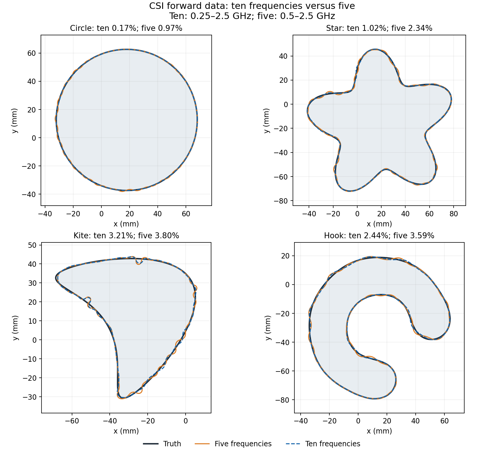

# Ten-frequency CSI tables and fits: results

18 November 2026. Runner: `bem-ten`. Plan: [plan.md](plan.md).
State: tables and checks complete; 4/4 GPU fits recorded.
The dry policy accepts band 0 at 0.25 GHz. No policy change was made.

## Data

Ten unchanged-CSI-forward tables at contrast 4, 0.25 to 2.5 GHz in 0.25 GHz steps.
Each has 17640 finite rows and the frozen 36-source, 49-receiver mask.
Order: circle, star, kite, hook, peanut, asymmetric, c_shape, cross, cog, aphex_twin.

Data runs: 2026-11-18T11:24:52Z to 2026-11-18T11:33:16Z.
Summed MATLAB wall time: 464.303 s.
Peak family RSS 2.259 GiB; minimum available 33.333 GiB.

All 50 old-frequency blocks equal the frozen five-frequency tables byte for byte.
This holds in the raw generated tables and the final frozen tables; field differences are zero.
Each block has its own matching SHA-256 in the per-shape checks.

Maximum native residual: 5.94342e-12.
All runs record HEAD and a clean `solvers/bem_inverse/`.
Table and material bulk files remain local and ignored, with SHA-256 in each bulk manifest.

Circle exact-series errors at all ten frequencies and byte proofs: [data_note.md](data_note.md).
All circle errors pass 1%; worst is 0.44397601% at 0.5 GHz using the exact norm.
Data evidence: [summary](../../../../results/csi/tg002/2026-11-18_ten_frequency_data/summary.json).

## BEM true-shape checks

Every entry is a percentage, worst over the two checked resolutions.
All ten shapes pass the adapter checks and the 1% rule at every frequency.
The largest mismatch is 0.712499% (Aphex Twin, 2.5 GHz).

| Shape | 0.25 | 0.5 | 0.75 | 1 | 1.25 | 1.5 | 1.75 | 2 | 2.25 | 2.5 | Worst (%) |
|---|---:|---:|---:|---:|---:|---:|---:|---:|---:|---:|---:|
| circle | 0.2455 | 0.4420 | 0.3052 | 0.1723 | 0.1883 | 0.1347 | 0.1959 | 0.1260 | 0.2266 | 0.1767 | 0.4420 |
| star | 0.2414 | 0.4164 | 0.2787 | 0.1730 | 0.1755 | 0.1842 | 0.2111 | 0.1437 | 0.2758 | 0.2684 | 0.4164 |
| kite | 0.1615 | 0.1229 | 0.1461 | 0.1905 | 0.1519 | 0.1685 | 0.2380 | 0.2001 | 0.1555 | 0.2855 | 0.2855 |
| hook | 0.1763 | 0.2067 | 0.1890 | 0.1739 | 0.1433 | 0.1627 | 0.1853 | 0.1404 | 0.1313 | 0.1877 | 0.2067 |
| peanut | 0.1275 | 0.2080 | 0.1894 | 0.1724 | 0.1463 | 0.1101 | 0.1479 | 0.1682 | 0.1591 | 0.2622 | 0.2622 |
| asymmetric | 0.1659 | 0.2779 | 0.2115 | 0.1839 | 0.2172 | 0.1967 | 0.1785 | 0.2002 | 0.2021 | 0.3668 | 0.3668 |
| c_shape | 0.2468 | 0.2978 | 0.2388 | 0.2989 | 0.2308 | 0.2155 | 0.2240 | 0.2085 | 0.2817 | 0.2755 | 0.2989 |
| cross | 0.1492 | 0.2666 | 0.2176 | 0.1609 | 0.1749 | 0.1500 | 0.1612 | 0.1369 | 0.1778 | 0.2359 | 0.2666 |
| cog | 0.2067 | 0.4004 | 0.3073 | 0.1824 | 0.1703 | 0.1415 | 0.1534 | 0.1371 | 0.1950 | 0.3111 | 0.4004 |
| aphex_twin | 0.4163 | 0.3538 | 0.3082 | 0.4009 | 0.4226 | 0.4566 | 0.4858 | 0.4825 | 0.6215 | 0.7125 | 0.7125 |
| Worst per GHz | 0.4163 | 0.4420 | 0.3082 | 0.4009 | 0.4226 | 0.4566 | 0.4858 | 0.4825 | 0.6215 | 0.7125 | 0.7125 |

Evidence: [check summary](../../../../results/bem/baseline_data/csi_ten_frequency/2026-11-18/check_summary.json).
Each `adapter_checks/<shape>__c4.json` retains both resolutions and provenance.
No CPU fit or tuning run was made.

## Dry plan

Same default wrapper and solver. Fixed work limit 13412; no elapsed-time stop.
The ten ladder quotas total 8000. All frequencies in each range advance by 0.25 GHz.
The first stage's band 0 is accepted by the unchanged policy.

| Stage | GHz | Shape band | Quota |
|---|---|---:|---:|
| ladder_1_real | 0.25 | 0 | 1000 |
| ladder_2_real | 0.25–0.5, step 0.25 | 1 | 375 |
| ladder_3_real | 0.25–0.75, step 0.25 | 2 | 375 |
| ladder_4_real | 0.25–1, step 0.25 | 3 | 375 |
| ladder_5_real | 0.25–1.25, step 0.25 | 3 | 375 |
| ladder_6_real | 0.25–1.5, step 0.25 | 4 | 375 |
| ladder_7_real | 0.25–1.75, step 0.25 | 5 | 375 |
| ladder_8_real | 0.25–2, step 0.25 | 6 | 375 |
| ladder_9_real | 0.25–2.25, step 0.25 | 7 | 375 |
| ladder_10_real | 0.25–2.5, step 0.25 | 7 | 4000 |
| full_1_M11 | 0.25–2.5, step 0.25 | 11 | 1500 |
| full_2_M15 | 0.25–2.5, step 0.25 | 15 | 1500 |
| full_3_M19 | 0.25–2.5, step 0.25 | 19 | 1500 |
| full_4_M25 | 0.25–2.5, step 0.25 | 25 | 304 |
| full_5_M31 | 0.25–2.5, step 0.25 | 31 | 304 |
| full_6_M37 | 0.25–2.5, step 0.25 | 37 | 304 |

Before `full_4_M25`, the default cleanup runs; it has no fit quota.
After `full_6_M37`, the default frontier check uses two work units.
It may append bands 43, 49, 55, 61, 67, 73, 79, 85 or 91,
all ten frequencies, quota 304 each, within the same global work limit.

Evidence: [dry plan](../../../../results/bem/baseline_data/csi_ten_frequency/2026-11-18/policy_dry_check.json).
All four GPU fits completed the band-0 stage and their full schedule.
No refusal, workaround or rerun occurred.

## Fits

The coordinator accepted the checks and dry plan and gave the go on 18 November 2026.
Fits ran detached, one at a time here, sharing the GPU with activity 09.
Times are indicative. No rerun, tuning or elapsed-time stop was used.

Settings: centred 65 mm circle; modal_muller + slider; real data only;
no localization, warm-up or declared noise; recovered contrast from the weak start.
Series limit 1e-9; 13412 work units. The ten-stage ladder and quotas are unchanged.

| Shape | Data | Outcome | Last stage | Work units | Fit seconds | Contrast | Area error (%) |
|---|---|---|---|---:|---:|---:|---:|
| circle | five frequencies | COMPLETED_SCHEDULE | full_6_M37 | 4477 | 199.658 | 4.000202526 | 0.968039 |
| circle | ten frequencies | COMPLETED_SCHEDULE | full_6_M37 | 5867 | 130.072 | 4.001086944 | 0.170636 |
| star | five frequencies | COMPLETED_SCHEDULE | full_6_M37 | 1464 | 47.484 | 4.001657661 | 2.343903 |
| star | ten frequencies | COMPLETED_SCHEDULE | full_6_M37 | 2522 | 61.864 | 4.001308345 | 1.016269 |
| kite | five frequencies | COMPLETED_SCHEDULE | full_6_M37 | 3500 | 194.045 | 4.002384294 | 3.796632 |
| kite | ten frequencies | COMPLETED_SCHEDULE | full_6_M37 | 5622 | 160.248 | 4.001533701 | 3.210032 |
| hook | five frequencies | COMPLETED_SCHEDULE | full_6_M37 | 2312 | 162.049 | 4.005380405 | 3.590275 |
| hook | ten frequencies | COMPLETED_SCHEDULE | full_6_M37 | 4695 | 163.713 | 4.003194758 | 2.443489 |

## Area error at every saved stage

Every saved stage curve is decoded from fit.json with bem_inverse.io.curve_from,
then scored with csi_fit.score(case, curve, contrast). No solve is run.
Area error is symmetric difference area divided by true area, in percent.

| Shape | Data | Stage | Top GHz | Shape band | Area error (%) |
|---|---|---|---:|---:|---:|
| circle | five | ladder_1_real | 0.5 | 1 | 2.564571 |
| circle | five | ladder_2_real | 1 | 3 | 0.190815 |
| circle | five | ladder_3_real | 1.5 | 4 | 0.073965 |
| circle | five | ladder_4_real | 2 | 6 | 0.078862 |
| circle | five | ladder_5_real | 2.5 | 7 | 0.080929 |
| circle | five | full_1_M11 | 2.5 | 11 | 0.429744 |
| circle | five | full_2_M15 | 2.5 | 15 | 0.638376 |
| circle | five | full_3_M19 | 2.5 | 19 | 0.727294 |
| circle | five | full_4_M25 | 2.5 | 25 | 0.792986 |
| circle | five | full_5_M31 | 2.5 | 31 | 0.910797 |
| circle | five | full_6_M37 | 2.5 | 37 | 0.968039 |
| circle | ten | ladder_1_real | 0.25 | 0 | 65.956150 |
| circle | ten | ladder_2_real | 0.5 | 1 | 1.996955 |
| circle | ten | ladder_3_real | 0.75 | 2 | 0.770509 |
| circle | ten | ladder_4_real | 1 | 3 | 0.331402 |
| circle | ten | ladder_5_real | 1.25 | 3 | 0.260833 |
| circle | ten | ladder_6_real | 1.5 | 4 | 0.088474 |
| circle | ten | ladder_7_real | 1.75 | 5 | 0.088163 |
| circle | ten | ladder_8_real | 2 | 6 | 0.079118 |
| circle | ten | ladder_9_real | 2.25 | 7 | 0.070518 |
| circle | ten | ladder_10_real | 2.5 | 7 | 0.068498 |
| circle | ten | full_1_M11 | 2.5 | 11 | 0.124051 |
| circle | ten | full_2_M15 | 2.5 | 15 | 0.148983 |
| circle | ten | full_3_M19 | 2.5 | 19 | 0.163547 |
| circle | ten | full_4_M25 | 2.5 | 25 | 0.163642 |
| circle | ten | full_5_M31 | 2.5 | 31 | 0.165737 |
| circle | ten | full_6_M37 | 2.5 | 37 | 0.170636 |
| star | five | ladder_1_real | 0.5 | 1 | 32.450985 |
| star | five | ladder_2_real | 1 | 3 | 31.233888 |
| star | five | ladder_3_real | 1.5 | 4 | 32.077703 |
| star | five | ladder_4_real | 2 | 6 | 3.471104 |
| star | five | ladder_5_real | 2.5 | 7 | 3.814836 |
| star | five | full_1_M11 | 2.5 | 11 | 1.659524 |
| star | five | full_2_M15 | 2.5 | 15 | 1.007168 |
| star | five | full_3_M19 | 2.5 | 19 | 2.155939 |
| star | five | full_4_M25 | 2.5 | 25 | 2.280248 |
| star | five | full_5_M31 | 2.5 | 31 | 2.324645 |
| star | five | full_6_M37 | 2.5 | 37 | 2.343903 |
| star | ten | ladder_1_real | 0.25 | 0 | 90.757366 |
| star | ten | ladder_2_real | 0.5 | 1 | 31.523068 |
| star | ten | ladder_3_real | 0.75 | 2 | 31.517868 |
| star | ten | ladder_4_real | 1 | 3 | 31.361323 |
| star | ten | ladder_5_real | 1.25 | 3 | 31.490511 |
| star | ten | ladder_6_real | 1.5 | 4 | 32.080384 |
| star | ten | ladder_7_real | 1.75 | 5 | 3.414568 |
| star | ten | ladder_8_real | 2 | 6 | 3.405894 |
| star | ten | ladder_9_real | 2.25 | 7 | 3.540243 |
| star | ten | ladder_10_real | 2.5 | 7 | 3.644577 |
| star | ten | full_1_M11 | 2.5 | 11 | 1.578873 |
| star | ten | full_2_M15 | 2.5 | 15 | 0.859021 |
| star | ten | full_3_M19 | 2.5 | 19 | 1.019366 |
| star | ten | full_4_M25 | 2.5 | 25 | 1.011200 |
| star | ten | full_5_M31 | 2.5 | 31 | 1.034510 |
| star | ten | full_6_M37 | 2.5 | 37 | 1.016269 |
| kite | five | ladder_1_real | 0.5 | 1 | 45.031258 |
| kite | five | ladder_2_real | 1 | 3 | 16.208448 |
| kite | five | ladder_3_real | 1.5 | 4 | 8.763064 |
| kite | five | ladder_4_real | 2 | 6 | 5.365391 |
| kite | five | ladder_5_real | 2.5 | 7 | 3.061399 |
| kite | five | full_1_M11 | 2.5 | 11 | 4.301579 |
| kite | five | full_2_M15 | 2.5 | 15 | 4.169549 |
| kite | five | full_3_M19 | 2.5 | 19 | 4.054397 |
| kite | five | full_4_M25 | 2.5 | 25 | 3.994145 |
| kite | five | full_5_M31 | 2.5 | 31 | 3.967985 |
| kite | five | full_6_M37 | 2.5 | 37 | 3.796632 |
| kite | ten | ladder_1_real | 0.25 | 0 | 247.752156 |
| kite | ten | ladder_2_real | 0.5 | 1 | 38.544116 |
| kite | ten | ladder_3_real | 0.75 | 2 | 38.242936 |
| kite | ten | ladder_4_real | 1 | 3 | 15.243650 |
| kite | ten | ladder_5_real | 1.25 | 3 | 15.125537 |
| kite | ten | ladder_6_real | 1.5 | 4 | 9.051654 |
| kite | ten | ladder_7_real | 1.75 | 5 | 11.290013 |
| kite | ten | ladder_8_real | 2 | 6 | 5.470342 |
| kite | ten | ladder_9_real | 2.25 | 7 | 3.799999 |
| kite | ten | ladder_10_real | 2.5 | 7 | 3.547175 |
| kite | ten | full_1_M11 | 2.5 | 11 | 3.611589 |
| kite | ten | full_2_M15 | 2.5 | 15 | 3.600204 |
| kite | ten | full_3_M19 | 2.5 | 19 | 3.318204 |
| kite | ten | full_4_M25 | 2.5 | 25 | 3.314554 |
| kite | ten | full_5_M31 | 2.5 | 31 | 3.321760 |
| kite | ten | full_6_M37 | 2.5 | 37 | 3.210032 |
| hook | five | ladder_1_real | 0.5 | 1 | 90.263373 |
| hook | five | ladder_2_real | 1 | 3 | 92.940396 |
| hook | five | ladder_3_real | 1.5 | 4 | 30.798331 |
| hook | five | ladder_4_real | 2 | 6 | 6.366013 |
| hook | five | ladder_5_real | 2.5 | 7 | 4.436534 |
| hook | five | full_1_M11 | 2.5 | 11 | 1.987685 |
| hook | five | full_2_M15 | 2.5 | 15 | 1.999900 |
| hook | five | full_3_M19 | 2.5 | 19 | 3.799261 |
| hook | five | full_4_M25 | 2.5 | 25 | 3.748605 |
| hook | five | full_5_M31 | 2.5 | 31 | 3.696052 |
| hook | five | full_6_M37 | 2.5 | 37 | 3.590275 |
| hook | ten | ladder_1_real | 0.25 | 0 | 200.492417 |
| hook | ten | ladder_2_real | 0.5 | 1 | 79.392214 |
| hook | ten | ladder_3_real | 0.75 | 2 | 84.070114 |
| hook | ten | ladder_4_real | 1 | 3 | 84.101939 |
| hook | ten | ladder_5_real | 1.25 | 3 | 82.405566 |
| hook | ten | ladder_6_real | 1.5 | 4 | 29.357915 |
| hook | ten | ladder_7_real | 1.75 | 5 | 27.649810 |
| hook | ten | ladder_8_real | 2 | 6 | 6.093339 |
| hook | ten | ladder_9_real | 2.25 | 7 | 5.725794 |
| hook | ten | ladder_10_real | 2.5 | 7 | 5.782427 |
| hook | ten | full_1_M11 | 2.5 | 11 | 2.977239 |
| hook | ten | full_2_M15 | 2.5 | 15 | 1.940500 |
| hook | ten | full_3_M19 | 2.5 | 19 | 2.512585 |
| hook | ten | full_4_M25 | 2.5 | 25 | 2.479786 |
| hook | ten | full_5_M31 | 2.5 | 31 | 2.452250 |
| hook | ten | full_6_M37 | 2.5 | 37 | 2.443489 |

## Per-frequency data mismatch

Percent relative scattered-field mismatch. True shape: worst of the two checked resolutions.
Final fit: saved wrapper final_residual at its own working resolution.
Only saved values are read here; no extra forward solve is run.

| Shape | Curve | 0.25 GHz | 0.5 GHz | 0.75 GHz | 1 GHz | 1.25 GHz | 1.5 GHz | 1.75 GHz | 2 GHz | 2.25 GHz | 2.5 GHz |
|---|---|---:|---:|---:|---:|---:|---:|---:|---:|---:|---:|
| circle | true | 0.245503 | 0.442034 | 0.305160 | 0.172326 | 0.188260 | 0.134680 | 0.195902 | 0.126049 | 0.226631 | 0.176721 |
| circle | ten-frequency final | 0.285771 | 0.410793 | 0.295896 | 0.154770 | 0.175323 | 0.142591 | 0.164124 | 0.120777 | 0.138404 | 0.101913 |
| circle | five-frequency final | not used | 0.402493 | not used | 0.145990 | not used | 0.146974 | not used | 0.115867 | not used | 0.097416 |
| star | true | 0.241413 | 0.416448 | 0.278684 | 0.172982 | 0.175524 | 0.184197 | 0.211119 | 0.143713 | 0.275842 | 0.268444 |
| star | ten-frequency final | 0.287670 | 0.382196 | 0.267185 | 0.158926 | 0.159714 | 0.184905 | 0.191814 | 0.124742 | 0.107158 | 0.169214 |
| star | five-frequency final | not used | 0.365854 | not used | 0.147694 | not used | 0.175679 | not used | 0.145305 | not used | 0.165309 |
| kite | true | 0.161455 | 0.122862 | 0.146080 | 0.190502 | 0.151881 | 0.168532 | 0.237958 | 0.200074 | 0.155529 | 0.285510 |
| kite | ten-frequency final | 0.103177 | 0.150673 | 0.184366 | 0.161354 | 0.099260 | 0.095511 | 0.096553 | 0.055218 | 0.076503 | 0.070169 |
| kite | five-frequency final | not used | 0.139163 | not used | 0.166465 | not used | 0.093804 | not used | 0.060311 | not used | 0.070641 |
| hook | true | 0.176264 | 0.206659 | 0.189010 | 0.173926 | 0.143333 | 0.162682 | 0.185256 | 0.140420 | 0.131334 | 0.187653 |
| hook | ten-frequency final | 0.152077 | 0.233327 | 0.216683 | 0.140449 | 0.100364 | 0.119235 | 0.103760 | 0.104388 | 0.097416 | 0.101513 |
| hook | five-frequency final | not used | 0.218987 | not used | 0.147834 | not used | 0.120558 | not used | 0.105351 | not used | 0.105833 |

## Run records

| Shape | Start UTC | Commit | Solver dirty | Start GiB | Peak host / GPU GiB |
|---|---|---|---|---:|---:|
| circle | 2026-11-18T11:37:09+00:00 | `068501c18` | False | 35.149 | 1.966 / 0.827 |
| star | 2026-11-18T11:40:19+00:00 | `33e0a6579` | False | 36.569 | 1.948 / 0.827 |
| kite | 2026-11-18T11:41:57+00:00 | `b00d4a220` | False | 36.536 | 1.959 / 0.827 |
| hook | 2026-11-18T11:45:01+00:00 | `2f21e47ec` | False | 36.758 | 1.940 / 0.827 |

Evidence: [fit comparison and saved stage scores](../../../../results/bem/baseline_data/csi_ten_frequency/2026-11-18/fit_comparison.json).
Each fit has manifest.json, fit.json, metrics.json, a log and bulk_manifest.json.
Fit-local histories stay local and ignored; bulk_manifest.json records their SHA-256.

## Outlines



The five-frequency reference spans 0.5–2.5 GHz; the new list also adds 0.25 GHz.
Line styles distinguish the two fitted curves where they overlap.

## Conclusion

Clear gain (area error at most half the saved five-frequency value): 2/4 shapes (circle, star).
By the fixed criterion, frequency count is not the main cause on these CSI data.
All four final area errors are lower. In the checked figure, circle and star look smoother;
waviness remains on kite and hook. Ten frequencies reduce the error but do not remove it.
Circle still grows from 0.0685% area error at the end of the ladder to 0.1706% at band 37.
Activity 09 checks the separate effect of data error.

## Failures kept

The first batch check began before star was frozen. Circle finished; star had not begun.
The command stopped on the missing star SHA-256 file. The later command skipped circle.
No check or fit was repeated. The launch failure receipt is kept in the results folder.
No numerical data, 1% check or fit failure.

```text
Activity: adapt_bem_to_baseline_data/08_fit_csi_tables_at_ten_frequencies
Runs: 10 data runs; 10 BEM checks; 1 dry plan; 4/4 GPU fits
Result: all data and checks pass; clear area-error gain on 2/4 shapes
Failures: early batch launch met pending star input; no numerical failure
Upstream patches: none
Changes to our code: new data drivers, thin runner and saved-result report scripts; existing code unchanged
New unknowns: cause of remaining outline error; activity 09 checks data error
Proposed next activity: coordinator compares activities 08 and 09; no further run proposed
```
