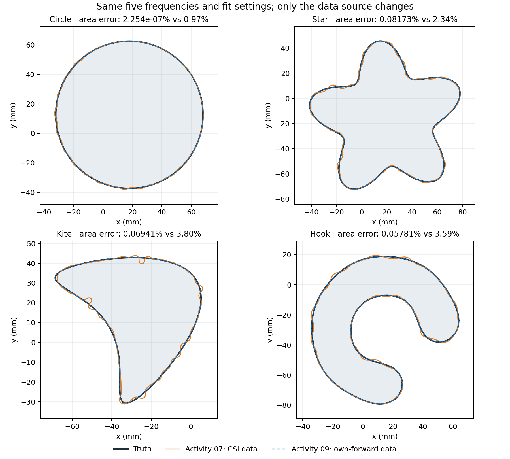

# Fit tables made by our own forward: results

18 November 2026. Runner: `bem-own`. [Plan](plan.md); [accepted checks](prefit_checks.md).
Four new tables, four checks and four GPU fits, each run once. No rerun or tuning.
The coordinator accepted the checks before fitting and gave the go on 18 November.

## Data and settings

CPU reference `nodal_kress` made the data at 2048 nodes, with 1024/2048 doubling.
All four shapes are the frozen TG-002 truth at contrast 4. Each table keeps the frozen
Fresnel row order, pair mask and 8820 rows at 0.5, 1, 1.5, 2 and 2.5 GHz.

The fit is the unchanged activity 07 wrapper: `modal_muller` + `slider`, GPU,
centred 65 mm circle, real data only, no localization, warm-up or declared noise.
Contrast is recovered from the weak start. Series limit 1e-9; budget 13,412 work units.

Ladder quotas are 1000, 1000, 1000, 1000 and 4000, then the default all-frequency stages.
Saved settings equal activity 07 after excluding the data-dependent weak-start value and time:
circle: yes, star: yes, kite: yes, hook: yes.

All fits ran detached, one at a time in this activity. Other sessions shared the machine,
so times are indicative. No elapsed-time stop was applied. Each manifest records its
commit, available memory and whether the solver was dirty.

## Checks before fitting

| Shape | Worst doubling error | Worst reader error | Worst modal truth mismatch |
|---|---:|---:|---:|
| circle | 6.809e-16 | 2.042e-16 | 9.650e-15 |
| star | 1.208e-15 | 2.015e-16 | 9.906e-15 |
| kite | 7.157e-16 | 4.312e-16 | 6.692e-15 |
| hook | 2.020e-14 | 3.013e-16 | 1.759e-14 |

All layout checks pass. Circle against the exact series: worst 6.101e-15 relative.
The differences from the frozen CSI data repeat activity 07 within 3.229e-15.
The [check report](prefit_checks.md) gives every frequency, the forward and the hashes.

## Fits beside activity 07

Area error is the symmetric difference area divided by truth area, in percent.
Scores below come from the unchanged `csi_fit.score`; truth is used only after fitting.

| Shape | Data | Outcome | Last stage | Work units | Fit seconds | Contrast | Area error (%) |
|---|---|---|---|---:|---:|---:|---:|
| circle | activity 07 CSI | COMPLETED_SCHEDULE | full_6_M37 | 4477 | 199.658 | 4.0002025257 | 0.96803881 |
| circle | own forward | COMPLETED_SCHEDULE | full_6_M37 | 169 | 4.426 | 3.9999999825 | 2.2544064e-07 |
| star | activity 07 CSI | COMPLETED_SCHEDULE | full_6_M37 | 1464 | 47.484 | 4.0016576609 | 2.3439029 |
| star | own forward | COMPLETED_SCHEDULE | full_6_M37 | 1259 | 32.818 | 4.0000004824 | 0.081734776 |
| kite | activity 07 CSI | COMPLETED_SCHEDULE | full_6_M37 | 3500 | 194.045 | 4.0023842942 | 3.7966323 |
| kite | own forward | COMPLETED_SCHEDULE | full_6_M37 | 3389 | 141.372 | 4.0000006922 | 0.069408377 |
| hook | activity 07 CSI | COMPLETED_SCHEDULE | full_6_M37 | 2312 | 162.049 | 4.0053804055 | 3.5902748 |
| hook | own forward | COMPLETED_SCHEDULE | full_6_M37 | 1042 | 44.416 | 4.0000002520 | 0.057810775 |

## Area error at every saved stage

Each stage curve is read from `fit.json` as `stages[i]["curve"]`, decoded with
`bem_inverse.io.curve_from`, then scored with `csi_fit.score(case, curve, contrast)`.
No solve is run for these scores. Both data sources are scored the same way.

| Shape | Stage | Band | Own-forward area error (%) | Activity 07 area error (%) |
|---|---|---:|---:|---:|
| circle | ladder_1_real | 1 | 2.2544064e-07 | 2.5645706 |
| circle | ladder_2_real | 3 | 2.2544064e-07 | 0.19081457 |
| circle | ladder_3_real | 4 | 2.2544064e-07 | 0.0739654 |
| circle | ladder_4_real | 6 | 2.2544064e-07 | 0.078861879 |
| circle | ladder_5_real | 7 | 2.2544064e-07 | 0.080928881 |
| circle | full_1_M11 | 11 | 2.2544064e-07 | 0.42974403 |
| circle | full_2_M15 | 15 | 2.2544064e-07 | 0.63837592 |
| circle | full_3_M19 | 19 | 2.2544064e-07 | 0.72729443 |
| circle | full_4_M25 | 25 | 2.2544064e-07 | 0.79298622 |
| circle | full_5_M31 | 31 | 2.2544064e-07 | 0.91079726 |
| circle | full_6_M37 | 37 | 2.2544064e-07 | 0.96803881 |
| star | ladder_1_real | 1 | 32.008032 | 32.450985 |
| star | ladder_2_real | 3 | 31.247354 | 31.233888 |
| star | ladder_3_real | 4 | 32.075442 | 32.077703 |
| star | ladder_4_real | 6 | 3.4951074 | 3.4711043 |
| star | ladder_5_real | 7 | 3.8049091 | 3.8148359 |
| star | full_1_M11 | 11 | 1.6504946 | 1.6595244 |
| star | full_2_M15 | 15 | 0.87102059 | 1.007168 |
| star | full_3_M19 | 19 | 0.87102216 | 2.1559391 |
| star | full_4_M25 | 25 | 0.2502415 | 2.2802483 |
| star | full_5_M31 | 31 | 0.13863345 | 2.324645 |
| star | full_6_M37 | 37 | 0.081734776 | 2.3439029 |
| kite | ladder_1_real | 1 | 43.270589 | 45.031258 |
| kite | ladder_2_real | 3 | 16.328579 | 16.208448 |
| kite | ladder_3_real | 4 | 8.8583893 | 8.7630639 |
| kite | ladder_4_real | 6 | 5.311098 | 5.3653908 |
| kite | ladder_5_real | 7 | 3.0616003 | 3.0613993 |
| kite | full_1_M11 | 11 | 2.0508017 | 4.3015794 |
| kite | full_2_M15 | 15 | 0.84896712 | 4.1695491 |
| kite | full_3_M19 | 19 | 0.46939081 | 4.0543966 |
| kite | full_4_M25 | 25 | 0.19540222 | 3.9941449 |
| kite | full_5_M31 | 31 | 0.098181554 | 3.967985 |
| kite | full_6_M37 | 37 | 0.069408377 | 3.7966323 |
| hook | ladder_1_real | 1 | 88.553794 | 90.263373 |
| hook | ladder_2_real | 3 | 92.56787 | 92.940396 |
| hook | ladder_3_real | 4 | 30.823374 | 30.798331 |
| hook | ladder_4_real | 6 | 6.3538565 | 6.3660132 |
| hook | ladder_5_real | 7 | 4.4863151 | 4.4365336 |
| hook | full_1_M11 | 11 | 1.8977488 | 1.9876853 |
| hook | full_2_M15 | 15 | 0.68942629 | 1.9999005 |
| hook | full_3_M19 | 19 | 0.20353561 | 3.7992612 |
| hook | full_4_M25 | 25 | 0.057810775 | 3.7486045 |
| hook | full_5_M31 | 31 | 0.057810775 | 3.6960523 |
| hook | full_6_M37 | 37 | 0.057810775 | 3.5902748 |

## Final data mismatch

Relative scattered-field mismatch, percent. These values are saved by the unchanged
wrapper after each fit at its own forward resolution; no additional solve was run.

| Shape | Data | 0.5 GHz | 1 GHz | 1.5 GHz | 2 GHz | 2.5 GHz |
|---|---|---:|---:|---:|---:|---:|
| circle | csi | 0.402493 | 0.14599 | 0.146974 | 0.115867 | 0.0974159 |
| circle | own | 4.78233e-07 | 4.47129e-07 | 3.78215e-07 | 6.77626e-07 | 1.11578e-06 |
| star | csi | 0.365854 | 0.147694 | 0.175679 | 0.145305 | 0.165309 |
| star | own | 5.87269e-06 | 7.56895e-06 | 4.84204e-05 | 6.67093e-05 | 9.08997e-05 |
| kite | csi | 0.139163 | 0.166465 | 0.0938037 | 0.060311 | 0.0706409 |
| kite | own | 4.42227e-06 | 2.11178e-06 | 7.06197e-06 | 1.93046e-05 | 2.08811e-05 |
| hook | csi | 0.218987 | 0.147834 | 0.120558 | 0.105351 | 0.105833 |
| hook | own | 2.656e-06 | 3.50275e-06 | 8.14167e-06 | 1.32552e-05 | 2.19439e-05 |

## Outlines



## Run records

| Shape | Start (UTC) | Commit | Solver dirty | Start memory (GiB) | Peak host / GPU (GiB) |
|---|---|---|---|---:|---:|
| circle | 2026-11-18T11:32:16+00:00 | `324e0c43c` | False | 34.36 | 1.73 / 0.60 |
| star | 2026-11-18T11:32:34+00:00 | `8548fd6ea` | False | 34.57 | 1.83 / 0.83 |
| kite | 2026-11-18T11:34:31+00:00 | `0bee9942a` | False | 35.66 | 1.80 / 0.83 |
| hook | 2026-11-18T11:37:09+00:00 | `068501c18` | False | 36.00 | 1.79 / 0.83 |

Evidence: [fits, checks and manifests](../../../../results/bem/baseline_data/fresnel_own_forward/2026-11-18/).
The [stage scores and comparisons](../../../../results/bem/baseline_data/fresnel_own_forward/2026-11-18/stage_scores_and_comparison.json)
retain all scores and run provenance. Tables, prediction arrays and fit-local bulk stay
local and ignored, with SHA-256 receipts in the data and bulk manifests.

## Conclusions and report

All four area errors are below the fixed 0.3% criterion; the worst is star at 0.0817%.
The inspected figure shows smooth outlines close to truth at the plotted scale. The visible
wiggles in the activity 07 outlines are absent from the new outlines.

This meets the plan's criterion: five frequencies and this layout suffice for these four
accurate, noiseless tables. With the fit settings unchanged, replacing the CSI data removes
the wiggles and most of the area error. This supports data error as their cause in activity 07.

Higher bands help on these accurate data. From band 7 to the final stage, area error falls
from 3.805% to 0.0817% on star, 3.062% to 0.0694% on kite and 4.486% to 0.0578% on hook.
Circle is already recovered at the first ladder stage; hook is unchanged after band 25.

All four finish `COMPLETED_SCHEDULE` at `full_6_M37`. Contrast is within 6.93e-7 of 4.
Final relative data mismatch is at most 9.09e-7 (0.0000909%, star at 2.5 GHz).
All saved settings match activity 07 apart from the data-dependent weak start and its time.

No fit, check or report step failed. No run was repeated. All four solver records are clean.
The four fits took 4.4, 32.8, 141.4 and 44.4 seconds; shared-machine times are indicative.
This activity answers its four-shape question. The other six shapes and noisy data were not tested.

```text
Activity: 09_fit_tables_from_our_forward, 18 November 2026
Runs: four table preparations, four checks, four detached GPU fits; one pass
Result: all complete; area error circle 2.25e-7%, star 0.0817%, kite 0.0694%, hook 0.0578%
Failures: none
Upstream patches: none
Changes to our code: three new own_forward files; no existing solver or wrapper changed
New unknowns: whether the same result holds for the other six shapes and noisy data
Proposed next activity: coordinator combines this result with activity 08; no further run here
```
