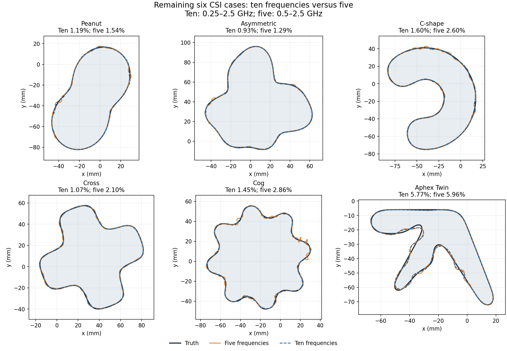

# Fit the remaining ten-frequency CSI cases: results

18 November 2026. Runner: bem-ten. [Plan](plan.md).
State: 6/6 new GPU fits recorded; 10/10 ten-frequency results available.

## Settings and evidence

Same frozen ten-frequency CSI tables and passing checks as activity 08.
Frequencies: 0.25 to 2.5 GHz in 0.25 GHz steps. All tables have 17640 rows.
Unchanged csi_ten_frequency.py runner and csi_fit.py wrapper; no code change.
Default modal_muller + slider, centred 65 mm circle, real data only,
recovered contrast, no localization, warm-up or declared noise. Series limit 1e-9.
Ten-stage ladder quotas: 1000, eight times 375, 4000; total fit limit 13412 work units.

Each new shape is fitted once on the GPU. Fits run detached, one at a time here.
The machine is shared with other sessions, so times are indicative.
There is no elapsed-time stop, tuning or rerun. Existing checks are reused.

The first four ten-frequency rows are copied from activity 08. They were not rerun.
Five-frequency rows are read from activity 07, without fitting or solving again.

## All ten shapes beside the five-frequency pass

Area error is symmetric difference divided by true area, in percent.
A clear gain halves the five-frequency area error. A score above 5% is a miss.

| Shape | Frequencies | Outcome | Last stage | Work units | Fit seconds | Contrast | Area error (%) |
|---|---|---|---|---:|---:|---:|---:|
| circle | five | COMPLETED_SCHEDULE | full_6_M37 | 4477 | 199.658 | 4.000202526 | 0.968039 |
| circle | ten | COMPLETED_SCHEDULE | full_6_M37 | 5867 | 130.072 | 4.001086944 | 0.170636 |
| star | five | COMPLETED_SCHEDULE | full_6_M37 | 1464 | 47.484 | 4.001657661 | 2.343903 |
| star | ten | COMPLETED_SCHEDULE | full_6_M37 | 2522 | 61.864 | 4.001308345 | 1.016269 |
| kite | five | COMPLETED_SCHEDULE | full_6_M37 | 3500 | 194.045 | 4.002384294 | 3.796632 |
| kite | ten | COMPLETED_SCHEDULE | full_6_M37 | 5622 | 160.248 | 4.001533701 | 3.210032 |
| hook | five | COMPLETED_SCHEDULE | full_6_M37 | 2312 | 162.049 | 4.005380405 | 3.590275 |
| hook | ten | COMPLETED_SCHEDULE | full_6_M37 | 4695 | 163.713 | 4.003194758 | 2.443489 |
| peanut | five | COMPLETED_SCHEDULE | full_6_M37 | 4264 | 143.819 | 4.001764050 | 1.539403 |
| peanut | ten | COMPLETED_SCHEDULE | full_6_M37 | 5757 | 85.829 | 4.001841091 | 1.194016 |
| asymmetric | five | COMPLETED_SCHEDULE | full_6_M37 | 2241 | 65.087 | 4.001952240 | 1.291805 |
| asymmetric | ten | COMPLETED_SCHEDULE | full_6_M37 | 4212 | 54.588 | 4.001927242 | 0.931083 |
| c_shape | five | COMPLETED_SCHEDULE | full_6_M37 | 2243 | 105.033 | 4.002706452 | 2.601924 |
| c_shape | ten | COMPLETED_SCHEDULE | full_6_M37 | 4749 | 75.087 | 4.002807168 | 1.597686 |
| cross | five | COMPLETED_SCHEDULE | full_6_M37 | 1839 | 50.599 | 4.001249691 | 2.099419 |
| cross | ten | COMPLETED_SCHEDULE | full_6_M37 | 3534 | 46.748 | 4.000895941 | 1.066044 |
| cog | five | COMPLETED_SCHEDULE | full_8_M49 | 3619 | 247.363 | 4.000492089 | 2.860390 |
| cog | ten | COMPLETED_SCHEDULE | full_6_M37 | 3178 | 36.220 | 4.001349644 | 1.450649 |
| aphex_twin | five | COMPLETED_SCHEDULE | full_6_M37 | 3039 | 194.896 | 3.996963087 | 5.960888 |
| aphex_twin | ten | COMPLETED_SCHEDULE | full_6_M37 | 6562 | 267.970 | 3.998133556 | 5.769998 |

## Area error of every saved stage: the six new fits

Each curve comes from fit.json stages[i]["curve"], decoded with bem_inverse.io.curve_from,
then scored with csi_fit.score(case, curve, contrast). No solve is needed or run.
Saved scores are reused when this report is updated.

| Shape | Stage | Shape band | Outcome | Area error (%) |
|---|---|---:|---|---:|
| peanut | ladder_1_real | 0 | NORMAL_OPTIMIZER_RETURN | 221.132308 |
| peanut | ladder_2_real | 1 | NORMAL_OPTIMIZER_RETURN | 49.285894 |
| peanut | ladder_3_real | 2 | NORMAL_OPTIMIZER_RETURN | 6.307550 |
| peanut | ladder_4_real | 3 | NORMAL_OPTIMIZER_RETURN | 6.377021 |
| peanut | ladder_5_real | 3 | NORMAL_OPTIMIZER_RETURN | 6.477009 |
| peanut | ladder_6_real | 4 | NORMAL_OPTIMIZER_RETURN | 2.501369 |
| peanut | ladder_7_real | 5 | NORMAL_OPTIMIZER_RETURN | 2.459736 |
| peanut | ladder_8_real | 6 | NORMAL_OPTIMIZER_RETURN | 1.268330 |
| peanut | ladder_9_real | 7 | NORMAL_OPTIMIZER_RETURN | 1.214526 |
| peanut | ladder_10_real | 7 | NORMAL_OPTIMIZER_RETURN | 1.198011 |
| peanut | full_1_M11 | 11 | NORMAL_OPTIMIZER_RETURN | 1.411161 |
| peanut | full_2_M15 | 15 | STAGE_QUOTA_REACHED | 1.319533 |
| peanut | full_3_M19 | 19 | STAGE_QUOTA_REACHED | 1.241337 |
| peanut | full_4_M25 | 25 | STAGE_QUOTA_REACHED | 1.226121 |
| peanut | full_5_M31 | 31 | STAGE_QUOTA_REACHED | 1.208913 |
| peanut | full_6_M37 | 37 | STAGE_QUOTA_REACHED | 1.194016 |
| asymmetric | ladder_1_real | 0 | NORMAL_OPTIMIZER_RETURN | 166.513652 |
| asymmetric | ladder_2_real | 1 | NORMAL_OPTIMIZER_RETURN | 25.546512 |
| asymmetric | ladder_3_real | 2 | NORMAL_OPTIMIZER_RETURN | 25.694255 |
| asymmetric | ladder_4_real | 3 | NORMAL_OPTIMIZER_RETURN | 16.482569 |
| asymmetric | ladder_5_real | 3 | NORMAL_OPTIMIZER_RETURN | 16.418942 |
| asymmetric | ladder_6_real | 4 | NORMAL_OPTIMIZER_RETURN | 8.640973 |
| asymmetric | ladder_7_real | 5 | NORMAL_OPTIMIZER_RETURN | 8.495551 |
| asymmetric | ladder_8_real | 6 | NORMAL_OPTIMIZER_RETURN | 7.378474 |
| asymmetric | ladder_9_real | 7 | NORMAL_OPTIMIZER_RETURN | 3.909651 |
| asymmetric | ladder_10_real | 7 | NORMAL_OPTIMIZER_RETURN | 3.902942 |
| asymmetric | full_1_M11 | 11 | NORMAL_OPTIMIZER_RETURN | 1.285345 |
| asymmetric | full_2_M15 | 15 | NORMAL_OPTIMIZER_RETURN | 0.869653 |
| asymmetric | full_3_M19 | 19 | STAGE_QUOTA_REACHED | 0.843257 |
| asymmetric | full_4_M25 | 25 | STAGE_QUOTA_REACHED | 0.912219 |
| asymmetric | full_5_M31 | 31 | STAGE_QUOTA_REACHED | 0.930613 |
| asymmetric | full_6_M37 | 37 | STAGE_QUOTA_REACHED | 0.931083 |
| c_shape | ladder_1_real | 0 | NORMAL_OPTIMIZER_RETURN | 177.794379 |
| c_shape | ladder_2_real | 1 | NORMAL_OPTIMIZER_RETURN | 69.660558 |
| c_shape | ladder_3_real | 2 | NORMAL_OPTIMIZER_RETURN | 63.400403 |
| c_shape | ladder_4_real | 3 | NORMAL_OPTIMIZER_RETURN | 49.695251 |
| c_shape | ladder_5_real | 3 | NORMAL_OPTIMIZER_RETURN | 48.494222 |
| c_shape | ladder_6_real | 4 | NORMAL_OPTIMIZER_RETURN | 14.727092 |
| c_shape | ladder_7_real | 5 | NORMAL_OPTIMIZER_RETURN | 7.538708 |
| c_shape | ladder_8_real | 6 | NORMAL_OPTIMIZER_RETURN | 5.179664 |
| c_shape | ladder_9_real | 7 | NORMAL_OPTIMIZER_RETURN | 2.916081 |
| c_shape | ladder_10_real | 7 | NORMAL_OPTIMIZER_RETURN | 2.985673 |
| c_shape | full_1_M11 | 11 | NORMAL_OPTIMIZER_RETURN | 0.673645 |
| c_shape | full_2_M15 | 15 | NORMAL_OPTIMIZER_RETURN | 1.533839 |
| c_shape | full_3_M19 | 19 | STAGE_QUOTA_REACHED | 1.605810 |
| c_shape | full_4_M25 | 25 | STAGE_QUOTA_REACHED | 1.592128 |
| c_shape | full_5_M31 | 31 | STAGE_QUOTA_REACHED | 1.583794 |
| c_shape | full_6_M37 | 37 | STAGE_QUOTA_REACHED | 1.597686 |
| cross | ladder_1_real | 0 | NORMAL_OPTIMIZER_RETURN | 166.612680 |
| cross | ladder_2_real | 1 | NORMAL_OPTIMIZER_RETURN | 31.817542 |
| cross | ladder_3_real | 2 | NORMAL_OPTIMIZER_RETURN | 31.815281 |
| cross | ladder_4_real | 3 | NORMAL_OPTIMIZER_RETURN | 31.815584 |
| cross | ladder_5_real | 3 | NORMAL_OPTIMIZER_RETURN | 31.821986 |
| cross | ladder_6_real | 4 | NORMAL_OPTIMIZER_RETURN | 10.349061 |
| cross | ladder_7_real | 5 | NORMAL_OPTIMIZER_RETURN | 10.347275 |
| cross | ladder_8_real | 6 | NORMAL_OPTIMIZER_RETURN | 10.350182 |
| cross | ladder_9_real | 7 | NORMAL_OPTIMIZER_RETURN | 10.319967 |
| cross | ladder_10_real | 7 | NORMAL_OPTIMIZER_RETURN | 10.301531 |
| cross | full_1_M11 | 11 | NORMAL_OPTIMIZER_RETURN | 1.885248 |
| cross | full_2_M15 | 15 | NORMAL_OPTIMIZER_RETURN | 1.067729 |
| cross | full_3_M19 | 19 | NORMAL_OPTIMIZER_RETURN | 1.018407 |
| cross | full_4_M25 | 25 | STAGE_QUOTA_REACHED | 1.043220 |
| cross | full_5_M31 | 31 | STAGE_QUOTA_REACHED | 1.063206 |
| cross | full_6_M37 | 37 | STAGE_QUOTA_REACHED | 1.066044 |
| cog | ladder_1_real | 0 | NORMAL_OPTIMIZER_RETURN | 76.213164 |
| cog | ladder_2_real | 1 | NORMAL_OPTIMIZER_RETURN | 17.176728 |
| cog | ladder_3_real | 2 | NORMAL_OPTIMIZER_RETURN | 17.225851 |
| cog | ladder_4_real | 3 | NORMAL_OPTIMIZER_RETURN | 17.215588 |
| cog | ladder_5_real | 3 | NORMAL_OPTIMIZER_RETURN | 17.214495 |
| cog | ladder_6_real | 4 | NORMAL_OPTIMIZER_RETURN | 17.256102 |
| cog | ladder_7_real | 5 | NORMAL_OPTIMIZER_RETURN | 17.192950 |
| cog | ladder_8_real | 6 | STAGE_QUOTA_REACHED | 19.147332 |
| cog | ladder_9_real | 7 | NORMAL_OPTIMIZER_RETURN | 19.768474 |
| cog | ladder_10_real | 7 | NORMAL_OPTIMIZER_RETURN | 17.189853 |
| cog | full_1_M11 | 11 | NORMAL_OPTIMIZER_RETURN | 1.232068 |
| cog | full_2_M15 | 15 | NORMAL_OPTIMIZER_RETURN | 1.232784 |
| cog | full_3_M19 | 19 | NORMAL_OPTIMIZER_RETURN | 1.629563 |
| cog | full_4_M25 | 25 | STAGE_QUOTA_REACHED | 1.555328 |
| cog | full_5_M31 | 31 | STAGE_QUOTA_REACHED | 1.519285 |
| cog | full_6_M37 | 37 | STAGE_QUOTA_REACHED | 1.450649 |
| aphex_twin | ladder_1_real | 0 | NORMAL_OPTIMIZER_RETURN | 504.375399 |
| aphex_twin | ladder_2_real | 1 | NORMAL_OPTIMIZER_RETURN | 113.349183 |
| aphex_twin | ladder_3_real | 2 | NORMAL_OPTIMIZER_RETURN | 84.056566 |
| aphex_twin | ladder_4_real | 3 | NORMAL_OPTIMIZER_RETURN | 74.159045 |
| aphex_twin | ladder_5_real | 3 | NORMAL_OPTIMIZER_RETURN | 75.164171 |
| aphex_twin | ladder_6_real | 4 | STAGE_QUOTA_REACHED | 75.715564 |
| aphex_twin | ladder_7_real | 5 | STAGE_QUOTA_REACHED | 45.246981 |
| aphex_twin | ladder_8_real | 6 | STAGE_QUOTA_REACHED | 26.359591 |
| aphex_twin | ladder_9_real | 7 | STAGE_QUOTA_REACHED | 21.772176 |
| aphex_twin | ladder_10_real | 7 | NORMAL_OPTIMIZER_RETURN | 21.899736 |
| aphex_twin | full_1_M11 | 11 | NORMAL_OPTIMIZER_RETURN | 12.785721 |
| aphex_twin | full_2_M15 | 15 | NORMAL_OPTIMIZER_RETURN | 5.553309 |
| aphex_twin | full_3_M19 | 19 | STAGE_QUOTA_REACHED | 6.104372 |
| aphex_twin | full_4_M25 | 25 | STAGE_QUOTA_REACHED | 5.986088 |
| aphex_twin | full_5_M31 | 31 | STAGE_QUOTA_REACHED | 5.856925 |
| aphex_twin | full_6_M37 | 37 | STAGE_QUOTA_REACHED | 5.769998 |

## Run records for the six new fits

| Shape | Start UTC | Commit | Solver dirty | Start GiB | Peak host / GPU GiB |
|---|---|---|---|---:|---:|
| peanut | 2026-11-18T11:51:41+00:00 | `fd6d557f1` | False | 36.758 | 1.954 / 0.827 |
| asymmetric | 2026-11-18T11:53:40+00:00 | `e33fc7870` | False | 38.208 | 1.948 / 0.828 |
| c_shape | 2026-11-18T11:55:15+00:00 | `feff0daa4` | False | 38.170 | 1.947 / 0.827 |
| cross | 2026-11-18T11:57:00+00:00 | `6d7c2e673` | False | 38.184 | 1.941 / 0.827 |
| cog | 2026-11-18T11:58:14+00:00 | `225946ae0` | False | 32.916 | 1.945 / 0.827 |
| aphex_twin | 2026-11-18T11:59:38+00:00 | `12a5117e2` | False | 32.374 | 1.964 / 0.827 |

Evidence: [ten-frequency fits](../../../../results/bem/baseline_data/csi_ten_frequency/2026-11-18/).
Each attempt has manifest.json, fit.json, metrics.json and bulk_manifest.json; logs are in logs/.
[Saved stage scores](../../../../results/bem/baseline_data/csi_ten_frequency/2026-11-18/remaining_stage_scores.json)
include fit-file SHA-256 and run provenance. Fit-local histories stay ignored with their hashes.

## Outlines



## Conclusion

All-ten clear-gain count: 2/10 (circle, star).
Ten-frequency misses above 5%: 1/10 (aphex_twin).
All ten final area errors are lower than their five-frequency references.
Cross and cog fall just short of the strict halving rule; neither is counted as a clear gain.
The checked figure shows less waviness on several shapes, while the Aphex Twin notch remains inaccurate.
The six new fits complete the BEM side of the paired ten-frequency table.

## Failures

Run failures: none. Aphex Twin is a quality miss at 5.770% area error.
No fit or data check was rerun. Activity 08 retains its earlier pending-input launch receipt.

```text
Activity: adapt_bem_to_baseline_data/10_fit_remaining_csi_tables_at_ten_frequencies
Runs: 6/6 new GPU fits; four activity 08 fits copied; no new forward checks
Result: 10/10 results available; 2 clear gains; 1 misses above 5%
Failures: no run failure; aphex_twin is a quality miss at 5.770%
Upstream patches: none
Changes to our code: none; unchanged activity 08 runner and settings
New unknowns: paired MF-CC-CSI results on the ten-frequency tables
Proposed next activity: coordinator pairs this BEM table with the baseline ten-frequency results
```
