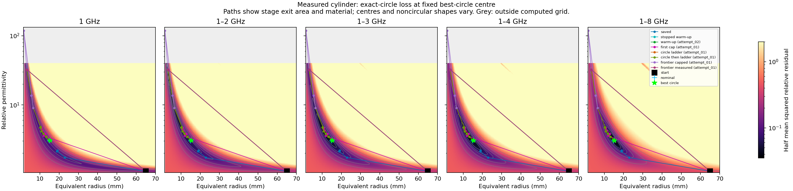

# Measured-cylinder schedule results

**The saved fit failed after its outline pinched near self-contact; it did not use up its total work budget.** The tested remedy that reaches and keeps the best-circle geometry is `circle_ladder`: keep update band 1 while adding measured frequencies, then release the original full-catalog shape bands. It finishes at radius 15.28 mm and permittivity 3.052, loss 0.0375382, close to the independent best circle. Its area error is 36.59% against the nominal placement and 3.72% against the registered reference described below.

A longer first stage helps but does not recover the same size and material. The 1 GHz-only warm-up and the entry-frontier cap are **negative results**. The uncapped frontier control was deliberately stopped by the coordinator after matching the completed warm-up stages; it is not a failed fit. `circle_then_ladder` also loses the good circle and ends at its wall limit. All six variants are now accounted for; no more measured fits are planned. This report includes its final files and the coordinator's completion report at 04:06 UTC on 19 November 2026. All fits were run by the coordinator; this analysis ran no fits.

## BEM and CSI on the same measured cylinder

Loss is half the mean squared relative residual, each frequency divided by its data norm with equal weights. Radius is area-equivalent, including for CSI image supports. CSI material is the mean permittivity within its half-signed-peak support; BEM fits one homogeneous value. A dash means no comparable final evaluation or work count was reported, not zero.

| Method / variant | End state | Loss, all eight | Radius mm | Centre mm | Permittivity | Nominal area error | Registered area error | Units |
|---|---|---:|---:|---|---:|---:|---:|---:|
| [Saved default](../../../../results/bem/baseline_data/csi_adapter/2026-11-18/first_fit/dielTM_dec8f/cuda/attempt_01/metrics.json) | Completed | 0.0840431 | 19.0453 | (2.9827, 29.2413) | 2.19373 | 67.85% | 61.49% | 894 |
| [warmup (attempt_02)](../../../../results/bem/baseline_data/measured_schedule/2026-11-19/warmup/dielTM_dec8f/cuda/attempt_02/metrics.json) | Wall limit, full_1 | 0.2066049 | 3.3357 | (1.7996, 31.2178) | 32.07558 | 95.05% | 95.05% | 1076 |
| [first_cap](../../../../results/bem/baseline_data/measured_schedule/2026-11-19/first_cap/dielTM_dec8f/cuda/attempt_01/metrics.json) | Completed | 0.0428901 | 12.7872 | (2.1879, 27.0630) | 3.79299 | 46.07% | 35.24% | 2552 |
| [circle_ladder](../../../../results/bem/baseline_data/measured_schedule/2026-11-19/circle_ladder/dielTM_dec8f/cuda/attempt_01/metrics.json) | Completed | 0.0375382 | 15.2764 | (1.9447, 26.1897) | 3.05177 | 36.59% | 3.72% | 6445 |
| [circle_then_ladder](../../../../results/bem/baseline_data/measured_schedule/2026-11-19/circle_then_ladder/dielTM_dec8f/cuda/attempt_01/metrics.json) | Wall limit, full_4 | 0.0772304 | 10.3411 | (2.7564, 27.4754) | 4.76155 | 60.72% | 57.34% | 1937 |
| [frontier_capped](../../../../results/bem/baseline_data/measured_schedule/2026-11-19/frontier_capped/dielTM_dec8f/cuda/attempt_01/metrics.json) | Forward failure, ladder_4 | 0.1360509 | 5.5115 | (2.0464, 26.9745) | 13.72576 | 87.35% | 86.50% | 1344 |
| [frontier_measured](../../../../results/bem/baseline_data/measured_schedule/2026-11-19/frontier_measured/dielTM_dec8f/cuda/attempt_01) | Stopped by coordinator; no final score | — | — | — | — | — | — | — |
| [Best exact circle](../../../../results/bem/baseline_data/csi_adapter/2026-11-18/cylinder_info/cylinder_info.json) | Diagnostic circle fit | 0.0375490 | 15.2662 | (1.9393, 26.1912) | 3.05255 | 36.55% | 3.58% | — |
| MF-CC-CSI | Saved image, half signed peak | — | 15.3117 | (1.8874, 26.3513) | 2.72927 (mean) | 35.12% | Not evaluated | — |
| MF-MR-CSI | Saved image, half signed peak | — | 15.0931 | (1.6148, 26.2820) | 3.01211 (mean) | 34.22% | Not evaluated | — |
| CSI | Saved image, half signed peak | — | 13.4285 | (1.8378, 26.5295) | 3.28088 (mean) | 38.47% | Not evaluated | — |

CSI numbers are the saved 2,048-iteration results for this same `dielTM_dec8f` target, from [registered_scores.json](../../../../results/csi/preparation/2026-11-17_frame/registered_scores.json), generated by [register_saved.py](../../../../experiments/baselines/csi/register_saved.py) with [registered_metrics.py](../../../../experiments/baselines/csi/registered_metrics.py). They are also checked in [the baseline review](../../verify_baseline_claims.md). On the shared **nominal-centre** score, `circle_ladder` is better than classical CSI (38.47%), but worse than MF-CC-CSI (35.12%) and MF-MR-CSI (34.22%). All three beat the saved default BEM fit. Their objectives and work units are not compared here.

**Two reference placements, one area metric.** Nominal area error uses the 15 mm disk at (0, 30) mm. Registered area error uses a 15 mm disk translated to the fixed best-circle centre (1.939292, 26.191172) mm; the returned BEM outline is not moved or fitted again. Both use missing plus excess area divided by reference area, equivalently symmetric-difference area divided by reference area. The same registered reference is used for every BEM row.

The CSI file's word “registered” means a fixed coordinate-frame registration and explicitly states `no_fitted_alignment`; its scores still use the **nominal centre**. Our additional BEM score is registered to a **data-fitted best-circle centre**, so 3.72% cannot be ranked directly against CSI's nominal-centre numbers. CSI scores at the best-circle centre have not been computed here. `first_cap` required scoring-ring repair and produced one hole; both its area numbers use that repaired region. Other finished BEM rows and the best exact circle needed no repair.

## What stopped the saved fit

The original first stage hit its 22-step cap. Stages two and three then accepted 19 and 7 steps, leaving a **41 nm neck** at the end of ladder three. Full stage one later narrowed its neck to **1.53 nm**. The saved accepted outlines remain simple, but the reconstructed refused moves genuinely cross. Ladder four and most later stages could not accept another move. The final stage also has two irregular-parameterization refusals. [Trial replays, counts and neck figure](../../investigate_bem_stage_scheduling/02_compare_clean_failures_and_passes/trial_refusals.md).

The fit used only **894 of 13,412 units**. Thus the late exits were not caused by exhausting the whole budget. In the [A1–C12 chain](../../../reference/inverse_information_chain.md), slider geometry checks refuse these trials before C11's candidate-loss test. [Slider](../../../../solvers/bem_inverse/geometry_update_methods/slider.py), [fit-stage backtracking](../../../../solvers/bem_inverse/fit_stage.py). They are on the default `modal_muller` + `slider` path. The exact-circle loss slice still descends toward the best circle, but this does not prove that the actual noncircular outline has the same free descent directions.

## What each schedule changed

**`circle_ladder` recovers the best-circle region and stays there.** Its band-1 exits move through radius/permittivity 3.205 mm / 32.57 at 1 GHz, 6.515 / 9.043 at 1–2, 11.815 / 3.832 at 1–3, 13.223 / 3.471 at 1–4, and 15.2663 / 3.05254 at all eight. The last circle-stage loss is 0.0375490. Subsequent full-catalog shape stages change that only to 0.0375382, with final radius 15.2764 mm and material 3.05177. The full-catalog stages reach their stage quotas, rather than all stopping for lack of descent. Total work is 6,445 units. Band 1 with storage 4 is the established low-detail parameterization, not a strict constraint to an exact disk.

**`first_cap` partly improves the result.** Raising only the first cap to 220 allows 101 accepted steps before its 1,000-unit stage quota interrupts it, reaching radius 11.9408 mm and material 3.56784. Later stages finish at 12.7872 mm / 3.79299, all-frequency loss 0.0428901 and nominal/registered errors 46.07% / 35.24%. The first 22 steps are close, not bit-identical, to the saved control: across 23 stored states, maximum loss difference is 4.45e-9, material difference 8.42e-8 and relative coefficient difference 3.11e-7. Retained operation records, input hash, common settings and limits match. Scoring repair limits the interpretation of its geometry gain.

**`warmup` alone is a negative result.** The 1 GHz band-1 warm-up finds a small strong object, and the original shape ladder keeps it near permittivity 32. The returned result is radius 3.3357 mm / material 32.0756, loss 0.206605 and area error 95.05%. Its receipt says `TRIAL_WALL_LIMIT` in `full_1_M11`, after 4,058.33 fit seconds against the configured 3,600 s ceiling; this overrun is recorded, not treated as a 3,600 s runtime. The earlier stopped `attempt_01` is retained as partial evidence and plotted separately.

**`frontier_capped` is a negative result.** Its measured ladder-entry frontiers are **1, 1, 3, 10**, allowing bands 1, 1, 3, 10. The first capped stage makes the outline even smaller and stronger (1.622 mm / material 118.60); later band 3 admits a different distorted state, and band 10 ends in a candidate forward-solver failure at ladder four. The returned accepted state is radius 5.5115 mm / material 13.7258, loss 0.136051 and nominal/registered errors 87.35% / 86.50%. A relative column-norm frontier measured at a wrong small strong outline did not prevent the failure. It is not a successful replacement for the five band-1 frequency stages.

**`frontier_measured` validates the measurement control, then stops deliberately.** Its five completed stages match `warmup/attempt_02` exactly in steps, entry/exit losses, materials and stored curves (all recorded differences zero). The coordinator stopped it at 04:00 UTC before repeating the expensive next stage. It has no returned fit or final residual evaluation. No final score is invented; its last completed path is shown.

**`circle_then_ladder` reaches the good circle, then loses it.** Its first five band-1 stages exactly reach the same 15.2663 mm / 3.05254 circle as `circle_ladder`. Returning to 1 GHz with band 3 moves it to 10.6784 mm / 4.16169 in 22 steps. Later stages show many crossing refusals and some further accepted changes. It ends at `TRIAL_WALL_LIMIT` in `full_4_M25`, at radius 10.3411 mm, centre (2.7564, 27.4754) mm and material 4.76155. Its final all-frequency loss is 0.0772304; nominal/registered area errors are 60.72% / 57.34%, with no scoring repair. Work is 1,937 units and recorded fit time 4,428.73 s against the configured 3,600 s ceiling. Adding the original low-frequency shape ladder after the successful band-1 stages undoes their recovery; directly proceeding to the full catalog is the successful tested variant.

## Loss maps and supported shape detail



Maps use the exact circle series at the best-circle centre and B5's fit loss scaling. Paths project each stage's area-equivalent radius and stored permittivity; their changing centres and noncircular shapes mean a marker's map loss is not its actual saved stage loss. Grey areas lie outside the computed grid and show the capped run's excursion to permittivity 118.6. Stored `contrast` already is relative permittivity; no one is added.

At 1 GHz the radius/material trade-off is weakly resolved: at permittivity 2, the valley gives radius 19.4686 mm and loss 0.0935247; at permittivity 31 it gives 3.2885 mm and loss 0.0904507. The all-eight minimum is 15.2662 mm / 3.05255, loss 0.0375490. At the saved endpoint's radius/material but the map centre, local descent reduces circle loss from 0.0739312 to 0.0375490. At its actual centre, the BEM-equivalent exact circle has loss 0.0830640; the noncircular BEM fit's saved loss is 0.0840431. The nominal circle loss reproduces 0.0579453. Cached series evaluations match the direct series within 1e-10 at the checked geometries.

The [frontier measurements](../../investigate_bem_stage_scheduling/02_compare_clean_failures_and_passes/stage_frontiers.md) explain why the frequency-only band is a concern near the small best circle: ladder frontiers 2, 3, 4, 5 versus default bands 3, 6, 9, 12; all-eight frontier 8 versus full bands 11–37. They are local sensitivities, not an absolute noise or independence test. The failed frontier-capped run shows that this observation alone does not establish a reliable stage rule.

## Limits and saved evidence

This is **one measured target**, with nominal radius 15 mm, position about (0, 30) mm and permittivity 3 ± 0.3. `circle_ladder` recovers its nominal size/material and the best-circle placement, but its 36.59% nominal area error does **not** meet the comparison's 5% nominal-area recovery threshold. The 3.72% registered score uses an estimated centre, not independent metrology. Even the best circle leaves a large 1 GHz residual: `circle_ladder` is 0.529 there and 0.171–0.255 at 2–8 GHz. These runs do not establish the origin of that remaining data mismatch or a universal schedule for other targets.

All matched variants retain the measured input hash, centred start, weak material rule, real data, recovered material and saved global limits of 13,412 units / 3,600 s. The frontier variants intentionally add charged diagnostics and resolve stage bands during execution. Timing is affected by concurrent host work and is not a speed comparison. The coordinator's frontier experiments also use its opt-in runner change; the original default path is unchanged.

[Comparison JSON](../../../../results/bem/baseline_data/measured_schedule/2026-11-19/analysis/matched_fit_comparison.json) includes per-stage stops/outcomes, accepted steps, refused-trial reasons, geometry, nominal/registered scores, limits and prefix checks. [Full stage tables](../../../../results/bem/baseline_data/measured_schedule/2026-11-19/analysis/matched_fit_comparison.md), [loss-map numbers and paths](../../../../results/bem/baseline_data/measured_schedule/2026-11-19/analysis/circle_loss_summary.json), [original stage table](../../../../results/bem/baseline_data/measured_schedule/2026-11-19/analysis/saved_stage_table.json).

The compressed loss grid is **local and Git-ignored**. Rebuild it with `/home/drdeng/miniconda3/envs/EMNerf/bin/python experiments/bem_on_baseline_data/csi_cylinder_loss_map.py`. To refresh saved comparisons and redraw paths without new solves:

```bash
/home/drdeng/miniconda3/envs/EMNerf/bin/python experiments/bem_on_baseline_data/csi_measured_comparison.py
/home/drdeng/miniconda3/envs/EMNerf/bin/python experiments/bem_on_baseline_data/csi_cylinder_loss_map.py --render-only
```
