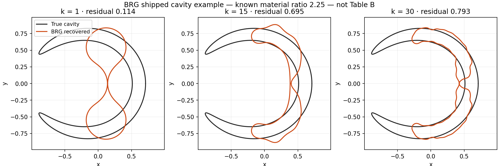
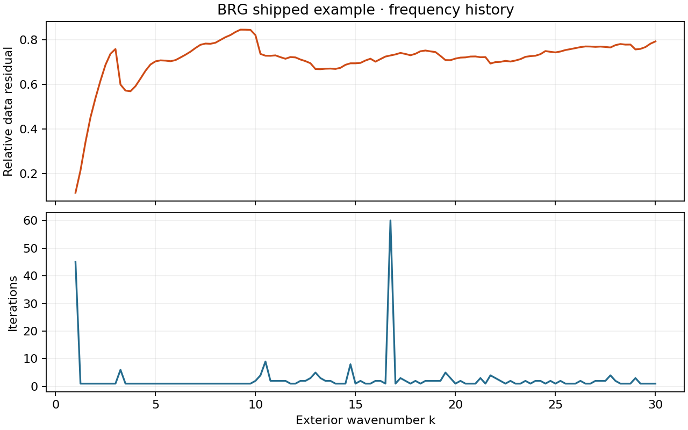

# BRG shipped examples: activity 01

## Handoff update, 18 November 2026

Activity 01 was accepted by the coordinator; no rerun or further work is
pending here. The shipped example is not a paper-table case. Patches 03/04
are approved; retain the pinned source and seven-argument wrapper call.
The paper shape definitions, six-case count and public-setting choices that
were open in this historical report were resolved in activity 02.

Still-unfixed upstream issues are the multi-component missing-L test and the
exact-fit steepest-descent zero-over-zero/MEX failure. Neither is fixed by a
new guard in the approved baseline; preserve and report a recurrence. The
shipped manufactured-source check was unsuitable for its cavity; the paper
and TG-002 wrappers use a verified interior point for this diagnostic.
The complete input conventions are in [data_handoff.md](data_handoff.md).

Activity 01 finished on 17 November 2026. The full **shipped example**
completed all 117 data and inverse frequencies after the coordinator approved
patches 03/04. This is not a table B result. The cavity was not recovered
accurately: final relative area error is 57.5954%. Earlier test failures remain
recorded below; they were not repaired or hidden.

## Full shipped example: final result

| Measurement | Result |
|---|---:|
| Data / inverse frequencies | 117 / 117 |
| Exterior wavenumbers | 1 through 30, step 0.25 |
| Known interior/exterior wavenumber ratio | 1.5 |
| Known squared material ratio | 2.25 |
| MATLAB compute threads | 8 |
| Total inverse iterations | 302 |
| Final relative data residual | 0.7933549307 |
| Driver's unnormalized symmetric-difference area | 0.3896366096 |
| Driver's 300-point truth polygon area | 0.6765062059 |
| Relative area error | 0.5759542280 (57.5954%) |
| Data generation compute time | 122.04 s |
| Inverse compute time | 1118.52 s |
| Successful process wall time | 1395.81 s (23 min 15.81 s) |
| All full-run attempts, including metadata failure | 1398.93 s (23 min 18.93 s) |

The data time includes the shipped analytic check. Inverse time measures
solver calls; process wall time also includes startup, checkpoint writes
and figure exports. CSI overlapped, so none of these times is a final
comparison timing. The four-hour cap was not reached.

Eighty-seven frequencies ended with public exit flag -1 (no accepted valid
or decreasing step); thirty ended with flag 2 (small update). None ended
on the residual threshold or the 100-iteration limit. The longest fit was
60 iterations at k=16.75. Completion of the loop is not convergence to the
true shape. Each frequency's original flag and full residual history are kept.

[Metrics](../../../../results/brg/examples/shipped_cavity_full/metrics.json),
[per-frequency table](../../../../results/brg/examples/shipped_cavity_full/frequency_summary.csv),
[compact progress log](../../../../results/brg/examples/shipped_cavity_full/progress.log),
[settings](../../../../results/brg/examples/shipped_cavity_full/settings.json).





The final curve follows part of the right-hand arc but misses the long
left-hand arms and opening, and retains a narrow central pinch. It fails to
resolve the cavity. This agrees qualitatively with the failure seen in
Figure 7, not with an exact numerical reproduction: the shipped geometry,
material ratio and optimization settings differ from the paper cases.
[Paper, section 4.3 and Figure 7](https://arxiv.org/html/2210.11607).

## Saving, checks and storage

The wrapper atomically saved every data frequency, every exact continuation
state and every compact inverse record. Restarting the same command skips
completed frequencies and uses the last saved state; it shares the remaining
four-hour budget across attempts. The only restart in this run followed the
metadata failure before data generation, so a mid-inversion resume was not
needed and is not claimed as a tested interruption case.

`python experiments/baselines/brg/summarize_full.py` checked all 117 compact
records: ordered frequencies, finite boundaries and residuals, history
length equal to iteration count, and final residual equal to the history
endpoint. The approved upstream source hashes were unchanged. Both final
plots were visually checked. No extra solver tests or fits were run.

The full run's committed compact files occupy about 1.01 MB and its three
report figures about 0.28 MB, below the approximately 5 MB limit. The 237
bulk files total 233.20 MB and remain in ignored `local/`, with
[commands and SHA-256 values](../../../../results/brg/examples/shipped_cavity_full/bulk_manifest.json).
No previously pushed evidence was removed or rewritten in Git history.

Run command: `python experiments/baselines/brg/run_full.py`.
[Attempt records](../../../../results/brg/examples/shipped_cavity_full/attempt_02.json)
and [source state](../../../../results/brg/examples/shipped_cavity_full/source_state.json)
make the settings and repairs explicit. The run began at 19:41:31 UTC and
finished at approximately 20:04:47 UTC on 17 November.

## Activity 02 handoff

The requested [paper-example plan](../02_rebuild_paper_examples/plan.md) is
drafted; no activity 02 run was made. It maps each setting to public options
and gives the exact glider and shipped-cavity definitions. Exact paper
star coefficients and cavity geometry remain unavailable in the checked
paper/source archive, and the six named cases do not identify a seventh
run. It also records resolution, curvature and filtering gaps for the
coordinator to resolve before a paper-case campaign.


## Run record

| UTC date | Step | Result | Wall seconds | Evidence |
|---|---|---|---:|---|
| 2026-11-17 | Build in sandbox | Fortran compiled; MEX could not write MATLAB preferences | 3.52 | [log](../../../../results/brg/examples/build/matlab.log), [command](../../../../results/brg/examples/build/run.json) |

The failed build is retained. MATLAB needs access outside the sandbox for
preferences and online licensing. The retry succeeded with approved access;
the user subsequently enabled unrestricted access.

Build retry: all four MEX files built in 1.87 s;
[log](../../../../results/brg/examples/build_retry/matlab.log).

Wrapper: MATLAB uses eight compute threads, disables interactive pauses,
and exports open figures. Two script path substitutions are applied in
memory only; [patch](../../../../external/patches/brg/01-wrapper-script-paths.patch).
No numerical settings are changed.

## Suite and thread check

17 November: upstream `test_all.m` passed 3/3. Process wall time 12.08 s.
MATLAB R2026a started with one compute thread; wrapper set eight. Median of
three complex dense 2500-by-2500 solves: 0.717075 s at one thread, 0.195035 s
at eight (3.677x); relative residual 4.04e-12.
[Evidence](../../../../results/brg/examples/suite/matlab.log).
These setup timings may overlap CSI and are not final comparison timings.

## Transmission tests

17 November: 23.97 s process wall time. The derivative script completed all
seven modes and six step sizes; [errors](../../../../results/brg/examples/transmission/frechet_errors.json).
The shipped script has no pass assertion. The multi-component test then
crashed in `rla.get_fw_mats`, line 223: `src_info.L` is absent after
`geometries.get_multi_comp`. No physics patch was made for this separate
problem. [Failure log](../../../../results/brg/examples/transmission/matlab.log).

The full derivative workspace is 82 MB and stays local, with command and
SHA-256 in [manifest](../../../../results/brg/examples/transmission/manifest.json).
The compact errors and multi-component failure workspace are committed.

## Data-generation first attempt

17 November: the shipped star script stopped before generating data because
its initial `save` names undefined variable `lam`. This is unused for the
transmission example. The retry will remove only `lam` from that save call.
[Failure log](../../../../results/brg/examples/data/matlab.log).

## Shared-checkout note

Commit `abade42e8` also captured CSI files staged concurrently by the CSI
agent, although BRG staged only its own paths. The files were preserved and
pushed. Subsequent BRG commits use explicit path-limited `git commit --only`
to avoid this shared-index race.

## Data-generation retry

17 November: completed 17/17 frequencies, k=1 through 5, with 90 directions
and 90 receivers (8100 scattered-field entries per frequency).
Process wall time 11.77 s. Analytic error estimates range from
6.22e-07 to 2.72e-05;
[summary](../../../../results/brg/examples/data_retry/data_summary.json).
The original dissipative transmission parameters are unchanged. This star
example is not the clean equal-density cavity baseline.

The data file is committed. The full workspace exceeds 50 MB and stays
local with its command and checksum recorded. Only the output path and
undefined `lam` save were changed in memory;
[patch](../../../../external/patches/brg/02-remove-undefined-lam-save.patch),
[executed source](../../../../results/brg/examples/data_retry/executed_script.m).

## Low-frequency check: first attempt

17 November: 4.55 s wall time. The actual inverse path crashed before a
residual could be checked: `update_inverse_iterate` replaces `bc` with a
struct containing only `type` and `invtype`, then passes it to the
transmission derivative, which requires `transk`, `transa`, and `transb`.
[Log](../../../../results/brg/examples/low_frequency_unpatched/matlab.log).
The next check changes only that struct copy, then checks the stale-frequency
residual before applying the frequency fix. This is a second upstream bug.

## Low-frequency stale-wavenumber check

17 November: 19.30 s wall time. With only the derivative struct-copy fix,
one inverse step from the true cavity gives relative residuals 6.087825,
6.524013 and 5.198061 at k=1,1.25,1.5. The harness correctly fails its 1e-8
limit. [Measurements](../../../../results/brg/examples/low_frequency_stale/check.json).

Ranked explanations before the frequency patch: (1) stale transmission
wavenumbers, predicted to vanish after synchronizing both with each k;
(2) a misread `bc.q`, predicted to persist unless its meaning changes;
(3) a field normalization error, predicted to persist with correct k.
Only (1) is changed next. The derivative patch preserves the input physics
struct; it does not change any parameter.

## Corrected-frequency exact-fit diagnostic crash

17 November: 4.32 s wall time. Updating both wavenumbers makes the exact
true-shape data residual zero. The shipped steepest-descent code computes
a zero-over-zero step before testing its residual stop; NaN geometry reaches
`curve_resampler.mexa64`, which segfaults.
[Redacted log](../../../../results/brg/examples/low_frequency_fixed/matlab.log).
No optimizer or MEX patch is proposed at this checkpoint.

The diagnostic is revised to start from the shipped unit disk and compare
one RLA step with a direct single-frequency inverse call supplied the correct
wavenumbers. This tests the actual frequency-loop boundary without the
exact-fit corner case. Both calls keep the same data and optimizer settings.

## Unit-disk diagnostic, stale frequencies

17 November: the direct reference residuals after one step were 1.324969,
2.096010 and 1.889293. RLA with stale [45,30] gave 4.668302, 4.697863 and
3.964944, with relative curve differences 0.59655, 0.27016 and 0.25518.
The intended assertion fails at all three frequencies.
[Evidence](../../../../results/brg/examples/low_frequency_stale_disk/check.json).

## Checkpoint result: corrected unit-disk calls

17 November: k=1,1.25,1.5 all pass. RLA and the direct reference produce
identical residuals and identical curves (differences exactly zero in the
saved double-precision results).
[Measurements](../../../../results/brg/examples/low_frequency_fixed_disk/check.json).
This confirms frequency plumbing and the derivative argument fix. It is
not a full reconstruction or a check at high frequencies.

The minimal physics fix is three lines in `rla_inverse_solver`: at every
transmission frequency with `bc.q`, reset `bc.transk` to `[bc.q*kh kh]`.
The additional one-line fix copies `bc` into the derivative call instead
of dropping its transmission fields. See
[patch 04](../../../../external/patches/brg/04-update-transmission-wavenumbers.patch) and
[patch 03](../../../../external/patches/brg/03-preserve-transmission-derivative-parameters.patch).

Source and paper agree that a fixed known material has both wavenumbers
scale with frequency. The driver's `bc.q=1.5` is the interior/exterior
wavenumber ratio; its squared ratio is 2.25 and susceptibility is 1.25.
The proposed update restores the same material used to generate its data.
This is an inference from the public source and the paper, not evidence of
how the authors repaired their unpublished drivers.
[Paper: equation 1, Remark 1.1 and section 4.1](https://arxiv.org/html/2210.11607).

The stale state is actually both interior 45 and exterior 30; the incident
wave still uses the current `kh`. Loading data in a fresh run leaves
`bc.transk` absent, rather than stale. The fix covers both cases when `bc.q`
is supplied. Drivers without `bc.q` retain their explicit transmission data.

In the [information chain](../../../reference/inverse_information_chain.md),
this is the BRG counterpart of A2–A4 frequency consistency and B7 derivative
inputs. These external BRG calls are not on our default BEM inverse path.
No `solvers/` or shared comparison code changed.

## Checkpoint disposition (before coordinator approval)

Stopped at the coordinator's requested checkpoint. At this checkpoint the full 117-frequency
run had not started and Figure 7 had not been compared. The later
coordinator approval below supersedes that hold.

After the coordinator's answer, finish the wrapper to checkpoint each data
and inverse frequency, restore the last curve on resume, and enforce a
cumulative four-hour data-plus-inverse budget. Keep the shipped single
unit-disk start, steepest descent and 100 iterations; no paper-setting
substitutions in activity 01. Use seven solver arguments; the optional
[driver patch](../../../../external/patches/brg/05-remove-obsolete-driver-argument.patch)
removes its unused eighth argument.

The multi-component missing-perimeter failure and exact-fit zero-gradient
MEX crash remain unresolved. Neither is hidden by a success claim.
The shipped derivative test shows roughly quadratic remainder decay in
all seven modes, ending between 7.07e-13 and 4.99e-12; this does not validate
its derivatives independently at unequal density.

Pre-full-run process timings and commands are in
[run summary](../../../../results/brg/examples/run_summary.json).
Timing overlap with CSI is permitted for activity 01; final comparison
timing must run alone. Two workspaces above 50 MB remain local with their
checksums, and all committed artifacts stay below 50 MB.

[Data and convention handoff](data_handoff.md).
[Patch status and reproduction](../../../../external/patches/brg/README.md).

## Full shipped example authorized, 17 November

The coordinator approved patches 03 and 04 and the full step 5 run; their
source/branch review is recorded in the plan. The first launch stopped
before data generation because MATLAB cannot JSON-encode complex-typed
coefficients, even with zero imaginary parts. This is a wrapper metadata
error; the retry converts only the metadata copy to real values.
The failed attempt and its bulk-log checksum are retained in
`results/brg/examples/shipped_cavity_full/attempt_01.json` and
`bulk_manifest.json`. Its wall time counts toward the four-hour limit.

## Shipped analytic-check source

The shipped data generator uses `opts.src_in=[0.85;0]` for its manufactured
solution check. The true 300-point cavity has maximum x=0.71054, so this
point is outside. The unused alternative `[0.6;0]` in the driver's comment
is inside. The reported `err_est` values near one therefore cannot certify
forward accuracy. This check is separate from plane-wave measurement
generation and does not alter its output. The shipped settings were kept.
[Point check](../../../../results/brg/examples/shipped_cavity_full/analytic_source_check.json).

## Paper-shape identity

The prior plan's description of the shipped cavity as the same paper cavity
was not established. Figure 7 opens upward; the shipped curve opens leftward
and has different visible scale. Its exact definition is known from public
code, but the paper text does not specify its own cavity parameterization.
Compare the recovery failure qualitatively, not as a reproduction of the
paper's numerical error. Activity 02 records this geometry gap.

## Coordinator report

```text
Activity: brg_adaptation/01_run_published_examples, 17 November 2026
Runs: 117/117 data and 117/117 inverse frequencies; full-run attempt wall time 0:23
Result: shipped cavity area error 0.38963661; relative area error 57.5954%; final residual 0.793355
Result: 302 iterations; eight compute threads; suite 3/3; star generation 17/17
Failures: multi-component test missing L; exact-fit diagnostic MEX crash; full-run metadata retry (logs linked above)
Upstream patches: external/patches/brg/01–04 used as needed; 03/04 approved; 05 unnecessary with seven arguments
Changes to our code: experiments/baselines/brg wrappers only; no BEM or shared comparison changes
New unknowns: paper star/cavity definitions, seventh case, resolution/roughness/filter choices; shipped analytic check invalid
Proposed next activity: review drafted 02_rebuild_paper_examples plan; needs user decision: none now, coordinator gaps listed
```
