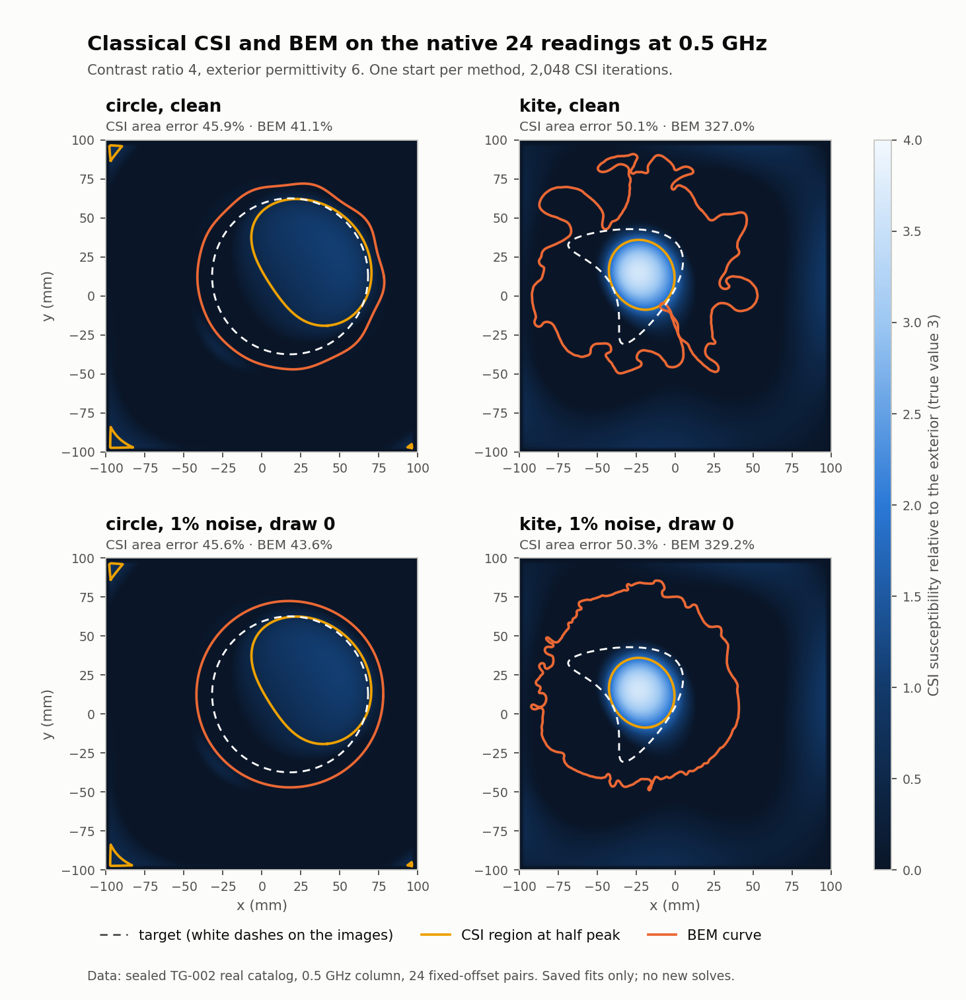

# Results: classical CSI on the native 24-pair data at 0.5 GHz

19 November 2026. Times are UTC. Plan: [plan.md](plan.md).
Status at 04:08: complete. Four CSI fits and both paired BEM rows are
in. The MATLAB slot is released.

## Answer

On the exact 24 readings our BEM saw at 0.5 GHz, neither method recovers
either shape at the 5% area limit. On the circle the two are close: CSI
45.9%, BEM 41.1%. On the kite CSI is far lower: 50.1% against 327.0%.
The frozen 1% noise draw changes every area error by under three points.

## Clean comparisons

Contrast ratio 4, exterior permittivity 6, one start per method.
Both field residuals are the same quantity: the fields predicted from
the returned image or curve, against the 24 readings.

| Case | Method | Area error at half peak | At 0.3 | At 0.7 | Material error | Field residual, 24 readings | Runtime |
|---|---|---:|---:|---:|---:|---:|---:|
| `circle__c4` | Classical CSI | 45.95% | 44.01% | 61.33% | 0.826 | 24.01% | 615.5 s |
| `circle__c4` | BEM, saved control | 41.11% | curve | curve | 0.532 | 0.148% | 16.8 s |
| `kite__c4` | Classical CSI | 50.07% | 38.04% | 70.83% | 0.636 | 12.45% | 622.3 s |
| `kite__c4` | BEM, saved control | 327.04% | curve | curve | 1.463 | 22.01% | 99.0 s |

Threshold sensitivity applies to images only; BEM returns a curve.

What the images look like:

- **Circle, CSI.** Peak susceptibility 1.07 against a true 3. The half-peak
  region is an oval inside the target with 42.6% of the true area
  missing. Three small pieces sit in the corners of the image domain;
  the scoring keeps every piece, and they add 3.4% excess area.
- **Kite, CSI.** One compact piece inside the kite body, peak 3.64.
  All of its error is missing area: it covers half of the target.
- **Circle, BEM.** A larger closed curve with contrast 3.11. It fits the
  24 readings to 0.15% with a 41% area error. So one frequency and 24
  readings do not fix size and contrast together.
- **Kite, BEM.** The curve grew far outside the target and the contrast
  fell to 0.005.

CSI's own costs at iteration 2,048 are a different quantity and are kept
apart. Circle: data cost 1.59e-5, state cost 9.41e-4. Kite: 1.40e-5 and
4.62e-4. Its contrast sources fit the readings closely while the image
alone, solved forward, does not.

## Noisy comparisons (1% noise, draw 0)

Both methods read the same frozen draw. The residual is against the
noisy readings.

| Case | Method | Area error at half peak | At 0.3 | At 0.7 | Material error | Field residual, 24 readings | Runtime |
|---|---|---:|---:|---:|---:|---:|---:|
| `circle__c4` | Classical CSI | 45.55% | 43.72% | 61.03% | 0.826 | 23.98% | 611.9 s |
| `circle__c4` | BEM | 43.61% | curve | curve | 0.543 | 1.04% | 0.6 s |
| `kite__c4` | Classical CSI | 50.29% | 37.99% | 70.97% | 0.636 | 12.58% | 613.2 s |
| `kite__c4` | BEM | 329.24% | curve | curve | 1.462 | 18.09% | 58.3 s |

Clean-to-noisy change for CSI: circle 45.95% to 45.55%, kite 50.07% to
50.29%. The 1% noise barely moves the CSI images.

Clean-to-noisy change for BEM: circle 41.11% to 43.61%, kite 327.04%
to 329.24%. The ranking of the two methods is the same as on clean data.

BEM fits (`bem/default_n1d0_uc_sf0.5`) were run by the BEM coordinator
and their records appeared at 04:07. The circle fit stopped at the
noise level after its first stage (five accepted steps, 0.2 s of
fitting): its 1.04% residual is below the 1.11% realized noise. The
kite fit ran its whole schedule and did not reach the noise level; both
of its stages ended on the 22-step cap. The two fits ran alone on the
machine from 04:06:08 to 04:07:11 and are pushed as `b09d50556`.
Recovered contrasts: 3.075 on circle and 0.0107 on kite, against a true 4.
The BEM coordinator notes that its `fit.json` lists eight uncommitted
code paths at run time. They are other agents' analysis scripts, not on
the default fit path; the solver was committed.

Noise information each method gets: CSI gets none and runs the fixed
2,048 iterations. The BEM fit is told the per-frequency noise standard
deviation; it uses it to weight the loss and to stop at the noise level.

## Checks that passed before any fit

| Check | Result | Limit |
|---|---|---|
| Round trip of the 24 readings, circle / kite | 3.48e-16 / 4.87e-16 | below 1e-10 |
| Pair order | exact | exact |
| Readings CSI scores: mask, normaliser, residual | 24 / 24 / 24 | 24 |
| FDFD against the exact circle, 1.25 mm operators | 0.643% | at most 1% |
| Same at 0.625 mm | 0.661% | recorded only |
| Owned configuration against the pinned reader | exact; start differs by 1.8e-17 | about 1e-12 |
| `CSI.m` against commit `73a64e1` | byte-identical | identical |
| True circle through the scoring path | 0.69% area error | near zero |
| Noisy tables, circle / kite | 2.88e-16 / 5.80e-16, 24 entries | as above |

- No gain or phase was fitted. The best-fit gain, 0.9996 − 0.0039j, is
  a diagnostic only.
- The forward error did not fall on the finer grid. So the remaining
  0.64% is not a cell-size effect. Its source is open.
- The sealed circle readings agree with an independent disk series to
  1.3e-15.

Details: [adapter_report.md](adapter_report.md).

## Input hashes (SHA-256)

| Item | Circle | Kite |
|---|---|---|
| Sealed observations | `320f132b652283aab198bca11a999e31dcc0092c780c780c2c3766548b8b9d32` | `8fedad76730156c5adc2dc14edde7eaa14d0e5a307d6097400842e6f0d8ef811` |
| 24 clean readings | `fc5e08b348694572f2cbc0bb521a21a0e34531e30f08de35e5205ed01f8147b1` | `307b755b35dd654624343908a69407ab5fdc4b3b23854b524c4b46df8df11b33` |
| Clean CSI table | `597956b2fafd788ab726671c0da82279c0de90a02481afbf2d8916a9a06fb17e` | `0281036e38bd87745eb210393d18a7e082d1d853c77d545666eb148463a5cdf9` |
| Noise file, draw 0 | `3d23d3a9f8d9168c32af5341eaf5a4a8c6b42a390a5a2973926b00b099652aba` | `355ca4155e95cf0ab6fd17e02fa906ecf0bbcc3d3c3b94379bcb95d512c738ff` |
| 24 noisy readings | `a5bdb06134d39785b93e05c82ee959963b28b9fdcfa5bfcd50cdb527cef283fa` | `0c813d0254631c13677ae4a5b5bcddd0972a88b8836811699aa80b5bb4d72997` |

Shared: mask `f5a368f44e976680337b7770bc13bdb09ac08942c872ba2b9d25fa6e22323e5c`,
`CSI.m` `2f0d40aae645a2514613c8ddf6c19672061f62db4e20ef1706f0e889b01867fe`,
CC-CSI commit `73a64e1`, MaxwellFDFD commit `690ca8d`. The noisy readings
match the 0.5 GHz column of the BEM noise files bit for bit.

## Actual settings

- Pinned classical `CSI.m`, unchanged. Native back-propagation start, one
  start, no tuning, 2,048 iterations, no early stop, no truth passed in.
- Inverse grid 166 by 166 cells of 1.25 mm, centred on the ring centre.
- Exterior permittivity 6 enters as the exact equivalent frequency in
  vacuum, 1.2247 GHz, which gives the native wavenumber 25.669 per metre.
  The image is susceptibility relative to the exterior; the true value
  is 3 and the ratio is one plus its real part.
- Fields inside CSI are divided by the known 1e-6 source strength and
  conjugated. With unscaled fields the epsilon term in `CSI.m` would be
  7e9 times its denominator; with scaled fields it is 7e-15.
- The back-propagation weight uses the full 24-receiver operator for
  each source, as upstream does. Data cost and residual use the single
  measured pair per source.

## Runs and resources

| Run | Launched | Ended | Wall time | Peak memory |
|---|---|---|---:|---:|
| Clean circle | 03:14:34 | 03:24:49 | 615.5 s | 1.60 GiB |
| Clean kite | 03:25:57 | 03:36:19 | 622.3 s | 1.60 GiB |
| Noisy circle | 03:37:51 | 03:48:02 | 611.9 s | 1.59 GiB |
| Noisy kite | 03:49:03 | 03:59:16 | 613.2 s | 1.58 GiB |

- Iteration 64 of the circle fit came 24.95 s after launch. The linear
  forecast was 798 s; the fit took 616 s.
- One MATLAB worker at a time, eight threads, CPU only, inside an 8 GiB
  systemd memory scope. Every launch saw more than 32 GiB available.
- The BEM coordinator reserved 8 GiB for its own jobs' growth.

## Failures

- **Table check, attempt 1 (03:09).** The pinned `ReadFreData.m` stopped
  at line 384 before any numbers: with one receiver per source it gets
  a row where it expects a column. The log is kept in
  `checks/table_circle__c4__clean/attempt_01/`. The coordinator
  authorized an owned TM configuration built from the pinned `FDFDpars`
  and the upstream back-propagation equations. No upstream file was
  edited. The equivalence check above shows the start is unchanged.
- No fit failed.

## What this supports

- A feasibility result on two shapes at one frequency. With 24 readings
  at 0.5 GHz neither method recovers a shape.
- The different priors are part of the comparison. CSI starts from
  back-propagation and estimates an image. BEM starts from the centred
  65 mm circle and fits one curve and one contrast.
- It says nothing about the default 19-frequency BEM method. That needs
  a matched multifrequency comparison.

## Limitations

- Two shapes, one contrast, one frequency, one noise draw.
- The noisy comparison is not symmetric in what each method knows. BEM
  is told the noise level and stops there; CSI is told nothing.
- CSI's image is scored on a 1.25 mm grid resampled to the scoring
  grid. The true circle scores 0.69% through that path, so this floor
  is small against the errors here.
- The circle image has three small pieces in the corners of the image
  domain. The protocol keeps every piece; they add 3.4% to its error.
- Open: why the forward error stays at 0.64% on the finer grid, and why
  CSI's own data cost (about 1.5e-5) is so far below the field residual
  of its image solved forward (12% to 24%).
- BEM runtimes are GPU fits; CSI runtimes are one CPU worker with eight
  threads. They are not a like-for-like speed comparison.

## Evidence

- Raw records: `results/csi/native_tg002/2026-11-19/` (`inputs/`,
  `checks/`, `fits/`, `logs/`).
- CSI scores:
  [circle](../../../../results/csi/native_tg002/2026-11-19/fits/circle__c4__clean/score.json) ·
  [kite](../../../../results/csi/native_tg002/2026-11-19/fits/kite__c4__clean/score.json).
- CSI noisy scores:
  [circle](../../../../results/csi/native_tg002/2026-11-19/fits/circle__c4__n1d0/score.json) ·
  [kite](../../../../results/csi/native_tg002/2026-11-19/fits/kite__c4__n1d0/score.json).
- BEM clean controls:
  [circle](../../../../results/bem/default_clean_uc_sf0.5/circle__c4/score.json) ·
  [kite](../../../../results/bem/default_clean_uc_sf0.5/kite__c4/score.json).
- BEM noisy fits, committed by the BEM coordinator:
  [circle](../../../../results/bem/default_n1d0_uc_sf0.5/circle__c4/score.json) ·
  [kite](../../../../results/bem/default_n1d0_uc_sf0.5/kite__c4/score.json).
- Reports: [adapter](adapter_report.md) · [runs](run_report.md).
- Code: `experiments/baselines/csi/native_tg002/`. Figure script:
  [make_figures.py](make_figures.py).
