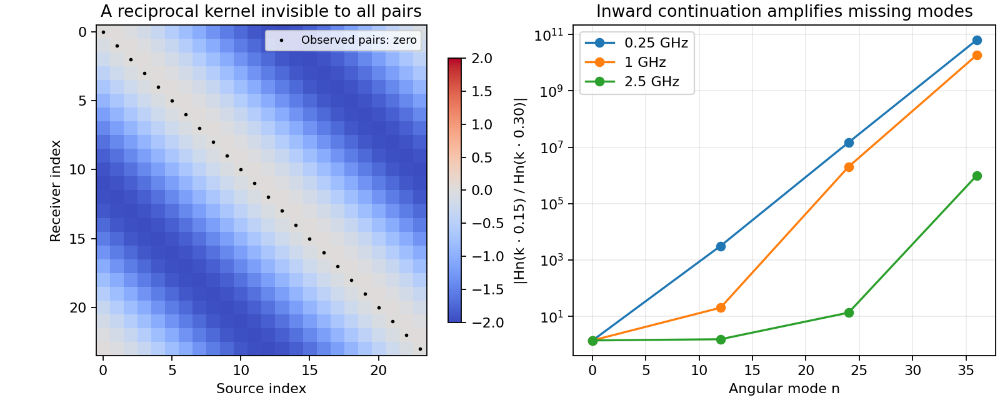

# Carleman convexification for transmission shape reconstruction

2026-10-11. Track 13 formulation investigation, CVX-001.

**The useful direction is a smoother differentiated auxiliary field, with an
explicit treatment of its missing tail and boundary data.** The dielectric jump
does not, by itself, demand a Carleman estimate with an unknown discontinuous
principal coefficient: the maintained TMz problem has a constant principal
Laplacian. However, the inspected literature does not establish global recovery
of this sharp-interface problem from TG-002's paired measurements. Importing a
published auxiliary functional would leave important assumptions unmet.

This study establishes a regularity improvement analytically and checks it
against an exact transmission solution. It also constructs explicit limitations
on boundary-data completion, audits the relevant theorems, and identifies one
reproducibility issue in a recent method. These are formulation/component
results. No inverse reconstruction, benchmark improvement, or new global
convergence theorem is claimed.

## Evidence and reproducibility

- [Pre-registered plan](CVX-001_plan.md).
- [Isolated diagnostic driver](../../../experiments/convexification/formulation_checks.py).
- [Numerical summary](../../../results/validation/convexification/CVX-001/summary.json),
  [source and environment manifest](../../../results/validation/convexification/CVX-001/manifest.json),
  [raw arrays](../../../results/validation/convexification/CVX-001/arrays.npz).
- [Post-run validation](../../../results/validation/convexification/CVX-001/validation.json):
  source hashes, saved-array consistency, local links and independent review.
- [Figure](../../../results/validation/convexification/CVX-001/diagnostics.svg).

All five registered gates passed. The nine flat-interface states had maximum
normalized algebra error **1.78e-15** and fine frequency-difference error
**3.55e-12**. A reciprocal kernel had paired residual **1.72e-16** while its
complete sampled matrix had RMS **1.209**. All 24 samples of a second outgoing
field were below **2.50e-14**, although its unsampled trace reached **2**.
These numbers validate exact identities and counterexamples; they are not
reconstruction errors. The driver took 0.434 s internally on this host, with
no runtime comparison intended.

Root owned implementation and measurements. Independent agents reviewed the
primary literature, derived the transmission identities, audited the repository
data, reviewed the plan/code, and checked saved arrays, hashes and the figure.
The source constants were corrected to the frozen benchmark values before the
single registered run. No post-run tuning or rerun was needed.

```bash
OMP_NUM_THREADS=1 OPENBLAS_NUM_THREADS=1 MKL_NUM_THREADS=1 timeout 300 \
  /home/drdeng/miniconda3/envs/EMNerf/bin/python \
  experiments/convexification/formulation_checks.py --output /tmp/CVX-001-reproduction
```

The destination must be fresh. This command performs analytic component checks,
not an inverse experiment. The run manifest hashes the executed driver, plan,
benchmark constants and scene definitions. The plot and arrays were inspected
afterward; all manifest hashes matched. Source and result files are preserved
together in Git.

## What information and physics the repository actually provides

Let the normalized permittivity be

\[
c(x)=1+(\chi-1)\mathbf1_D(x),\qquad \chi\in\{0.5,4,13.3\}.
\tag{1}
\]

The background relative permittivity is **6**; \(\chi\) is the ratio to that
background, not an absolute permittivity. Away from external line sources,

\[
\Delta u+k^2c(x)u=0,\qquad [u]=[\partial_nu]=0.
\tag{2}
\]

Here brackets mean interior minus exterior, and permeability is constant.
This is the maintained equal-density/TMz model. A TE model with a discontinuous
principal coefficient is a different theory question.

TG-002 records scattered fields at 24 pairs on a 0.30 m ring:

\[
\theta_j=2\pi j/24,\quad s_j=R e^{i\theta_j},\quad
r_j=R e^{i(\theta_j+0.2)},\quad d_j(k)=u_{\rm sc}(r_j;s_j,k).
\tag{3}
\]

Coordinates here are relative to the physical center. There are 19 frequencies
from 0.25 to 2.5 GHz in 0.125 GHz steps: 456 complex measurements per catalog.
The code uses length unit 0.05 m and
\(k_{\rm code}=0.05(2\pi f)\sqrt{6\mu_0\epsilon_0}\).
The allowed damped catalog is generated independently at \(k(1+0.25i)\).
It is additional synthetic information, not a consequence of the 19 real
frequency samples. These facts are pinned in the
[acquisition and wavenumber definitions](../../../experiments/cleaned_interface/benchmark.py),
[benchmark contract](../../../experiments/benchmark/README.md),
[scene constants](../../../experiments/benchmark/scenes.py), and
[Observation contract](../../../solvers/bem_inverse/problem.py).

For a fixed source, we have **one receiver per frequency**. Adding the known
incident field provides total field at that point, not an entire trace. Also,
the usual optimization box \([0.2,0.8]^2\) contains source-ring points. A
source-free auxiliary PDE must use a justified interior domain avoiding the
sources, or retain their singular forcing. On the source ring, interpolate
the regular scattered field before adding incident fields on an interior
source-free boundary; the total field is singular at its own source.

## What the primary literature proves

The following source summaries specify the mathematical scope rather than
treating “globally convergent” as a guarantee for every inverse formulation.
Equation numbers refer to the linked versions.

| Primary source | Relevant result and assumptions | Consequence here |
|---|---|---|
| [Klibanov, Kolesov and Nguyen, 1805.07618](https://arxiv.org/html/1805.07618) | Equations (2.6)–(2.9) assume smooth \(c\ge1\), including \(C^{15}\) regularity. High-frequency/geodesic hypotheses justify the log. Equations (4.1)–(4.3) approximate its tail. Theorems 7.3 and 7.6 concern a semidiscrete auxiliary model; Remark 5.1 fixes the transverse grid. | Sharp jumps, contrast 0.5, tail consistency and mesh refinement need separate treatment. |
| [Khoa, Klibanov and Nguyen, 1911.10289v2](https://arxiv.org/pdf/1911.10289v2) | Moving-source, fixed-frequency formulation. Equations (3.14)–(3.16) prescribe full Dirichlet data and Neumann data on the measured face. Equation (4.3) uses an \(H^3\) ball; Theorem 5.1 proves strict convexity. Remark 3.1 explicitly treats finite expansion, differentiated expansion and boundary completion as an approximate model, with no \(N\to\infty\) accuracy theorem. | This is a strong finite-model result, not a sharp-interface/paired-data theorem. |
| [Thành and Klibanov, 1901.03183](https://arxiv.org/html/1901.03183) | Equation (2.3) permits positive coefficients below one but requires \(C^2\). Equation (3.1) uses a logarithmic derivative. Lemma 3.1 proves nonvanishing in one dimension; Theorems 4.3–4.6 concern the truncated ODE model. | Below-background contrast is not inherently incompatible with the whole family; the 1D zero-free argument does not transfer to 2D. |
| [Truong, Nguyen and Klibanov, 2002.08427](https://arxiv.org/html/2002.08427) | Direct 2D multifrequency precedent. Equations (3)–(4) require fixed-illumination Cauchy data on a receiver segment. Equation (7) assumes a suitable nonzero log field. The introduction defers convergence analysis; Remark 1 distinguishes partial-boundary numerics from theory requiring completed Dirichlet data. Algorithm Step 2b also performs forward solves. | Useful computational precedent, with a different data contract and an incomplete theoretical justification for its partial-data implementation. |
| [Nguyen, Nguyen and Vu, 2404.04145v2](https://arxiv.org/html/2404.04145v2) | Equation (2.17) freezes one quadratic factor, producing linear least-squares subproblems. Theorem 3.1 gives contraction for the projected auxiliary model with a regularization floor. It assumes full Cauchy data, nonvanishing, \(H^s\), \(s>\lceil d/2\rceil+2\), and a bounded \(C^2\) set. | Attractive alternative to nonlinear minimization, but neither the data nor high regularity is supplied by TG-002. |
| [Le Rousseau and Robbiano, 2010](https://doi.org/10.1007/s00205-009-0242-9) | Studies an operator with a discontinuous principal diffusion coefficient, \(-\partial_{x_0}^2-\nabla_x\cdot(c(x)\nabla_x)\). | Its interface difficulty must not be imported unchanged into (2). |

The 2024 preprint is now indexed as a [2026 journal article](https://arxiv.org/abs/2404.04145); this audit concerns
the explicitly linked **v2 preprint**, not a claim about later corrections.

For a nonlinear residual \(\mathcal L(V)\), the relevant functional is of the
form

\[
J_{\lambda,\alpha}(V)=\int_\Omega e^{2\lambda\psi}
 |\mathcal L(V)|^2\,dx+\alpha\|V\|_{H^s}^2.
\tag{4}
\]

Strict convexity on an admissible bounded set requires an appropriate weight,
homogeneous boundary conditions on differences, bounded nonlinear terms and
compatible regularity. It is not strict convexity of the original shape
least-squares objective. Nor does a unique regularized minimizer automatically
equal the true coefficient when tails, projection or boundary completion are
approximate.

## Why an unknown principal interface is not the first obstacle

This subsection is a direct deduction for (2). Continuity of \(u\) and its
normal derivative removes interface delta distributions from \(\Delta u\).
The equation holds weakly with \(c\in L^\infty\). Interior elliptic
regularity in 2D gives local \(W^{2,p}\) regularity for finite \(p\), starting
from a physical weak solution and bootstrapping. Sources are excluded.

To see why bounded jumps are different from a principal-coefficient jump,
suppose an applicable Laplacian Carleman estimate, with its required boundary
conditions, gives

\[
\lambda\|\nabla z\|_w^2+\lambda^3\|z\|_w^2
 \le C\|\Delta z\|_w^2.
\tag{5}
\]

For \(P=\Delta+V\), \(V=k^2c\), substitute \(\Delta z=Pz-Vz\). The right
side is at most
\(2C\|Pz\|_w^2+2C\|V\|_\infty^2\|z\|_w^2\).
The last term can be absorbed when
\(\lambda^3>4C\|V\|_\infty^2\). This conditional perturbation argument
does not differentiate \(c\), locate the interface or construct the starting
Carleman weight. It shows that bounded zeroth-order jumps alone are not the
same obstruction. Large contrast/frequency can still make sufficient weight
parameters demanding.

**What remains:** an admissible nonlinear transformed unknown, appropriate
boundary data, a tail/closure argument, and a quantitative discrete method.
The earlier S1 statement that this transmission problem necessarily requires
an unknown-interface Carleman theorem was too broad.

## Deriving the actual auxiliary equations

Let \(u_0(x;s,k)\) be the known nonzero background incident field in a
source-free imaging domain. Assume \(u\ne0\) there and select a compatible
logarithm. Set

\[
v=k^{-2}\log(u/u_0),\qquad a=\nabla\log u_0.
\]

All gradient dot products below are **bilinear**, without complex conjugation.
Absolute squares in a residual norm remain the usual Hermitian squares. Using
\(\Delta\log u+\nabla\log u\cdot\nabla\log u=-k^2c\), and subtracting
the corresponding background equation, gives exactly

\[
\Delta v+k^2\nabla v\cdot\nabla v+2a\cdot\nabla v=1-c.
\tag{6}
\]

For the nondispersive coefficient in this repository, put \(q=\partial_kv\).
Differentiation eliminates \(c\):

\[
\Delta q+2k^2\nabla v\cdot\nabla q
 +2k\nabla v\cdot\nabla v
 +2a\cdot\nabla q+2a_k\cdot\nabla v=0.
\tag{7}
\]

Unlike a plane wave, a point source has a spatially variable \(a\), obtained
from the Hankel incident field. Its \(a_k\) term cannot be omitted.
The closure is

\[
v(x,k)=V(x)-\int_k^{k_{\max}}q(x,\kappa)\,d\kappa,
\qquad V=v(x,k_{\max}).
\tag{8}
\]

Thus differentiation removes the coefficient from the PDE but leaves a tail
field. A high-frequency approximation, a jointly reconstructed tail or another
closure must be justified. **An exact interior tail is an oracle**: inserting
\(V\) into (6) already recovers \(c\). Supplying it cannot demonstrate inverse
feasibility, even if a subsequent auxiliary solve is convex.

Alternatively, at fixed \(k\), differentiating in a source parameter \(s\)
with \(p=v_s\) gives

\[
\Delta p+2k^2\nabla v\cdot\nabla p
 +2a\cdot\nabla p+2a_s\cdot\nabla v=0.
\tag{9}
\]

The paired angular derivative does not give this data:
\(d u(r(s);s)/ds=r'(s)\cdot\nabla_xu+\partial_su\).
Receiver motion is an additional term.

## A useful regularity gain at the unknown interface

Assume a smooth fixed interface and fields smooth on either side, with no
zeros in the neighborhood. Tangential derivatives of the two transmission
conditions imply

\[
[D^2u]=-k^2[c]u\,n\otimes n.
\]

Since \(u\) and \(\nabla u\) are continuous, their quadratic log term is
continuous. The background field is smooth. Consequently,

\[
[D^2\log(u/u_0)]=-k^2[c]n\otimes n,\qquad
[D^2v]=-[c]n\otimes n.
\tag{10}
\]

Generically \(v\notin H^3\): a third weak derivative includes a surface
delta from the second-derivative jump. Merely putting an \(H^3\) regularizer
on \(v\) does not make the true field belong to its admissible ball.
Smoothing a nonzero jump over width \(\varepsilon\) incurs a third-derivative
norm of order \(\varepsilon^{-1/2}\) per unit interface length, so fixed-radius
theorems do not automatically remain uniform as smoothing vanishes.

But the right side of (10) is independent of frequency and source position.
Therefore

\[
[D^2q]=0,\qquad [D^2p]=0.
\tag{11}
\]

With the stated piecewise smoothness these differentiated fields can belong
to \(H^3\), although generally not \(H^4\). The gain requires a fixed,
nondispersive interface/contrast when differentiating; it is not a claim for
arbitrary dispersive or moving-interface models.

There is also a local argument without a smooth-interface assumption. Suppose
\(c\in L^\infty\), the fields are differentiable in the parameter, and both
the physical field and reference are bounded away from zero on a compact
source-free subdomain. The original and parameter-differentiated Helmholtz
equations give \(v,q\in W^{2,p}_{\rm loc}\) for finite \(p\). Choose \(p>2\).
In 2D, \(W^{1,p}\) is an algebra, so every gradient-product term on the right
of (7) lies in \(W^{1,p}_{\rm loc}\). Applying interior Laplacian regularity
again gives \(q\in W^{3,p}_{\rm loc}\subset H^3_{\rm loc}\). The same argument
applies to (9). This is a local regularity deduction, not a global boundary
estimate or a convexification theorem; the smooth-interface calculation shows
why another derivative generally cannot be gained.

An exact flat-interface control makes the distinction explicit. Write
\(m=\sqrt\chi\), \(r=(1-m)/(1+m)\), \(t=2/(1+m)\), and

\[
u_-(x)=e^{ikx}+r e^{-ikx},\quad
u_+(x)=t e^{ikmx}.
\tag{12}
\]

At \(x=0\), both transmission conditions hold; \(|r|<1\) ensures the field
has no real-axis zeros. For \(v=k^{-2}\log(u/e^{ikx})\), direct differentiation
gives

\[
[v_{xx}]=1-\chi,\quad [v_{xxx}]=2ik\sqrt\chi(\chi-1),\quad
[q_{xx}]=0,\quad [q_{xxx}]=2i\sqrt\chi(\chi-1).
\tag{13}
\]

The registered nine-state computation formed the log derivatives independently
from incident/reflected/transmitted field jets, then differentiated their jumps
in frequency. It verified (13) to the errors reported above. The conclusion
comes from the exact identities; finite differences are an implementation
check, not evidence of Sobolev membership by themselves.

**Research implication:** a differentiated-field formulation deserves attention
before smoothing away the interface. Its smoother unknown is compatible with
some lower-regularity proof strategies, but the tail \(V\) remains generally
outside \(H^3\). The 2024 theorem's still-higher regularity does not follow
from this gain. A joint-tail argument remains necessary.

## What the paired acquisition can and cannot complete

Here is an exact obstruction to completing a general reciprocal response from
the paired values. On the ring define

\[
K(\theta_r,\theta_s)=\cos(\theta_r-\theta_s)-\cos\delta,
\qquad \delta=0.2.
\tag{14}
\]

It vanishes at every measured pair, is symmetric under exchange of its
arguments, and is nonzero elsewhere. It even has an outgoing Helmholtz
extension in both spatial arguments. With
\(h_n(r)=H_n^{(1)}(kr)/H_n^{(1)}(kR)\), use

\[
\mathcal K(x,y)=h_1(|x|)h_1(|y|)\cos(\theta_x-\theta_y)
 -\cos\delta\,h_0(|x|)h_0(|y|).
\tag{15}
\]

This is an exterior-kernel witness, **not** a demonstrated passive/unitary
scattering response or the difference of two admissible homogeneous objects.
It proves that reciprocity and exterior Helmholtz structure alone do not
complete the matrix. It does not prove nonuniqueness of the binary inverse.

For the symmetric tensor basis generated by \(1,\cos\theta,\sin\theta\),
there are six coefficients. The paired sampling map has rank **5**, whereas
the complete \(24\times24\) map has rank **6**. Thus this obstruction already
exists at very low angular order. Physical reciprocity was tested by swapping
arguments, not by transposing a matrix on two shifted grids.

The repository also has a stronger empirical warning about adding physical
constraints. The archived [FM-003 lifting screen](../cleaned_interfaces/iteration_21/01_results.md)
used reciprocity/unitarity, yet at 0.25 GHz/order 4 a paired residual
**8.65e-9** coexisted with full-matrix relative error **1.757** and ambiguity
**3.093**. Those values were checked against its
[raw lifting results](../../../results/validation/cleaned_interfaces/FM-003/lift/lift.json). This is
legacy evidence in a finite model, not a new experiment or an impossibility
theorem. Only its 0.25 GHz/order-2 lift passed the registered usable-lift rule.

## Why a full sampled column is still not continuous Cauchy data

For a continuous scattered trace on a circle outside the object, the outgoing
Dirichlet-to-Neumann map is

\[
(\partial_r u_{\rm sc})_n(R)
 =k\frac{H_n^{(1)\prime}(kR)}{H_n^{(1)}(kR)}(u_{\rm sc})_n(R).
\tag{16}
\]

This standard result is stated as Theorem 5.22, section 5.3, in
[Cakoni and Colton, 2014](https://sites.math.rutgers.edu/~fc292/Cakoni-Colton-2014.pdf).
Thus independently measuring Neumann data is not inherently necessary if a
qualified continuous exterior Dirichlet trace is available.

Finite samples require additional control. For the 24 receiver angles
\(\theta_j=\theta_0+2\pi j/24\), the outgoing field

\[
w(r,\theta)=h_{24}(r)e^{24i(\theta-\theta_0)}-h_0(r)
\tag{17}
\]

is zero at all samples, yet its trace between samples has maximum magnitude
2. Its sampled normal derivative has magnitude **78.35, 77.76 and 27.92 m⁻¹**
at 0.25, 1 and 2.5 GHz respectively. These are unit-normalized analytic
witnesses, not actual measurement error amplitudes.

Continuation inward through a homogeneous background annulus multiplies mode \(n\)
by \(H_n^{(1)}(kr_0)/H_n^{(1)}(kR)\), asymptotically
\((R/r_0)^{|n|}\) at large order and fixed radii/wavenumber. The inner boundary
must enclose the object's support, so the whole annulus is homogeneous; merely
being source-free is insufficient. The following component factors for
\(R=0.30\) m and \(r_0=0.15\) m do not certify that enclosure for arbitrary
inverse candidates:

| Frequency | Mode 12 | Mode 24 | Mode 36 |
|---|---:|---:|---:|
| 0.25 GHz | 3.16e3 | 1.49e7 | 6.35e10 |
| 1 GHz | 20.43 | 2.04e6 | 1.85e10 |
| 2.5 GHz | 1.56 | 13.65 | 9.90e5 |



Large factors do not establish that these modes have appreciable amplitude
in TG-002 data. They state what an error in that mode would do. A useful
adapter could still succeed under explicit tail bounds and regularization.
It must report those bounds, retained bandwidth and propagated derivative
error; “24 samples” is not a Cauchy-data certificate.

Full-matrix acquisition is also not logically necessary for the frequency
formulation: **one sufficiently sampled receiver curve for one fixed source
over frequency** can provide its intended kind of input. That still changes
the present paired information contract.

Similarly, finitely many frequency values do not uniquely specify their
derivatives without assumptions: \(f(k)+A\prod_j(k-k_j)\) agrees with \(f\)
at every sampled node. Including damped nodes simply extends the product.
This is an interpolation fact, not a construction of indistinguishable
dielectric objects. Frequency truncation needs its own error budget.

## Finite expansion can hide the missing constant component

The special polynomial-exponential bases used in this literature make the
projected derivative matrix invertible. That fact does not imply uniform
conditioning as the expansion grows. The following is an independent proof.

On a fixed interval \([-L,L]\), let
\(E_N=e^t\mathcal P_{N-1}\). Differentiation maps \(E_N\) to itself. In the
monomial-exponential basis its matrix is triangular with diagonal one; an
orthonormal change of basis preserves determinant one. But choose

\[
f_N(t)=e^t\sum_{j=0}^{N-1}\frac{(-t)^j}{j!},\qquad
f_N'(t)=e^t\frac{(-t)^{N-1}}{(N-1)!}.
\tag{18}
\]

Then \(f_N\to1\) and \(f_N'\to0\) uniformly, so in an orthonormal basis

\[
\sigma_{\min}(D_N)\le\frac{\|f_N'\|_2}{\|f_N\|_2}\to0,
\qquad
\|f_N'\|_2\le\frac{e^L L^{N-1}\sqrt{2L}}{(N-1)!}.
\tag{19}
\]

The approximation is recovering the constant function in the derivative's
kernel. Therefore a fixed-\(N\) result cannot be extended by citing
\(\det D_N=1\). The coefficient information that disappears on differentiation
must be restored by closure/data, not by ill-conditioned inversion of an
ever-larger derivative matrix. This matters particularly because the Hessian
jump in (10) is parameter-independent. The proof shows a conditioning limit,
not the failure of every finite-order method.

## Nonvanishing and weight conditioning need explicit checks

A local log exists if the field is nonzero. A global branch also needs
topological compatibility; a simply connected zero-free imaging domain and
a consistent reference phase suffice spatially. Source-angle periodicity can
add winding issues. Neither a positive dielectric coefficient nor complex
frequency damping alone certifies these properties.

A useful conditional alternative to a high-frequency smooth-ray assumption
comes from the volume integral equation \(u=u_0+T_ku\). If
\(\|T_k\|_{\infty\to\infty}\le\eta<1\), \(m=\inf|u_0|>0\) and
\(M=\sup|u_0|\), then the Neumann-series bound gives

\[
|u|\ge m-\frac{\eta M}{1-\eta}>0
\quad\hbox{if}\quad \eta<\frac{m}{M+m}.
\tag{20}
\]

For a unit plane wave this is \(\eta<1/2\). One sufficient bound is
\(\eta\le k^2|\chi-1|\sup_x\int_D|G_k(x-y)|dy\), which tends to zero
like \(k^2|\log k|\) on bounded 2D domains at low real frequency.
For point sources, retain \(m,M\) and exclude sources. This is a proposed
conservative certificate, not a computed TG-002 qualification. Failure of
the bound would be inconclusive about actual zeros.

Weights require equally concrete checking. In the **printed v2** specification
of [2404.04145](https://arxiv.org/html/2404.04145v2), equation (3.5) and section
4.2 give \(w=e^{2\lambda |x-x_0|^{-\beta}}\), \(x_0=(0,-10)\),
\(\beta=20\), \(\lambda=6\), and \(\Omega=(-1,1)^2\). Our direct arithmetic
gives

\[
1.64\times10^{-20}\le\log w\le9.87\times10^{-19}.
\tag{21}
\]

Every computed float64 weight is exactly **1**. An unstated scaling or a typo
could explain this; the calculation does not identify the authors' actual
code or refute their theorem. It does require a reproduction to document its
literal weight range and an unweighted control before attributing improvement
to Carleman weighting.

Conversely, large weights can impair conditioning. Subtracting the maximum
exponent prevents overflow but leaves \(w_{\max}/w_{\min}\) unchanged:
log spans 10, 40 and 100 imply ratios **2.20e4, 2.35e17 and 2.69e43**.
Row scaling, derivative normalization, coordinate units and the regularizer's
relative coefficient must be reported. Rescaling \(x\) without transforming
the weight changes the numerical method.

## Interface recovery is a separate mathematical requirement

Known contrast need not be discarded in a volume formulation. For an estimated
coefficient \(\widehat c\), define

\[
\widehat p=\frac{\operatorname{Re}\widehat c-1}{\chi-1},\qquad
\widehat D=\{x:\widehat p(x)>1/2\}.
\tag{22}
\]

This handles \(\chi<1\) with the correct reversed coefficient ordering.
If a point is misclassified, \(|\operatorname{Re}\widehat c-c|\ge
|\chi-1|/2\). Integration immediately proves

\[
|D\mathbin\triangle\widehat D|
 \le \left(\frac{2}{|\chi-1|}\right)^p
 \|\operatorname{Re}\widehat c-c\|_{L^p}^p.
\tag{23}
\]

For \(p=2\), the constants are **16, 0.4444 and 0.02644** for the three
contrasts. These are conditional readout bounds, not evidence that high
contrast is easier to reconstruct: obtaining a small coefficient error can
be substantially harder. Small symmetric-difference area does not imply a
small Hausdorff distance; thin spikes or remote tiny islands defeat that
inference. Boundary regularity, reach, minimum feature width or uniform
normal-displacement controls would be additional assumptions.

There is a direct bridge from an auxiliary-field error to (23). At a fixed
real \(k\), let \(h=\widehat v-v\) and reconstruct the complex coefficient
expression from (6). Then

\[
\widehat c-c=-\Delta h-2a\cdot\nabla h
 -k^2(2\nabla v\cdot\nabla h+\nabla h\cdot\nabla h).
\tag{23a}
\]

Taking a real part cannot increase the error norm. On a bounded regular 2D
domain, \(H^2\hookrightarrow W^{1,4}\), so Hölder's inequality gives a bound
of the form

\[
\|\operatorname{Re}\widehat c-c\|_2
\le C(1+\|a\|_\infty+k^2\|v\|_{H^2})\|h\|_{H^2}
 +Ck^2\|h\|_{H^2}^2.
\tag{23b}
\]

Thus an actual \(H^2\) field-error estimate could imply a coefficient and area
bound. A small PDE residual without stability does not supply that estimate;
the tail error enters \(h\) through (8), and high frequency increases the
nonlinear error constants.

Binary constraints inside the auxiliary optimization could forfeit convexity;
a fixed threshold afterward retains known contrast in the readout without
claiming convexity of the binary feasible set. It still needs independent
forward qualification and TG-002's unchanged geometric gates.

This distinction is already material in the repository. The TG-002
[GS-001 volume experiment](../CI-SPD/GS-001_results.md) reduced a single-frequency
paired residual to **0.461%**, while its contour RMS stayed **28.088 mm**.
It stopped at its wall cap while still improving. This is evidence that its
volume fit was not a shape recovery, not a refutation of multifrequency
convexification. Its [raw final values](../../../results/validation/cleaned_interfaces/GS-001/qualified_tv/result.json)
and saved validation were inspected for this audit.

## Other ideas worth retaining and their precise limitations

**Carleman contraction instead of nonlinear minimization.** Solving successive
linear weighted problems could simplify optimization. A fair test must compare
weighted and unweighted updates with identical data, discretization and
regularization; account for boundary lifting and all linear solves; and track
the coefficient and final contour separately. It still needs a sharp-interface
function space and a closure argument.

**Avoid logs, while exposing zero-related degeneracy.** Differentiating (2)
and eliminating \(c\) without division gives the exact identity

\[
u\Delta u_k-u_k\Delta u-\frac2k u\Delta u=0.
\tag{24}
\]

The leading coefficient now involves \(u\), so zeros create degeneracy instead
of disappearing. With several fields at a common real \(k\), coefficient recovery can use
\(-\operatorname{Re}\sum_s\bar u_s\Delta u_s/
(k^2\sum_s|u_s|^2)\), provided the denominator has a proven positive lower
bound. Coupled compatibility and a convexity/contraction estimate remain to
be derived. A “log-free” formula is not automatically zero-safe.

**Eliminate an anchor using source diversity.** Put \(w=\log u\),
\(q_s=\partial_s w\), \(I_s=\int_{s_0}^s q_\sigma d\sigma\), and
\(b=\nabla w(s_0)\). At fixed \(k\), the exact equations imply

\[
2\nabla q_s\cdot b=-\Delta q_s-2\nabla I_s\cdot\nabla q_s.
\tag{25}
\]

Two or more independent complex gradient rows can determine \(b\) pointwise
in 2D; then \(c=-k^{-2}(\nabla\cdot b+b\cdot b)\). This is a conditional
identity, not a stable algorithm: the smallest singular value must be bounded,
\(b\) must be integrable, and substitution introduces second derivatives and
an inverse gradient matrix into the nonlinearity. The principal-part structure
used by a Carleman proof may change. This route is more concrete than simply
assuming a known interior tail, but it needs richer boundary information.

**Direct sparse-data auxiliary fields.** One can keep unmeasured traces as
unknowns and enforce the true coefficient/PDE jointly. This respects the data
contract, but the standard proof's homogeneous Cauchy differences are then
absent. Carleman boundary terms must be controlled by the actual observation
operator or a justified physical prior. The reciprocal null kernel shows why
independent trace completion is insufficient, while leaving open whether the
joint binary problem has useful identifiability.

Merely adding an auxiliary field and a positive weight does not guarantee
convexity. For example, \(f(c,u)=\tfrac12(cu-4)^2\) has Hessian
\(\begin{pmatrix}1&-2\\-2&1\end{pmatrix}\) at \((1,1)\), with eigenvalues
\(-1,3\). A positive scalar weight preserves the negative direction. The
existing [relaxed BIE](../relaxed_bie/README.md) is a related optimization idea
with qualified derivatives, but not a Carleman convexification theorem.

**Sparse radar alternatives.** A relevant Carleman-based SAR paper,
[Khoa et al., 2023](https://par.nsf.gov/servlets/purl/10407411), explicitly uses
heuristic independent 1D inversions to form images (introduction and section
3.2), with smooth 1D coefficients and a calibration factor (section 5.1).
Its 1D theorem is not a theorem for this 2D transmission acquisition.

A different, promising auxiliary-field approach appears in
[Borcea et al., 2026 preprint](https://arxiv.org/abs/2601.20583): Theorem 1 and
equation (21) derive snapshot Gram matrices from monostatic time data, then
use approximate internal fields in inversion. Its collocated antenna and
time-sampling assumptions differ from our offset pairs and finite frequency
catalog. It is not a Carleman method or an immediate adapter. Both papers keep
the exploration open beyond “full matrix or nothing,” while requiring a
separate feasibility question and information contract.

## Decision and the next discriminating question

The direct transplant hypothesis is **not supported**: no inspected result
covers the current sharp-interface auxiliary field and paired measurement
operator. That is not evidence that all Carleman or auxiliary-field methods
must fail. The claim that an unknown discontinuous principal interface is the
unavoidable first blocker is **refuted for this TMz model**. The smoother
differentiated-field mechanism is **supported by an exact derivation and the
registered controls**.

The next discriminating task should be **tail and boundary closure for the
\(H^3\) differentiated-field formulation**. Specify the unknown spaces and
derive an estimate controlling their differences from the proposed residual
and the actual measurement operator. Keep the unknown tail or anchor explicit
after eliminating the coefficient. A useful result is either a coercivity/contraction estimate
with stated additional data, or a counterexample identifying precisely which
uncontrolled direction survives. Do not supply the exact interior tail, omit
the unknown boundary terms, or claim uniformity from finite-basis invertibility.

If the estimate needs a fixed-source receiver curve, state that augmented
acquisition explicitly and qualify its sampling/DtN adapter before any inverse
comparison. If working with unchanged paired data, a new observability argument
or a quantified physical prior is needed. A small regularized minimizer alone
does not settle that question. Only after this formulation gate should an
isolated inverse prototype be registered against TG-002 with its prescribed
centered start, contrasts and unchanged audits.

CVX-001 closes as a completed formulation/component study. It changes no
maintained solver defaults and reports no TG-002 recovery gain.
