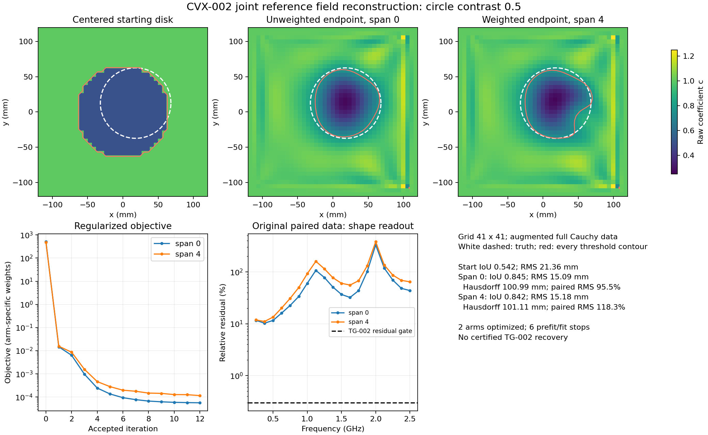
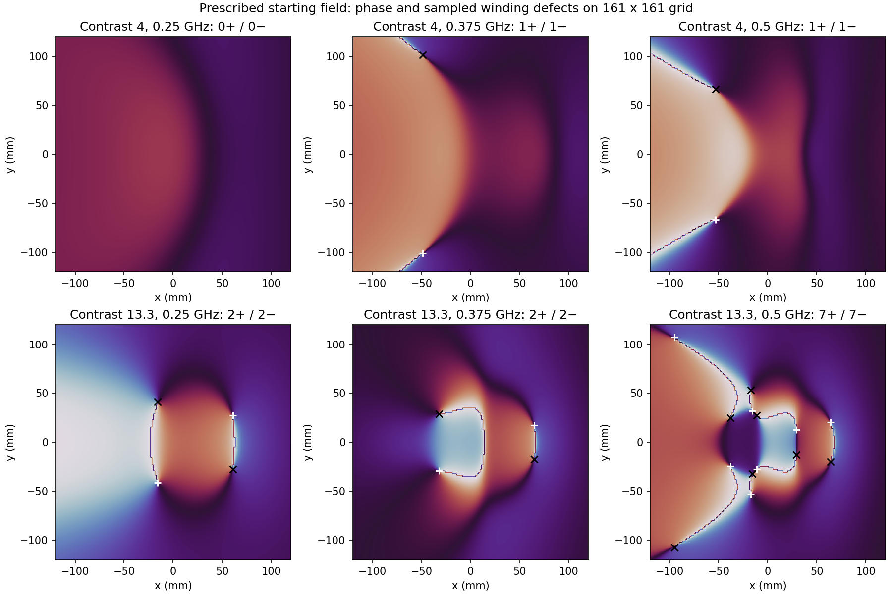

# Joint unknown reference field: implementation and numerical results

2026-10-11. Track 13, CVX-002. **The 41×41 screen, pre-registered 57×57 resolution
checks, and supplementary phase/readout diagnostics are complete.**

The implemented joint-field method produced a useful partial reconstruction
of the below-background circle from added full-boundary data. With the
unweighted 41×41 solve, occupancy IoU rose from **0.542 to 0.845**. Its main
object readout improved sampled RMS from **21.353 to 4.071 mm** and Hausdorff
distance from **37.000 to 6.920 mm**. Original paired-data RMS residual improved
from **198.125% to 95.473%**, which still fails physical recovery by a wide
margin. A tiny distant component remains in the raw threshold image; the frozen
all-contour score gives that component a minimum of 128 samples and therefore
describes a different, less favorable geometric result.

The tested Carleman-type weight did not beat the unweighted arm. At 57×57,
the unweighted main-object RMS was **4.458 mm** and its paired RMS **102.967%**;
the two grids do not establish grid convergence. Six other preselected screen
arms stopped at phase qualifications. Their discrete phase defects persisted
under the supplementary sampling refinements, so they cannot be dismissed as
a single coarse-grid anomaly.

## Evidence and experimental scope

- [Pre-registered plan](CVX-002_plan.md).
- [Sparse joint-field implementation](../../../experiments/convexification/joint_tail.py)
  and [campaign/data/readout driver](../../../experiments/convexification/cvx002.py).
- [Complete screen summary](../../../results/validation/convexification/CVX-002/screen/summary.json),
  [launch manifest](../../../results/validation/convexification/CVX-002/screen/manifest.json),
  and [executed source archive](../../../results/validation/convexification/CVX-002/screen/sources.tar.gz).
- [Algebra qualification](../../../results/validation/convexification/CVX-002/screen/algebra_qualification.json),
  [successful data qualification](../../../results/validation/convexification/CVX-002/screen/circle__c0.5/data_qualification.json),
  [unweighted endpoint](../../../results/validation/convexification/CVX-002/screen/circle__c0.5/span0/result.json),
  and [weighted endpoint](../../../results/validation/convexification/CVX-002/screen/circle__c0.5/span4/result.json).
- [Post-run validation](../../../results/validation/convexification/CVX-002/screen/validation.json),
  [numerical table](../../../results/validation/convexification/CVX-002/screen/table.csv),
  and [overview figure](../../../results/validation/convexification/CVX-002/screen/overview.svg).
- [Complete 57×57 summary](../../../results/validation/convexification/CVX-002/refinement57/summary.json)
  and [refinement launch manifest](../../../results/validation/convexification/CVX-002/refinement57/manifest.json).
- [Supplementary diagnostic plan](CVX-002_diagnostics_plan.md),
  [complete diagnostic summary](../../../results/validation/convexification/CVX-002/diagnostics/summary.json),
  [diagnostic validation](../../../results/validation/convexification/CVX-002/diagnostics/validation.json),
  [readout comparison](../../../results/validation/convexification/CVX-002/diagnostics/readout_comparison.json),
  [diagnostic manifest](../../../results/validation/convexification/CVX-002/diagnostics/manifest.json),
  and [phase figure](../../../results/validation/convexification/CVX-002/diagnostics/phase.png).

This is an augmented-acquisition feasibility screen on four frozen TG-002
targets, not the standard 30-case benchmark. It uses one existing source at
three catalog frequencies, 0.25, 0.375 and 0.5 GHz, with full Dirichlet and
outward-normal data on a source-free square enclosing the target. These are
new synthetic measurements. They cannot be obtained by relabeling the existing
paired catalog. Original paired data are used only for post-fit prediction.

Both weight arms use the same prescribed centered 65 mm circle, grid, frequency
set, data, regularization, stopping rules and single start. Interior truth
fields and a true reference field are never supplied to the optimizer. Truth
is used to generate boundary data and to score the final coefficient/readout.
The code remains isolated under `experiments/convexification`; it changes no
maintained solver default.

## Actual screen results

The following numbers concern `circle__c0.5`. The coefficient and raster metrics
include the whole auxiliary grid, with background fixed on its boundary.
Contour metrics include **all** threshold contours, including disconnected
components. They are sampled metrics, not certified geometric bounds. The
original implementation gives each contour at least 128 samples; its combined
RMS is not uniform weighting by total perimeter. The supplementary main-object
measurements below clarify this distinction without replacing the frozen score.

| Metric | Centered initial circle | Unweighted, span 0 | Weighted, span 4 |
|---|---:|---:|---:|
| Coefficient RMSE | 0.16179 | **0.08392** | 0.08784 |
| Coefficient relative error | 17.032% | **8.834%** | 9.248% |
| Occupancy IoU | 0.54167 | **0.84545** | 0.84234 |
| Area relative error | +70.320% | −14.612% | −13.242% |
| Sampled symmetric contour RMS | 21.358 mm | **15.086 mm** | 15.176 mm |
| Sampled Hausdorff distance | **39.390 mm** | 100.985 mm | 101.107 mm |
| Threshold contour count | 1 | 2 | 2 |
| Grid values outside material interval [0.5, 1] | 0% | 40.809% | 41.344% |
| Raw interior coefficient range | [0.5, 1] | [0.27017, 1.23667] | [0.26804, 1.26783] |
| Accepted nonlinear updates | — | 12 | 12 |
| Fit wall time | — | 15.93 s | 16.42 s |

Both fits stopped at the registered iteration cap. Neither met the small-step
stop: their final relative steps were 0.00714 and 0.04462, respectively. Every
accepted update used the full proposed step; the backtracking alternatives
were unnecessary in these two fits. These endpoint observations do not establish
convergence to a fixed point or a globally optimal reconstruction.

The raw threshold image's Hausdorff distance worsens because it includes a
distant second contour. This does not mean the main object's boundary worsens:
its separately measured RMS and Hausdorff distance both improve substantially.
The all-contour RMS is also sensitive to the per-component sampling floor,
as quantified below. The real coefficient is unconstrained in this prototype;
the large fraction outside the known material interval is reported rather than
hidden by display clipping.

| Auxiliary endpoint diagnostic | Unweighted | Weighted |
|---|---:|---:|
| Nonlinear objective | 5.6601e-5 | 1.1566e-4 |
| Unweighted PDE residual RMS | 7.5258e-4 | 1.7193e-3 |
| Boundary-normal relative mismatch | 0.18141% | 0.19335% |
| Minimum inferred \(|u/u_0|\) on grid | 0.68708 | 0.68713 |
| Maximum linear normalized stationarity | 1.8138e-14 | 1.6367e-14 |
| Applied interior weight range | [1, 1] | [0.57530, 13.59075] |
| Applied interior weight mean | 1 | 1 |

The weight is genuinely nonconstant: its full-grid maximum/minimum ratio is
54.598, with full-grid log span 4. The PDE uses interior points only, hence its
applied range is narrower than the full-grid range. The objectives use different
spatial weights and should not themselves be read as matched physical errors;
the unweighted PDE RMS and common geometry/prediction diagnostics provide those
comparisons. No benefit from this particular weight is demonstrated by the
successful screen case.

The large objective decrease needs context. Initial objectives were **506.48**
and **479.10**, with a common normal-mismatch contribution of **364.16**.
The initialization takes the physical centered-circle field in the interior
and overwrites its boundary values with the measured target values. This
discrete boundary lift creates large near-boundary derivative residuals.
Consequently the many-order objective reduction substantially includes repair
of that initial lift; it is not evidence of a comparable reduction in physical
shape error. After the first update, objectives were already 0.01477 and
0.01563, respectively. The subsequent improvement and final independent
metrics are the informative reconstruction evidence.

## Physical prediction improves, but does not qualify recovery

The physical readout takes the largest closed contour, resamples by arclength,
and fits Fourier band 16. Each arm discards one other component. Its smoothing
RMS is 0.0409 mm unweighted and 0.0775 mm weighted. Thus these paired predictions
test the declared single-object readout, not the entire raw volume image.

| Original paired-data check, 19 real frequencies | Unweighted | Weighted |
|---|---:|---:|
| RMS of per-frequency relative residuals | 95.473% | 118.321% |
| Maximum relative residual | 330.938% | 381.019% |
| Frequencies at or below 0.3% residual | 0 / 19 | 0 / 19 |
| Relative residual at 0.25 GHz | 11.649% | 11.866% |
| Relative residual at 0.375 GHz | 10.281% | 11.080% |
| Relative residual at 0.5 GHz | 11.607% | 13.477% |

All readout forward solves passed their N256/N512 refinement check. This
qualifies their numerical evaluation, not their fit to measurements. Even at
the three fitting frequencies, changing illumination/receivers to the original
paired catalog exposes substantial readout error. The small auxiliary residual
and boundary-normal mismatch do not transfer to a good binary shape prediction.
The reported RMS is the root mean square of 19 frequency-relative errors, not
one aggregate norm over the full catalog. These checks are not TG-002's
certified endpoint audit and support no recovery count.

The supplementary comparison evaluates the **exact prescribed initial circle**
with the same paired-data normalization and forward qualification. It also
samples each saved main-object Fourier readout and the truth uniformly by
arclength at 16,384 points. These dense sampled geometric metrics differ from
the original all-contour metrics; neither is a certified bound.
The starting geometry here is the exact prescribed circle, whereas the original
score uses its rasterized threshold contour. This explains their different
initial Hausdorff values without changing the physical initialization.

| Main-object readout | Sampled RMS | Sampled Hausdorff | Paired RMS residual | Paired maximum residual | Raw main / discarded component areas |
|---|---:|---:|---:|---:|---:|
| Exact prescribed start | 21.353 mm | 37.000 mm | 198.125% | 513.849% | — |
| 41×41 unweighted | **4.071 mm** | **6.920 mm** | **95.473%** | **330.938%** | 6728.04 / 0.73244 mm² |
| 41×41 weighted | 5.337 mm | 15.499 mm | 118.321% | 381.019% | 6741.13 / 1.14300 mm² |
| 57×57 unweighted | 4.458 mm | 7.716 mm | 102.967% | 359.205% | 6603.92 / 0.02049 mm² |
| 57×57 weighted | 4.588 mm | 7.925 mm | 105.539% | 367.564% | 6571.55 / 0.05510 mm² |

All five forward evaluations qualify numerically, and all have **0 / 19**
frequencies at or below 0.3% relative residual. Thus the main-shape and paired
improvement over the prescribed start is real within this experiment, while
the remaining physical error is substantial. The weighted main readout
improves with grid refinement; the unweighted main readout deteriorates
slightly. Neither trend supports a general grid-convergence claim.

The frozen contour scorer allocates
\(N_\ell=\max(128,\lceil P_\ell/(0.1\,\mathrm{mm})\rceil)\) points to each
component, where \(P_\ell\) is its perimeter, then pools those samples for one
direction of the symmetric RMS. Every tiny component above receives 128
points. In particular, the **0.02049 mm²** speck on the finer unweighted grid
gets the same minimum count as the much larger coarse-grid speck. Its distant
location strongly affects the pooled RMS; it also controls the all-contour
Hausdorff distance, which legitimately ignores component size. Accordingly,
the increase from 15.086 to 15.946 mm in frozen all-contour RMS must not be
described as a comparable deterioration of the main object's boundary.

Both views are preserved: the full threshold image contains a spurious distant
component, while the declared largest-component readout has a substantially
better main boundary. The supplementary comparison changes no optimizer,
endpoint selection, threshold or pre-registered refinement decision.

## Pre-registered 57×57 resolution check

Both successful screen arms met the pre-registered rule: at least 25% sampled
RMS improvement, at least 0.10 IoU improvement, and passed linear/forward
qualifications. Both were therefore rerun at 57×57, without changing the data
contract, start, weights, regularization or 12-update cap. Eligibility did not
require good paired residuals or improved Hausdorff distance; it was a
development refinement rule rather than a recovery qualification.

| Endpoint metric, circle / 0.5 | 41×41 unweighted | 57×57 unweighted | 41×41 weighted | 57×57 weighted |
|---|---:|---:|---:|---:|
| Grid spacing | 6.000 mm | 4.286 mm | 6.000 mm | 4.286 mm |
| Coefficient RMSE | 0.08392 | 0.08034 | 0.08784 | 0.08071 |
| Occupancy IoU | 0.84545 | 0.83450 | 0.84234 | 0.83217 |
| All-contour sampled RMS | 15.086 mm | 15.946 mm | 15.176 mm | 15.997 mm |
| All-contour sampled Hausdorff | 100.985 mm | 105.362 mm | 101.107 mm | 105.411 mm |
| Paired RMS relative residual | 95.473% | 102.967% | 118.321% | 105.539% |
| Paired maximum relative residual | 330.938% | 359.205% | 381.019% | 367.564% |
| Fit wall time | 15.93 s | 58.99 s | 16.42 s | 59.04 s |

The finer-grid rasterized start itself changes slightly: its IoU is 0.54351,
sampled RMS 21.050 mm and Hausdorff distance 38.010 mm. Both refined endpoints
retain substantial IoU/RMS improvement over that start, but their RMS improvement
is now below the screen's 25% eligibility threshold. Each still has two
threshold contours; the single-object physical readout again discards one.
None of the 19 original paired frequencies passes the 0.3% residual threshold.

The finer-grid auxiliary PDE RMS falls to 3.7595e-4 unweighted and 4.0365e-4
weighted; normal mismatches fall to 0.09245% and 0.09834%. Final objectives are
4.1892e-5 and 4.2506e-5. This improvement in auxiliary residuals does not provide
a consistent improvement in main-object geometry, and the frozen all-contour
score has the component-weighting limitation described above. Paired prediction becomes
worse for the unweighted arm and better for the weighted arm relative to their
own coarse endpoints, while remaining poor in both cases. The unweighted arm
still has the better coefficient, IoU, contour and paired metrics at the finer
resolution.

Both refined fits accepted all 12 full steps and stopped at the iteration cap.
Their final relative steps are 1.1437e-4 and 1.8475e-4, above the 1e-5 small-step
criterion. All 24 refined linear solves passed, with maximum stationarity
2.2328e-14 and no LSMR fallback. The full refinement campaign took **159.76 s**;
its source hashes remained unchanged. Original paired forward checks again
passed numerical refinement. Numerical evaluation is therefore qualified, but
neither iteration convergence nor spatial grid convergence is established.

The result is a mixed resolution check, not evidence that the favorable coarse
main-object RMS represents a converged boundary reconstruction. The completed
supplementary inspection distinguishes the improved main object from the
persistent tiny extra contour and records both without revising earlier scores.

## Six arms stopped before optimization

All four cases passed the nodal refinement and initial Mie/field qualification
checks before the log conditions were applied. The failures are retained as
part of the result, rather than replaced by another start or omitted from the
screen denominator.

| Target / contrast | Arms stopped | Recorded phase evidence | Interpretation |
|---|---:|---|---|
| Circle / 4 | 2 | 4 nonzero initial-grid plaquette windings; sampled minimum \(|u/u_0|=0.01557\) | Prescribed initial physical field fails the sampled global-log qualification. |
| Circle / 13.3 | 2 | 22 nonzero initial-grid plaquette windings; sampled minimum \(|u/u_0|=0.01133\) | Same starting-field obstruction, more sampled phase defects. |
| C-shape / 13.3 | 2 | Boundary winding −1 at 0.375 GHz; three-frequency sampled minimum \(|u/u_0|=0.07002\) | Measured boundary fails the single-valued-log qualification. |

The underlying records are
[circle / 4](../../../results/validation/convexification/CVX-002/screen/circle__c4/log_qualification.json),
[circle / 13.3](../../../results/validation/convexification/CVX-002/screen/circle__c13.3/log_qualification.json),
and [C-shape / 13.3](../../../results/validation/convexification/CVX-002/screen/c_shape__c13.3/log_qualification.json).
These are sampled diagnostics. Nonzero discrete winding warrants the declared
stop; the computations have not certified continuous zeros or continuous
winding. The initial-circle failures do not establish
that every possible auxiliary initialization fails. The boundary failure is
different: changing an interior starting field would not remove the recorded
boundary inconsistency. No phase branch cut was silently introduced to continue.

The supplementary diagnostics save the raw complex ratios and repeat the exact
initial-disk calculation on grids 41, 81 and 161. The positive/negative
plaquette counts are identical on all three grids:

| Initial contrast | 0.25 GHz, positive / negative | 0.375 GHz, positive / negative | 0.5 GHz, positive / negative |
|---|---:|---:|---:|
| 4 | 0 / 0 | 1 / 1 | 1 / 1 |
| 13.3 | 2 / 2 | 2 / 2 | 7 / 7 |

Every affected frequency has zero net index despite nonzero local indices.
This explains why an outer-boundary winding check alone would miss these
initial-field obstructions. From grid 81 to 161, every detected defect has a
same-sign nearest defect center within **1.061 mm**. Mie cutoff checks,
integer-index checks and discrete boundary/plaquette telescoping checks all
pass. Stable sampled counts and locations strengthen the numerical evidence;
they do not prove a continuous zero count or exclude unresolved phase motion
between samples. Raw arrays and records are preserved in
[contrast 4](../../../results/validation/convexification/CVX-002/diagnostics/initial_c4.json)
and [contrast 13.3](../../../results/validation/convexification/CVX-002/diagnostics/initial_c13.3.json).

For the measured C-shape boundary, winding remains **−1 at 0.375 GHz** with
160, 320 and 640 perimeter points. Its maximum wrapped phase increment falls
from **0.31745 to 0.16222 to 0.08155 radians**, and its sampled minimum magnitude
at that frequency remains above **0.2574**. The other two frequencies have zero
sampled winding. The independently refined forward boundary values pass their
qualification at every resolution. These
[refined boundary records](../../../results/validation/convexification/CVX-002/diagnostics/measured_c_shape.json)
make a coarse sampling accident a less plausible explanation, while remaining
a sampled qualification rather than a rigorous continuous winding certificate.

The obstruction is distinct from interface regularity. If a global smooth log
exists, \(w=u/u_0=\exp(k^2v)\) implies
\(\oint dw/w=k^2\oint dv=0\) on a closed loop. A certified nonzero continuous
winding would contradict that representation; the calculation here establishes
stable sampled evidence only. Moreover, differentiating the log introduces
\(u_k/u\), which is generally singular at a moving field zero. Cancellation
of the material-interface jump does not cancel this separate singularity.

## What was implemented and what follows mathematically

Coordinates use the repository's 50 mm length unit, with dimensionless
wavenumber \(k\). For a known incident field, put
\(a_j=\nabla\log u_{0,j}\),
\(v_j=k_j^{-2}\log(u_j/u_{0,j})\), and

\[
F_j(v_j)=\Delta v_j+k_j^2\nabla v_j\cdot\nabla v_j
 +2a_j\cdot\nabla v_j.
\]

The solver retains one real common coefficient and all complex fields:

\[
F_j(v_j)+c-1=0. \tag{1}
\]

It stores the fields in sparse coordinates, but explicitly distinguishes
\(V=v_{K-1}\) and reference secants
\(s_j=(v_j-V)/(t_j-1)\), where
\(t_j=(k_j-k_0)/(k_{K-1}-k_0)\). The inverse map is
\(v_j=V+(t_j-1)s_j\). Consequently \(V\) is a genuine unknown; no supplied
interior tail or basis-truncation inversion conceals the missing constant part.
Subtracting equations (1) eliminates \(c\), while their last-frequency equation
provides the explicit anchor relation.

CVX-001 derived \([D^2v_j]=-[c]n\otimes n\) under its local smooth-interface
and nonvanishing assumptions. Therefore \([D^2s_j]=0\). This motivates the
separate discrete \(H^2\) penalty on \(V\) and \(H^3\) penalties on the
secants. It does not place the rough reference field in \(H^3\), and it does
not prove global zero-freeness from finitely sampled minima.

For each iteration, the code freezes one factor of the quadratic term:

\[
\left[\Delta+
 (k_j^2\nabla v_j^{(p)}+2a_j)\cdot\nabla\right]v_j^{(p+1)}
 +c^{(p+1)}=1. \tag{2}
\]

The resulting weighted least-squares subproblem is real-linear after complex
stacking. Dirichlet data are imposed by elimination; normal data are penalized.
Positive zeroth-order terms in the reference/secant regularizers, together with
positive coefficient regularization, make the finite linear system injective:
zero reference and zero secants force every field to vanish, and the coefficient
regularizer forces its remaining component to vanish. Thus each regularized
subproblem has a unique minimizer. This elementary finite-dimensional fact does
not make the original nonlinear inverse objective convex or prove that the
Picard map contracts. Backtracking evaluates the actual nonlinear objective.

This implementation takes its one-factor linearization from
[Nguyen, Nguyen and Vu, 2404.04145v2, equation (2.17)](https://arxiv.org/html/2404.04145v2).
That paper treats a projected angular system with full Cauchy data and smooth,
nonvanishing fields. Its theorem does not cover this joint coefficient/reference
model, sharp-interface truth, or present finite-difference regularization.

The multifrequency precedent
[Truong, Nguyen and Klibanov, 2002.08427](https://arxiv.org/html/2002.08427)
uses an \(H^2\)-regularized auxiliary functional and boundary penalties, but
its Algorithm Step 2b also solves a forward problem after each coefficient
update. CVX-002 does not perform that physical refresh during optimization.
It is a new feasibility variant inspired by these papers, not a literal
reproduction of either published method. The qualifications and limitations
identified in [CVX-001](CVX-001_results.md) remain applicable.

## Verification and next formulation decisions

The nonlinear residual directional-derivative check was **6.22e-12** relative;
the independent full linear residual check was **2.47e-16**. Polynomial stencil
error was **1.71e-13**, and the small qualification matrix had rank **343/343**.
For the successful case, the analytic normal derivative's finer off-surface
finite-difference error was **1.34e-10**. Linear stationarity stayed below
**1.82e-14** in all 24 solves; all used scaled sparse normal equations and none
invoked the declared LSMR fallback. These checks verify implementation
consistency, not stability of the inverse problem or accuracy of the spatial
discretization across an interface.

The complete screen took **113.60 s** on the recorded host, including data
generation, both successful fits and their physical checks, and the retained
qualification failures. Source hashes remained unchanged during execution.

The supplementary diagnostic run completed in **59.50 s**, passed every
registered qualification, and preserved its source and input hashes. It
performed no new optimization and changed no saved endpoint. The three measured
campaigns total **332.86 s**; this excludes implementation and analysis time.
The combined
evidence separates three practical questions for further work:

1. **Make the field representation admissible.** The repository's fixed damped
   catalog could be tested for phase defects under a new pre-registered
   qualification. Complex damping might help, but it was not tested here and
   does not guarantee nonvanishing. A direct complex-field formulation or
   compatible local logarithm charts away from zeros could address parts of
   the observed phase structure. Charts still need a separate treatment at
   zeros. Each alternative changes the unknowns, compatibility equations and
   applicable theory. Ordinary unwrapping cannot simply remove nonzero winding.
2. **Enforce physical coefficient/readout consistency.** The successful image
   has many out-of-material-range values, a small extra component, and sizable
   binary forward error. A separately controlled trial could enforce the
   convex material interval in each linear subproblem and compare a physical
   forward refresh, as in the 2020 precedent, with the present pure auxiliary
   updates. Neither modification is validated by the current run, and a
   binary constraint would add a nonconvex restriction.
3. **Address the real acquisition gap.** The prototype still uses additional
   Cauchy data. Even a successful augmented-data reconstruction would leave
   the paired-data boundary/tail observability question from CVX-001 unresolved.
   A data adapter or a coupled sparse-data formulation needs its own explicit
   evidence; these calculations do not supply one.

The present conclusion is limited but concrete: a jointly unknown reference
field and smoother frequency secants produce a better low-contrast image,
main boundary and paired prediction than the prescribed start when supplied
with augmented Cauchy data. This weight did not improve that result; remaining
physical error is large, and the single-valued-log requirement blocks the
other preselected cases with phase evidence stable under sampling refinement.
Spatial refinement gives mixed main-object results, with no demonstrated
convergence. The evidence does not justify a
global-convergence claim, adoption as the maintained solver, or a TG-002
recovery claim.
