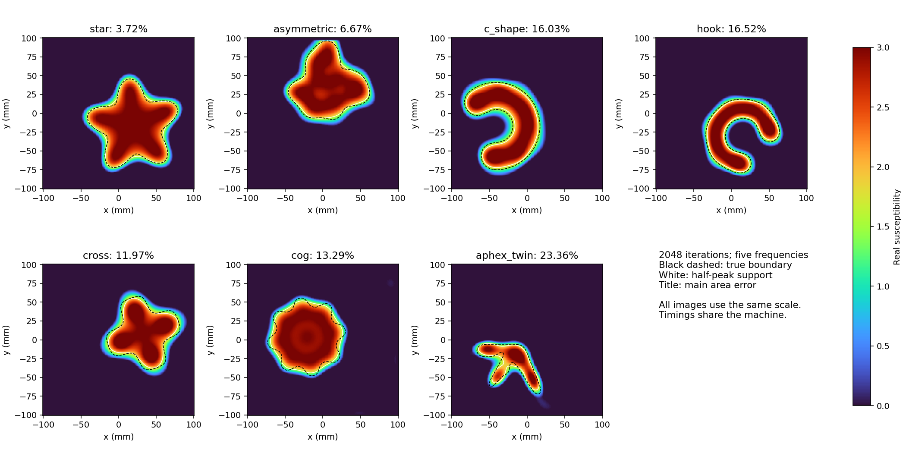

# Seven MF-CC-CSI fits at five frequencies

Run 2026-11-18T04:00:52+00:00 to 2026-11-18T07:47:29+00:00: seven outcomes in 3:46 wall time.
All seven completed 2048 iterations. Half-peak area errors range from 3.72% to 23.36%.
All cases use 0.5, 1, 1.5, 2 and 2.5 GHz, 2048 iterations, the 166 by 166 grid at 1.25 mm,
native back-propagation, one centred start and eight compute threads. No upstream numerical change.
The worker ceiling came from the resource monitor before every launch. No fit stopped on time.

| Shape | Area error % (0.5) | Sensitivity % (0.3 / 0.7) | Mean permittivity | Contrast error % | Native s | Wall s |
|---|---:|---:|---:|---:|---:|---:|
| star | 3.716 | 16.049 / 19.271 | 3.7121 | 7.197 | 4746.28 | 4756.44 |
| asymmetric | 6.673 | 13.224 / 26.235 | 3.7760 | 5.601 | 5023.79 | 5034.73 |
| c_shape | 16.034 | 10.908 / 45.107 | 3.8484 | 3.789 | 5050.57 | 5061.73 |
| hook | 16.516 | 9.623 / 44.651 | 3.8657 | 3.357 | 4957.90 | 4975.62 |
| cross | 11.970 | 12.550 / 39.278 | 3.8255 | 4.362 | 4923.65 | 4935.12 |
| cog | 13.294 | 16.542 / 16.256 | 3.7089 | 7.277 | 4871.88 | 4882.87 |
| aphex_twin | 23.360 | 28.214 / 58.064 | 3.5101 | 12.247 | 3654.55 | 3665.21 |



## Findings and limits

Star has the smallest main error (3.72%); aphex_twin has the largest (23.36%).
Mean permittivity is below truth 4 in every case, ranging from 3.510 to 3.866.
The table reports the fixed half-peak rule. The 0.3 and 0.7 scores show substantial threshold sensitivity;
the saved arrays support further scoring without another fit. Mean permittivity is compared with truth 4.
These are shared-machine times and do not establish isolated timing against BEM.
Circle, kite and peanut keep their separate eight-frequency results; this activity does not rerun them.

The first measured rate was 2.192 seconds per iteration on star, over iterations 1 to 100, excluding startup.
All seven data releases passed and used the same hashes verified by BEM. See [release evidence](releases.md)
and [full release check values](releases.jsonl). The largest release mismatch was 0.7125% on aphex_twin.

## Runs and evidence

| Shape | Start UTC | Finish UTC | State |
|---|---|---|---|
| star | 2026-11-18T04:03:05+00:00 | 2026-11-18T05:22:21+00:00 | [completed](../../../../results/csi/tg002/2026-11-18_five_frequency/star/outcome.json) |
| asymmetric | 2026-11-18T04:05:09+00:00 | 2026-11-18T05:29:03+00:00 | [completed](../../../../results/csi/tg002/2026-11-18_five_frequency/asymmetric/outcome.json) |
| c_shape | 2026-11-18T04:11:09+00:00 | 2026-11-18T05:35:31+00:00 | [completed](../../../../results/csi/tg002/2026-11-18_five_frequency/c_shape/outcome.json) |
| hook | 2026-11-18T05:23:22+00:00 | 2026-11-18T06:46:17+00:00 | [completed](../../../../results/csi/tg002/2026-11-18_five_frequency/hook/outcome.json) |
| cross | 2026-11-18T05:29:06+00:00 | 2026-11-18T06:51:22+00:00 | [completed](../../../../results/csi/tg002/2026-11-18_five_frequency/cross/outcome.json) |
| cog | 2026-11-18T05:35:34+00:00 | 2026-11-18T06:56:57+00:00 | [completed](../../../../results/csi/tg002/2026-11-18_five_frequency/cog/outcome.json) |
| aphex_twin | 2026-11-18T06:46:21+00:00 | 2026-11-18T07:47:26+00:00 | [completed](../../../../results/csi/tg002/2026-11-18_five_frequency/aphex_twin/outcome.json) |

Fit failures: none. All four raw checkpoint counts were checked at each successful finish.
The native executed-driver EOF blank line initially delayed the first publication check. A result-only
Git whitespace attribute fixed that check while preserving the driver hash. Star was then pushed;
no fit was stopped. Details and logs: [checks](checks.md). No numerical upstream patch was needed.

Compact final measurements: [CSV](../../../../results/csi/tg002/2026-11-18_five_frequency/final_summary.csv) and [JSON](../../../../results/csi/tg002/2026-11-18_five_frequency/final_summary.json).
Each case also keeps scores at 256, 512, 1024 and 2048; costs; resources; exact driver; compressed native log;
and a SHA-256 manifest. Bulk histories, truths and tables remain local and ignored. Each committed case is below 5 MB.
Protocol 1 scoring is unchanged. No BEM solver or shared scoring code was edited.

Rebuild this report and figure, without a fit:

```bash
PYTHONPATH=solvers:. OPENBLAS_NUM_THREADS=1 /home/drdeng/miniconda3/envs/EMNerf/bin/python -B docs/iterations/csi_adaptation/07_run_seven_cases_at_five_frequencies/make_report.py
```
