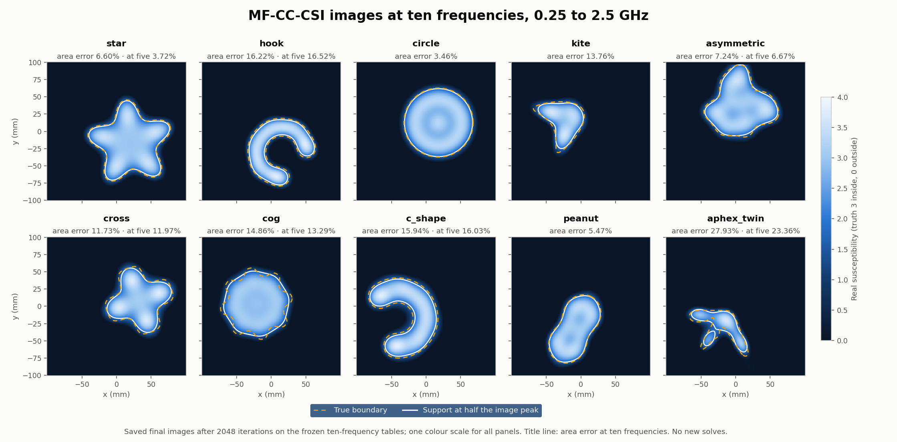
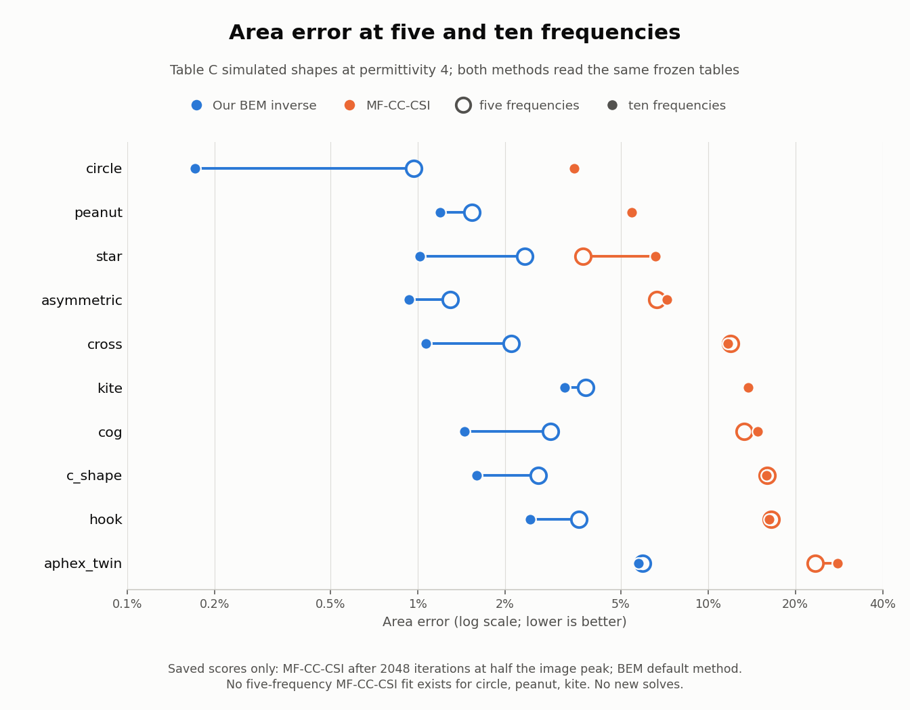

# MF-CC-CSI fits at ten frequencies

Run 2026-11-18T11:57:23+00:00 to 2026-11-18T21:12:05+00:00: 10 outcomes in 9:14 wall time.
10 of 10 fits completed; 10 reached 2048 iterations.
Half-peak area errors range from 3.46% (circle) to 27.93% (aphex_twin).

Settings: 0.25 to 2.5 GHz in 0.25 GHz steps, 2048 iterations, the 166 by 166 grid at 1.25 mm,
native back-propagation, one centred start, eight compute threads. Only the frequency list
differs from activity 07. The upstream code is unchanged. Up to three fits ran at once under
the memory rule of the plan. No fit was stopped on time.

## Ten-frequency results

| Shape | Area error % (0.5) | Sensitivity % (0.3 / 0.7) | Mean permittivity | Contrast error % | Centre error mm | Native s | Wall s |
|---|---:|---:|---:|---:|---:|---:|---:|
| star | 6.600 | 12.324 / 28.386 | 3.7970 | 5.074 | 0.094 | 10020 | 10037 |
| hook | 16.219 | 8.958 / 43.560 | 3.8793 | 3.018 | 0.692 | 8134 | 8149 |
| circle | 3.458 | 10.668 / 18.467 | 3.8232 | 4.419 | 0.055 | 10043 | 10060 |
| kite | 13.760 | 12.764 / 39.558 | 3.8104 | 4.741 | 0.578 | 9793 | 9809 |
| asymmetric | 7.240 | 11.423 / 26.734 | 3.8080 | 4.799 | 0.201 | 9882 | 9898 |
| cross | 11.725 | 12.176 / 38.966 | 3.8256 | 4.360 | 0.051 | 9860 | 9876 |
| cog | 14.859 | 18.080 / 18.239 | 3.7021 | 7.449 | 0.013 | 8232 | 8248 |
| c_shape | 15.939 | 10.316 / 44.803 | 3.8587 | 3.533 | 0.640 | 9933 | 9949 |
| peanut | 5.472 | 12.151 / 24.543 | 3.7961 | 5.099 | 0.046 | 10030 | 10046 |
| aphex_twin | 27.929 | 30.676 / 66.918 | 3.4884 | 12.791 | 1.432 | 6902 | 6918 |



## Against five frequencies and against BEM

Both methods read the same frozen table at each frequency count. BEM numbers are read from the
BEM side's saved `metrics.json` files; that side owns them.

| Shape | CSI, ten | CSI, five | CSI change | BEM, ten | BEM, five | CSI / BEM at ten |
|---|---:|---:|---:|---:|---:|---:|
| star | 6.60% | 3.72% | +2.88 | 1.02% | 2.34% | 6.5 |
| hook | 16.22% | 16.52% | -0.30 | 2.44% | 3.59% | 6.6 |
| circle | 3.46% | not run |  | 0.17% | 0.97% | 20.3 |
| kite | 13.76% | not run |  | 3.21% | 3.80% | 4.3 |
| asymmetric | 7.24% | 6.67% | +0.57 | 0.93% | 1.29% | 7.8 |
| cross | 11.73% | 11.97% | -0.24 | 1.07% | 2.10% | 11.0 |
| cog | 14.86% | 13.29% | +1.57 | 1.45% | 2.86% | 10.2 |
| c_shape | 15.94% | 16.03% | -0.09 | 1.60% | 2.60% | 10.0 |
| peanut | 5.47% | not run |  | 1.19% | 1.54% | 4.6 |
| aphex_twin | 27.93% | 23.36% | +4.57 | 5.77% | 5.96% | 4.8 |



## Findings

- MF-CC-CSI at ten frequencies over 10 shapes: mean 12.32%, median 12.74%. BEM on the same tables: mean 1.88%, median 1.32%.
- BEM has the lower error on 10 of 10 shapes. The ratio of the CSI error to the BEM error runs from 4.3 to 20.3.
- On the 7 shapes fitted by MF-CC-CSI at both counts, the ten-frequency error is lower on 3 and higher on 4. Their mean moves from 13.08% to 14.36%; the median from 13.29% to 14.86%.
- The CSI changes run from -0.30 points (hook) to +4.57 points (aphex_twin).
- BEM on the same 7 shapes moves from a mean of 2.96% to 2.04%, lower on 7 of 7.
- Mean permittivity inside the half-peak support runs from 3.488 to 3.879 against truth 4; it is below 4 on 10 of 10 shapes.
- The final half-peak support is one piece without holes on 9 of 10 shapes; aphex_twin has 2 pieces and 0 holes.

## Error during the fit

Area error at half the image peak at each saved snapshot. The reported number is the one at 2048.

| Shape | 256 | 512 | 1024 | 2048 | Lowest at |
|---|---:|---:|---:|---:|---:|
| star | 8.89% | 5.76% | 6.62% | 6.60% | 512 |
| hook | 7.40% | 9.64% | 14.45% | 16.22% | 256 |
| circle | 6.60% | 1.49% | 2.02% | 3.46% | 512 |
| kite | 12.06% | 11.24% | 13.56% | 13.76% | 512 |
| asymmetric | 6.86% | 7.86% | 8.30% | 7.24% | 256 |
| cross | 9.76% | 11.39% | 14.02% | 11.73% | 256 |
| cog | 16.95% | 16.43% | 15.85% | 14.86% | 2048 |
| c_shape | 7.94% | 14.82% | 17.29% | 15.94% | 256 |
| peanut | 8.15% | 10.33% | 8.00% | 5.47% | 2048 |
| aphex_twin | 41.96% | 36.47% | 31.99% | 27.93% | 2048 |

The error is lowest at an earlier snapshot than 2048 on 7 of 10 shapes (star, hook, circle, kite, asymmetric, cross, c_shape).
No stopping rule picks the earlier snapshot without knowing the truth, so 2048 stays the reported number.
Shapes whose error was still falling at 2048: cog, peanut, aphex_twin. More iterations might lower those; that was not tested.

## Limits

- The table reports the fixed half-peak rule. The 0.3 and 0.7 columns show how much the cut-off matters.
- Times are shared-machine times with up to three fits at once; they are not isolated timings.
- Circle, kite and peanut have no five-frequency MF-CC-CSI fit. Their separate eight-frequency results
  (circle 13.67%, kite 16.11%, peanut 21.13%) use another frequency set, so the gap to this run is not an effect of the count alone.
- One centred start and one noise-free table per shape: no spread over starts or noise is measured.

## Runs and evidence

| Shape | Start UTC | Finish UTC | Peak memory GiB | State |
|---|---|---|---:|---|
| star | 2026-11-18T11:57:23+00:00 | 2026-11-18T14:44:40+00:00 | 7.4 | [completed](../../../../results/csi/tg002/2026-11-18_ten_frequency/star/outcome.json) |
| hook | 2026-11-18T11:59:45+00:00 | 2026-11-18T14:15:34+00:00 | 7.5 | [completed](../../../../results/csi/tg002/2026-11-18_ten_frequency/hook/outcome.json) |
| circle | 2026-11-18T12:01:56+00:00 | 2026-11-18T14:49:36+00:00 | 7.4 | [completed](../../../../results/csi/tg002/2026-11-18_ten_frequency/circle/outcome.json) |
| kite | 2026-11-18T14:15:38+00:00 | 2026-11-18T16:59:07+00:00 | 7.4 | [completed](../../../../results/csi/tg002/2026-11-18_ten_frequency/kite/outcome.json) |
| asymmetric | 2026-11-18T14:44:44+00:00 | 2026-11-18T17:29:42+00:00 | 7.4 | [completed](../../../../results/csi/tg002/2026-11-18_ten_frequency/asymmetric/outcome.json) |
| cross | 2026-11-18T14:49:39+00:00 | 2026-11-18T17:34:16+00:00 | 7.4 | [completed](../../../../results/csi/tg002/2026-11-18_ten_frequency/cross/outcome.json) |
| cog | 2026-11-18T16:59:11+00:00 | 2026-11-18T19:16:39+00:00 | 7.4 | [completed](../../../../results/csi/tg002/2026-11-18_ten_frequency/cog/outcome.json) |
| c_shape | 2026-11-18T17:29:46+00:00 | 2026-11-18T20:15:35+00:00 | 7.3 | [completed](../../../../results/csi/tg002/2026-11-18_ten_frequency/c_shape/outcome.json) |
| peanut | 2026-11-18T17:34:19+00:00 | 2026-11-18T20:21:45+00:00 | 7.3 | [completed](../../../../results/csi/tg002/2026-11-18_ten_frequency/peanut/outcome.json) |
| aphex_twin | 2026-11-18T19:16:44+00:00 | 2026-11-18T21:12:02+00:00 | 7.5 | [completed](../../../../results/csi/tg002/2026-11-18_ten_frequency/aphex_twin/outcome.json) |

Fit failures: none. Alerts: none.
The tables were checked before the first fit: [table checks](../../../../results/csi/tg002/2026-11-18_ten_frequency/checks/table_checks.json).
Compact final measurements: [CSV](../../../../results/csi/tg002/2026-11-18_ten_frequency/final_summary.csv) and [JSON](../../../../results/csi/tg002/2026-11-18_ten_frequency/final_summary.json).
Each case keeps scores at 256, 512, 1024 and 2048, costs, resources, the exact driver, the compressed
native log and a SHA-256 manifest. Bulk histories, truths and tables stay local and ignored.
Protocol 1 scoring is unchanged. No BEM solver or shared scoring code was edited.

Rebuild this report and both figures, without a fit:

```bash
PYTHONPATH=solvers:. OPENBLAS_NUM_THREADS=1 /home/drdeng/miniconda3/envs/EMNerf/bin/python -B docs/iterations/csi_adaptation/08_run_cases_at_ten_frequencies/make_report.py
```
