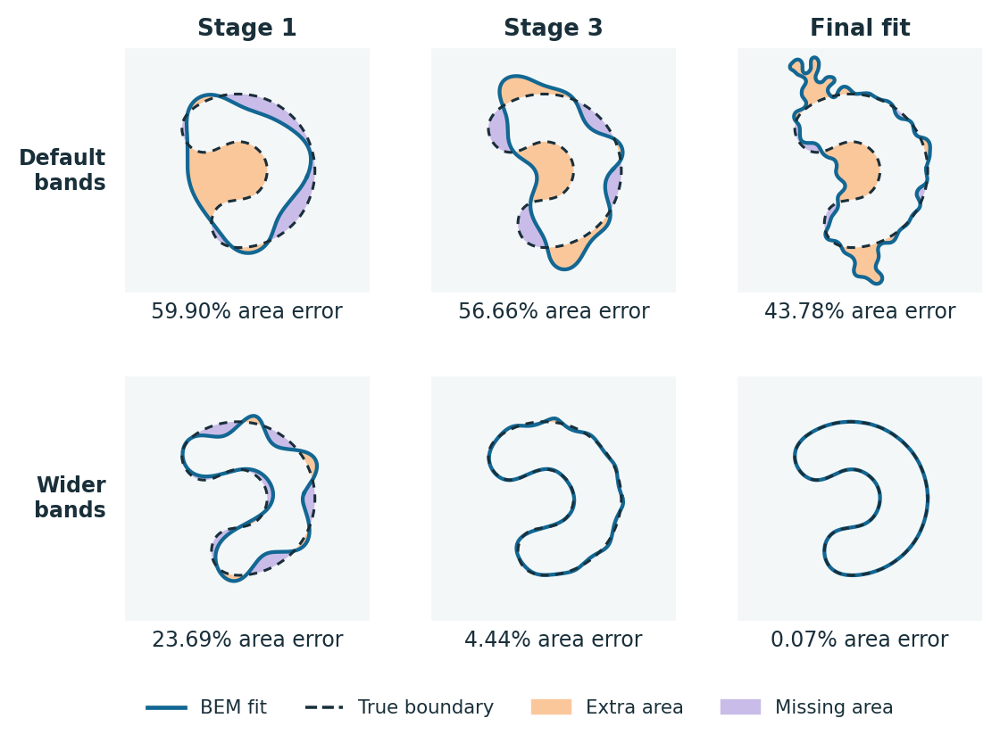

# Do early stage limits explain the contrast-4 misses?

**The early shape-update limit explains the C-shape miss.** At the same 22-step cap, two more update modes let the fit trace the opening by stage three. Raising the iteration cap alone recovered none of the three missed shapes. Cog was already a recovery.

Final area error on clean TG-002 data, 18 November 2026. Recovery requires 5% or less. Only the first four stages changed. All fits used the same centred start, estimated contrast and real data. [Plan and settings](plan.md)

| Shape | Original | More steps | Wider updates | Both changes |
|---|---:|---:|---:|---:|
| Kite | 467.38% | 486.69% | 278.87% | 493.76% |
| C-shape | 43.78% | 43.78% | **0.07%** | **0.07%** |
| Aphex Twin | 196.85% | 196.91% | 202.50% | 202.50% |
| Cog | **2.00%** | **2.01%** | **0.04%** | **0.04%** |
| Recovered | 1/4 | 1/4 | 2/4 | 2/4 |

“More steps” raised the cap from 22 to 220. “Wider updates” changed the four normal-update bands from 3/5/7/9 to 5/7/9/11. The stored curve bands, physics resolution, frequencies and later settings stayed the same. [Original fits](../../../../results/bem/default_clean_uc_fc/) · [More steps](../../../../results/bem/stage_stops/2026-11-18/longer/) · [Wider updates](../../../../results/bem/stage_stops/2026-11-18/wider/) · [Both changes](../../../../results/bem/stage_stops/2026-11-18/both/)

## Which stages were still moving?

All 16 early reference replays matched the saved curves, losses and stops exactly. Eight hit the 22-step cap. The other eight exhausted their trial steps without finding a decrease. Across all ten contrast-4 scenes, 7/12 early stages hit the cap on the three missed shapes, versus 2/28 on the seven recovered shapes. [Reference replays](../../../../results/bem/stage_stops/2026-11-18/reference/)

| Shape | Original early stages that hit the cap | Data loss decrease over steps 17–22 in those stages |
|---|---|---|
| Kite | 1, 2 | 0.102%, 0.060% |
| C-shape | 2, 3, 4 | Below 0.00001%, below 0.00001%, 0.0068% |
| Aphex Twin | 1, 4 | 0.026%, 2.97% |
| Cog | 4 | 0.0071% |

With the original bands and 220 steps allowed, all 16 early stages stopped because they found no decreasing step. Kite took 197 steps in stage one. After step 22 its loss fell another 2.00% while area error rose from 332.4% to 336.5%. C-shape took 33 steps in stage four for just 0.00010% more loss reduction.

Aphex Twin's original fourth stage was still improving. From steps 17 to 22 its area error fell from 198.50% to 196.85%. Extending all four stages changed the boundary entering stage four. It then stalled in nine steps at 196.91%. A separate stage replay tests what happens from the original entry.

## How did the shape limits change the fit?

C-shape reached 4.44% area error in stage three with wider updates, versus 56.66% with the default. Cog also improved. At the wider bands, C-shape, cog and Aphex Twin all stopped naturally before step 22 in every early stage. Their curves were identical with either cap.

**The two settings interacted on kite.** With wider updates, extending stage one from 22 to 41 steps cut its area error from 263.7% to 205.3%. By the end of stage three the same fit had grown to 493.8% error, versus 278.9% with wider updates alone. The combined run exhausted its whole-fit time in stage four before accepting a step there.

On the default path, B6 sets the normal directions the slider can try. A1 stores the curve itself. Its early bands grow from 8 to 12, 16 and 20 by adding zeros, so there is no repeated trimming at these handoffs. Cropping the *true* curves to band 8 gives 0%, 1.52%, 7.68% and 9.80% area error for kite, C-shape, Aphex Twin and cog. By band 12 all four are below 3%. This measures storage in the truth's parameterisation. It cannot tell which shape the data will favour. [B6 slider](../../../../solvers/bem_inverse/geometry_update_methods/slider.py#L92) · [A1 storage resize](../../../../solvers/bem_inverse/continuation/geometry.py#L44)

## Later stops and limits

On the default path, C12 can advance a stage when its work quota runs out. That happened to cog at bands 25, 31 and 37 after just four accepted steps each. Loss had fallen by 63%, 48% and 52% within those stages, but cog had already passed 5% area error at band 15. Its measured frontier was 94 and its time ran out at band 49. [C12 stage return](../../../../solvers/bem_inverse/runner.py#L228) · [Cog stages](../../../../results/bem/default_clean_uc_fc/cog__c4/fit.json)

C-shape also ran out of stage work at bands 25 and 31, then hit the forward solver's numerical limit at 37. Its error was already 45.33% before the scheduled removal of harmonics above 64. That cleanup changed the error by less than 0.00004 percentage points. Original kite hit the forward solver's numerical limit and Aphex Twin hit the time limit as they entered the first 19-frequency stage. Neither accepted a step there. [C-shape stages](../../../../results/bem/default_clean_uc_fc/c_shape__c4/fit.json)

These tests cover four contrast-4 scenes and one modest widening. The nominal 120-second cap checks elapsed time between operations, so an expensive solve can finish later. Later quotas were held fixed. The earlier fixed-band-37 test changed storage and later releases too, and recovered 0/10 at contrast 4. The damped warm-up and damped early stages together recovered 10/10 with the original bands and estimated contrast. The warm-up's individual effect is unresolved. [Ablations](../02_run_ablations/results.md)
