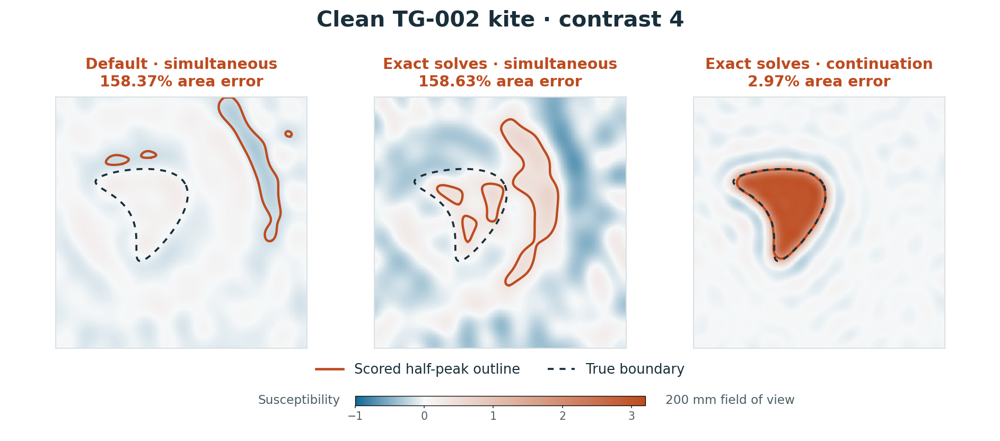

# GauGal on the clean TG-002 kite

**Only frequency continuation met the 5% area-error criterion on this case.**
The exact simultaneous fit reduced field mismatch while leaving area error
near 158%. Continuation reached 2.97% area error at its iteration caps.

| Fit | Step | Iterations and stop | Area error | Material relative L2 | Endpoint weighted squared mismatch | Optimization time |
|---|---:|---|---:|---:|---:|---:|
| [Default, simultaneous](../../../../results/gaugal/default_clean_uc_fs/kite__c4/score.json) | 0.05 | 80, cap | 158.37% | 0.96934 | 13.5471 | 323.36 s |
| [Converged, simultaneous](../../../../results/gaugal/converged_clean_uc_fs/kite__c4/score.json) | 0.05 | 578, plateau | 158.63% | 0.96478 | 10.1760 | 433.23 s |
| [Converged, continuation](../../../../results/gaugal/converged_clean_uc_fc/kite__c4/score.json) | 0.20 | 6 × 1,000, every stage capped | 2.97% | 0.26189 | 0.019462 | 2,255.98 s including pause |

The mismatch column uses the saved endpoint predictions across all 19 frequencies.
In the default fit, 2,258 of 3,059 inner solves missed tolerance.
Both dense-solve fits met tolerance on every solve.

The images share a physical frame and susceptibility scale. The orange
outline uses half the signed peak for each fit, as in scoring. The largest
magnitude in the default image is negative, so its outline encloses troughs.

## Checked field solves and the simultaneous stop rule

The converged variant projects the fixed Green matrix with GauGal’s pixel
FFT and computes the separable Gaussian mass matrix. GauGal’s dense LU
solves the forward and adjoint systems with one factorization per frequency
and coefficient update. The original pixel operators check each solution.

The relative residual limit is 1e-4 for every source. The frequency-by-
iteration arrays in `fit.npz` retain the worst relative residual over
the 24 sources for each forward, adjoint and endpoint solve.

The simultaneous variant keeps the 51-by-51 lattice, width 0.7, TV scale
0.5, step 0.05 and bounds −0.9 to 15. The original TV schedule runs through iteration
80 and holds its final weight thereafter.

The fit stops when the range of 51 successive weighted squared mismatches
is less than 1% of the first value in that window. All 51 values must
use the final TV weight. The cap is 3,000 evaluations. Both time limits
are disabled. A cap stop is recorded separately from a plateau.

## Gradient and default checks

On the clean blind kite, all 19 frequencies contributed to a central
difference at three lattice coefficients. The perturbation was 1e-4.
The calculation used complex128 and coefficients of 0.04 plus a sinusoid
of amplitude 0.02 and angular increment 0.017 per lattice index.

| Coefficient, zero-based | Adjoint derivative of half weighted squared mismatch | Central difference | Relative difference |
|---:|---:|---:|---:|
| 1134 | 0.0161402080648 | 0.0161402080687 | 2.44e-10 |
| 1300 | 0.000169199420711 | 0.000169199427112 | 3.78e-8 |
| 1635 | 0.00801431441756 | 0.00801431442310 | 6.90e-10 |

The worst checked linear residual in this diagnostic was 4.11e-16.
The fit uses the reference complex64 field precision. The stored
`default_n1d0_uc_fs` settings matched exactly. The default branch still
uses the original BiCGStab gradient, TV schedule and time limits.

The GauGal-only parser change admits the new run name through the normal
comparison CLI. The BEM parser continued to reject `converged`.

## Cumulative frequency continuation

The coordinator fixed this follow-up before the continuation run. It uses
the lowest 1, 2, 4, 8, 16 and 19 frequencies in order. Every stage uses
step 0.2 and the same 51-value plateau test, with a 1,000-iteration cap.

Only the previous stage’s endpoint coefficients initialize the next stage.
Each stage restarts momentum, the TV variables and its 80-iteration TV
schedule. The TV scale uses that stage’s frequency count. The fixed
matrices are reused across stages.

The case’s `stages.json` is written after each endpoint prediction. It
records starting and final mismatch, per-frequency field residuals,
iterations, elapsed time, stop reason and cap status.

## Clean kite with all 19 frequencies together

The fit reached its mismatch plateau at iteration 578. The last 51
weighted squared mismatches spanned 0.99947% of the first. Mismatch
fell from 19.0000 to 10.1760. Per-frequency relative field errors still
ranged from 42.01% to 105.84%. The final shape area error was 158.63%.

All 21,983 forward, adjoint and endpoint solves passed. The largest
relative residual over any source was 6.34e-7. This puts the remaining
data mismatch well above the observed linear-solver error.

Optimization took 433.23 s, or 0.750 s/iteration overall; setup took
18.66 s. The first 20 iterations took 0.571 s/iteration with two other
GauGal fits on the RTX 5090. GPU load changed later in the run.

The clean kite worker loaded commit `86232abe1` with a clean code tree.
[Fit record](../../../../results/gaugal/converged_clean_uc_fs/kite__c4/fit.json)
· [Frozen score](../../../../results/gaugal/converged_clean_uc_fs/kite__c4/score.json)

## Clean kite with frequency continuation

The final 19-frequency stage shared the GPU with BEM from 15:15:51 UTC
on 19 November. The coordinator paused GauGal from 15:16:53 until
15:18:57 UTC. Final-stage and total wall times include those 124 seconds.
The first five stages and the simultaneous fit finished before the pause.

**Clean kite area error fell to 2.9655% with continuation and step 0.2.**
The simultaneous fit at step 0.05 scored 158.63%. The continuation fit
met the 5% area criterion. All six stages reached the 1,000-iteration cap.

| Frequencies | Initial weighted squared mismatch | Endpoint weighted squared mismatch | Field residual range at endpoint |
|---:|---:|---:|---:|
| 1 | 1.0000 | 0.0017594 | 4.19% |
| 2 | 0.40222 | 0.030255 | 8.05–15.42% |
| 4 | 2.7871 | 0.0087947 | 1.96–7.10% |
| 8 | 2.1130 | 0.010958 | 1.00–6.28% |
| 16 | 5.5973 | 0.035273 | 1.00–6.95% |
| 19 | 1.4920 | 0.019462 | 0.93–5.68% |

Final field residuals in percent follow the catalog from 0.25 to 2.5 GHz
in 0.125 GHz steps.

| GHz | 0.25 | 0.375 | 0.5 | 0.625 | 0.75 | 0.875 | 1.0 | 1.125 | 1.25 | 1.375 |
|---|---:|---:|---:|---:|---:|---:|---:|---:|---:|---:|
| Error % | 0.931 | 1.225 | 2.290 | 3.150 | 2.658 | 2.505 | 2.662 | 3.064 | 2.732 | 2.729 |

| GHz | 1.5 | 1.625 | 1.75 | 1.875 | 2.0 | 2.125 | 2.25 | 2.375 | 2.5 |
|---|---:|---:|---:|---:|---:|---:|---:|---:|---:|
| Error % | 2.689 | 3.237 | 2.548 | 3.231 | 3.255 | 3.583 | 4.413 | 5.679 | 4.751 |

All 100,050 linear solves passed, with a worst relative residual of
3.63e-6. Material-field relative L2 error was 0.26189. Setup took
19.26 s. Optimization took 2,255.98 s, or 2,131.98 s after subtracting
the recorded pause. Other GPU jobs shared parts of that time.

The worker started at code commit `2296ed11d`, with a clean code tree.
[Stage records](../../../../results/gaugal/converged_clean_uc_fc/kite__c4/stages.json)
· [Fit](../../../../results/gaugal/converged_clean_uc_fc/kite__c4/fit.json)
· [Frozen score](../../../../results/gaugal/converged_clean_uc_fc/kite__c4/score.json)

## Restart rule for cumulative stages

The failed weak-contrast circle reached weighted mismatch 86.36 from
6.614 during the 16-frequency stage. Its 19-frequency adjoint later missed
the linear tolerance. The coordinator fixed the following rule before the rerun.

A nonfinite mismatch, a mismatch strictly above twice the stage’s initial
value, or a failed linear solve rejects the attempt. The adapter halves the
step and restarts from the last accepted stage’s coefficients with fresh
momentum and TV variables. Later stages inherit the reduced step.

The four halvings are shared across the whole fit. Another trigger after
the fourth halving records a failed fit. Each stage records its step,
restart count and rejected attempts in both stage and fit records.

CPU replay of all 60 saved contrast-4 stages found a maximum mismatch
ratio of 1.407234. All saved endpoint solve checks had passed. On a
five-iteration, two-frequency CPU check, enabling the rule preserved the
coefficients, image, predictions and mismatch history bit for bit.

Controlled CPU checks exercised the strict threshold, nonfinite mismatch,
solve failure, endpoint check, coefficient restart, step carry-forward and
four-halving limit, including exhaustion before the first accepted stage.
