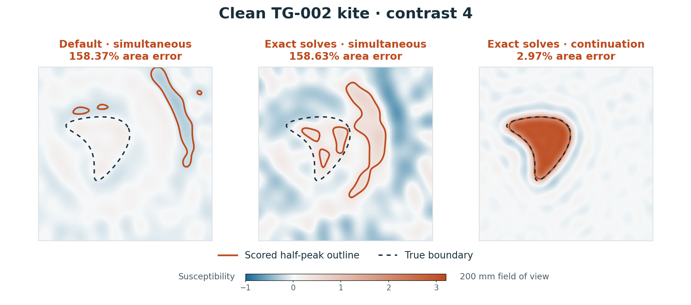

# Make the GauGal fits converge — results, 19 November 2026

Run 14:35–19:20 UTC. Written 19:25 UTC. [Plan](plan.md) ·
[code report](code_report.md) · [run report](run_report.md).

## Answer

GauGal's 0/20 on TG-002 was not caused by its early stop or its failing inner
solves. At contrast 4 the fit is trapped when all 19 frequencies are fitted
at once. At contrast 0.5 the fit is good but its soft edge costs area.

With frequency continuation GauGal recovers **9/10 at contrast 4** and
**1/10 at contrast 0.5**, against 0/20 before. One more contrast-0.5 case,
circle, scores under 5% but its fit is recorded as failed.

These numbers come from a continuation that had one defect, found at the end.
[Activity 07](../07_refit_gaugal_with_tv_warm_start/plan.md) refits all 20
cases with it removed. Use that count once it exists.

## How the plan changed

The plan guessed that the fits were only cut off early. The first checks
showed otherwise, so the work changed course three times:

1. Exact inner solves and a stop on the data mismatch (commit `86232abe1`).
   This did not help at contrast 4.
2. Frequency continuation, `gaugal/converged_<data>_uc_fc` (commit
   `2296ed11d`): six stages with the lowest 1, 2, 4, 8, 16 and all 19
   frequencies, each started from the last image, 1,000 steps at most, step 0.2.
3. A step safeguard (commit `c20b5dfeb`): if a stage's mismatch doubles, the
   step is halved and the stage restarts. At most four halvings.

Every choice used the data mismatch and solver residuals only. The `default`
variant and its saved 0/20 are unchanged.

## What was measured

**The old fits were unfinished and slow.** All 50 saved fits stopped at
80 iterations, and 69–92% of their inner solves hit the 100-iteration cap.
Raising the cap to 2,000 did not cure it: 91–93% of solves still failed
(worst residual 3%), and one evaluation took 130 s. The solver stagnates. A dense solve of the 2,601 unknowns is exact
(worst residual 3.6e-6); a six-stage fit of 6,000 steps takes about 614 s
with the GPU alone.

**Finishing the fit does not help at contrast 4.** Clean `kite__c4`, all
frequencies at once, exact solves:

| Run | Steps | Final mismatch (start 19) | Residual per frequency | Area error |
|---|---:|---:|---:|---:|
| Saved default | 80 | 13.5 | 58–101% | 158.4% |
| Exact solves, step 0.05, to plateau | 578 | 10.2 | 42–106% | 158.6% |
| Exact solves, step 0.2, 200 steps | 200 | 10.1 | — | not scored |
| Exact solves, step 1.0, 200 steps | 200 | 10.1 | — | not scored |

**The lattice can fit the data.** The true kite placed on GauGal's lattice 51
reproduces the sealed data to 0.1% at 0.25 GHz and 11% at 2.5 GHz at
contrast 4, and to 3.5% or better at contrast 0.5. So the stall near 10 is a
trap of the search, not a limit of the image.
[Script](forward_floor.py) ·
[numbers](../../../../results/_probes/gaugal_convergence/2026-11-19/forward_floor/forward_floor_kite__c0.5_kite__c4.json)

**Our BEM shows the same trap.** With all frequencies at once it recovers
0/20; with continuation 16/20. See the
[ablations](../02_run_ablations/results.md).

**Finishing the fit does not help at contrast 0.5 either.** With all
frequencies at once and exact solves, `kite__c0.5` reached a 1.0% residual
and still scored 9.98%. `circle__c0.5` stalled at 76.3%.

## Continuation on the 20 clean cases

Area error is in percent; 5% or less is a recovery. "Residual" is the worst
frequency. Seconds are the fit loop with the GPU alone, except where noted.

| Case | Saved default | Continuation | Residual | Contrast found | Boundary RMS mm | Final step | Restarts | Seconds |
|---|---:|---:|---:|---:|---:|---:|---:|---:|
| `aphex_twin__c4` | 85.8 | 10.32 | 5.4 | 3.46 | 0.95 | 0.2 | 0 | 614 |
| `asymmetric__c4` | 144.7 | **1.65** | 6.2 | 3.79 | 0.40 | 0.2 | 0 | 614 |
| `c_shape__c4` | 125.0 | **3.04** | 8.1 | 3.77 | 0.59 | 0.2 | 0 | 614 |
| `circle__c4` | 110.9 | **2.36** | 9.2 | 3.75 | 0.72 | 0.2 | 0 | 2,125 (shared GPU) |
| `cog__c4` | 125.8 | **2.80** | 7.6 | 3.71 | 0.65 | 0.2 | 0 | 614 |
| `cross__c4` | 132.3 | **2.30** | 6.6 | 3.77 | 0.49 | 0.2 | 0 | 614 |
| `hook__c4` | 116.5 | **2.55** | 10.5 | 3.66 | 0.36 | 0.2 | 0 | 614 |
| `kite__c4` | 158.4 | **2.97** | 5.7 | 3.70 | 0.61 | 0.2 | 0 | 2,256 (shared, 124 s paused) |
| `peanut__c4` | 223.7 | **1.63** | 5.8 | 3.77 | 0.32 | 0.2 | 0 | 632 |
| `star__c4` | 100.3 | **2.01** | 7.9 | 3.79 | 0.49 | 0.2 | 0 | 615 |
| `aphex_twin__c0.5` | 22.1 | 17.01 | 1.5 | 0.60 | 1.99 | 0.2 | 0 | 614 |
| `asymmetric__c0.5` | 7.2 | 5.50 | 1.1 | 0.53 | 1.21 | 0.2 | 0 | 614 |
| `c_shape__c0.5` | 10.0 | 9.21 | 1.2 | 0.53 | 1.50 | 0.2 | 0 | 614 |
| `circle__c0.5` | 71.5 | 4.70 (fit failed) | 2.1 (16 frequencies) | 0.52 | 1.19 | 0.0125 | 4 | 393 |
| `cog__c0.5` | 9.1 | **4.67** | 1.5 | 0.53 | 1.14 | 0.2 | 0 | 614 |
| `cross__c0.5` | 9.8 | 7.67 | 0.9 | 0.53 | 1.54 | 0.2 | 0 | 614 |
| `hook__c0.5` | 8.5 | 15.72 | 0.6 | 0.53 | 1.89 | 0.2 | 0 | 614 |
| `kite__c0.5` | 11.5 | 7.58 | 0.9 | 0.54 | 1.28 | 0.2 | 0 | 614 |
| `peanut__c0.5` | 9.3 | 5.41 | 1.1 | 0.53 | 1.01 | 0.1 | 1 | 621 |
| `star__c0.5` | 10.1 | 8.08 | 0.8 | 0.52 | 1.73 | 0.2 | 0 | 609 |

- **Contrast 4: 9/10.** The miss is `aphex_twin`, the hardest shape.
- **Contrast 0.5: 1/10, plus circle.** Eight cases sit between 5.4% and 17.0%.
- For reference, clean BEM on the same 20 cases: 16/20 with the original
  schedule and 19/20 with the warm-up
  ([report](../../final_comparison_report.md)). BEM fits one boundary and one
  contrast; GauGal fits an image. This is not a general ranking.

**Why contrast 0.5 still misses.** The data are fitted to about 1%. The error
is almost all missing area, in one piece, with the boundary 1.0–2.0 mm inside
the truth. The image overshoots to −0.56 to −0.60 where the truth is −0.5,
and the scoring rule cuts at half the deepest value. The lattice cell is
3.9 mm. Other thresholds do not rescue it (`kite__c0.5`: 15.0% at 0.3, 29.0%
at 0.7). A finer lattice is the likely cure; it was not tested, because dense
solves on lattice 101 would take about 60 times longer.

## Failures and faults

- **No fit ended on the plateau rule.** Of 120 stages, 118 stopped at the
  1,000-step cap while still improving slowly; one reached the plateau
  (`star__c0.5`, four frequencies) and one was rejected (circle). The
  records label these fits `STOPPED_EARLY`. The plan's test "all fits end on
  the stop rule" was not met.
- **`circle__c0.5`, first fit, ran away.** Step 0.2 on the old code: the
  16-frequency stage reached mismatch 86 with an image peak of +10.7, and the
  last stage died on the adjoint solve check. Kept in
  [failed_before_step_safeguard](../../../../results/_probes/gaugal_convergence/2026-11-19/failed_before_step_safeguard/).
- **`circle__c0.5`, refit, ended `FAILED`.** The safeguard accepted the
  16-frequency stage at step 0.05, then rejected the 19-frequency stage three
  more times and hit its limit. The scored image is the 16-frequency one.
- **Cause of those rejections: a defect in the continuation.** Each stage
  after the first reset the TV auxiliary variable to zero on a non-flat
  image. That smoothed the image at the stage start, whatever the step. On
  the circle, TV alone raised the mismatch from 0.087 to 0.337. The same
  reset acted at all 95 later stage starts of the other 19 fits; the mismatch
  rose at 21 of them, across nine fits. The proposed repair gave 0.074 on the
  circle test.
- **One restart was genuine.** `peanut__c0.5` halved its step once, at step 6.
- **The step-1.0 probe** rose between steps 60 and 100, so 0.2 was used.

## Pauses and shared GPU

- 15:16:53–15:18:57 UTC: all four GauGal fits paused at the user's order, so
  three BEM fits could finish. The GPU was shared with BEM from 15:15:51.
- 16:04:26–19:19:41 UTC: the two cap-2,000 probes and the contrast-0.5 run
  without continuation paused by the coordinator, to give the continuation
  run the GPU. They were resumed and were still running when this was written.
- 17:38:34–17:42:08 UTC: the runner held while the safeguard was written.
- `kite__c4` and `circle__c4` ran on a shared GPU; their times include that.

## Not done

- The noisy draw was not run.
- The remaining contrast-0.5 fits without continuation were still running;
  see the [run report](run_report.md) for their results.
- Contrast 13.3 was not run.

## Evidence

- This continuation run, the 20 fits in the table:
  [converged_clean_uc_fc](../../../../results/gaugal/converged_clean_uc_fc/).
  Activity 07's refit has its own run, `gaugal/tvwarm_clean_uc_fc`.
- Fits without continuation:
  [converged_clean_uc_fs](../../../../results/gaugal/converged_clean_uc_fs/).
- Probes: [gaugal_convergence](../../../../results/_probes/gaugal_convergence/2026-11-19/).
- Saved default fits: [default_clean_uc_fs](../../../../results/gaugal/default_clean_uc_fs/).
