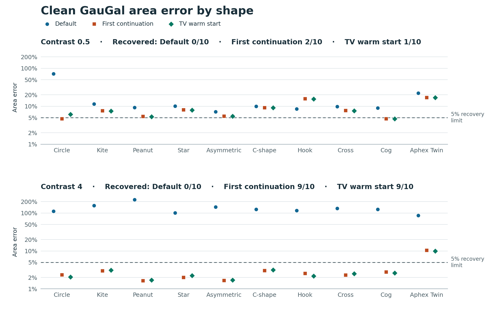

# Refit GauGal with the TV warm start — results, 19 November 2026

Run 19:29–23:00 UTC. Written 23:05 UTC. [Plan](plan.md) ·
[run report](run_report.md) ·
[activity 06](../06_make_gaugal_fits_converge/results.md).

## Answer

With the stage-start defect removed, GauGal with frequency continuation
recovers **10/20** clean TG-002 cases: **9/10 at contrast 4** and **1/10 at
contrast 0.5**. The saved untuned run recovered 0/20.

The defect was real but did not set the count. Apart from the circle, every
case moved by about 0.1 points at contrast 0.5 and at most 0.4 points at
contrast 4.

The figure counts by area alone. Its 2/10 for the first continuation run at
contrast 0.5 includes the circle, whose fit failed before its last stage.

## Answers to the plan's questions

1. **Count without the defect:** 10/20. The misses are `aphex_twin__c4` and
   nine contrast-0.5 cases.
2. **Does `circle__c0.5` complete?** Yes, all six stages. It fits the data to
   1.3% and scores 6.10%, a near miss. The first run's 4.70% came from an
   unfinished 16-frequency image and was not a fair pass.
3. **Do stages end on the plateau rule?** No. One of 120 did. The other 119
   stopped at the 1,000-step cap while still improving slowly, so the
   records label every fit `STOPPED_EARLY`.

## Settings as run

- Run `gaugal/tvwarm_clean_uc_fc`, code `ecf3bddbb`. Clean TG-002, contrasts
  0.5 and 4, recovered contrast, one centred start, protocol version 1.
- Lattice 51, width 0.7, TV weight 0.5, susceptibility limits −0.9 and 15.
- Exact inner solves (projected dense LU). All 20 fits passed every solve
  check.
- Six stages with the lowest 1, 2, 4, 8, 16 and 19 frequencies; plateau rule
  or 1,000 steps per stage; step 0.2 with the halving safeguard.
- At a warm-started stage the TV auxiliary starts from the gradient of the
  first candidate. This is the one change from activity 06.
- One runner, GPU alone. The lower-value jobs were paused 19:23–23:00 UTC.

## Scores

Area error in percent; 5% or less is a recovery. "Residual" is the worst of
the 19 frequencies. "Missing / extra" splits the area error.

| Case | Saved default | First continuation | Refit | Residual | Contrast found | Boundary RMS mm | Missing / extra | Final step | Restarts |
|---|---:|---:|---:|---:|---:|---:|---:|---:|---:|
| `aphex_twin__c4` | 85.8 | 10.32 | 9.97 | 5.2 | 3.48 | 0.95 | 6.7 / 3.3 | 0.2 | 0 |
| `asymmetric__c4` | 144.7 | 1.65 | **1.71** | 5.8 | 3.81 | 0.42 | 1.3 / 0.4 | 0.2 | 0 |
| `c_shape__c4` | 125.0 | 3.04 | **3.15** | 7.8 | 3.78 | 0.61 | 3.0 / 0.2 | 0.2 | 0 |
| `circle__c4` | 110.9 | 2.36 | **2.05** | 7.8 | 3.77 | 0.62 | 0.3 / 1.7 | 0.2 | 0 |
| `cog__c4` | 125.8 | 2.80 | **2.63** | 7.3 | 3.74 | 0.60 | 1.0 / 1.6 | 0.2 | 0 |
| `cross__c4` | 132.3 | 2.30 | **2.50** | 6.4 | 3.79 | 0.53 | 1.9 / 0.6 | 0.2 | 0 |
| `hook__c4` | 116.5 | 2.55 | **2.19** | 9.4 | 3.66 | 0.31 | 2.1 / 0.1 | 0.2 | 0 |
| `kite__c4` | 158.4 | 2.97 | **3.10** | 5.4 | 3.71 | 0.63 | 2.6 / 0.5 | 0.2 | 0 |
| `peanut__c4` | 223.7 | 1.63 | **1.72** | 5.6 | 3.78 | 0.34 | 1.5 / 0.2 | 0.2 | 0 |
| `star__c4` | 100.3 | 2.01 | **2.23** | 7.5 | 3.81 | 0.52 | 1.7 / 0.5 | 0.2 | 0 |
| `aphex_twin__c0.5` | 22.1 | 17.01 | 16.95 | 1.6 | 0.60 | 1.99 | 12.9 / 4.0 | 0.2 | 0 |
| `asymmetric__c0.5` | 7.2 | 5.50 | 5.47 | 1.1 | 0.53 | 1.20 | 5.2 / 0.2 | 0.2 | 0 |
| `c_shape__c0.5` | 10.0 | 9.21 | 9.13 | 1.2 | 0.53 | 1.49 | 9.1 / 0.0 | 0.2 | 0 |
| `circle__c0.5` | 71.5 | 4.70 (fit failed) | 6.10 | 1.3 | 0.52 | 1.55 | 6.1 / 0.0 | 0.05 | 2 |
| `cog__c0.5` | 9.1 | 4.67 | **4.65** | 1.5 | 0.53 | 1.13 | 4.2 / 0.5 | 0.2 | 0 |
| `cross__c0.5` | 9.8 | 7.67 | 7.64 | 0.9 | 0.53 | 1.53 | 7.5 / 0.1 | 0.2 | 0 |
| `hook__c0.5` | 8.5 | 15.72 | 15.63 | 0.6 | 0.53 | 1.88 | 15.6 / 0.0 | 0.2 | 0 |
| `kite__c0.5` | 11.5 | 7.58 | 7.50 | 0.9 | 0.54 | 1.27 | 7.5 / 0.0 | 0.2 | 0 |
| `peanut__c0.5` | 9.3 | 5.41 | 5.30 | 1.2 | 0.53 | 1.00 | 5.3 / 0.0 | 0.1 | 1 |
| `star__c0.5` | 10.1 | 8.08 | 7.97 | 0.8 | 0.52 | 1.70 | 7.6 / 0.4 | 0.2 | 0 |

| Contrast | Saved default | First continuation | Refit | Mean area error, refit | Median |
|---|---:|---:|---:|---:|---:|
| 4 | 0/10 | 9/10 | **9/10** | 3.13% | 2.50% |
| 0.5 | 0/10 | 1/10, plus a failed circle at 4.70% | **1/10** | 8.63% | 7.64% |

Each fit took about 614 s in the fit loop, 3.4 hours for the 20. The untuned
noisy run took a median of 328 s per case for 80 unfinished iterations.

## What the scores mean

- **Contrast 4 was a search trap, now removed.** All frequencies at once
  stalls at residuals of 42–106%. Continuation fits every case to 9.4% or
  better and recovers nine shapes to 0.3–0.6 mm boundary RMS.
- **`aphex_twin__c4` is a near miss at 9.97%**, with data fitted to 5.2%.
- **Contrast 0.5 is limited by the image, not the fit.** Data are fitted to
  0.6–1.6%. The error is mostly missing area, with the boundary 1.0–2.0 mm
  inside the truth. The image overshoots to −0.55 to −0.60 where the truth is
  −0.5, and the scoring rule cuts at half the deepest value. The lattice cell
  is 3.9 mm.
- **Three contrast-0.5 cases sit within 1.1 points of the limit:** `peanut`
  5.30%, `asymmetric` 5.47%, `circle` 6.10%.

## Against BEM, same 20 clean cases

| Method | Recovered |
|---|---:|
| BEM, original schedule | 16/20 |
| BEM, with the 0.25 GHz warm-up | 19/20 |
| GauGal, saved untuned run | 0/20 |
| GauGal, frequency continuation (this run) | 10/20 |

BEM rows are reused from the [comparison report](../../final_comparison_report.md).
BEM fits one boundary and one contrast, which suits these single-material
targets; GauGal fits an image and is scored at half its peak. The table is a
result on TG-002, not a general ranking.

## Limits

- The fits are not converged in the plateau sense; they stop at step caps.
- Step 0.2 and the six stages were fixed after tests on `kite__c4` alone,
  using the data mismatch only. No other schedule was tried.
- The lattice, width and TV weight are still the untuned 2 November values.
  A finer lattice is the likely cure at contrast 0.5 and was not tested.
- Clean data only. The noisy draw and contrast 13.3 were not run.

## Failures

- The first launch at 19:26 UTC failed before any fit: the runner refused new
  settings under the old run name. The refit then got its own run name. The
  failure records are kept in the [run report](run_report.md).
- No fit failed. Three restarts were genuine step reductions (`circle__c0.5`
  twice, `peanut__c0.5` once).

## Evidence

- Refit: [tvwarm_clean_uc_fc](../../../../results/gaugal/tvwarm_clean_uc_fc/).
- First continuation run: [converged_clean_uc_fc](../../../../results/gaugal/converged_clean_uc_fc/).
- Saved default: [default_clean_uc_fs](../../../../results/gaugal/default_clean_uc_fs/).
- Code: `experiments/gaugal_comparison/gaugal_arm.py`,
  `experiments/comparison/gaugal.py`; [code report](../06_make_gaugal_fits_converge/code_report.md).
