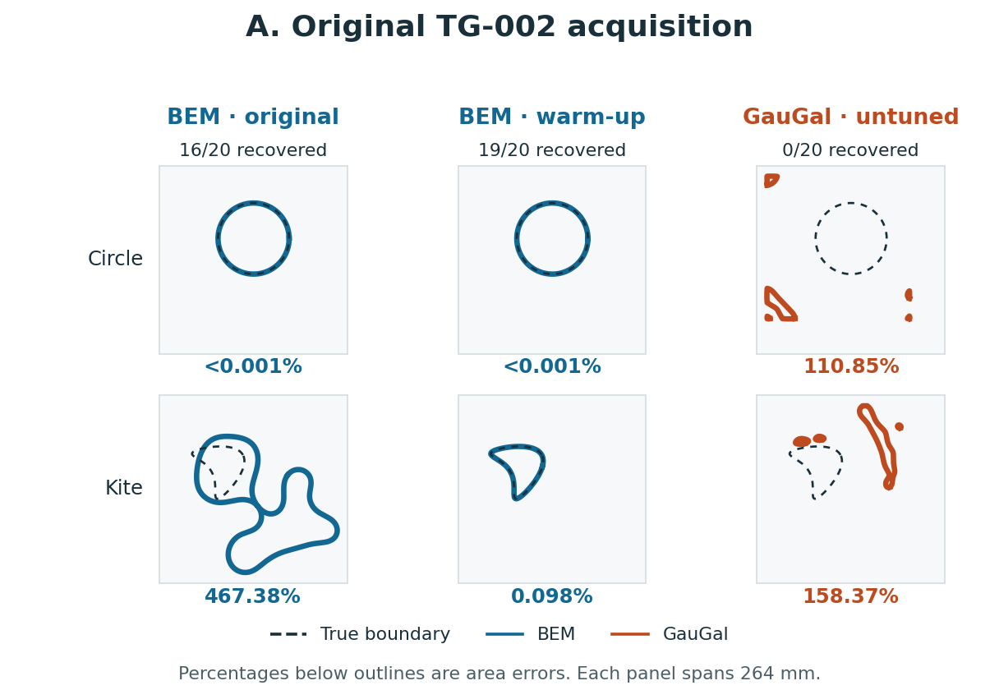
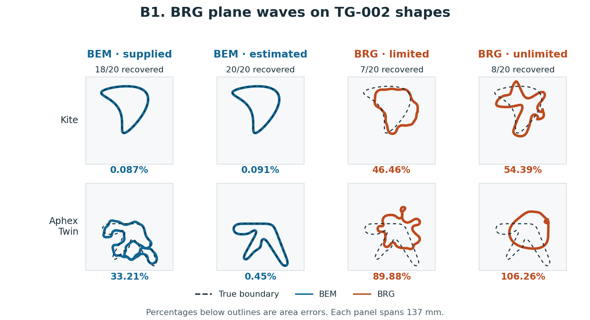
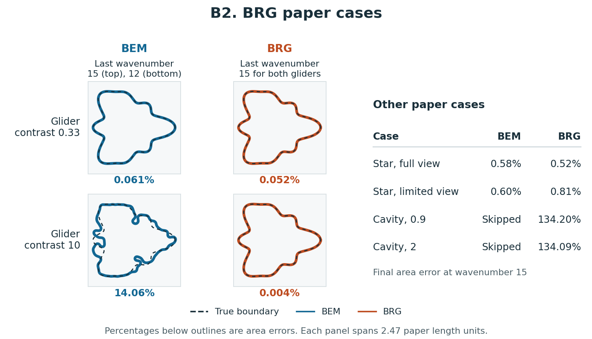
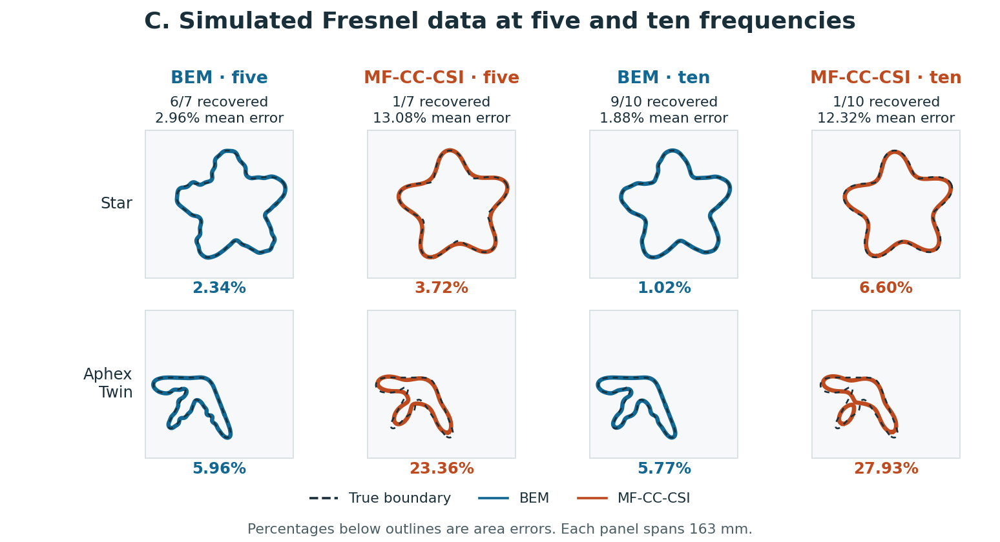
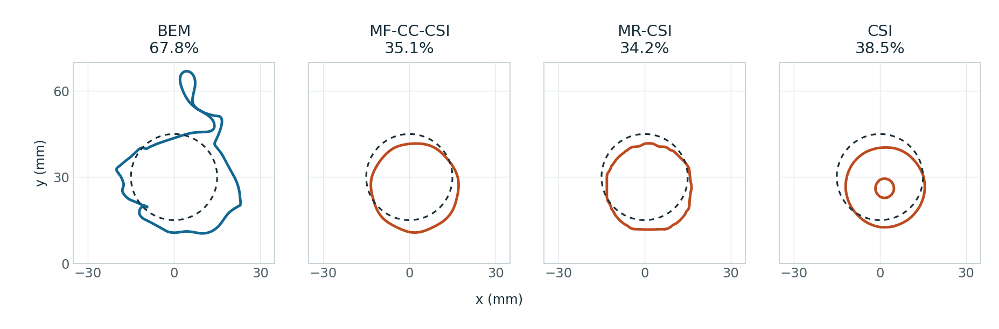

# Final shape recovery on simulated and measured data

**Table 1. Comparison settings and results, 17–19 November 2026.** Area error counts missing and extra area as a percentage of the reference area. A recovery has at most 5% area error. Image methods include every component at half the signed peak. The 16/20 in A is the original BEM schedule.

| Test | BEM | Baseline |
|---|---|---|
| A. Original TG-002, 20 clean cases at contrasts 0.5 and 4 | 16/20 recovered | Untuned GauGal recovered 0/20. With frequency continuation added on 19 November it recovered 10/20: 9/10 at contrast 4 and 1/10 at contrast 0.5. [BEM results](evaluate_our_method/01_measure_clean_and_noisy_recovery/results.md) · [Untuned GauGal](evaluate_our_method/03_record_untuned_gaugal_reference/results.md) · [GauGal with continuation](evaluate_our_method/07_refit_gaugal_with_tv_warm_start/results.md) |
| B1. Same shapes and contrasts, BRG plane-wave data | Using 19 of BRG’s 37 frequencies, BEM recovered 18/20 with contrast supplied and 20/20 with contrast estimated. Both misses were on `aphex_twin`. | With contrast supplied, BRG recovered 7/20 with its curvature limit and 8/20 without it. [BEM scores](adapt_bem_to_baseline_data/06_fit_brg_tg002_cases/final_report.md) · [BRG scores](brg_adaptation/05_run_brg_without_curvature_limit/results.md) |
| B2. Six BRG paper cases, up to wavenumber 15 | Below 1% on one glider and both star tests. The high-contrast glider stopped at wavenumber 12 with 14.1% error. Both cavities exceeded BEM’s numerical limit and were skipped. | Below 1% on both gliders and both star tests, including 0.004% on the high-contrast glider. Both cavity errors were about 134%. [BEM cases](adapt_bem_to_baseline_data/02_fit_brg_paper_cases/results.md) · [BRG cases](brg_adaptation/02_rebuild_paper_examples/results.md) |
| C. Seven simulated shapes at contrast 4, same five frequencies from 0.5 to 2.5 GHz | 2.96% mean area error, 6/7 recovered | MF-CC-CSI had 13.08% mean error, 1/7 recovered. BEM had lower error on every shape at all three image thresholds tested. [Per-shape scores](coordinate_final_comparison.md#table-c-simulated-shapes-the-numbers-18-november-0750-utc) |
| C. One measured Fresnel cylinder, 1–8 GHz | 67.85% area error with the default schedule, 36.59% with circle fitting across frequencies | MF-CC-CSI 35.12%, MF-MR-CSI 34.22%, classical CSI 38.47%. All scores use the nominal cylinder position. [Measured comparison](adapt_bem_to_baseline_data/11_test_measured_cylinder_schedule/results.md) |

## A. Original TG-002 acquisition

Ten shapes were tested at contrasts 0.5 and 4 using 24 source–receiver pairs and 19 frequencies from 0.25 to 2.5 GHz. BEM estimated contrast from one centred start. The original schedule recovered **16/20**. The current schedule adds a 0.25 GHz warm-up and recovered **19/20**. Untuned GauGal recovered **0/20**: fitting all 19 frequencies at once traps it at contrast 4. With frequency continuation, exact inner solves and its other settings unchanged, GauGal recovered **10/20**, 9/10 at contrast 4 and 1/10 at contrast 0.5. At contrast 0.5 it fits the data to about 1%, but its soft image edge on a 3.9 mm lattice leaves the area 5–17% short. [Original BEM fits](evaluate_our_method/01_measure_clean_and_noisy_recovery/results.md) · [Current BEM schedule](investigate_bem_stage_scheduling/04_adopt_warmup_and_supply_contrast/results.md) · [Untuned GauGal fits](evaluate_our_method/03_record_untuned_gaugal_reference/results.md) · [GauGal with continuation](evaluate_our_method/07_refit_gaugal_with_tv_warm_start/results.md)

*Figure 1. Circle and kite at contrast 4. The counts above the outlines cover all 20 cases in A. Extending BEM to contrast 13.3 added one recovery in ten cases, giving 20/30 overall on clean data and 20/30 on one frozen 1% noise draw.* [Thirty-case scores](investigate_bem_stage_scheduling/03_compare_schedule_effects/results.md)

### Single-frequency comparison on the same 24 pairs

At 0.5 GHz alone, BEM and classical CSI both missed the circle and kite, clean and with 1% noise. On the clean kite, the BEM outline extended far outside the target (**327.04%** error), while classical CSI covered about half of it (**50.07%**). [Single-frequency results](compare_sparse_baselines/01_test_single_frequency_csi/results.md)

*Figure 2. White dashes mark the target, gold the CSI half-peak contour, and orange the BEM outline. Both methods used the same frozen noise draw. Only BEM used the noise level for stopping.*

## B1. BRG plane waves on TG-002 shapes

BRG used 37 frequencies and received the material contrast. BEM used 19 of those frequencies. With contrast supplied to both methods, BEM recovered **18/20** and BRG recovered **7/20** with its shipped curvature limit. Both BEM misses were on Aphex Twin, one at each contrast. [BEM scores](adapt_bem_to_baseline_data/06_fit_brg_tg002_cases/final_report.md) · [BRG scores](brg_adaptation/05_run_brg_without_curvature_limit/results.md)

*Figure 3. Kite and Aphex Twin at contrast 4. Estimating contrast recovered both Aphex Twin cases and brought BEM to 20/20. Removing the curvature limit brought BRG to 8/20 overall, though its error increased on both examples shown.*

## B2. Six BRG paper cases

Both methods received the contrast. They reached wavenumber 15 with less than 1% area error on the low-contrast glider and both star tests. On the high-contrast glider, BRG reached **0.004%** at 15. BEM’s last accepted fit was **14.06%** at 12. Its numerical limit prevented the step to 15 and excluded both cavities from the reported BEM runs. [BEM paper cases](adapt_bem_to_baseline_data/02_fit_brg_paper_cases/results.md#reported-gpu-pass-18-november-2026) · [BRG paper cases](brg_adaptation/02_rebuild_paper_examples/results.md#outcomes)

*Figure 4. The two rows use the same glider geometry. At high contrast, the BEM outline developed extra lobes along the left edge. The right panel gives the full- and limited-view star results and BRG’s two cavity errors.*

## C. Simulated Fresnel shapes

BEM and MF-CC-CSI used the same simulated readings for each paired shape at contrast 4, with 1,764 source–receiver pairs per frequency. At the five frequencies in Table 1, BEM recovered **6/7** and MF-CC-CSI **1/7**. At ten frequencies from 0.25 to 2.5 GHz, the comparison covered all ten shapes. BEM recovered **9/10** and MF-CC-CSI **1/10**. [Five-frequency scores](coordinate_final_comparison.md#table-c-simulated-shapes-the-numbers-18-november-0750-utc) · [Ten-frequency scores](csi_adaptation/08_run_cases_at_ten_frequencies/results.md)

*Figure 5. The star passed for both methods at five frequencies. Aphex Twin missed for both methods at both frequency counts. Each column gives the mean over all shapes tested by both methods at that frequency count.*

## C. Measured Fresnel cylinder

All fits used the same measured cylinder at 1–8 GHz. The reference disk has radius 15 mm and nominal centre (0, 30) mm. MF-MR-CSI had the lowest nominal area error, **34.22%**. BEM gave **36.59%** when it fitted the circle across frequencies before allowing finer shape changes, and **67.85%** with the original schedule. [Measured BEM fits](adapt_bem_to_baseline_data/11_test_measured_cylinder_schedule/results.md) · [Measured CSI scores](../../results/csi/preparation/2026-11-17_frame/registered_scores.json)

*Figure 6. Dashes mark the nominal disk. Circle-first BEM estimated a radius of 15.28 mm and relative permittivity of 3.05 (nominal 3 ± 0.3). Its fitted centre was about 4 mm from the nominal position. The inner contour in the classical CSI panel is a hole in its half-peak region.* [Reference geometry](csi_adaptation/03_prepare_simulated_tg002_cases/frame.md)
