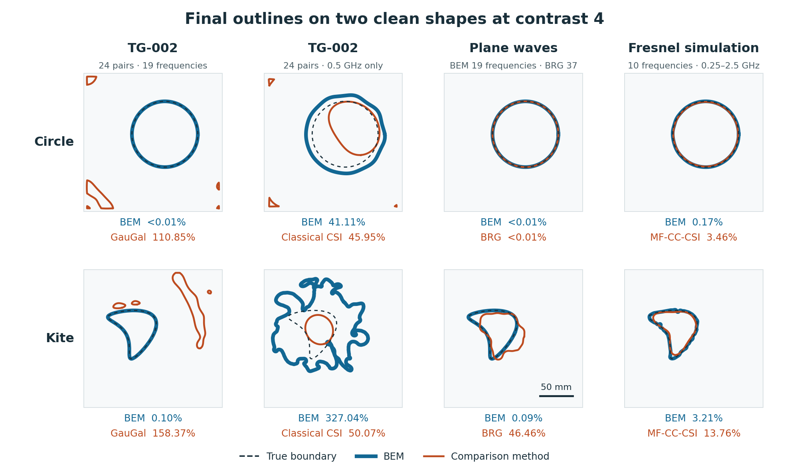

# Final shape recovery on simulated and measured data

## Simulated shapes

On the ten shapes simulated in the Fresnel layout, BEM recovered **9/10** and MF-CC-CSI recovered **1/10**, using a recovery threshold of **5% area error or less**. With just 24 readings at one frequency, both BEM and classical CSI missed the circle and kite. [Ten-shape comparison](csi_adaptation/08_run_cases_at_ten_frequencies/results.md) · [Single-frequency comparison](compare_sparse_baselines/01_test_single_frequency_csi/results.md)

*Figure 1. Circle and kite have clean fits in all four comparisons. Compare methods within each column. Only the plane-wave pair received the true contrast. Percentages give missing plus extra area divided by true area. Image methods use the contour at half the signed peak, including every component. All panels share one scale.*

| Clean data | BEM | Comparison method |
|---|---|---|
| TG-002 · 24 pairs, 19 frequencies, 30 cases | **20/30** recovered with the 0.25 GHz warm-up. By contrast, 10/10 at 0.5, 9/10 at 4 and 1/10 at 13.3. | Untuned GauGal **0/30**. [BEM results](investigate_bem_stage_scheduling/03_compare_schedule_effects/results.md) · [GauGal results](evaluate_our_method/03_record_untuned_gaugal_reference/results.md) |
| TG-002 · same 24 pairs, 0.5 GHz alone, 2 cases | **0/2**. Lower error on the circle. | Classical CSI **0/2**. Lower error on the kite. [Scores](compare_sparse_baselines/01_test_single_frequency_csi/results.md) |
| BRG plane waves · 20 cases at contrasts 0.5 and 4 | **18/20** with contrast supplied (shown), **20/20** with contrast estimated. BEM used 19 of the 37 frequencies. | BRG received the contrast. It recovered **7/20** with its shipped curvature limit (shown) and **8/20** without the limit. [BEM scores](adapt_bem_to_baseline_data/06_fit_brg_tg002_cases/final_report.md) · [BRG scores](brg_adaptation/05_run_brg_without_curvature_limit/results.md) |
| Fresnel simulation · 1,764 pairs per frequency, 10 frequencies, 10 shapes at contrast 4 | **9/10**. Mean area error **1.88%**. Only Aphex Twin missed (5.77%). | MF-CC-CSI **1/10**. Mean **12.32%**. Only the circle passed (3.46%). [All ten paired scores](csi_adaptation/08_run_cases_at_ten_frequencies/results.md) |
| Fresnel simulation · 5 frequencies, 7 shared shapes at contrast 4 | **6/7**. Mean area error **2.96%**. | MF-CC-CSI **1/7**. Mean **13.08%**. [Seven paired scores](coordinate_final_comparison.md#table-c-simulated-shapes-the-numbers-18-november-0750-utc) |

On one frozen 1% noise draw, BEM again recovered 20/30 native TG-002 cases. Untuned GauGal recovered 0/20 at the two contrasts tested with noise. [BEM noise results](investigate_bem_stage_scheduling/03_compare_schedule_effects/results.md) · [GauGal noise results](evaluate_our_method/03_record_untuned_gaugal_reference/results.md)

On BRG’s own paper examples, both methods finished below 1% on the low-contrast glider and both star tests. BRG reached 0.004% on the high-contrast glider at wavenumber 15. BEM stopped at 12 with 14.1% error. BRG’s two cavity errors were about 134%, and BEM skipped both because of its numerical limit. [Paper-case BRG scores](brg_adaptation/02_rebuild_paper_examples/results.md) · [Paper-case BEM scores](adapt_bem_to_baseline_data/02_fit_brg_paper_cases/results.md#reported-gpu-pass-18-november-2026)

## Measured Fresnel cylinder

On the measured cylinder, **MF-MR-CSI had the lowest nominal area error (34.22%)**. The other three fits ranged from 35.12% to 38.47%. All four used the same 1–8 GHz measurements and placed the cylinder centre about 4 mm from its approximate nominal position. [CSI scores](../../results/csi/preparation/2026-11-17_frame/registered_scores.json) · [BEM fit](adapt_bem_to_baseline_data/11_test_measured_cylinder_schedule/results.md)

*Figure 2. Each solid outline is the final fit. Dashes mark the nominal disk of radius 15 mm centred at (0, 30) mm. The inner contour in the classical CSI panel is a hole in its half-peak region.* [Reference geometry](csi_adaptation/03_prepare_simulated_tg002_cases/frame.md)

For this cylinder, BEM fitted position, size and material as frequencies were added, then allowed finer shape changes. It estimated a radius of **15.28 mm** and relative permittivity **3.05** (nominal **3 ± 0.3**). This cylinder-specific schedule gave **36.59%** nominal error. The original BEM schedule gave **67.85%**. [Measured BEM comparison](adapt_bem_to_baseline_data/11_test_measured_cylinder_schedule/results.md)
