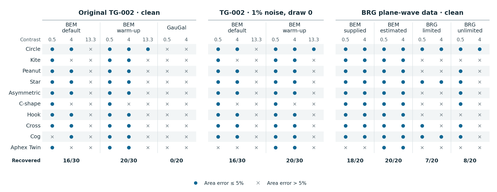
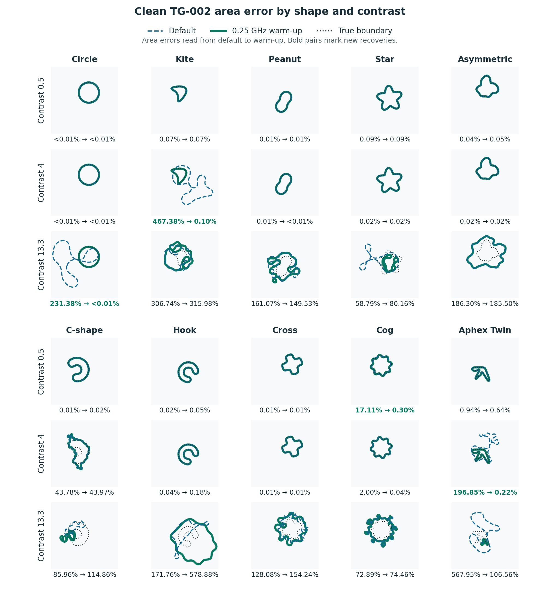
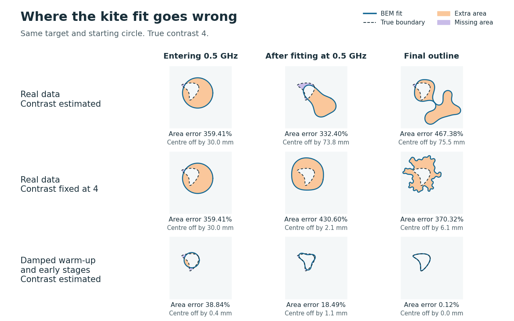
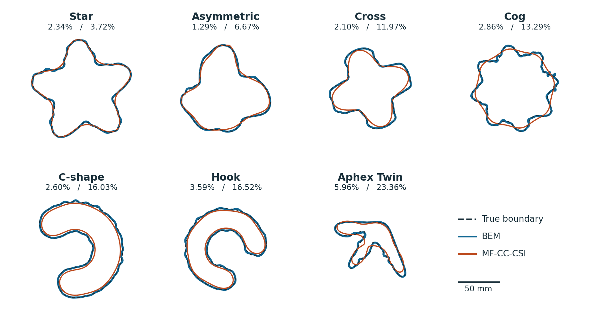

# Shape recovery on simulated and measured data

Our boundary element method (BEM) recovered more of the simulated TG-002 shapes than the baselines tested. The result changed on the one measured cylinder, where all three CSI methods had lower area error.

Area error is the missing area plus the extra area, as a percentage of true area. “Recovered” means 5% error or less. Runs took place on 17–18 November 2026.

| Test | BEM | Baseline |
|---|---|---|
| A. Original TG-002, 20 clean cases at contrasts 0.5 and 4 | 16/20 recovered | Untuned GauGal recovered 0/20. [BEM results](evaluate_our_method/01_measure_clean_and_noisy_recovery/results.md) · [GauGal results](evaluate_our_method/03_record_untuned_gaugal_reference/results.md) |
| B1. Same shapes and contrasts, BRG plane-wave data | Using 19 of BRG’s 37 frequencies, BEM recovered 18/20 with contrast supplied and 20/20 with contrast estimated. Both misses were on `aphex_twin`. | With contrast supplied, BRG recovered 7/20 with its curvature limit and 8/20 without it. [BEM scores](adapt_bem_to_baseline_data/06_fit_brg_tg002_cases/final_report.md) · [BRG scores](brg_adaptation/05_run_brg_without_curvature_limit/results.md) |
| B2. Six BRG paper cases, up to wavenumber 15 | Below 1% on one glider and both star tests. The high-contrast glider stopped at wavenumber 12 with 14.1% error. Both cavities exceeded BEM’s numerical limit and were skipped. | Below 1% on both gliders and both star tests, including 0.004% on the high-contrast glider. Both cavity errors were about 134%. [BEM cases](adapt_bem_to_baseline_data/02_fit_brg_paper_cases/results.md) · [BRG cases](brg_adaptation/02_rebuild_paper_examples/results.md) |
| C. Seven simulated shapes at contrast 4, same five frequencies from 0.5 to 2.5 GHz | 2.96% mean area error, 6/7 recovered | MF-CC-CSI had 13.08% mean error, 1/7 recovered. BEM had lower error on every shape at all three image thresholds tested. [Per-shape scores](coordinate_final_comparison.md#table-c-simulated-shapes-the-numbers-18-november-0750-utc) |
| C. One measured Fresnel cylinder, 1–8 GHz | 67.8% area error | MF-CC-CSI 35.1%, MR-CSI 34.2%, CSI 38.5%. [BEM fit](adapt_bem_to_baseline_data/03_adapt_bem_to_csi_data/results.md) · [CSI scores](csi_adaptation/03_prepare_simulated_tg002_cases/results.md) |

*Figure 1. Each pair of columns shows the same ten shapes at contrasts 0.5 and 4. A dot marks a recovery within 5% area error.*

## All 30 clean BEM fits

`default_clean_uc_fc` recovered **16/30** by the 5% area rule. At contrast **0.5**, only the cog missed (**9/10**). At **4**, the kite, C-shape and Aphex Twin missed (**7/10**). At **13.3**, all ten missed (**0/10**). [Saved run](../../results/bem/default_clean_uc_fc/run.json)

*Figure 2. Solid blue shows the final fit and dashed black shows the true boundary. Every panel uses the same position and scale. The percentage is the area error.*

**Video.** Four contrast-4 fits stopped early. The kite and Aphex Twin grew large lobes outside the target. The C-shape also included extra area even though its final contrast was 3.91, close to 4. Cog passed at 2.00% area error before the time limit. The video shades extra area orange and missing area purple. [Watch the four fits (MP4)](figures/final_comparison/contrast_4_fit_history.mp4)

*The kite started 30 mm off centre. The damped 0.25 GHz warm-up reduced that to 0.4 mm. Without a warm-up, the first 0.5 GHz fit moved the centre to 73.8 mm from the target when estimating contrast. Fixing contrast at 4 brought it within 2.1 mm, but the fitted area remained too large.*

On real data at contrast 4, supplying the true contrast recovered 2/10 shapes, compared with 7/10 when estimating it. Restoring the damped warm-up and damped early stages recovered 10/10 while still estimating contrast. The starting contrast also came from damped data in that run, so the warm-up’s individual contribution remains open. [Run settings and scores](evaluate_our_method/02_run_ablations/results.md)

**Early stage limits.** Eight of the 16 early stages on the four shapes in the video hit the 22-step limit. Raising it to 220 let all 16 run until they found no decreasing step. The same three shapes missed. Kite even lowered its first-stage data loss by another 2% while its outline got worse. [Stage-by-stage results](evaluate_our_method/04_check_stage_stops_and_shape_bands/results.md)

*At the same 22-step limit, adding two shape-update modes per early stage let BEM trace the opening of the C-shape. Both runs stored the same number of curve coefficients.*

Area error and estimated contrast for each fit

Each cell gives area error / estimated contrast and links to the saved score.

| Shape | True contrast 0.5 | True contrast 4 | True contrast 13.3 |
|---|---:|---:|---:|
| Circle | [&lt;0.01% / 0.5](../../results/bem/default_clean_uc_fc/circle__c0.5/score.json) | [&lt;0.01% / 4](../../results/bem/default_clean_uc_fc/circle__c4/score.json) | [231.38% / 1.615](../../results/bem/default_clean_uc_fc/circle__c13.3/score.json) |
| Kite | [0.07% / 0.5](../../results/bem/default_clean_uc_fc/kite__c0.5/score.json) | [467.38% / 1.871](../../results/bem/default_clean_uc_fc/kite__c4/score.json) | [306.74% / 0.005634](../../results/bem/default_clean_uc_fc/kite__c13.3/score.json) |
| Peanut | [0.01% / 0.5](../../results/bem/default_clean_uc_fc/peanut__c0.5/score.json) | [0.01% / 4](../../results/bem/default_clean_uc_fc/peanut__c4/score.json) | [161.07% / 0.0002251](../../results/bem/default_clean_uc_fc/peanut__c13.3/score.json) |
| Star | [0.09% / 0.5](../../results/bem/default_clean_uc_fc/star__c0.5/score.json) | [0.02% / 4](../../results/bem/default_clean_uc_fc/star__c4/score.json) | [58.79% / 1.938](../../results/bem/default_clean_uc_fc/star__c13.3/score.json) |
| Asymmetric | [0.04% / 0.5](../../results/bem/default_clean_uc_fc/asymmetric__c0.5/score.json) | [0.02% / 4](../../results/bem/default_clean_uc_fc/asymmetric__c4/score.json) | [186.30% / 0.3399](../../results/bem/default_clean_uc_fc/asymmetric__c13.3/score.json) |
| C-shape | [0.01% / 0.5](../../results/bem/default_clean_uc_fc/c_shape__c0.5/score.json) | [43.78% / 3.913](../../results/bem/default_clean_uc_fc/c_shape__c4/score.json) | [85.96% / 8.721](../../results/bem/default_clean_uc_fc/c_shape__c13.3/score.json) |
| Hook | [0.02% / 0.5](../../results/bem/default_clean_uc_fc/hook__c0.5/score.json) | [0.04% / 4](../../results/bem/default_clean_uc_fc/hook__c4/score.json) | [171.76% / 0.001538](../../results/bem/default_clean_uc_fc/hook__c13.3/score.json) |
| Cross | [0.01% / 0.5](../../results/bem/default_clean_uc_fc/cross__c0.5/score.json) | [0.01% / 4](../../results/bem/default_clean_uc_fc/cross__c4/score.json) | [128.08% / 0.2057](../../results/bem/default_clean_uc_fc/cross__c13.3/score.json) |
| Cog | [17.11% / 0.5115](../../results/bem/default_clean_uc_fc/cog__c0.5/score.json) | [2.00% / 4.002](../../results/bem/default_clean_uc_fc/cog__c4/score.json) | [72.89% / 0.3849](../../results/bem/default_clean_uc_fc/cog__c13.3/score.json) |
| Aphex Twin | [0.94% / 0.4999](../../results/bem/default_clean_uc_fc/aphex_twin__c0.5/score.json) | [196.85% / 2.067](../../results/bem/default_clean_uc_fc/aphex_twin__c4/score.json) | [567.95% / 2.231](../../results/bem/default_clean_uc_fc/aphex_twin__c13.3/score.json) |

## Conclusions and limits

**At contrast 13.3, the 17 November real-only BEM run recovered 0/10.** It estimated the starting contrast at 0.25 GHz, then fitted the shape at 0.5 GHz, adding 0.75, 1 and 1.25 GHz in turn. All ten clean fits reached the stage using all 19 real frequencies from 0.25 to 2.5 GHz in 0.125 GHz steps. There was no damped warm-up. [Run settings](../../results/bem/default_clean_uc_fc/run.json) · [Case scores](../../results/metrics.csv)

The 4 October BEM run recovered **26/30 overall, including 8/10 at 13.3**, with contrast supplied. It used the same frequency band, a damped 0.25 GHz warm-up and damped early stages before switching to real data. The earlier runs used boundary and field checks. A later set of damped fits that estimated contrast also met those checks on 26/30 overall, including 7/10 at 13.3. The 17 November damped comparison covered only contrasts 0.5 and 4, so it cannot isolate the cause of the drop at 13.3. [October results](../../../Neural_SDF_BEM_AD/results/validation/cleaned_interfaces/PC-001/README.md) · [October schedule](../../../Neural_SDF_BEM_AD/results/validation/cleaned_interfaces/PC-001/M1/runs/circle__c13.3/plan.md) · [Later case scores](../../../Neural_SDF_BEM_AD/docs/iterations/gaugal_comparison/iteration_01/comparison.csv) · [November comparison](evaluate_our_method/02_run_ablations/results.md)

With 1% noise, the 17 November BEM run still recovered 0/10 at contrast 13.3. At contrasts 0.5 and 4, it recovered 16, 17 and 17 of the same 20 cases across three draws. GauGal recovered 0/20 on the first draw with untuned settings. Only BEM used the noise level to decide when to stop. [BEM results](evaluate_our_method/01_measure_clean_and_noisy_recovery/results.md) · [GauGal settings](evaluate_our_method/03_record_untuned_gaugal_reference/results.md)

**The simulations suit BEM’s assumptions.** Each object has one boundary and one material value. BEM fits both directly. CSI estimates an image, scored at half its peak. BEM recovered 9/10 shapes at five frequencies and estimated contrast within 0.14% of 4. CSI ran circle, kite and peanut only at eight frequencies, so the paired mean covers seven shapes. [Five-frequency results and separate eight-frequency scores](coordinate_final_comparison.md#table-c-simulated-shapes-the-numbers-18-november-0750-utc)

*Figure 3. Area errors under each shape name are BEM first, then MF-CC-CSI. The dashed line is the true boundary. All panels use the same scale.*

**On measured data, BEM found a cylinder that was too large and too weak.** Its area corresponded to a circle of radius 19 mm against the known 15 mm. Its relative permittivity was 2.19 against a nominal 3 ± 0.3. A separate circle fit found 15.3 mm and 3.05 on the same data. The measured centre is approximate, so that uncertainty affects every method’s area score. [Cylinder fit and check](adapt_bem_to_baseline_data/03_adapt_bem_to_csi_data/results.md) · [Reference geometry](csi_adaptation/03_prepare_simulated_tg002_cases/frame.md)

*Figure 4. Solid lines show the fitted boundaries. The dashed circle is the nominal cylinder at its reported position. Each percentage is the area error.*

**Timing depends on hardware and load.** On the seven shared simulations, BEM took 47–247 seconds per fit on a GPU. MF-CC-CSI took 3,655–5,051 seconds on CPU threads, often with several fits running at once. These times describe this setup. [Run conditions](csi_adaptation/07_run_seven_cases_at_five_frequencies/results.md)
