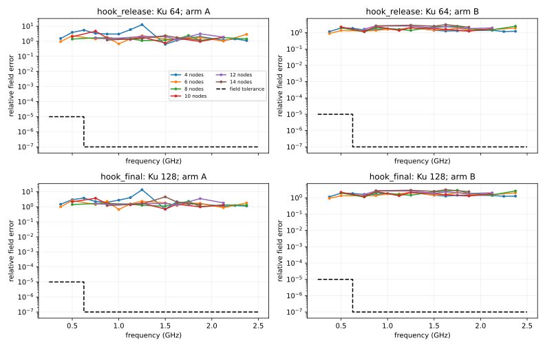

# FI-001: full-band polynomial interpolation is not accurate

**Questions:** can 4–14 exact frequencies replace 19 at a fixed saved curve,
meet the endpoint field/Jacobian tolerances, and save at least 25% of physics
time? Does contrast 13.3 cause a special failure?

**Answer:** neither tested arm passes any of the 36 curve/arm/node settings.
The smallest passing node count is unknown. This rejects this polynomial
implementation; it does not reject every possible frequency surrogate.

The three planned saved curves were evaluated once as exact references,
then at each planned node set. No inverse fits, extra curves, extra
frequencies, family tuning or solver changes were run.

## Main numbers

At 14 exact nodes, the five held-out frequencies are 0.875, 1.25, 1.5,
1.625 and 1.875 GHz. All five fail the field tolerance in every row below.
The full 36-row [table](../../../../results/validation/cleaned_interfaces/FI-001/table.md)
also includes 4, 6, 8, 10 and 12 nodes.

| Curve | Arm | Worst field error | Worst stacked J error | Exact s | Interpolated s | Raw saving |
|---|---|---:|---:|---:|---:|---:|
| hook, K24/Ku64 | A: matrix | 2.345 | 4.431 | 1.047 | 0.859 | 18.0% |
| hook, K24/Ku64 | B: results | 3.147 | 1.387 | 1.047 | 0.834 | 20.3% |
| hook, K136/Ku128 | A: matrix | 4.596 | 45.426 | 5.872 | 5.466 | 6.9% |
| hook, K136/Ku128 | B: results | 3.123 | 1.668 | 5.872 | 5.358 | 8.8% |
| peanut c4, K192/Ku128 | A: matrix | 0.139 | 0.127 | 5.661 | 4.559 | 19.5% |
| peanut c4, K192/Ku128 | B: results | 2.668 | 0.691 | 5.661 | 4.474 | 21.0% |

These are relative errors. Field limits are 1e-7 above 0.5 GHz and 1e-5
at or below it. The Jacobian limit is 1e-3 on the worst observed-normalized,
frequency-stacked column, matching the benchmark's endpoint check.

CPU timings use cores 0–5, one frequency at a time and single-thread BLAS.
Across table rows, one-minute load was 0.06–1.27; GPU snapshots were 0%
utilization with 900–1606 MiB allocated. Each JSON row records both ends.

At smaller node counts, raw savings can exceed 25%, but the errors remain
unacceptable. At 14 nodes, even the raw savings are below 25% on all curves.
There is no accurate saving to estimate for a whole inverse fit.

## What fails, using only the saved outputs

Hook matrix interpolation is worst at 1.5 GHz at 14 nodes; direct output
interpolation is worst at 1.625 GHz. Peanut's corresponding worst
frequencies are 1.625 and 1.25 GHz. These are interior held-out points.

The best field errors over all six node sets are 2.345/2.072 for hook Ku64,
2.328/2.145 for hook Ku128, and 0.139/1.620 for peanut, in A/B order.
Even the best row misses its field threshold by at least 1.39 million times.

At 14 nodes, peanut's matrix-arm errors range from 0.0408 to 0.139 across
the five held-out points. Hook's corresponding ranges are 1.187–2.345
and 1.212–4.596. Failure is spread across the interval.

The largest normalized change between adjacent exact field vectors is
1.861 and 1.872 for the hook states, both between 2.25 and 2.375 GHz.
Peanut reaches 1.582 between 2 and 2.125 GHz.

Field norms vary by factors 6.33, 6.00 and 5.11; Jacobian Frobenius norms
vary by 30.49, 35.15 and 10.09, respectively. These sampled responses
are not slowly varying complex outputs over the full band.

This supports oscillatory or channel-dependent frequency variation as a
problem for the chosen polynomial. It does not establish narrow resonances:
19 samples cannot resolve sharp behavior between catalog frequencies.

Contrast 13.3 is not required for failure: peanut at contrast 4 also fails.
The hook failures are larger, but shape and contrast differ together.
This study cannot separate their effects.

[Local Jacobian errors](../../../../results/validation/cleaned_interfaces/FI-001/jacobians_by_frequency.svg)
are diagnostic; their 1e-3 line is not the stacked-column decision rule.
[Exact response norms](../../../../results/validation/cleaned_interfaces/FI-001/exact_response.svg)
show the same saved reference data without interpolation.

## Meaning for D02 and Haibing's items

**D02:** do not replace the exact frequency catalog with this full-band
polynomial in production. A different family, phase removal or local
frequency intervals would require a new plan and independent evaluation.

None of items 2, 7 and 9 was tested here. This study tests a D02 idea;
the notes below only show where its numbers touch those items.

**Item 2 (not tested):** sharing exact geometry remains useful. The fresh
reference contexts spend 18–37% of their CPU time on A1 and 59–78% on A2.
Smooth scalar frequency dependence does not ensure a low polynomial degree.
No Ψ_j closed form or band structure was built.

**Item 7 (not tested):** Arm A actually skips held-out assembly; a projected
model that still assembles every full matrix has a different cost. Arm B
also skips held-out waves and solves, but its output error prevents using
that saving. No reduced model was built.

**Item 9 (not tested):** recursive linearization remains the context for the 19-frequency
catalog. These fixed-curve results give no evidence that dropping frequencies
preserves recovery. No fit or continuation policy was changed.

These interpretations refer to [Haibing's review, items 2, 7 and 9](../../../../Haibing_directions.md),
[D02](../../../directions.md#d02-reuse-a-library-of-physical-responses), and
the [benchmark tolerances](../../../../experiments/benchmark/audit.py).

## Execution details and limits

The fixed family is barycentric polynomial interpolation in real wavenumber.
The nested endpoint-first discrete Leja order is catalog indices
0, 18, 9, 14, 3, 16, 1, 6, 12, 17, 2, 7, 15, 4.

Every node set has a fresh production physics context, charging A1,
lazy radial bases, node matrices, waves, LU, fields and reciprocal Jacobians.
Arm A adds actual held-out interpolation, waves, LU and reciprocal solves.

The node work is shared when comparing A and B. Arm B adds measured field
and Jacobian interpolation. The saved update coordinates remain fixed:
hook slider M11/M67 and peanut spectral M37.

B6 update-basis preparation is outside physics and is excluded equally.
The original timer omitted the final `np.stack` packing of node arrays,
so the reported savings are optimistic. This cannot rescue any failed row.

The timer was tightened afterward for future runs, without changing or
rerunning the evidence. The measured source is commit `17e0a64c5`, SHA256
`08f396a4a83670d9fe117ae3bc4bd153d14e26896adac3067f49f3268874b2ed`.

Timing was CPU-only to leave CUDA available to the parallel study. GPU
snapshots were idle; this departs from the planned idle-GPU timing preference.
These numbers make no claim about production CUDA savings.

H3's saved final stage actually stores K136/Ku128, not the plan's K192.
M61/M67 accept no new step; the final state carries M55's accepted curve
through storage promotions. Its exact source path/hash is in the manifest.

The two hook states are different accepted geometries and stage settings,
not one curve evaluated at two resolutions. Reference accuracy means
agreement with the production CPU solver at each saved resolution.

Only three saved curves and six node sets were tested. Node counts above
14, rational models, coefficient-specific interpolation, damped frequencies,
and the reasons for matrix sensitivity remain untested.

Peak resident memory was 799, 1259 and 2339 MiB; all were below 6 GB.
No GPU was used by this track. The historical deadline
was removed by the user's current instruction.

## Checks and evidence

All six interpolants reproduced degree n−1 polynomials to below 1e-11.
On every curve, the held-out solve implementation replayed an exact training
matrix against production fields and Jacobians within relative 1e-13.

Plots were inspected visually. No unrelated test suite or documentation
checks were run. All 36 numerical comparisons and the same-output failure
analysis completed; there were no failed executions or additional fits.

- [Execution choices](04_execution.md) and [original plan](03_plan.md).
- [Run manifests, exact outputs and per-setting JSON](../../../../results/validation/cleaned_interfaces/FI-001/).
- [Full machine-readable table](../../../../results/validation/cleaned_interfaces/FI-001/table.csv).
- [Saved-response analysis](../../../../results/validation/cleaned_interfaces/FI-001/response_analysis.json).
- [Prototype](../../../../experiments/frequency_interpolation/study.py) and
  [analysis code](../../../../experiments/frequency_interpolation/analyze.py).
