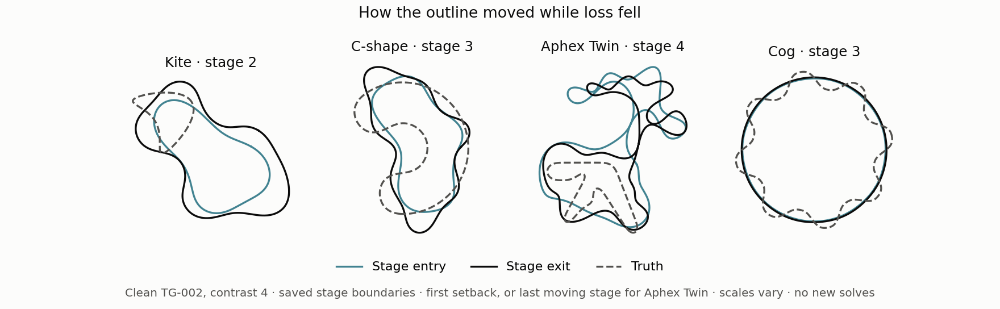
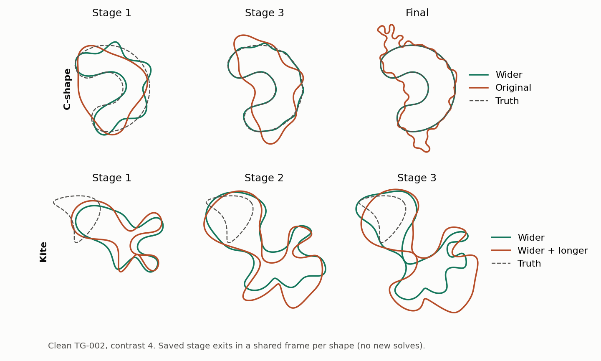

# Which limit changed each recovery?

**Stages do advance while the fit still moves, but that cost no recovery.** Eight of 16 early stages hit the 22-step cap with loss still falling. Raising the cap to 220 recovered no further shape. **The shape band did cost one recovery.** C-shape's first stage, at update band 3, closed the opening, and no later stage reopened it. Kite and Aphex Twin miss for a reason that neither limit explains.

18 November 2026. Four clean TG-002 contrast-4 fits: one centred start, real data, estimated contrast, no warm-up, no localization. Recovery means area error of 5% or less. No fit ran in this activity; every number comes from saved records. [Plan and briefs](plan.md) · [Stage-stops note](stage_stops.md) · [Shape-bands note](shape_bands.md)

| Shape | Final error | First stage that goes wrong | Stage stops | Shape bands |
|---|---:|---|---|---|
| Kite | 467.38% | Stage two, in all four settings | Did not change the recovery | Wider helped (278.87%), still a miss |
| C-shape | 43.78% | Stage one closes the opening | Did not cause the miss; later stops kept it | **Caused the miss.** Wider early bands reach 0.07% |
| Aphex Twin | 196.85% | None; far off from the start | Cap at stage four cost 0.22 points; the time limit ended the fit | No help (202.50%) |
| Cog | 2.00% | Stage three, regained in stage four | Passed despite one cap and four quota stops | Wider passes in stage three, not six (0.04%) |

## Stage stops

Across the 32 stages of the four original fits there were 12 iteration caps, 10 exhausted trial searches, six stage work quotas, two whole-fit time limits and two forward-solver refusals. Each label was checked against its counts and the code that sets it. [Every stage, with work, time and refusals](stage_stops.md#every-stage-of-the-original-fits) · [How each stop arises](stage_stops.md#how-the-five-stops-arise-on-the-default-path)

- **Early cap.** All eight capped early stages had lower loss at step 22 than at step 21. Over steps 17 to 22 the loss fell by 0.0000008% to 2.97%. Seven improved the outline too; kite's first stage lowered loss and worsened the outline. [Matched steps](stage_stops.md#was-the-fit-still-improving-at-the-cutoff)
- **Late work quota.** From band 25 on, each stage has 304 work units. That allowed three or four accepted steps. It stopped C-shape at bands 25 and 31 while loss fell 3.9% and 2.6% within the stage, and cog at bands 25 to 43 after it had passed.
- **Time and forward solver.** Aphex Twin spent 104 of its 120 seconds in the four early stages, 66 of them in stage four with 184 refused trial curves. Kite's stage-five entry and a C-shape candidate at band 37 exceeded the forward solver's limit.
- **Healthy fits.** The seven recovered shapes hit the early cap in two of 28 stages, against seven of 12 on the three misses. Cog and cross both had a small setback in stage three and regained it in stage four. A cap or a setback alone did not decide the outcome. [Controls](stage_stops.md#what-healthy-stages-looked-like)

## Shape bands

On the default path, A1 stores the curve and B6 sets the normal directions the slider may try. The A1 resize at each handoff only adds zeros; every earlier coefficient carries over exactly. The limit that mattered is B6's update band. [Measure and its limits](shape_bands.md#how-much-of-the-gap-could-a-stage-move) · [Handoffs](shape_bands.md#what-carried-into-the-next-stage)

- **C-shape.** After stage one the original fit covered 99.47% of the true opening; with update band 5 it covered 1.76%. Both runs had the same storage and both stopped before the cap. The original still covered 56.62% at the end, against 0.02%.
- **Later bands could express the fix and did not complete it.** At C-shape's first full-frequency stage, 16.76 mm of the gap was reachable and 1.22 mm was not. Stages five to nine moved towards the truth, from 58.40% to 43.78%. Three hit the cap, two the quota, and the forward solver refused the next. [Later stages](shape_bands.md#what-later-bands-corrected)
- **Kite.** The reachable gap was 40 to 69 mm in every early stage, against 1 to 11 mm outside the band. Kite does not lack directions. In the wider second stage, a 23.27 mm move had 0.36 mm towards the truth.
- **Kite's interaction.** The two wider runs match exactly to step 22 of stage one. The longer one took 19 more steps, improved to 205.32%, then lost the lead before step 17 of stage two. Its stage-one exit crosses itself twice on the 16,384-point scoring grid and passes at 1,024 points; the coordinator repeated that check. [Where the runs part](shape_bands.md#where-the-two-wider-kite-runs-separated)

## Where the evidence ends

- **Kite and Aphex Twin.** In all four settings kite's second stage lowers loss while area error jumps (332% to 518%, 336% to 453%, 264% to 351%, 205% to 399%) and the contrast estimate falls to about 2.0. Aphex Twin's estimate stays between 1.9 and 2.4 in every stage of every setting. The seven recovered shapes are at 3.86 to 4.02 after stage two. This is an observation from the [saved stage records](../../../../results/bem/stage_stops/2026-11-18/), not a tested cause. The earlier ablations bear on it: the damped warm-up with damped early stages recovered 10/10, and fixing contrast at 4 recovered 2/10. [Ablations](../../evaluate_our_method/02_run_ablations/results.md)
- **C-shape.** The four early bands were widened together. Whether widening only stage one is enough is untested. So is how far the later stages would get with more work.
- **Crossing check.** The slider accepted two kite curves that cross themselves on a finer grid, both in the diagnostic wider runs. The original fits were not checked for this.
- **Scope.** Four contrast-4 shapes and one widening. Later-stage steps of the original fits have only entry and exit scores.

## New runs

None was launched, and the two questions do not need one. The agents recorded three small comparisons with commands, budgets and output paths:

| Comparison | Budget | What it would settle |
|---|---|---|
| [Kite stage two alone, cap 220](stage_stops.md#what-remains-open) | One stage, at most 1,250 units, about 119 s | Whether that stage gains anything past step 22 from its original entry |
| [C-shape band-25 stage, quota 1,500](stage_stops.md#what-remains-open) | One stage, about 79 s | How much progress the 304-unit quota cut off |
| [Kite first stage to step 41, traced](shape_bands.md#evidence-limit-and-smallest-follow-up) | One stage, 41 steps | When the curve first crosses itself, and with a dense check, whether that caused the reversal |

Coordinator's reading, not a user decision: kite misses with or without the extra steps, and C-shape's cause is already identified, so none of the three changes a verdict. The step that would change the method is outside this activity's limit of small comparisons: test update bands 5, 7, 9, 11 on all TG-002 cases before considering them as the default.

## How this was done

Two Codex agents (GPT-6.2-Astra, high effort) worked in Herdr panes from 15:45 to 15:54 UTC, sandboxed, on saved records only. The coordinator checked the stop counts against the ten original `fit.json` files, the per-stage contrast and area error in all four settings, the opening measure and the kite crossings. No failure and no rerun.

- Stage stops: [script](../../../../experiments/comparison/trace_stage_stops.py) · [stage table](../../../../results/bem/stage_scheduling/2026-11-18/stage_stops/original_stages.csv) · [matched steps](../../../../results/bem/stage_scheduling/2026-11-18/stage_stops/matched_steps.csv)
- Shape bands: [script](../../../../experiments/comparison/trace_shape_bands.py) · [per-shape records](../../../../results/bem/stage_scheduling/2026-11-18/shape_bands/)
- Sources: [original fits](../../../../results/bem/default_clean_uc_fc/) · [four settings and the Aphex Twin replay](../../../../results/bem/stage_stops/2026-11-18/) · [earlier results](../../evaluate_our_method/04_check_stage_stops_and_shape_bands/results.md)
