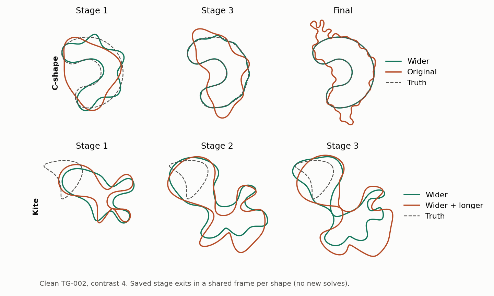

# What the shape bands changed

- **C-shape recovered with wider early updates.** After the first stage, the original fit filled 99.47% of the true opening. The wider fit filled 1.76%. Both had the same storage and both stopped before the step cap. Final area error fell from 43.78% to 0.07%. [C-shape measurements][c] · [Original fit][c-fit] · [Wider fit][c-wide]
- **Kite missed with both settings.** Wider updates reduced final area error from 467.38% to 278.87%. On those same wider bands, more steps improved the first-stage outline, then made the second-stage outline worse. Final error rose to 493.76%. The extended first-stage boundary crossed itself. [Kite measurements][k] · [Wider fit][k-wide] · [Wider and longer fit][k-both]
- **Aphex Twin missed with both settings.** The wider fourth stage had a 53.23 mm reachable normal gap and accepted zero steps. Final error was 202.50%, against 196.85% originally. The saved stop records a stall on this path. It leaves open why the data-led fit settled on this outline. [Aphex Twin measurements][a] · [Wider fit][a-wide] · [Original stage extension](../../../../results/bem/stage_stops/2026-11-18/aphex_fourth/aphex_twin__c4.json)
- **Cog recovered sooner with wider updates.** Bringing the eight-tooth detail into reach in stage three cut area error to 1.76% there, against 17.75% originally. The original fit passed in stage six. Final errors were 2.00% original and 0.04% wider. [Cog measurements][g] · [Cog truth definition](../../../../experiments/benchmark/scenes.py#L128)

Checked on 18 November 2026 using saved clean TG-002 contrast-4 fits. Each started from the same centred circle, used real data and estimated contrast, with no warm-up or localisation. This analysis used CPU geometry calculations only. [Dispatch and settings](plan.md) · [Original fit][c-fit] · [Wider fit][c-wide]



## How much of the gap could a stage move?

On the clean TG-002 default path, A1 stores signed Cartesian Fourier coefficients. B6 requests constant, cosine and sine normal motions in normalised arclength. It fits their Cartesian velocities while penalising uneven speed change. One B6 direction can change many stored orders. The slider rebuilds the directions after an accepted move. [A1 resize](../../../../solvers/bem_inverse/continuation/geometry.py#L44) · [B6 basis](../../../../solvers/bem_inverse/continuation/geometry.py#L127) · [B6 slider](../../../../solvers/bem_inverse/geometry_update_methods/slider.py#L92) · [Stage linearisation](../../../../solvers/bem_inverse/fit_stage.py#L142)

I paired entry and truth points by fractional arclength and chose the cyclic starting point that minimised squared distance, keeping their physical positions fixed. On the entry normals I split this gap into its least-squares projection onto the actual CPU B6 slider velocities and the perpendicular remainder, weighted by arclength. I measured the saved exit displacement at the same entry parameters. “Towards” is its signed component along the reachable gap. All distances are RMS millimetres. This is one point pairing and one local space. Large moves can change the pairing and the slider directions. Area error measures the outline independently. [Measurement code][script] · [Area score](../../../../experiments/comparison/scoring.py#L95)

In each row the bands are the original and wider B6 limits. The two fits share the first entry. After that, each uses its own saved entry. The records also give both projected gaps on each *same* entry, so a change of band can be checked without a change of outline. [C-shape][c] · [Kite][k]

| Shape and stage | Bands | Reachable, original / wider (mm) | Outside, original / wider (mm) | Actual move, original / wider (mm) | Towards, original / wider (mm) | Exit area error, original / wider |
|---|---|---:|---:|---:|---:|---:|
| [C-shape 1][c] | 3 / 5 | 30.30 / 30.36 | 2.44 / 1.39 | 33.28 / 32.21 | +25.22 / +31.43 | 59.90% / 23.69% |
| [C-shape 2][c] | 5 / 7 | 22.25 / 4.40 | 1.38 / 1.52 | 14.81 / 4.34 | +12.80 / +4.20 | 48.17% / 6.57% |
| [C-shape 3][c] | 7 / 9 | 10.18 / 1.02 | 1.11 / 0.87 | 7.57 / 1.08 | −1.60 / +1.06 | 56.66% / 4.44% |
| [C-shape 4][c] | 9 / 11 | 15.00 / 0.51 | 1.09 / 0.72 | 6.46 / 0.61 | −1.43 / +0.60 | 58.40% / 3.54% |
| [Kite 1][k] | 3 / 5 | 40.23 / 40.25 | 1.40 / 0.82 | 36.94 / 39.65 | −5.31 / +1.22 | 332.40% / 263.66% |
| [Kite 2][k] | 5 / 7 | 52.57 / 52.09 | 2.19 / 11.78 | 15.83 / 23.27 | −8.21 / +0.36 | 517.63% / 351.07% |
| [Kite 3][k] | 7 / 9 | 61.18 / 61.67 | 3.35 / 4.46 | 18.04 / 9.88 | −4.24 / +0.59 | 467.11% / 278.91% |
| [Kite 4][k] | 9 / 11 | 69.26 / 63.84 | 11.04 / 7.45 | 0.06 / 0.02 | −0.01 / ≈0 | 467.38% / 278.87% |

C-shape’s two first-stage fits moved similar distances, but the wider move followed more of the truth-directed displacement and exposed the opening. Kite had a large reachable component on both paths. In the wider second stage, a 23.27 mm move had only 0.36 mm along that component. Its poor recovery therefore has little support as a simple shortage of local directions. [C-shape][c] · [Kite][k]

The matched widening establishes the effect of the four-stage schedule. The opening is visible at the first exit. Whether widening only that first stage suffices for final recovery remains untested. [Original C-shape][c-fit] · [Wider C-shape][c-wide]

For the other two shapes, each cell lists reachable gap / outside gap / actual motion, in mm. On the original cog stage-three entry, switching only the projected band from 7 to 9 reduced the outside gap from 4.11 to 0.13 mm. The wider fit actually used the tooth detail. On Aphex Twin the wider fourth stage stopped at `no_decreasing_step` while the gap remained large. [Cog][g] · [Aphex Twin][a] · [Aphex Twin stage stops][a-wide]

| Shape and setting | Stage 1 | Stage 2 | Stage 3 | Stage 4 |
|---|---:|---:|---:|---:|
| [Cog original][g] | 24.06 / 4.10 / 28.76 | 1.60 / 4.11 / 1.00 | 0.64 / 4.11 / 0.53 | 4.28 / 0.13 / 5.21 |
| [Cog wider][g] | 24.06 / 4.10 / 23.55 | 1.77 / 3.98 / 1.50 | 4.14 / 0.35 / 4.13 | 0.30 / 0.26 / 0.30 |
| [Aphex Twin original][a] | 45.49 / 5.88 / 34.27 | 60.57 / 7.67 / 19.23 | 56.17 / 8.93 / 6.10 | 49.96 / 11.62 / 10.12 |
| [Aphex Twin wider][a] | 45.85 / 1.32 / 21.67 | 49.32 / 4.60 / 16.85 | 57.54 / 4.24 / 4.81 | 53.23 / 12.25 / 0.00 |

## What carried into the next stage?

Applying the default A1 stage-entry resize to each saved early exit preserved every old coefficient exactly and added only zeros at the new orders. This reconstructs entry from the exit and the runner’s operation. The summaries retain exit curves. The original records also save the separate cleanup curve later in the schedule. [Runner stage entry](../../../../solvers/bem_inverse/runner.py#L174) · [A1 resize and cleanup](../../../../solvers/bem_inverse/continuation/geometry.py#L44) · [C-shape fit][c-fit]

The early A1 storage bands were 8, 12, 16 and 20. Cropping truth to band 8 gives area errors of 0% for kite, 1.52% for C-shape, 7.68% for Aphex Twin and 9.80% for cog. At band 12 the corresponding errors are 0%, 0%, 2.79% and 1.11%. Storage can lose detail in the first stage. Its later growth preserves what the fit has already learned. [Kite crop](../../../../results/bem/stage_stops/2026-11-18/reference/kite__c4.json) · [C-shape crop](../../../../results/bem/stage_stops/2026-11-18/reference/c_shape__c4.json) · [Aphex Twin crop](../../../../results/bem/stage_stops/2026-11-18/reference/aphex_twin__c4.json) · [Cog crop](../../../../results/bem/stage_stops/2026-11-18/reference/cog__c4.json)

For each stage, the JSON lists which signed Cartesian orders it changed and which still match at **each later exit and the final curve**. It records exact equality and, separately, changes of at least 1 µm followed by agreement within 1 µm. Order zero is the constant Cartesian coefficient. [C-shape][c] · [Kite][k] · [Cog][g] · [Aphex Twin][a]

- **C-shape.** Every early order set by at least 1 µm moved by more than that by the final curve on both paths. Yet the original still filled 56.62% of the opening at the end, against 0.02% wider. Here “opening filled” means the fraction of the empty region inside the true convex hull covered by the estimate. The wrong feature persisted while its coefficients changed. [C-shape][c]
- **Kite.** On both paths every order changed in stage four carried exactly to the final curve because stage five accepted zero steps. Even before that, stage-three orders −16 and +15 remained within 1 µm of their original stage-three values to the end. Many lower orders continued to move. [Kite][k]
- **Aphex Twin.** All original stage-four orders −20 through +20 carried exactly to the end. On the wider path all stage-three orders −16 through +16 carried exactly through both later stages. Neither later stage accepted a move there. [Aphex Twin][a]
- **Cog.** Both paths changed every early order set by at least 1 µm by more than that at the final exit. The wider third stage’s largest coefficient changes were at −7 and +9, followed by zero. These are Cartesian coefficients of a moving boundary with eight teeth. [Cog][g]

## What later bands corrected

The original fits entered the full catalogue with A1 storage band 192. Both true curves fit exactly in that storage in their saved parameters. B6 still limits each *local* move. A target that fits in storage and has a reachable component need not be attainable by a sequence of accepted data-loss decreases. The table gives entry and exit loss *within each stage*, where the data are matched. [C-shape fit][c-fit] · [Kite fit][k-fit] · [B5 data loss](../../../../solvers/bem_inverse/b5_residual.py#L21)

| Shape, stage, B6 band | Steps | Data loss, entry → exit | Area error, entry → exit | Largest changed signed orders, in order | Saved stop or outcome if stop was null |
|---|---:|---|---|---|---|
| [C-shape 5, 11][c] | 22 | .68448 → .44580 | 58.40% → 50.35% | 0, +2, −5 | `maximum_iterations` |
| [C-shape 6, 15][c] | 22 | .44580 → .43967 | 50.35% → 47.48% | +1, 0, −1 | `maximum_iterations` |
| [C-shape 7, 19][c] | 22 | .43967 → .42634 | 47.48% → 45.33% | +1, 0, −1 | `maximum_iterations` |
| [C-shape 8, 25][c] | 4 | .42634 → .40970 | 45.33% → 44.48% | 0, +2, −1 | `STAGE_QUOTA_REACHED` |
| [C-shape 9, 31][c] | 3 | .40970 → .39903 | 44.48% → 43.78% | +1, 0, +2 | `STAGE_QUOTA_REACHED` |
| [C-shape 10, 37][c] | 0 | .39903 → .39903 | 43.78% → 43.78% | none | `NUMERICAL_FAILURE`, candidate evaluation |
| [Kite 5, 11][k] | 0 | unavailable at entry and exit | 467.38% → 467.38% | none | `NUMERICAL_FAILURE`, initial state |

C-shape improved at every full-catalogue stage that accepted a step. The table uses the saved post-cleanup entry at band 25. The original kite’s A3 wave calculation failed the cancellation check at entry, before B6 could try the wider band. Both are default-path C12 numerical stops. The saved runs leave open what a longer feasible later path could recover. [C-shape fit][c-fit] · [Kite fit][k-fit] · [A3 waves](../../../../solvers/bem_inverse/a3_waves.py#L87) · [C12 stage return](../../../../solvers/bem_inverse/runner.py#L228)

At C-shape’s first full-catalogue entry the reachable and outside gaps were 16.76 and 1.22 mm. At its final failed stage they were 18.04 and 2.86 mm. Kite’s failed entry had 69.82 mm reachable and 6.96 mm outside. These are geometric projections on the saved boundaries. The forward failure prevented an actual step at each failed stage. [C-shape projections][c] · [Kite projection][k]

## Where the two wider kite runs separated

The first difference in the schedule was **stage one, step 23**. All saved losses and contrasts through step 22 match exactly, as do the sampled area errors. The shorter run advanced to stage two. The extended run took one more step on the first frequency. Loss fell from .16040021 to .16039790, contrast rose from 3.209894 to 3.210276 and area error fell from 263.66% to 263.24%. The save contains a scalar area score at step 23. The individual coefficient changes and trial refusals at that step were not retained. [Wider steps][k-wide] · [Wider and longer steps][k-both] · [Fields saved by the driver](../../../../experiments/comparison/check_stage_stops.py#L94)

| Compared stage exits | Steps, wider / both | Area error, wider / both | Contrast, wider / both | Largest between-run coefficient differences, mm |
|---|---:|---:|---:|---|
| [First stage][k] | 22 / 41 | 263.66% / 205.32% | 3.2099 / 3.0785 | +1 (5.03), +4 (3.23), −1 (3.05) |
| [Second stage][k] | 20 / 26 | 351.07% / 399.44% | 2.0343 / 2.0111 | 0 (10.56), −5 (5.23), −2 (4.53) |
| [Third stage][k] | 7 / 5 | 278.91% / 493.76% | 2.0822 / 1.8664 | +1 (11.01), +3 (10.51), 0 (9.54) |

Every stored order differed at those stage exits. The extra first-stage steps improved area, but by matched step 17 of stage two the longer path had 321.42% error against 318.30%. The crossover happened between entry and step 17. The first-stage cap changed the next entry, before the longer second-stage cap could act. Stage three then widened the difference. The combined run reached its time limit at stage four without accepting a move. [Kite coefficients][k] · [Wider steps][k-wide] · [Wider and longer steps][k-both]

**The longer first-stage endpoint crossed itself twice.** Both first-stage endpoints looked simple on the slider’s 1,024-point trial grid. On the 16,384-point scoring grid there were two crossings at step 41 and none at the shorter endpoint. Evaluating the Fourier curves at the refined pairs confirmed both intersections to within 0.000001 mm. Both second- and third-stage endpoints passed the dense check. The shorter run also had two crossings at the fourth-stage exit. The area score repairs intersecting polygons. A crossing alone therefore cannot identify the cause of the poorer later result. [Kite crossing parameters][k] · [Default slider trial checks](../../../../solvers/bem_inverse/geometry_update_methods/slider.py#L195) · [Score repair](../../../../experiments/comparison/scoring.py#L80)

## Evidence limit and smallest follow-up

The saved cases answer the band question. They establish the first extra kite step, a crossing by the extended stage exit, and the stage where the area ranking reverses. The first crossed step, its coefficient changes, and any refused geometry trials or forward solves around it remain open. `no_decreasing_step` alone does not identify a refusal. No new fit is needed for the four verdicts. [Kite original and wider][k] · [Extended kite steps][k-both]

If the coordinator needs the missing first-stage history, compare one extended kite first stage with the existing wider step-22 curve and extended step-41 curve. Use the original centred input, estimated starting contrast, one real frequency, storage 8, update band 5, original stage quota and 120-second fit limit. Cap the diagnostic at 41 accepted steps. Record the stage history and trials. After it returns, check each curve for crossings and differences in signed orders, and read the recorded refusal reasons and physics failures. [Saved wider endpoint][k-wide] · [Saved extended endpoint][k-both] · [Stage history and trials](../../../../solvers/bem_inverse/runner.py#L224)

Proposed command for the coordinator, from the repository root. This comparison has **not been run**. It uses the existing activity driver with a stage-local cap and writes to a fresh follow-up directory.

```bash
OMP_NUM_THREADS=1 OPENBLAS_NUM_THREADS=1 MKL_NUM_THREADS=1 PYTHONPATH=solvers:. \
/home/drdeng/miniconda3/envs/EMNerf/bin/python - <<'PY'
from dataclasses import replace
from pathlib import Path
from experiments.comparison import check_stage_stops as source
from bem_inverse.io import curve_from, read
from bem_inverse.material import MaterialUnknown
from bem_inverse.problem import Problem

class FirstKiteStage(source.EarlyStagePolicy):
    def operations(self, problem, physics):
        first = super().operations(problem, physics)[0]
        return [replace(first, stage=replace(first.stage, iterations=41))]

case = "kite__c4"
row = source.campaign.row(case)
real, _ = source.bem.observations(source.BASE, row, source.RESULTS)
circle = curve_from(read(source.campaign.ROOT / row["initial"]))
contrast = read(source.OUTPUT / "both" / (case + ".json"))["initial_contrast"]
out = Path("results/bem/stage_scheduling/2026-11-18/kite_first_crossing")
out.mkdir(parents=True, exist_ok=False)
source.fit(Problem(circle, real, None, contrast), solver=source.bem.solver(source.BASE),
           execution=source.bem.EXECUTION, geometry_update=source.bem.GEOMETRY_UPDATE,
           material=MaterialUnknown(), policy=FirstKiteStage(arm="both", fit_seconds=120),
           output=out)
PY
```

Compare the first 22 losses, contrasts and the step-22 boundary before interpreting the new trace. If the trace reproduces both endpoints, the first dense crossing and nearby refusals can be dated from `ladder_1_real.json`. If the trace differs, keep it as an unmatched run. Even a match would establish the order of events only. [Reference steps][k-wide] · [Extended steps][k-both]

If the question is specifically whether accepting crossings caused the reversal, the smallest intervention is one extended kite prefix against the saved extended control. Use the same command above with the following substitutions before calling `source.fit`. Keep the original extended cap on stage one. Stop at matched step 17 of stage two. Use the same 120-second limit and a fresh output path ending in `kite_dense_crossing_check`. [Extended control][k-both]

```python
from bem_inverse.errors import UpdateRefused
from bem_inverse.geometry_update_methods import slider
from shapely.geometry import LinearRing
import numpy as np

class FirstKiteStage(source.EarlyStagePolicy):
    def operations(self, problem, physics):
        first, second = super().operations(problem, physics)[:2]
        return [first, replace(second, stage=replace(second.stage, iterations=17))]

standard_trial = slider.geometry_update
def checked_trial(*args, **kwargs):
    curve, info = standard_trial(*args, **kwargs)
    z = curve.values(16384)
    if not LinearRing(np.column_stack((z.real, z.imag))).is_simple:
        raise UpdateRefused("dense_self_intersection", "Crossing on the area-score grid.")
    return curve, info

slider.geometry_update = checked_trial  # process-local change for this proposed comparison
```

Match the accepted losses up to the first affected proposal. If refusing a previously accepted crossing restores the shorter run’s advantage to the extended path by the matched step, the crossing contributed to the observed reversal. If error remains as high, the stronger check alone did not prevent it. An earlier unmatched change or a time stop leaves attribution open. [Shorter control][k-wide] · [Extended control][k-both]

To reproduce **this note’s saved-curve measurements** on CPU, run the command below. The four JSON records include every stage, signed orders and the source paths. The accompanying figure uses the saved outlines. [Measurement script][script]

```bash
OMP_NUM_THREADS=1 OPENBLAS_NUM_THREADS=1 MKL_NUM_THREADS=1 MPLCONFIGDIR=/tmp/shape_bands_mpl \
PYTHONPATH=solvers:. /home/drdeng/miniconda3/envs/EMNerf/bin/python -B -m experiments.comparison.trace_shape_bands
```

[c]: ../../../../results/bem/stage_scheduling/2026-11-18/shape_bands/c_shape.json
[k]: ../../../../results/bem/stage_scheduling/2026-11-18/shape_bands/kite.json
[a]: ../../../../results/bem/stage_scheduling/2026-11-18/shape_bands/aphex_twin.json
[g]: ../../../../results/bem/stage_scheduling/2026-11-18/shape_bands/cog.json
[c-fit]: ../../../../results/bem/default_clean_uc_fc/c_shape__c4/fit.json
[k-fit]: ../../../../results/bem/default_clean_uc_fc/kite__c4/fit.json
[c-wide]: ../../../../results/bem/stage_stops/2026-11-18/wider/c_shape__c4.json
[a-wide]: ../../../../results/bem/stage_stops/2026-11-18/wider/aphex_twin__c4.json
[k-wide]: ../../../../results/bem/stage_stops/2026-11-18/wider/kite__c4.json
[k-both]: ../../../../results/bem/stage_stops/2026-11-18/both/kite__c4.json
[script]: ../../../../experiments/comparison/trace_shape_bands.py
