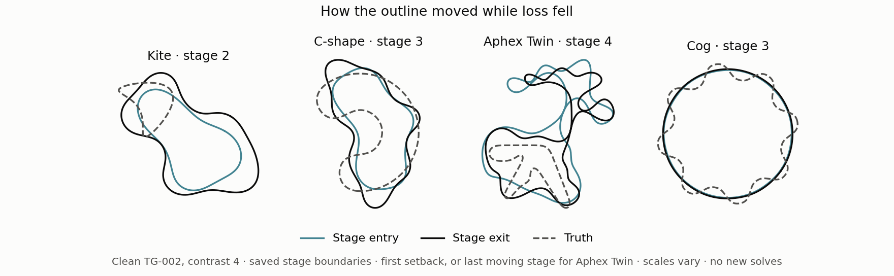

# Which stage stops changed the recovery?

- **Kite.** Stage two was the first lasting setback. Loss fell from 0.5810 to 0.3066 while area error rose from 332.40% to 517.63%. No later exit regained its entry accuracy. More early steps took the final error from 467.38% to 486.69%. The full-frequency forward solve later refused the stage-five entry. [Original][kite] · [Longer][kl] · [Stage scores][stages]
- **C-shape.** Stage three first moved away from the truth, from 48.17% to 56.66%. Stage six regained that ground at 47.48%, but the fit never reached 5%. More early steps left the final error at 43.78%. Wider early updates reached 0.07% under the original step cap. Two later work quotas cut short improving stages. [Original][cshape] · [Longer][cl] · [Wider][cw] · [Stage scores][stages]
- **Aphex Twin.** Every stage that accepted a step improved both loss and outline from entry to exit. The fourth-stage cap interrupted real progress. Extending only that stage reduced error from 196.85% to 196.63%. Stage five ran out of time before it obtained a loss. The separate endpoint check found that the same curve also exceeded the forward solver’s limit. [Original][aphex] · [Isolated extension][a4] · [Stage scores][stages]
- **Cog.** The first setback was temporary. Error rose from 17.43% to 17.75% in stage three, fell to 7.85% in stage four and passed 5% in stage six. Work quotas then stopped four improving stages. The time limit ended the fit at 2.00%. More early steps also passed, at 2.01%. [Original][cog] · [Longer][gl] · [Stage scores][stages]



## Reading the stage records

The area error is the area belonging to just one of the fitted and true regions, divided by the true area. Entry uses the centred circle, the prior exit, or the saved post-cleanup curve, resized to the stage's storage band. Loss uses that stage's active frequencies. Compare loss within a stage. [Scoring](../../../../experiments/comparison/scoring.py#L143) · [A1 resize](../../../../solvers/bem_inverse/continuation/geometry.py#L44) · [C12 handoff](../../../../solvers/bem_inverse/runner.py#L158)

I counted a setback when loss fell and exit error exceeded entry error by more than one millionth of a percentage point. A setback lasted if no subsequent exit regained its entry error to that tolerance. By this rule only kite had a lasting setback. By the separate benchmark rule, kite, C-shape and Aphex Twin stayed above 5% from stage one through the last recorded exit. A saved path can show when ground was lost. It cannot prove later recovery was impossible. [All entries and exits][stages]

### Every stage of the original fits

Bands are B6 update / A1 storage. Steps are accepted steps out of 22. Work is charged units / stage quota. Seconds are stage time / elapsed whole-fit time, with a 120 s whole-fit limit. The three counts are slider geometry refusals / actual failed forward evaluations / charged failures. A dash means the stage never finished evaluating its entry. [Run settings][settings] · [Full precision and source paths][stages]

The stop column uses **cap** for iteration cap, **trials** for exhausted trial steps, **quota** for stage work quota, **time** for whole-fit time limit and **forward** for forward-solver refusal. Across 32 stages there were 12 caps, 10 exhausted trial searches, six quotas, two time limits and two forward refusals. [Stage accounting][stages]

**Kite.** [Run record][kite] · [Area scores][stages]

| Stage | Bands | Steps | Loss in → out | Area error in → out (%) | Work | Seconds | Refused / failed / charged | Stop |
|---:|---:|---:|---:|---:|---:|---:|---:|---|
| 1 | 3/8 | 22 | 0.786095 → 0.190717 | 359.4060 → 332.4047 | 73/1000 | 0.76/0.76 | 0/0/0 | cap |
| 2 | 5/12 | 22 | 0.580968 → 0.306555 | 332.4047 → 517.6268 | 168/1250 | 1.45/2.21 | 0/0/0 | cap |
| 3 | 7/16 | 20 | 0.395526 → 0.268201 | 517.6268 → 467.1068 | 204/1750 | 6.06/8.27 | 46/0/0 | trials |
| 4 | 9/20 | 1 | 0.363761 → 0.362638 | 467.1068 → 467.3785 | 24/4000 | 1.91/10.18 | 46/0/0 | trials |
| 5 | 11/192 | 0 | — | 467.3785 → 467.3785 | 14/1500 | 18.76/28.94 | 0/6/1 | forward |

**C-shape.** [Run record][cshape] · [Area scores][stages]

| Stage | Bands | Steps | Loss in → out | Area error in → out (%) | Work | Seconds | Refused / failed / charged | Stop |
|---:|---:|---:|---:|---:|---:|---:|---:|---|
| 1 | 3/8 | 19 | 0.502929 → 0.0458682 | 151.6621 → 59.8974 | 141/1000 | 1.92/1.92 | 0/0/0 | trials |
| 2 | 5/12 | 22 | 0.551943 → 0.175168 | 59.8974 → 48.1687 | 138/1250 | 0.87/2.78 | 0/0/0 | cap |
| 3 | 7/16 | 22 | 0.279506 → 0.166831 | 48.1687 → 56.6553 | 207/1750 | 1.26/4.05 | 0/0/0 | cap |
| 4 | 9/20 | 22 | 0.306656 → 0.216943 | 56.6553 → 58.4003 | 276/4000 | 1.75/5.80 | 0/0/0 | cap |
| 5 | 11/192 | 22 | 0.684483 → 0.445799 | 58.4003 → 50.3538 | 1311/1500 | 11.61/17.41 | 0/0/0 | cap |
| 6 | 15/192 | 22 | 0.445799 → 0.439671 | 50.3538 → 47.4794 | 1311/1500 | 11.87/29.28 | 0/0/0 | cap |
| 7 | 19/192 | 22 | 0.439671 → 0.426343 | 47.4794 → 45.3310 | 1311/1500 | 11.98/41.26 | 0/0/0 | cap |
| 8 | 25/192 | 4 | 0.426344 → 0.409704 | 45.3311 → 44.4760 | 266/304 | 3.19/44.45 | 0/0/0 | quota |
| 9 | 31/192 | 3 | 0.409704 → 0.399035 | 44.4760 → 43.7773 | 285/304 | 5.58/50.03 | 5/0/0 | quota |
| 10 | 37/192 | 0 | 0.399035 → 0.399035 | 43.7773 → 43.7773 | 76/304 | 1.68/51.71 | 1/1/1 | forward |

**Aphex Twin.** [Run record][aphex] · [Area scores][stages]

| Stage | Bands | Steps | Loss in → out | Area error in → out (%) | Work | Seconds | Refused / failed / charged | Stop |
|---:|---:|---:|---:|---:|---:|---:|---:|---|
| 1 | 3/8 | 22 | 0.561861 → 0.116093 | 486.7568 → 446.4133 | 69/1000 | 0.73/0.73 | 0/0/0 | cap |
| 2 | 5/12 | 14 | 0.778286 → 0.15108 | 446.4133 → 258.4658 | 90/1250 | 3.56/4.29 | 44/0/0 | trials |
| 3 | 7/16 | 7 | 0.50284 → 0.307318 | 258.4658 → 256.1484 | 99/1750 | 34.01/38.30 | 113/0/0 | trials |
| 4 | 9/20 | 22 | 0.433904 → 0.279368 | 256.1484 → 196.8456 | 304/4000 | 66.01/104.31 | 184/0/0 | cap |
| 5 | 11/192 | 0 | — | 196.8456 → 196.8456 | 1/1500 | 28.07/132.38 | 0/0/0 | time |

**Cog.** [Run record][cog] · [Area scores][stages]

| Stage | Bands | Steps | Loss in → out | Area error in → out (%) | Work | Seconds | Refused / failed / charged | Stop |
|---:|---:|---:|---:|---:|---:|---:|---:|---|
| 1 | 3/8 | 13 | 0.330308 → 7.97609e-07 | 102.1959 → 18.0472 | 60/1000 | 0.58/0.58 | 0/0/0 | trials |
| 2 | 5/12 | 4 | 0.000972183 → 0.000191034 | 18.0472 → 17.4259 | 30/1250 | 0.16/0.74 | 0/0/0 | trials |
| 3 | 7/16 | 15 | 0.00346286 → 0.00236724 | 17.4259 → 17.7549 | 144/1750 | 0.69/1.43 | 0/0/0 | trials |
| 4 | 9/20 | 22 | 0.225137 → 0.00171516 | 17.7549 → 7.8513 | 280/4000 | 1.58/3.01 | 0/0/0 | cap |
| 5 | 11/192 | 22 | 0.373583 → 0.0808064 | 7.8513 → 6.6171 | 1349/1500 | 12.61/15.62 | 0/0/0 | cap |
| 6 | 15/192 | 8 | 0.0808064 → 0.00861799 | 6.6171 → 3.7894 | 513/1500 | 6.18/21.80 | 0/0/0 | trials |
| 7 | 19/192 | 11 | 0.00861799 → 0.00294741 | 3.7894 → 3.2135 | 893/1500 | 15.34/37.14 | 0/0/0 | trials |
| 8 | 25/192 | 4 | 0.00268882 → 0.000989465 | 3.0365 → 2.6944 | 266/304 | 10.50/47.64 | 5/0/0 | quota |
| 9 | 31/192 | 4 | 0.000989465 → 0.000517743 | 2.6944 → 2.5252 | 266/304 | 16.69/64.33 | 32/0/0 | quota |
| 10 | 37/192 | 4 | 0.000517743 → 0.000248676 | 2.5252 → 2.0600 | 285/304 | 12.97/77.30 | 29/0/0 | quota |
| 11 | 43/192 | 4 | 0.000248676 → 0.000241348 | 2.0600 → 2.0043 | 285/304 | 20.26/101.43 | 78/0/0 | quota |
| 12 | 49/192 | 3 | 0.000241348 → 0.000240438 | 2.0043 → 2.0031 | 218/304 | 18.61/120.04 | 65/0/0 | time |

### How the five stops arise on the default path

These fits use the real-only policy, modal Müller physics and the slider. B6 builds the allowed normal directions. C9 proposes a step and retries with more damping. The geometry update checks each constructed boundary. C11 tests whether the predicted data lower B5 loss. C12 keeps the accepted curve. The stage queue advances on normal return or stage quota. [Default settings][settings] · [B6 slider](../../../../solvers/bem_inverse/geometry_update_methods/slider.py#L92) · [C9 retries](../../../../solvers/bem_inverse/fit_stage.py#L295) · [C11 acceptance](../../../../solvers/bem_inverse/fit_stage.py#L395) · [C12 stage return](../../../../solvers/bem_inverse/runner.py#L229)

| Cause | Evidence that decides it |
|---|---|
| Iteration cap | The C12 loop reached its configured count of accepted steps. All cap rows above have 22 acceptances. The cap alone says nothing about the size of the last gain. [Loop](../../../../solvers/bem_inverse/fit_stage.py#L269) · [Commit](../../../../solvers/bem_inverse/fit_stage.py#L423) · [Counts][stages] |
| Exhausted trial steps | C9 retries and successively halved steps ended without an accepted candidate. A trial may be too small, invalid or nondecreasing in loss. Even a stage with zero slider refusals can stop this way. The records do not identify the last trial's reason in each stage. [Trial lengths](../../../../solvers/bem_inverse/fit_stage.py#L322) · [Stop](../../../../solvers/bem_inverse/fit_stage.py#L420) · [Counts][stages] |
| Stage work quota | C12 kept the last accepted curve. At 266/304 units the next derivative reservation needed 38 plus 12 reserved for the endpoint. At 285/304 the next forward batch needed 19 plus 12. Each exceeded 304. This happened at bands 25 and 31 for C-shape and 25, 31, 37 **and 43** for cog. [B6–B8 reservation](../../../../solvers/bem_inverse/fit_stage.py#L151) · [Forward batch](../../../../solvers/bem_inverse/forward_batch.py#L20) · [Ledger](../../../../solvers/bem_inverse/work.py#L89) · [Counts][stages] |
| Whole-fit time limit | The ledger checks elapsed wall time at stage entry and before reservations. A running call can finish later. Aphex Twin had 15.69 s left on entering stage five and stopped at 132.38 s. Cog stopped at 120.04 s during a contrast derivative with 218/304 units charged in stage twelve. [Time check](../../../../solvers/bem_inverse/work.py#L67) · [Aphex Twin][aphex] · [Cog][cog] |
| Forward-solver refusal | On kite the A3 regular-wave cancellation check failed on the stage-five **entry**, at six frequencies from 1.875 to 2.5 GHz. On C-shape it failed on a stage-ten **candidate** at 2.5 GHz. C-shape's accepted entry still had a valid loss. Both stopped before another acceptance. [A3 check](../../../../solvers/bem_inverse/a3_waves.py#L77) · [Entry failure](../../../../solvers/bem_inverse/fit_stage.py#L242) · [Trial failure](../../../../solvers/bem_inverse/fit_stage.py#L395) · [Kite][kite] · [C-shape][cshape] |

The original four fits show only those five causes. The recovered controls also use gradient and loss tolerance. Wider C-shape and wider cog reached gradient tolerance in stage one. [Controls][stages] · [Wider C-shape][cw] · [Wider cog][gw]

**Two limits could be close.** Kite stage three and C-shape stage one exhausted trials at 20 and 19 steps out of 22. C-shape stages five through seven hit the cap with 87.4% of stage work spent. Cog stage five hit it with 89.9% spent. Aphex Twin stage four hit it with 86.9% of the fit time spent. Cog's last quota stop left 18.57 s for stage twelve. None reached the whole-fit work cap of 13,412 units. [Original receipts][stages] · [Fit budget][settings]

**Why refusals and failures differ.** The slider counts geometry refusals across the fit. For each stage we subtract candidate batches actually charged from constructed proposals. We also subtract the constructed candidate blocked before dispatch where the quota stopped a fully rebuilt tangent. The resulting stage counts sum to the saved slider totals of 92, 6, 341 and 209 for kite, C-shape, Aphex Twin and cog. The records do not give the individual geometry check that refused each curve. [Slider checks](../../../../solvers/bem_inverse/geometry_update_methods/slider.py#L195) · [Reconstruction](../../../../experiments/comparison/trace_stage_stops.py#L92) · [Stage counts][stages]

On kite, parallel frequency calls recorded six physical failures while the ledger charged only the first failed call consumed in order. Aphex Twin's original stage-five ledger and physics receipt both recorded zero failures. **After fitting**, the separate serial endpoint evaluation reused the final curve, contrast and production resolution and hit the A3 cancellation check at 2.2 × 10⁻⁹ against 1 × 10⁻⁹. This shows why extending only the clock at the original stage-five entry would still leave the full-frequency objective unavailable. [Ledger calls](../../../../solvers/bem_inverse/work.py#L40) · [Endpoint evaluation](../../../../experiments/comparison/bem.py#L121) · [Kite][kite] · [Aphex Twin, including endpoint traceback][aphex]

## Was the fit still improving at the cutoff?

Eight of the sixteen original early stages reached step 22. All eight had lower loss at step 22 than at step 21. The saved area samples generally bracket steps 17 and 22, so the table reports the direction across that window. Seven improved both measures over the window. Only kite stage one improved loss while worsening shape. The other eight stages exhausted trials before reaching the cutoff. [Matched loss, contrast and area by step][matched]

| Shape, stage | Loss decrease, steps 17–22 (%) | Area error at 17 → 22 (%) | What the longer setting showed |
|---|---:|---:|---|
| Kite 1 | 0.10176 | 331.544 → 332.405 | Same entry. At 23, loss dropped again and error rose to 333.102%. At 197 the error was 336.454%, with 2.00% less loss than at 22. [Reference][kr] · [Longer][kl] |
| Kite 2 | 0.05961 | 518.022 → 517.627 | Different entry. On the longer path, steps 22 → 23 lowered loss from 0.21486309 to 0.21486296 and raised error from 452.794% to 453.790%. [Reference][kr] · [Longer][kl] |
| C-shape 2 | 0.00000077 | 48.168766 → 48.168727 | Same entry. The larger allowance produced **zero** extra acceptances. The next search exhausted its trials at 22. [Reference][cr] · [Longer][cl] |
| C-shape 3 | 0.00000201 | 56.655833 → 56.655279 | Same entry. Seven extra steps gave 56.655220%. [Reference][cr] · [Longer][cl] |
| C-shape 4 | 0.00675 | 58.401708 → 58.400308 | Slightly different entry. On that path, steps 22 → 33 took error from 58.400278% to 58.398947%. [Reference][cr] · [Longer][cl] |
| Aphex Twin 1 | 0.02568 | 446.450 → 446.413 | Same entry. At 23, loss fell from 0.11609258 to 0.11609060 and error rose to 446.523%. At 73 it was 446.644%. [Reference][ar] · [Longer][al] |
| Aphex Twin 4 | 2.97205 | 198.495 → 196.846 | The isolated replay matched through 22. Error reached 196.633% at 34 and 196.629% at 47. The full longer run entered from a different curve and accepted only nine steps here. [Reference][ar] · [Isolated][a4] · [Longer][al] |
| Cog 4 | 0.00714 | 7.852491 → 7.851260 | Same entry. Four more accepted steps brought error to 7.851081%. [Reference][gr] · [Longer][gl] |

**Matched settings at the same count.** On kite stage one at step 22, original and longer gave identical loss / error of 0.190717 / 332.405%. Wider and both gave 0.160400 / 263.663%. The both run continued to step 41 at 205.321%. In its second stage, loss fell from 0.341037 to 0.222956 over steps 17–22 while error rose from 321.422% to 404.894%. Its stage-three exit was 493.761%, versus 278.907% for wider alone. Those stage-three endpoints took five and seven steps from different entries. [Matched steps][matched] · [Wider kite][kw] · [Both changes][kb]

On C-shape, all four settings shared the initial entry. At stage-one step 17 the two original-band settings gave 0.046160 / 57.962% and the two wider settings gave 0.000320 / 23.691%. For C-shape, Aphex Twin and cog, wider and both have identical loss and contrast at every saved early step and identical sampled area errors. Every early wider stage on those three shapes stopped before the original cap. [Matched steps][matched] · [Four-setting comparison][prior]

The CSV aligns all accepted counts in all four settings and adds the isolated Aphex Twin stage. Empty area cells mean there is no saved boundary at that count. Where a longer run changed a previous exit, a matched step compares trajectories from different entries. Only an identical entry and matched prefix isolate the extra allowance. Later original stages have only entry and exit scores. Their final five accepted steps cannot be scored separately. [Matched records][matched] · [Sampling code](../../../../experiments/comparison/check_stage_stops.py#L67)

## What healthy stages looked like

All seven recoveries improved area in stage one. Their median error fell from 20.03% at that exit to 2.70% at stage four. Of their 28 early stages, 22 exhausted trials, four reached gradient tolerance and two reached the iteration cap. The three misses hit the cap in seven of twelve early stages. Cog and cross both moved briefly away from the truth in stage three and regained the ground in stage four. An isolated setback or early cap did not decide the outcome. [All ten original paths][stages]

| Recovered shape | Stage-one exit (%) | Stage-four exit (%) | First exit at or below 5% | Final error (%) |
|---|---:|---:|---:|---:|
| Asymmetric | 14.31 | 2.70 | 3 | 0.0154 |
| Circle | 40.96 | 0.00052 | 2 | 0.00005 |
| Cog | 18.05 | 7.85 | 6 | 2.0031 |
| Cross | 20.03 | 2.22 | 4 | 0.0104 |
| Hook | 108.74 | 11.37 | 5 | 0.0415 |
| Peanut | 11.84 | 0.60 | 2 | 0.0110 |
| Star | 65.82 | 4.18 | 3 | 0.0161 |

Table values come from the saved stage curves. Each row of the data file names its source fit. [Stage scores and source paths][stages]

## What remains open

The saved runs answer the recovery question for raising **all four early caps**. No additional shape passed. They also identify every original stop. No further fit is needed for those findings. The separate consequences of extending only kite stage two or giving C-shape's later releases more work remain open. Cog had already passed before its first quota. The Aphex Twin endpoint check covers the original stage-five entry only. [Matched steps][matched] · [Original paths][stages] · [Aphex Twin][aphex]

If either isolated effect becomes the next question, use the corresponding **single-stage comparison** below. Each uses the original accepted boundary, recovered contrast, active frequencies, storage and update bands. For C-shape, start from the recorded cleanup at entry to band 25. Use the saved original as the control. Preserve the original remaining whole-fit time. [Kite][kite] · [C-shape][cshape]

- **Kite stage two.** Raise only its cap from 22 to 220. Budget one stage, at most 1,250 work units and about 119 s. Compare the original endpoint at 22, then the last accepted state. A gain beyond 22 would isolate an effect at this entry. A stall or worsening area would rule out an immediate gain on this extension. [Original][kite] · [Changed-entry comparison][kl]
- **C-shape stage eight.** Raise only its work quota from 304 to 1,500 with the same 22-step cap. Budget one stage and about 79 s. Match the original fourth acceptance, then measure extra progress. Reaching 5% would establish a local recovery. A smaller gain would quantify the lost progress. A new stop would bound the result under the tested allowance. Neither probe measures the later trajectory. [Original][cshape] · [Stage scores][stages]

Proposed commands for the coordinator, from the repository root. Each invocation writes one JSON under `results/bem/stage_scheduling/followup/<shape>__c4/`. Neither comparison was run in this activity.

```bash
probe_stage() {
  OMP_NUM_THREADS=1 OPENBLAS_NUM_THREADS=1 MKL_NUM_THREADS=1 PYTHONPATH=solvers:. \
    /home/drdeng/miniconda3/envs/EMNerf/bin/python - "$1" <<'PY'
import sys
from dataclasses import replace
from bem_inverse.io import curve_from, read, write
from bem_inverse.material import MaterialUnknown
from bem_inverse.problem import Problem
from bem_inverse.real_only_policy import RealOnlyPolicy
from bem_inverse.runner import fit
from experiments.benchmark import campaign
from experiments.comparison import bem
from experiments.comparison.runs import RESULTS, parse
from experiments.comparison.trace_stage_stops import shape_region
from experiments.comparison.scoring import region_scores

case = sys.argv[1]
index, option = {"kite__c4": (1, {"iterations": 220}),
                 "c_shape__c4": (7, {"quota": 1500})}[case]
base = parse("bem/default_clean_uc_fc")
saved = read(base.folder() / case / "fit.json")
old = saved["stages"][index]
label = old["stage"]
path = RESULTS / "bem/stage_scheduling/followup" / case / (label + ".json")
if path.exists():
    raise FileExistsError(path)
entry = saved["stages"][index - 1]["curve"]
for event in saved["decisions"]:
    if event["reason"] == "policy cleanup entered" and event["operation"]["label"] == label + "_cleanup":
        entry = event["curve"]
    if event["reason"] == "resolved stage entered" and event["operation"]["label"] == label:
        remaining = bem.FIT_SECONDS - event["work"]["seconds"]
        break

class OneStage(RealOnlyPolicy):
    def operations(self, problem, physics):
        op = next(op for op in super().operations(problem, physics) if op.label == label)
        return [replace(op, stage=replace(op.stage, **option))]

row = campaign.row(case)
real, _ = bem.observations(base, row, RESULTS)
problem = Problem(curve_from(entry), real, None, old["entry_contrast"])
physics, forward = campaign._physics(bem.solver(base), bem.EXECUTION)
history = []
def observe(kind, payload):
    if kind == "accepted_history":
        r = payload["row"]
        history.append({k: r[k] for k in ("iteration", "loss", "contrast", "coefficients")})
physics.observer = observe
result = fit(problem, solver=bem.solver(base), execution=bem.EXECUTION, physics=physics,
             forward_solve=forward, geometry_update=bem.GEOMETRY_UPDATE,
             material=MaterialUnknown(), policy=OneStage(fit_seconds=remaining))
truth = shape_region(curve_from(read(campaign.ROOT / row["truth"])))
def area(curve):
    return 100 * region_scores(shape_region(curve_from(curve)), truth)["area_error"]
for point in history:
    point["area_error_pct"] = area(point["coefficients"])
write(path, dict(case=case, stage=label, changed=option, seconds_limit=remaining,
                 outcome=result["outcome"], detail=result["detail"], stages=result["stages"],
                 history=history, final_area_error_pct=area(result["final_curve"])))
PY
}
probe_stage kite__c4
probe_stage c_shape__c4
```

The stage table, matched-step table and figure can be regenerated independently of those proposed comparisons. [Read-only analysis script](../../../../experiments/comparison/trace_stage_stops.py)

[stages]: ../../../../results/bem/stage_scheduling/2026-11-18/stage_stops/original_stages.csv
[matched]: ../../../../results/bem/stage_scheduling/2026-11-18/stage_stops/matched_steps.csv
[settings]: ../../../../results/bem/default_clean_uc_fc/run.json
[kite]: ../../../../results/bem/default_clean_uc_fc/kite__c4/fit.json
[cshape]: ../../../../results/bem/default_clean_uc_fc/c_shape__c4/fit.json
[aphex]: ../../../../results/bem/default_clean_uc_fc/aphex_twin__c4/fit.json
[cog]: ../../../../results/bem/default_clean_uc_fc/cog__c4/fit.json
[kr]: ../../../../results/bem/stage_stops/2026-11-18/reference/kite__c4.json
[kl]: ../../../../results/bem/stage_stops/2026-11-18/longer/kite__c4.json
[kw]: ../../../../results/bem/stage_stops/2026-11-18/wider/kite__c4.json
[kb]: ../../../../results/bem/stage_stops/2026-11-18/both/kite__c4.json
[cr]: ../../../../results/bem/stage_stops/2026-11-18/reference/c_shape__c4.json
[cl]: ../../../../results/bem/stage_stops/2026-11-18/longer/c_shape__c4.json
[cw]: ../../../../results/bem/stage_stops/2026-11-18/wider/c_shape__c4.json
[ar]: ../../../../results/bem/stage_stops/2026-11-18/reference/aphex_twin__c4.json
[al]: ../../../../results/bem/stage_stops/2026-11-18/longer/aphex_twin__c4.json
[a4]: ../../../../results/bem/stage_stops/2026-11-18/aphex_fourth/aphex_twin__c4.json
[gr]: ../../../../results/bem/stage_stops/2026-11-18/reference/cog__c4.json
[gl]: ../../../../results/bem/stage_stops/2026-11-18/longer/cog__c4.json
[gw]: ../../../../results/bem/stage_stops/2026-11-18/wider/cog__c4.json
[prior]: ../../evaluate_our_method/04_check_stage_stops_and_shape_bands/results.md
