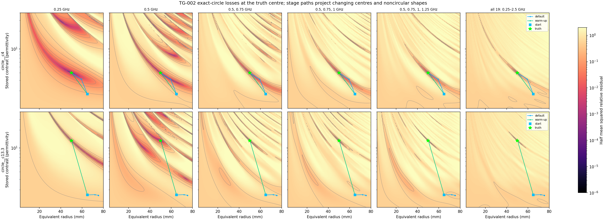

# Circle loss maps: default schedule and 0.25 GHz warm-up

19 November 2026. The circle cases support a schedule effect, but their weak starts do not behave like the measured-cylinder valley. For contrast 13.3, the weak start is already outside the good 0.25 GHz valley. Warm-up reaches that valley and almost recovers the circle; the next 0.5 GHz stage finishes recovery. For contrast 4, the default first stage reaches a wrong-radius, near-zero-loss 0.5 GHz solution, and adding 0.75 GHz resolves it.

## Measured paths

Truth is a 50 mm circle at (18.0213, 12.6187) mm relative to the scene centre. Stored contrast is relative permittivity, with no added one. Both starts are the prescribed 65 mm circle at the scene centre. These are saved fits; this analysis ran no fits.

| Case | Start contrast | Default first exit: radius / contrast | First-stage saved loss | Warm-up exit: radius / contrast | Warm-up saved loss |
|---|---:|---|---:|---|---:|
| circle__c4 | 1.763253 | 59.3642 mm / 3.114393 (11 steps) | 8.09e-6 | 50.0000 mm / 4.000000 (8 steps) | 4.13e-17 |
| circle__c13.3 | 1.640966 | 72.0769 mm / 1.661943 (15 steps) | 0.288917 | 50.2758 mm / 13.128925 (44 steps, cap) | 0.000211925 |

The contrast-4 default first exit has already moved to the truth centre, within 0.05 mm. Its second stage reaches radius 50.0000 mm and contrast 4.000005. Contrast 13.3 instead moves its first-stage centre to (−80.1179, −7.4455) mm, then ends at radius 75.3381 mm and contrast 1.615463. Its warm-up centre is within 0.002 mm of truth; the following 0.5 GHz stage takes three steps to radius 50.0000 mm and contrast 13.300000.

## Where the valley runs, and when it fails

All map losses below use exact circles at the truth centre, not the changing noncircular stage shapes. Loss is half the mean squared relative residual over the selected frequencies.

For contrast 4, the 0.25 GHz valley passes through 50 mm / 4 and extends to 27.41 mm / 8 (loss 0.00840) and 19.08 mm / 13.3 (0.01104). Resonances also give separate branches: 40 mm / 29.115 has loss 0.000116 at 0.25 GHz, 0.02169 at 0.5 GHz, and 1.55366 at {0.5, 0.75} GHz. It is not a single featureless trade-off valley.

The contrast-4 default first exit illustrates a different, 0.5 GHz ambiguity: its area-equivalent circle has 0.5 GHz loss 2.71e-6 at the truth centre, but loss 0.05945 when 0.75 GHz is added. Its actual saved noncircular curve enters that second stage at 0.05946. Thus {0.5, 0.75} GHz is the first scheduled set to reject this wrong end as a good fit.

For contrast 13.3, the main 0.25 GHz valley follows approximately 64.61 mm / 8 (loss 0.001412), 50 mm / 13.3 (zero), and 40.86 mm / 20 (0.001411). At radius 65 mm, its best material is about 7.9063, loss 0.001465; that same circle has loss 0.69852 at 0.5 GHz. The first default frequency, 0.5 GHz, therefore already rejects this large-radius part of the low-frequency valley.

Crucially, the actual contrast-13.3 weak start, 65 mm / 1.641, has 0.25 GHz loss 0.55479 at its actual centre (0.55413 at the map centre). Its default first exit has an area-equivalent-circle loss 0.52104 at 0.25 GHz at its actual centre. Neither is a good low-frequency fit. The default failure is not a fit sliding along an equally good weak-material end of the 0.25 GHz valley. The warm-up endpoint, by contrast, has exact-circle loss 0.000212 at 0.25 GHz and 0.000282 at 0.5 GHz; the next stage can finish from there.

## Check, files and limits

The exact paired-point-source disk series agrees with maintained `modal_muller` predictions at three circles and all 19 frequencies: 57 checks, worst relative prediction error 9.63e-13, below the requested 1e-8. Checks cover the weak 65 mm start, 50 mm / 13.3 truth, and 70 mm / 1.6 at the truth centre. The data at truth also agree to numerical precision. CPU only; BLAS one thread, at most four frequency workers.

[Script](../../../../experiments/comparison/map_tg002_circle_schedules.py), [numbers and checks](../../../../results/bem/stage_scheduling/2026-11-19/circle_loss_maps/summary.json), grids for [contrast 4](../../../../results/bem/stage_scheduling/2026-11-19/circle_loss_maps/circle__c4.npz) and [contrast 13.3](../../../../results/bem/stage_scheduling/2026-11-19/circle_loss_maps/circle__c13.3.npz). The `.npz` grids are local and Git-ignored. Rebuild them with `/home/drdeng/miniconda3/envs/EMNerf/bin/python experiments/comparison/map_tg002_circle_schedules.py`; add `--reuse-grid` only to reuse existing local grids. Stage frequency sets come from saved decisions; repeated full-catalog stages share the last panel. The first panel is the added warm-up, not an original default stage.

In the [A1–C12 chain](../../../reference/inverse_information_chain.md), this analysis substitutes an exact disk for A1–A4 and uses B5's per-frequency normalization and equal weighting. It is outside the default fitting path. The comparison checks call the maintained [A4 forward solver](../../../../solvers/bem_inverse/forward_solvers/modal_muller.py#L108). Maps fix the truth centre, while paths project stage exit area-equivalent radius and material; they cannot prove full shape-space minima or explain geometry refusals. Those are covered in [trial_refusals.md](trial_refusals.md). Grids use 0.5 mm radius spacing and about 2% material spacing, so narrow resonant valleys can lie between pixels; reported valley samples use local scalar refinement. Grids store float32 losses; JSON keeps full-precision reported values. The figure and two grids total under 3 MB.
