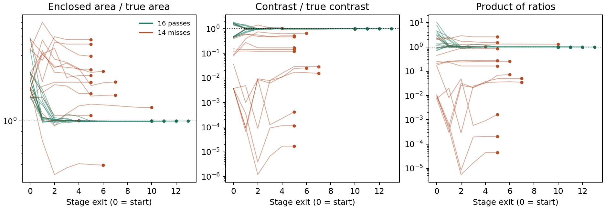
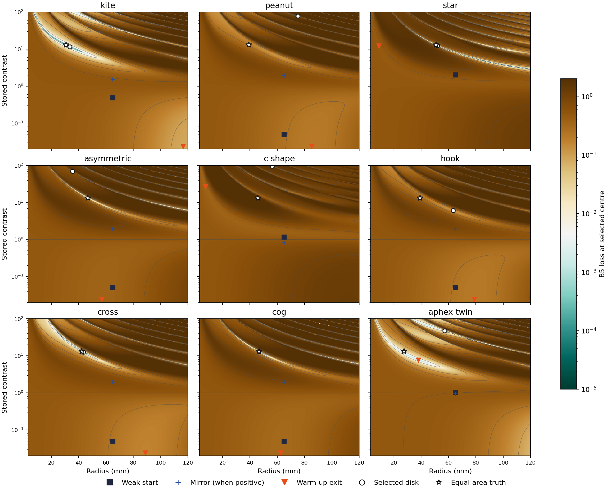
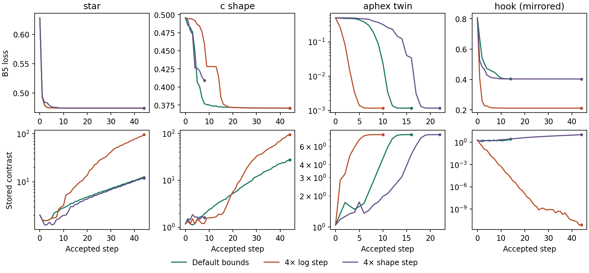

# Compare clean TG-002 misses with passes

**A real 0.25 GHz warm-up raised clean recovery from 16/30 to 20/30.** All 16 original passes stayed below 5% error. Cog at 0.5, kite and Aphex Twin at 4, and circle at 13.3 each crossed the 5% threshold. Three further misses improved and seven worsened. More iterations on asymmetric at 13.3 and twice the wall time on C-shape at 13.3 each left the case above 85% error. [Matched endpoints, work and stops](../../../../results/bem/stage_scheduling/2026-11-19/clean_tg002/matched_endpoints.csv)

The warm-up passed 10/10 cases at contrast 0.5, 9/10 at 4 and 1/10 at 13.3. Among the 16 retained passes, Aphex Twin at 0.5 had the largest warm-up error, 0.643%. [All 30 matched warm-up receipts](../../../../results/bem/stage_scheduling/2026-11-19/clean_tg002/warmup/)

**Round two recovered one more case.** For kite at 13.3, changing the warm-up start from 0.485 to 1.515 lowered final error from 315.98% to 0.0901%. Five other two-sided tests kept the weak start. Longer warm-ups and a longer wall yielded no further passes. [Round-two endpoints](../../../../results/bem/stage_scheduling/2026-11-19/clean_tg002/round_two_endpoints.csv)

## What explains each of the 14 misses?

Errors measure missing plus excess area as a percentage of true area at the end of the full fit. **Matched test** identifies the effect of the named change on final error. **Observation only** marks a possible cause of the final miss. A rejected mirror was tested through warm-up only. Background contrast is 1. [Paired endpoint scores](../../../../results/bem/stage_scheduling/2026-11-19/clean_tg002/matched_endpoints.csv)

| Case | Original error | Warm-up error | Cause and strength of evidence | Evidence |
|---|---:|---:|---|---|
| `cog__c0.5` | 17.11% | 0.30% | **Matched test.** Missing warm-up. Adding the 0.25 GHz band-one stage recovered the case. | [Fit record](../../../../results/bem/stage_scheduling/2026-11-19/clean_tg002/warmup/cog__c0.5.json) |
| `kite__c4` | 467.38% | 0.10% | **Matched test.** Missing warm-up. Adding the 0.25 GHz band-one stage recovered the case. | [Fit record](../../../../results/bem/stage_scheduling/2026-11-19/clean_tg002/warmup/kite__c4.json) |
| `c_shape__c4` | 43.78% | 43.97% | **Matched test.** The narrow stage-one band closed the opening. Widening the four early bands together preserved it and gave 0.07% final error. | [Matched band test](../01_trace_stage_stops_and_shape_bands/shape_bands.md) |
| `aphex_twin__c4` | 196.85% | 0.22% | **Matched test.** Missing warm-up. Adding the 0.25 GHz band-one stage recovered the case. | [Fit record](../../../../results/bem/stage_scheduling/2026-11-19/clean_tg002/warmup/aphex_twin__c4.json) |
| `circle__c13.3` | 231.38% | <0.001% | **Matched test.** Missing warm-up. Adding the 0.25 GHz band-one stage recovered the case. | [Fit record](../../../../results/bem/stage_scheduling/2026-11-19/clean_tg002/warmup/circle__c13.3.json) |
| `kite__c13.3` | 306.74% | 315.98% | **Matched test.** Wrong-side start. The mirror at 1.515 won the warm-up loss comparison and the same ladder recovered the case at 0.0901%. | [Round-two fit](../../../../results/bem/stage_scheduling/2026-11-19/clean_tg002/two_sided/kite__c13.3.json) |
| `peanut__c13.3` | 161.07% | 149.53% | **Observation only.** The weak start is below background. The mirror stalled after seven steps at higher loss. The matched selection repeated the 149.53% miss. | [Round-two fit](../../../../results/bem/stage_scheduling/2026-11-19/clean_tg002/two_sided/peanut__c13.3.json) |
| `asymmetric__c13.3` | 186.30% | 185.50% | **Observation only.** The mirror crossed below background and stalled after 12 steps. The matched selection kept the weak start at both caps. | [Round-two fit](../../../../results/bem/stage_scheduling/2026-11-19/clean_tg002/two_sided/asymmetric__c13.3.json) |
| `hook__c13.3` | 171.76% | 578.88% | **Observation only.** The mirror stalled after 14 steps at loss 0.403, above the weak side’s 0.211. The matched selection kept the weak start. | [Round-two fit](../../../../results/bem/stage_scheduling/2026-11-19/clean_tg002/two_sided/hook__c13.3.json) |
| `cross__c13.3` | 128.08% | 154.24% | **Observation only.** The mirror used all 44 and then all 220 steps. Its loss stayed above the weak side’s at both caps, so both fits kept the weak start. | [Round-two fit](../../../../results/bem/stage_scheduling/2026-11-19/clean_tg002/two_sided_long/cross__c13.3.json) |
| `cog__c13.3` | 72.89% | 74.46% | **Observation only.** The mirror crossed below background and stalled after nine steps. The matched selection kept the weak start at both caps. | [Round-two fit](../../../../results/bem/stage_scheduling/2026-11-19/clean_tg002/two_sided/cog__c13.3.json) |
| `star__c13.3` | 58.79% | 80.16% | **Matched test.** The 44-step cap cut off a moving warm-up. Extending it drove contrast to 2,079 and worsened final error to 98.61%. The cause of the remaining miss is open. | [Round-two fit](../../../../results/bem/stage_scheduling/2026-11-19/clean_tg002/warmup_long_wall600/star__c13.3.json) |
| `c_shape__c13.3` | 85.96% | 114.86% | **Matched test.** Extending the capped warm-up drove contrast to 6,674. Error fell to 100.62%. At 600 s the schedule finished at essentially the same error. | [Round-two fit](../../../../results/bem/stage_scheduling/2026-11-19/clean_tg002/warmup_long_wall600/c_shape__c13.3.json) |
| `aphex_twin__c13.3` | 567.95% | 106.56% | **Matched test.** The warm-up stayed at its 16-step local minimum (contrast 7.80) under both caps. The 600 s wall still left 105.84% error. | [Round-two fit](../../../../results/bem/stage_scheduling/2026-11-19/clean_tg002/warmup_long_wall600/aphex_twin__c13.3.json) · [Curvature](../../../../results/bem/stage_scheduling/2026-11-19/clean_tg002/../real_disk_starts/warmup_curvature.json) |

<details>
<summary>Final contrasts, fit stops and other matched endpoints</summary>


The errors below measure missing plus excess area as a percentage of true area. The warm-up column gives the returned endpoint after the full schedule. [Warm-up receipts](../../../../results/bem/stage_scheduling/2026-11-19/clean_tg002/warmup/)

| Case | Original error | Warm-up error | Warm-up final contrast | Warm-up result | Other matched endpoint |
|---|---:|---:|---:|---|---|
| `cog__c0.5` | 17.11% | 0.30% | 0.500 | **Pass** | — |
| `kite__c4` | 467.38% | 0.10% | 4.000 | **Pass** | — |
| `c_shape__c4` | 43.78% | 43.97% | 3.882 | Physics failure | — |
| `aphex_twin__c4` | 196.85% | 0.22% | 4.000 | **Pass** | — |
| `circle__c13.3` | 231.38% | <0.001% | 13.300 | **Pass** | — |
| `kite__c13.3` | 306.74% | 315.98% | 1.6e-07 | Physics failure | — |
| `peanut__c13.3` | 161.07% | 149.53% | 3.2e-08 | Physics failure | — |
| `star__c13.3` | 58.79% | 80.16% | 4.667 | Time limit | — |
| `asymmetric__c13.3` | 186.30% | 185.50% | 0.343 | Physics failure | Longer stage 187.15% |
| `c_shape__c13.3` | 85.96% | 114.86% | 10.825 | Time limit | Longer wall 85.32% |
| `hook__c13.3` | 171.76% | 578.88% | 0.161 | Physics failure | — |
| `cross__c13.3` | 128.08% | 154.24% | 0.00062 | Physics failure | — |
| `cog__c13.3` | 72.89% | 74.46% | 0.384 | Physics failure | — |
| `aphex_twin__c13.3` | 567.95% | 106.56% | 64.030 | Time limit | — |

</details>

**What happened during warm-up.** At 13.3 the weak starts for kite, peanut, asymmetric, hook, cross and cog lie below the background value of one. All six took 44 warm-up steps towards zero, then ended on forward-solver failures. Star and C-shape used all 44 steps at losses of 0.474 and 0.371. Aphex Twin instead stopped after 16 steps at loss 0.00118 and contrast 7.7985, then returned at contrast 64.03 after hitting the wall. Only circle recovered at 13.3. [Per-stage curves, losses and contrasting paths](../../../../results/bem/stage_scheduling/2026-11-19/clean_tg002/warmup/)

**What the extra iterations bought.** Asymmetric at 13.3 reproduced stage one and stage-two step 22 exactly. Increasing the stage-two cap to 220 gave 34 accepted steps before the search exhausted decreasing proposals. Its stage error fell from 218.84% to 218.68%, while its final error rose from 186.30% to 187.15%. The original and longer fits both ended on a candidate physics failure at full band 15. A separate process briefly shared the GPU during this test, so elapsed time is unsuitable for a speed comparison. [Longer-stage receipt](../../../../results/bem/stage_scheduling/2026-11-19/clean_tg002/longer_stage/asymmetric__c13.3.json) · [Coordinator’s timing note](plan.md)

**What the extra time bought.** C-shape at 13.3 reproduced the four ladder endpoints, full band 11 and step six of full band 15 exactly. Doubling the nominal wall limit from 120 to 240 s let the fit reach full band 37. Work rose from 2,376 to 4,922 units and actual time from 120.4 to 248.4 s. Error improved by 0.64 percentage points. A wall limit cost progress on this case. Recovery under a still larger budget remains untested here. [Longer-wall receipt](../../../../results/bem/stage_scheduling/2026-11-19/clean_tg002/longer_wall/c_shape__c13.3.json) · [Matched prefix checks](../../../../results/bem/stage_scheduling/2026-11-19/clean_tg002/matched_prefixes.csv)

**Settings, 19 November 2026.** The coordinator ran the GPU fits. The original fits date to 17 November. Each matched pair used the same 19 sealed real observations, centred 65 mm circle, weak estimate, recovered contrast, modal Müller, slider, no localization and 13,412-unit limit. Warm-up added band 1, storage 4, 44 steps and a 600-unit quota before the default ladder under the same 120 s nominal wall limit. Input hashes, start contrast and settings on common stages match. The available control for warm-up is the shared start. For cap and wall changes we also compared the saved accepted endpoints. [Comparison code](../../../../experiments/comparison/score_clean_schedule_changes.py) · [Original inventory](../../../../results/bem/stage_scheduling/2026-11-19/clean_tg002/original_stages.csv)

## Round two: mirrored starts, longer warm-ups and a 600 s wall

**Kite was the only case to cross 5%.** On 19 November 2026 the coordinator ran 18 fits on nine contrast-13.3 misses. Each pair compared the same real data, centred 65 mm geometry, 0.25 GHz warm-up, ladder and 13,412-unit fit limit. The six two-sided runs at each cap tried both starting contrasts before fitting from the one with lower warm-up loss. [Endpoints and matched stages](../../../../results/bem/stage_scheduling/2026-11-19/clean_tg002/round_two_endpoints.csv) · [Both candidates, stops and extra work](../../../../results/bem/stage_scheduling/2026-11-19/clean_tg002/round_two_side_selection.csv)

| Case | Weak / mirror loss at 44 steps or earlier | Mirror stop (accepted steps) | Plain warm-up error | Two-sided error | Two-sided, longer error |
|---|---:|---|---:|---:|---:|
| Kite | 0.081656 / **0.000287** | Gradient (15) | 315.98% | **0.0901%** | **0.0901%** |
| Peanut | **0.206237** / 0.406431 | No decreasing step (7) | 149.53% | 149.53% | 149.42% |
| Asymmetric | **0.358132** / 0.375034 | No decreasing step (12) | 185.50% | 185.50% | 158.54% |
| Hook | **0.211227** / 0.403490 | No decreasing step (14) | 578.88% | 578.88% | 437.13% |
| Cross | **0.162396** / 0.464913 | Iteration cap (44) | 154.24% | 154.24% | 153.22% |
| Cog | **0.317003** / 0.346181 | No decreasing step (9) | 74.46% | 74.46% | 98.30% |

Kite’s mirror started at 1.515, left warm-up at 11.643 and finished at 13.300. Both caps reproduced all 11 fitted stages. The other five mirrors started at 1.95. Four found no decreasing step. Cross reached contrast 5,490 at step 220 and still lost the comparison, 0.464768 to 0.162395. Asymmetric and cog crossed below background even from the mirrored start.

At the usual cap, all five rejected-mirror cases repeated every saved stage of their plain warm-up fits exactly. The longer warm-up still selected the weak side in all five. Four final errors fell, cog’s rose, and all five ended on forward-solver failures. Each pair of candidate warm-ups cost an extra 371–641 units at the usual cap and 780–2,458 at the longer cap, outside the selected fit’s limit. The rejected starts have no full-ladder endpoints. [Side-selection records](../../../../results/bem/stage_scheduling/2026-11-19/clean_tg002/round_two_side_selection.csv)

| Case | Warm-up contrast, usual → longer cap | Longer warm-up stop | Plain warm-up error | Longer, 120 s error | Longer, 600 s error | Final contrast, 120 s → 600 s |
|---|---:|---|---:|---:|---:|---:|
| Star | 12.33 → 2,079.16 | No decreasing step (206) | 80.16% | 98.61298% | 98.61443% | 254.72 → 254.97 |
| C-shape | 27.13 → 6,673.85 | No decreasing step (184) | 114.86% | 100.62457% | 100.62441% | 6,821.82 → 6,825.08 |
| Aphex Twin | 7.7985 → 7.7985 | Gradient (16) | 106.56% | 106.55527% | 105.84168% | 64.03 → 64.99 |

Raising the warm-up allowance from 44 steps / 600 units to 220 / 3,000 reduced warm-up loss by just 0.0000090 on star and 0.000101 on C-shape. Aphex Twin repeated every stage of its 120 s fit. Star and C-shape reached the extreme contrasts in the table before the ladder began. [Long warm-up fits](../../../../results/bem/stage_scheduling/2026-11-19/clean_tg002/warmup_long/)

All three wall comparisons matched the warm-up, four ladder exits and first full-catalog entry exactly. At 600 s, star and C-shape completed the schedule through bands 61 and 79. Aphex Twin reached band 55, hit the wall at 604.9 s and improved by 0.714 percentage points. The extra wall time changed how far all three fits ran and left all three above 98% error. [600 s fits](../../../../results/bem/stage_scheduling/2026-11-19/clean_tg002/warmup_long_wall600/)

The checks recomputed final area error from every returned outline and matched input hashes, common stage settings, accepted step counts, endpoint curves, contrasts and losses. For warm-ups that continued beyond step 44, the receipts save the common entry and the final stage state. The intermediate step-44 state is unavailable. [Scoring code](../../../../experiments/comparison/score_clean_warmup_variants.py) · [Prefix checks](../../../../results/bem/stage_scheduling/2026-11-19/clean_tg002/round_two_endpoints.csv)

**Round four was withdrawn** before the 30-case frontier-cap run. Its only clean TG-002 test was kite at contrast 4, with 0.29% error under the cap and a measurement-only control that reproduced the warm-up fit stage for stage. [Coordinator’s decision](plan.md#round-four-bands-capped-at-the-measured-frontier-19-november-2026-0317-utc-coordinator)

## When do the area and contrast separate?

**Eleven of the 14 misses already enclose at least 10% too much area and recover contrast at least 10% too low after the first 0.5 GHz stage.** This holds for kite and Aphex Twin at 4, and every shape except C-shape at 13.3. The same 11 meet both conditions at stages two, four and return. The 10% bands describe the trajectories. The benchmark pass threshold is 5% symmetric-difference area. [All 30 cases and 250 stage exits](../../../../results/bem/stage_scheduling/2026-11-19/clean_tg002/original_area_contrast.csv)

| Median ratio to truth | Passes, stage 1 | Misses, stage 1 | Passes, stage 2 | Misses, stage 2 | Passes, return | Misses, return |
|---|---:|---:|---:|---:|---:|---:|
| Enclosed area | 1.079 | 2.952 | 1.006 | 2.937 | 1.000 | 2.276 |
| Material contrast | 1.006 | 0.132 | 1.000 | 0.134 | 1.000 | 0.134 |
| Area ratio times contrast ratio | 1.078 | 0.246 | 1.003 | 0.203 | 1.000 | 0.211 |

At stage two all 16 passes have area between 0.915 and 1.074 times truth and contrast between 0.919 and 1.026 times truth (rounded bounds). Only one miss, cog at 0.5, falls inside both ranges. Cog returns with 1.005 times the true area and 1.023 times the true contrast. Its remaining error measures where the boundary lies.

C-shape at 4 returns with 1.333 times the true area and 0.978 times the true contrast. The earlier matched band test showed its opening closes in stage one. C-shape at 13.3 returns too small, at 0.394 times the true area and 0.656 times the true contrast. [Earlier opening and band tests](../01_trace_stage_stops_and_shape_bands/results.md)



Areas use the same filled outlines as benchmark scoring. The requested product is within 10% of one at return for only one miss, cog at 0.5. The weak start actually scales susceptibility, the fitted material value minus the background value of one. Six contrast-13.3 fits even return on the opposite side of the background (kite, peanut, asymmetric, hook, cross and cog). These observations limit a common explanation based on conserving scattering strength. The CSV includes both products. [Weak contrast estimate](../../../../experiments/comparison/bem.py) · [Area analysis](../../../../experiments/comparison/measure_clean_area_contrast.py)

## What the two circle cases tell us

Both truths are 50 mm disks, displaced 22 mm from the prescribed centre. At contrast 4 the fitted equal-area radius goes from 65 to 59.36 to 50.00 mm and the material from 1.763 to 3.114 to 4.000 in the first two stages. At 13.3 the radius goes from 65 to 72.08 to 75.24 mm, while the material goes from 1.641 to 1.662 to 1.617. The stage-one centroid misses truth by 0.048 mm at contrast 4 and by 100.17 mm at 13.3. In the latter case the boundary ranges from 2.94 to 143.37 mm from its own centroid. Translation and distortion already dominate the error. Stage four accepts no move, and the full catalog fails at entry. [Saved paths](../../../../results/bem/stage_scheduling/2026-11-19/circle_loss_slices/stage_path.csv)


At the true centre, the true disk gives B5 loss below 4 × 10⁻²⁹ on every frequency set. Among larger, low-contrast disks (65–105 mm, material above 1 and at most 2.5), the sampled minimum for true contrast 13.3 is 0.085 at 0.5 GHz. Adding 0.75 GHz raises it to 0.338, and all 19 frequencies raise it to 0.494. For true contrast 4 the same minima are 0.010, 0.030 and 0.278. For the passing circle, the actual stage-one exit has loss 0.0000081 at 0.5 GHz and enters stage two at 0.05946. Adding 0.75 GHz resolves its wrong radius. For the high-contrast circle, the weak start already fits poorly at 0.25 GHz (loss 0.555). At that frequency a 65 mm disk at the true centre fits much better at contrast 7.91 (loss 0.00147). Switching to 0.5 GHz raises that disk’s loss to 0.699. [Disk comparisons](../../../../results/bem/stage_scheduling/2026-11-19/circle_loss_slices/comparison.csv) · [Independent disk and BEM checks](circle_loss_maps.md)

At the second-stage entry for contrast 13.3, the nearest equal-area disk on the true-centre map has loss 0.614. To connect it to the true disk on this sampled map requires reaching loss 0.739. At contrast 4 the corresponding connection stays at or below 0.042. At the original 65 mm start the 0.5 GHz map alone shows no required rise above starting loss for either case. The evidence for a separate low-contrast region is stronger after stage one. These are fixed-centre disk slices. The fitted Fourier curves can translate and deform.

**Method, 19 November 2026.** The exact disk series uses the sealed 24 paired fields, source strengths and B5 frequency weights. It reproduces the saved initial losses for both fits. Stage markers show the radius of a disk enclosing the same area as each saved curve. Connectivity uses eight neighbours over radii 2.5–140 mm and contrast 0.05–30. The plot zooms in on the saved paths. No disk was used to initialize a fit. [Analysis code](../../../../experiments/comparison/map_clean_circle_losses.py) · [Exact disk series](../../../../solvers/bem_inverse/mie_localize.py) · [Loss arrays](../../../../results/bem/stage_scheduling/2026-11-19/circle_loss_slices/loss.npz)

## Trial refusals

The measured cylinder reaches a 41 nm neck. Two refused steps demonstrably put one side through the other. Only two of 80 clean miss stages tried moves and refused every one before candidate physics. Circle and star at 13.3 account for both. None of 170 pass stages did so. The original TG-002 files omit refusal reasons. [Refusal counts, reconstruction and figure](trial_refusals.md)

## Limits and one further comparison

The matched warm-up tests the added stage as a whole. It changes the first frequency, first update band and amount of work spent before the ladder. In round one, only asymmetric and C-shape received matched cap and wall extensions. Across the originals the 14 misses had 39 capped stages out of 80, while the 16 passes had seven out of 170. Nine misses ended on a physics failure and five on time. Counting stop labels alone cannot assign a cause. [All original stops](../../../../results/bem/stage_scheduling/2026-11-19/clean_tg002/original_stages.csv)

The coordinator approved changing only the successful warm-up frequency from 0.25 to 0.5 GHz for all four rescued cases (cog at 0.5, kite and Aphex Twin at 4, circle at 13.3). Passing would show that the same restricted first stage can rescue that case at the default first frequency. A miss would show that the first frequency matters for this controlled pair. Each of the four fits has a nominal 120 s limit and 13,412 units. [Proposed driver](../../../../experiments/comparison/check_warmup_frequency.py)

```sh
PYTHONPATH=solvers:. OPENBLAS_NUM_THREADS=1 MKL_NUM_THREADS=1 OMP_NUM_THREADS=1 \
  /home/drdeng/miniconda3/envs/EMNerf/bin/python -m experiments.comparison.check_warmup_frequency circle__c13.3
```

The driver would write `results/bem/stage_scheduling/2026-11-19/clean_tg002/warmup_050/circle__c13.3.json`.

## Test real-data disk starts and band-one stopping

**A truth-free 0.25 GHz disk search found a close start for four of the nine remaining contrast-13.3 misses (kite, star, cross and cog).** In all four, the selected centre is within 1.3 mm, the radius within 10% of the equal-area radius, and the material within 15% of 13.3. The other five show why fitting one frequency can favour the wrong material or position. These are starting disks. Recovery requires running the warm-up and ladder from them.

### What the localizer can return

The maintained localizer takes the first **damped** observations and holds the supplied contrast fixed. It refuses all 30 real-only problems. To answer the real-data question, we first reproduced its centre/radius search on the single real 0.25 GHz observation at each saved weak material. Then we allowed the exact disk model to select material as a fourth unknown. Both are diagnostics outside the default path. They substitute the exact disk series for A1–A4 and use the same B5 loss. The default remains **localization none, one centred start, no grid search**. Adoption is the user’s decision. [Maintained localization](../../../../solvers/bem_inverse/localization.py) · [Disk series](../../../../solvers/bem_inverse/mie_localize.py) · [Real-data diagnostic](../../../../experiments/comparison/localize_clean_real_disks.py)

| Diagnostic | All 30 within both size/material bands | Nine remaining misses | Other 21 | Measured CPU wall time for all 30 |
|---|---:|---:|---:|---:|
| Search centre and radius at weak material | 0/30 | 0/9 | 0/21 | 8.54 s |
| Joint centre, radius and material search | 15/30 | 4/9 | 11/21 | 51.56 s |

The descriptive bands above are 10% for radius and 15% for material. For the other 21 cases, the joint search’s median centre error was 0.126 mm, absolute radius error 5.46%, and absolute contrast error 10.19%. For the nine, those medians were 1.29 mm, 23.26% and 54.25%. Both CSVs give the returned centre, radius, material and errors for **every case**. [Fixed-material starts and scores](../../../../results/bem/stage_scheduling/2026-11-19/real_disk_starts/fixed_weak_scores.csv) · [Joint starts and scores](../../../../results/bem/stage_scheduling/2026-11-19/real_disk_starts/joint_scores.csv)

### Which disk fits each of the nine?

Coordinates below are in mm relative to the prescribed scene centre. “Runner-up” is the lowest loss found at a distinct disk, differing by more than 2 mm in radius or centre, or 0.1 in log material. Both losses use all 24 measured pairs at 0.25 GHz. A small difference can conceal a large change in radius or material.

| Case, true contrast 13.3 | Selected centre (x, y) | Centre error | Radius / true equal-area radius | Selected material | Best loss | Runner-up loss |
|---|---:|---:|---:|---:|---:|---:|
| Kite | (-24.83, 15.58) | 1.29 | 33.48 / 30.62 | 11.643 | 0.00028698 | 0.00028972 |
| Peanut | (-8.27, -32.79) | 0.528 | 75.00 / 38.97 | 78.772 | 0.12224 | 0.12225 |
| Star | (19.92, -16.71) | 0.00112 | 51.91 / 50.78 | 12.553 | 1.913e-06 | 7.6671e-05 |
| Asymmetric | (6.50, 38.76) | 1.34 | 35.58 / 46.58 | 69.558 | 0.0072764 | 0.0087607 |
| C shape | (-116.55, -40.23) | 93.5 | 56.27 / 45.65 | 95.612 | 0.19513 | 0.1955 |
| Hook | (3.21, -18.76) | 8 | 63.26 / 38.99 | 6.085 | 0.12775 | 0.12997 |
| Cross | (32.84, 8.80) | 0.000325 | 43.55 / 42.24 | 12.666 | 2.83e-05 | 3.0001e-05 |
| Cog | (-21.67, 3.82) | 0.0013 | 46.61 / 46.51 | 13.186 | 6.5129e-11 | 1.0159e-07 |
| Aphex twin | (-21.05, -28.35) | 2.29 | 57.28 / 27.26 | 47.506 | 0.0011487 | 0.0011792 |

The two meshes returned the same nine branches. For example, asymmetric also has a disk of radius 47.32 mm and contrast 13.10 at loss 0.00876, close to its equal-area radius of 46.58 mm. The data prefer radius 35.58 mm and contrast 69.56. Peanut hits the 75 mm radius ceiling. C-shape’s chosen centre lies 93.51 mm from truth. At the Aphex Twin warm-up minimum the loss is only 0.0000304 above the winning disk, and even the winner has over twice the true equal-area radius. [Refined competing disks](../../../../results/bem/stage_scheduling/2026-11-19/real_disk_starts/joint_minima.json) · [Independent mesh](../../../../results/bem/stage_scheduling/2026-11-19/real_disk_starts/mesh_check/joint_scores.csv)



The maps hold centre fixed. The square, plus and triangle show the radius and material of the weak start, its mirror and the saved warm-up exit. Their centres can differ from the slice centre. Triangles below contrast 0.02 are drawn at the lower edge. All six are tabulated at their actual values. [Loss grids and axes](../../../../results/bem/stage_scheduling/2026-11-19/real_disk_starts/disk_slices.npz) · [Four-coordinate starts, losses and descents](../../../../results/bem/stage_scheduling/2026-11-19/real_disk_starts/basin_descents.json)

### Why the warm-up starts stay apart

**Six cases start on the wrong side of a loss barrier.** The weak estimate projects the measured field onto the response just above background. For kite, peanut, asymmetric, hook, cross and cog this projection is negative. Kite starts at 0.485 and the others clip to 0.05. Their starting losses are already 0.261–0.442. At material one the object matches its background, the scattered field vanishes, and B5 loss is **0.5 for every centre, radius and shape**. A continuous downhill path from these starts cannot cross to material above one. C11 checks finite trial endpoints, so a sufficiently large jump could cross. The saved warm-ups instead move farther below one and finish 0.142–0.418 beneath the barrier. All six later end on full-catalog forward failures with recovered material still below one. [Weak-start rule](../../../../experiments/comparison/bem.py) · [B5 normalization](../../../../solvers/bem_inverse/b5_residual.py) · [Background and endpoint checks](../../../../results/bem/stage_scheduling/2026-11-19/real_disk_starts/disk_checks.json)

For a test of basin membership, we ran local descent on the **four-coordinate exact-disk loss** from each actual centre, radius and material. The same descent from the selected disk defines the comparison endpoint. Bounds were widened to admit the real warm-up exits, including radii above 75 mm and material below 0.02. The table describes where the descent went. A dagger marks a 240-evaluation limit, where further movement remains possible.

| Case | From 65 mm weak start | From 65 mm mirrored start | From saved warm-up exit |
|---|---|---|---|
| Kite | Near zero material | **Selected disk** | Near zero material |
| Peanut | Near zero | Near zero | Near zero |
| Star | Small dense disk † | Mirror −0.028 is inadmissible | Small dense disk † |
| Asymmetric | Near zero † | 47.32 mm / 13.10, a different minimum | Near zero |
| C-shape | Small dense disk, displaced left † | Small dense disk, displaced right † | Small dense disk, displaced left † |
| Hook | Near zero | Near zero | Near zero |
| Cross | Near zero | Near zero † | Near zero |
| Cog | Near zero † | Near zero † | Near zero † |
| Aphex Twin | 38.03 mm / 7.80 | Near zero | 38.03 mm / 7.80 |

Thus only the mirrored kite reaches the selected disk in this descent. The six weak starts already below background remain there. For star and C-shape, even starting above one leaves the warm-up shrinking the disk. For Aphex Twin, a plausible centre and low warm-up loss coexist with the wrong radius and material. Its subsequent 0.5 GHz fit raises material from 7.80 to 40.18, and the fit eventually returns at 64.03. The exact-disk descent and the slider have different step rules, as their mirrored hook paths illustrate. [Basin endpoints and termination codes](../../../../results/bem/stage_scheduling/2026-11-19/real_disk_starts/basin_descents.csv) · [Actual warm-up and ladder stages](../../../../results/bem/stage_scheduling/2026-11-19/clean_tg002/warmup/)

### What actually stopped band one?

The 12 CPU settings each ran just one warm-up with a 44-step cap and a 600-unit quota. We repeated the mirrored hook reference once to record directional slopes. We used the three weak starts and the mirrored hook start, then changed one bound at a time. The default limits are ±0.25 in log material, ±12 mm for the constant normal component, and ±18 mm for first-order components. The slider checks each trial before C11 checks loss. None of the four reference replays had a geometry refusal. All three weak-start reference losses agree with the saved GPU warm-up within 7 × 10⁻¹². [C9 bounds](../../../../solvers/bem_inverse/geometry_update_methods/__init__.py) · [Material step](../../../../solvers/bem_inverse/material.py) · [C11 and C12](../../../../solvers/bem_inverse/fit_stage.py) · [Replay measurements](../../../../results/bem/stage_scheduling/2026-11-19/real_disk_starts/warmup_replays.csv)

| Case and start | Default steps / loss | 4× log bound, steps / loss | 4× shape bounds, steps / loss | Default trials rejected for nondecreasing loss |
|---|---:|---:|---:|---:|
| Star, weak | 44 / 0.473981 | 44 / 0.473973 | 44 / 0.473981 | 212 |
| C-shape, weak | 44 / 0.370959 | 44 / 0.370886 | 8 / 0.409284 | 207 |
| Aphex Twin, weak | 16 / 0.00117915 | 10 / 0.00117915 | 22 / 0.00117915 | 49 |
| Hook, mirror 1.95 | 14 / 0.403490 | 44 / 0.211225 | 44 / 0.403003 | 43 |

**Star and C-shape ran out of iterations while still moving.** Their final B8 gradient norms were 0.0223 and 0.158, against a stopping tolerance of 10⁻⁷. Both final accepted proposals were already inside both bounds. Increasing the material bound sends star to 2.96 mm / 95.46 and C-shape to 3.80 mm / 93.79 for changes in loss below 0.00008. More room speeds the slide towards a smaller, denser disk. Widening the shape bound alone leaves star in the same region and stalls C-shape earlier.

**Aphex Twin reached a local minimum of the four-coordinate problem.** Its exact-disk gradient norm is 2.3 × 10⁻⁹ with distances in 50 mm units and material in log units. The four finite-difference curvature eigenvalues are positive, ranging from 0.0173 to 4.79. Both bound changes converge to the same 38.03 mm / 7.80 disk. The warm-up used 100 of 600 units. Raising its iteration or work cap alone cannot change the recorded gradient stop. [Exact-disk curvature](../../../../results/bem/stage_scheduling/2026-11-19/real_disk_starts/warmup_curvature.json)

**The mirrored hook stopped because clipping turned descent into ascent.** Its B8 gradient was still 0.518. At iteration 15 all five damping attempts produced downhill directions, with directional slope about −0.000873. After clipping the radial and material coordinates separately, all five slopes were about +0.001420. Each of the 40 backtracks then increased loss. Relaxing either bound allowed more steps. With the larger material step hook crossed back below one and finished at loss 0.211225, essentially the weak-side result. Escaping the stop did not yield the selected 63.26 mm / 6.08 disk. [Hook trial directions and backtracks](../../../../results/bem/stage_scheduling/2026-11-19/real_disk_starts/warmup_replays/hook__c13.3_reference.json)



### Search cost and matched GPU comparison

On 19 November 2026 the fixed-material diagnostic evaluated 111 × 111 centres and 61 radii per case, then used the maintained 12 coordinate-refinement iterations. The joint search shared 10,207,680 disk predictions across the 30 data vectors and refined up to 18 sampled minima per case. Its grid covered centres within ±220 mm on each axis, radii 15–75 mm and material 0.02–100. The material range was an analysis choice. The fixed-material diagnostic used the maintained contrast-dependent series cutoff and refinement bounds. The joint maps used orders −41 through 41. Independent direct-series checks reproduced all 60 reported losses to within 10⁻¹⁴. Only measured fields and acquisition geometry enter selection. Truth enters after the starts are saved. The 4.74 s grid and subsequent refinements took 51.56 s combined, with two BLAS threads. Neither disk search needs a BEM solve. An initial unbatched fixed-material scan was interrupted before producing a table. The complete timings above are for shared predictions on all 30 cases. [Settings and cost](../../../../results/bem/stage_scheduling/2026-11-19/real_disk_starts/joint_starts.json) · [Fixed-material cost](../../../../results/bem/stage_scheduling/2026-11-19/real_disk_starts/fixed_cost.json)

A second mesh used 15,132,825 predictions and took another 38.42 s as a check. Across all 30 winners the two meshes differed by at most 0.00032 mm in radius, 0.0013 in contrast, and 1.1 × 10⁻¹¹ in loss. A post-selection descent seeded at the equal-area truth found no lower solution among the nine. The finite search covers the stated parameter range. It cannot establish global optimality beyond it. [Mesh-check starts](../../../../results/bem/stage_scheduling/2026-11-19/real_disk_starts/mesh_check/joint_starts.json) · [Numerical checks](../../../../results/bem/stage_scheduling/2026-11-19/real_disk_starts/disk_checks.json)

**Matched arm for the coordinator.** On cog at 13.3 the truth-free disk gives radius 46.61 mm, contrast 13.186 and centre error 0.0013 mm. The control starts at 65 mm, contrast 0.05 and misses. The command below changes only the initial disk and material before the same 0.25 GHz warm-up and real ladder. The 120 s wall and 13,412-unit fit limits remain in force. The separate CPU search cost is recorded outside those limits. This diagnostic leaves adoption to the user. [Matched-arm driver](../../../../experiments/comparison/check_localized_real_warmup.py)

```sh
PYTHONPATH=solvers:. OPENBLAS_NUM_THREADS=1 MKL_NUM_THREADS=1 OMP_NUM_THREADS=1 \
  /home/drdeng/miniconda3/envs/EMNerf/bin/python -m experiments.comparison.check_localized_real_warmup cog__c13.3
```

Output is `results/bem/stage_scheduling/2026-11-19/clean_tg002/localized_real_warmup/cog__c13.3.json`.

**C-shape at contrast 4.** Its warm-up changes final area error from 43.78% to 43.97%. The earlier matched comparison already showed how the first narrow shape band closed the opening, covering 99.47% of it, while the wider early bands left 1.76% covered and recovered the shape at 0.07% final error without warm-up. That answers this case. Changing the default band schedule for other shapes would be a separate question. [Earlier band comparison](../01_trace_stage_stops_and_shape_bands/results.md)

### Does a second real frequency resolve the five wrong disk starts?

**Adding 0.375 GHz fixed none of the five. Adding 0.5 GHz fixed asymmetric alone.** Its selected radius is 5.1% low, contrast 14.1% high and centre 3.18 mm from the true centroid. All three meshes selected that disk. “Close” uses the previous 10% radius and 15% contrast bands. These scores describe starts. The user’s default is localization `none` with no grid search.

Each entry gives **radius in mm / stored contrast**. The last column explains the 0.25 GHz selection from the complex values at the 24 rotating source–receiver pairs. Angular orders refer to variation around that measurement ring.

| Case (true radius, mm) | 0.25 alone | Add 0.375 | Add 0.5 | What the 0.25 GHz data favour |
|---|---:|---:|---:|---|
| Peanut (38.97) | 75.00 / 78.77 | 26.61 / 100.00 | 15.00 / 97.81 | Disks at contrast 78.77 and 32.21 give fields only 0.66% of the observed norm apart. The 75 mm winner still leaves 65% of its loss in angular order 2. |
| Asymmetric (46.58) | 35.58 / 69.56 | 34.43 / 74.34 | **44.22 / 15.17** | The high-contrast disk fits the mean and first angular order slightly better than the 47.32 mm / 13.10 rival. At 0.5 GHz their losses reverse, 0.288 versus 0.119. |
| C-shape (45.65) | 56.27 / 95.61 | 32.44 / 86.17 | 34.77 / 3.06 | Order 2 carries 79.5% of measured power. Shifting the disk 93.5 mm from the centroid and changing radius and material cuts its order-2 loss from 0.493 to 0.067 relative to the equal-area disk. |
| Hook (38.99) | 63.26 / 6.08 | 56.15 / 7.98 | 15.23 / 100.00 | The wider, lower-contrast disk cuts the mean and first-order loss from 0.226 to 0.0026 relative to the equal-area disk. Order 2 still accounts for 79% of its remaining loss. |
| Aphex Twin (27.26) | 57.28 / 47.51 | 44.99 / 5.66 | 38.85 / 40.58 | The 57.28 mm disk and the 38.03 mm / 7.80 disk differ by only 0.67% of the observed norm. Their losses differ by 0.000030. |

For Aphex Twin, the first mesh with added 0.5 GHz found a promising 27.92 mm / 12.55 disk. Its paired loss of 0.12365 exceeds 0.10718 for the 38.85 mm disk, whose centre is 18.50 mm off. The finer search also lowered peanut’s loss with added 0.375 GHz, still at the contrast ceiling. The reported selections are the lowest losses found within the original bounds. [All centres, errors and losses by mesh](../../../../results/bem/stage_scheduling/2026-11-19/real_disk_frequency_pairs/scores.csv) · [Per-frequency losses and angular components](../../../../results/bem/stage_scheduling/2026-11-19/real_disk_frequency_pairs/ring_diagnostics.json)

On 19 November 2026 the CPU search used one common disk at both frequencies and averaged their separately normalized B5 losses. Three scans and their refinements took 202 s combined with two BLAS threads. A direct Mie sum reproduced all ten selected losses within 10⁻¹². Truth was read only for scoring and explaining the selected starts. No inverse fits were run. [Search code](../../../../experiments/comparison/compare_real_disk_frequencies.py) · [B5 definition](../../../reference/inverse_information_chain.md#b5-predicted-data--observations--normalized-real-residual) · [Selected disks](../../../../results/bem/stage_scheduling/2026-11-19/real_disk_frequency_pairs/selected_starts.json)
