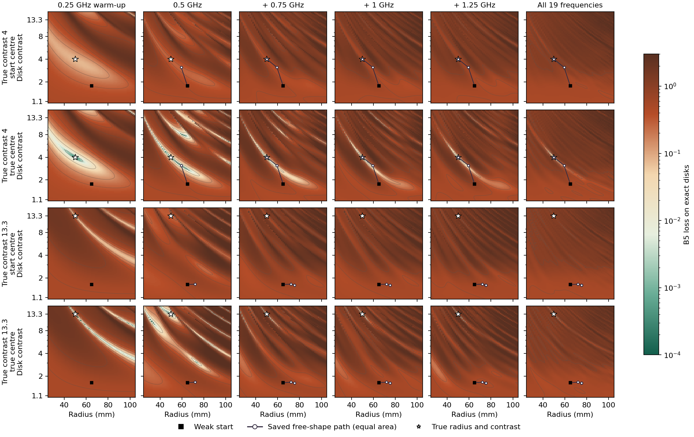

# Compare clean TG-002 misses with passes

**A real 0.25 GHz warm-up raised clean recovery from 16/30 to 20/30.** All 16 original passes stayed below 5% error. Cog at 0.5, kite and Aphex Twin at 4, and circle at 13.3 each crossed the 5% threshold. Three further misses improved and seven worsened. More iterations on asymmetric at 13.3 and twice the wall time on C-shape at 13.3 each left the case above 85% error. [Matched endpoints, work and stops](../../../../results/bem/stage_scheduling/2026-11-19/clean_tg002/matched_endpoints.csv)

The warm-up passed 10/10 cases at contrast 0.5, 9/10 at 4 and 1/10 at 13.3. Among the 16 retained passes, Aphex Twin at 0.5 had the largest warm-up error, 0.643%. [All 30 matched warm-up receipts](../../../../results/bem/stage_scheduling/2026-11-19/clean_tg002/warmup/)

## What changed for each original miss?

The errors below measure missing plus excess area as a percentage of true area. The warm-up column gives the returned endpoint after the full schedule. [Warm-up receipts](../../../../results/bem/stage_scheduling/2026-11-19/clean_tg002/warmup/)

| Case | Original error | Warm-up error | Warm-up final contrast | Warm-up result | Other matched endpoint |
|---|---:|---:|---:|---|---|
| `cog__c0.5` | 17.11% | 0.30% | 0.500 | **Pass** | — |
| `kite__c4` | 467.38% | 0.10% | 4.000 | **Pass** | — |
| `c_shape__c4` | 43.78% | 43.97% | 3.882 | Physics failure | — |
| `aphex_twin__c4` | 196.85% | 0.22% | 4.000 | **Pass** | — |
| `circle__c13.3` | 231.38% | <0.001% | 13.300 | **Pass** | — |
| `kite__c13.3` | 306.74% | 315.98% | 1.6e-07 | Physics failure | — |
| `peanut__c13.3` | 161.07% | 149.53% | 3.2e-08 | Physics failure | — |
| `star__c13.3` | 58.79% | 80.16% | 4.667 | Time limit | — |
| `asymmetric__c13.3` | 186.30% | 185.50% | 0.343 | Physics failure | Longer stage 187.15% |
| `c_shape__c13.3` | 85.96% | 114.86% | 10.825 | Time limit | Longer wall 85.32% |
| `hook__c13.3` | 171.76% | 578.88% | 0.161 | Physics failure | — |
| `cross__c13.3` | 128.08% | 154.24% | 0.00062 | Physics failure | — |
| `cog__c13.3` | 72.89% | 74.46% | 0.384 | Physics failure | — |
| `aphex_twin__c13.3` | 567.95% | 106.56% | 64.030 | Time limit | — |

**What happened during warm-up.** At 13.3 the weak starts for kite, peanut, asymmetric, hook, cross and cog lie below the background value of one. All six took 44 warm-up steps towards zero, then ended on forward-solver failures. Star and C-shape used all 44 steps at losses of 0.474 and 0.371. Aphex Twin instead stopped after 16 steps at loss 0.00118 and contrast 7.7985, then returned at contrast 64.03 after hitting the wall. Only circle recovered at 13.3. [Per-stage curves, losses and contrasting paths](../../../../results/bem/stage_scheduling/2026-11-19/clean_tg002/warmup/)

**What the extra iterations bought.** Asymmetric at 13.3 reproduced stage one and stage-two step 22 exactly. Increasing the stage-two cap to 220 gave 34 accepted steps before the search exhausted decreasing proposals. Its stage error fell from 218.84% to 218.68%, while its final error rose from 186.30% to 187.15%. The original and longer fits both ended on a candidate physics failure at full band 15. A separate process briefly shared the GPU during this test, so elapsed time is unsuitable for a speed comparison. [Longer-stage receipt](../../../../results/bem/stage_scheduling/2026-11-19/clean_tg002/longer_stage/asymmetric__c13.3.json) · [Coordinator’s timing note](plan.md)

**What the extra time bought.** C-shape at 13.3 reproduced the four ladder endpoints, full band 11 and step six of full band 15 exactly. Doubling the nominal wall limit from 120 to 240 s let the fit reach full band 37. Work rose from 2,376 to 4,922 units and actual time from 120.4 to 248.4 s. Error improved by 0.64 percentage points. A wall limit cost progress on this case. Recovery under a still larger budget remains untested here. [Longer-wall receipt](../../../../results/bem/stage_scheduling/2026-11-19/clean_tg002/longer_wall/c_shape__c13.3.json) · [Matched prefix checks](../../../../results/bem/stage_scheduling/2026-11-19/clean_tg002/matched_prefixes.csv)

**Settings, 19 November 2026.** The coordinator ran the GPU fits. The original fits date to 17 November. Each matched pair used the same 19 sealed real observations, centred 65 mm circle, weak estimate, recovered contrast, modal Müller, slider, no localization and 13,412-unit limit. Warm-up added band 1, storage 4, 44 steps and a 600-unit quota before the default ladder under the same 120 s nominal wall limit. Input hashes, start contrast and settings on common stages match. The available control for warm-up is the shared start. For cap and wall changes we also compared the saved accepted endpoints. [Comparison code](../../../../experiments/comparison/score_clean_schedule_changes.py) · [Original inventory](../../../../results/bem/stage_scheduling/2026-11-19/clean_tg002/original_stages.csv)

## When do the area and contrast separate?

**Eleven of the 14 misses already enclose at least 10% too much area and recover contrast at least 10% too low after the first 0.5 GHz stage.** This holds for kite and Aphex Twin at 4, and every shape except C-shape at 13.3. The same 11 meet both conditions at stages two, four and return. The 10% bands describe the trajectories. The benchmark pass threshold is 5% symmetric-difference area. [All 30 cases and 250 stage exits](../../../../results/bem/stage_scheduling/2026-11-19/clean_tg002/original_area_contrast.csv)

| Median ratio to truth | Passes, stage 1 | Misses, stage 1 | Passes, stage 2 | Misses, stage 2 | Passes, return | Misses, return |
|---|---:|---:|---:|---:|---:|---:|
| Enclosed area | 1.079 | 2.952 | 1.006 | 2.937 | 1.000 | 2.276 |
| Material contrast | 1.006 | 0.132 | 1.000 | 0.134 | 1.000 | 0.134 |
| Area ratio times contrast ratio | 1.078 | 0.246 | 1.003 | 0.203 | 1.000 | 0.211 |

At stage two all 16 passes have area between 0.915 and 1.074 times truth and contrast between 0.919 and 1.026 times truth (rounded bounds). Only one miss, cog at 0.5, falls inside both ranges. Cog returns with 1.005 times the true area and 1.023 times the true contrast. Its remaining error measures where the boundary lies.

C-shape at 4 returns with 1.333 times the true area and 0.978 times the true contrast. The earlier matched band test showed its opening closes in stage one. C-shape at 13.3 returns too small, at 0.394 times the true area and 0.656 times the true contrast. [Earlier opening and band tests](../01_trace_stage_stops_and_shape_bands/results.md)


Areas use the same filled outlines as benchmark scoring. The requested product is within 10% of one at return for only one miss, cog at 0.5. The weak start actually scales susceptibility, the fitted material value minus the background value of one. Six contrast-13.3 fits even return on the opposite side of the background (kite, peanut, asymmetric, hook, cross and cog). These observations limit a common explanation based on conserving scattering strength. The CSV includes both products. [Weak contrast estimate](../../../../experiments/comparison/bem.py) · [Area analysis](../../../../experiments/comparison/measure_clean_area_contrast.py)

## What the two circle cases tell us

Both truths are 50 mm disks, displaced 22 mm from the prescribed centre. At contrast 4 the fitted equal-area radius goes from 65 to 59.36 to 50.00 mm and the material from 1.763 to 3.114 to 4.000 in the first two stages. At 13.3 the radius goes from 65 to 72.08 to 75.24 mm, while the material goes from 1.641 to 1.662 to 1.617. The stage-one centroid misses truth by 0.048 mm at contrast 4 and by 100.17 mm at 13.3. In the latter case the boundary ranges from 2.94 to 143.37 mm from its own centroid. Translation and distortion already dominate the error. Stage four accepts no move, and the full catalog fails at entry. [Saved paths](../../../../results/bem/stage_scheduling/2026-11-19/circle_loss_slices/stage_path.csv)



At the true centre, the true disk gives B5 loss below 4 × 10⁻²⁹ on every frequency set. Among larger, low-contrast disks (65–105 mm, material above 1 and at most 2.5), the sampled minimum for true contrast 13.3 is 0.085 at 0.5 GHz. Adding 0.75 GHz raises it to 0.338, and all 19 frequencies raise it to 0.494. For true contrast 4 the same minima are 0.010, 0.030 and 0.278. For the passing circle, the actual stage-one exit has loss 0.0000081 at 0.5 GHz and enters stage two at 0.05946. Adding 0.75 GHz resolves its wrong radius. For the high-contrast circle, the weak start already fits poorly at 0.25 GHz (loss 0.555). At that frequency a 65 mm disk at the true centre fits much better at contrast 7.91 (loss 0.00147). Switching to 0.5 GHz raises that disk’s loss to 0.699. [Disk comparisons](../../../../results/bem/stage_scheduling/2026-11-19/circle_loss_slices/comparison.csv) · [Independent disk and BEM checks](circle_loss_maps.md)

At the second-stage entry for contrast 13.3, the nearest equal-area disk on the true-centre map has loss 0.614. To connect it to the true disk on this sampled map requires reaching loss 0.739. At contrast 4 the corresponding connection stays at or below 0.042. At the original 65 mm start the 0.5 GHz map alone shows no required rise above starting loss for either case. The evidence for a separate low-contrast region is stronger after stage one. These are fixed-centre disk slices. The fitted Fourier curves can translate and deform.

**Method, 19 November 2026.** The exact disk series uses the sealed 24 paired fields, source strengths and B5 frequency weights. It reproduces the saved initial losses for both fits. Stage markers show the radius of a disk enclosing the same area as each saved curve. Connectivity uses eight neighbours over radii 2.5–140 mm and contrast 0.05–30. The plot zooms in on the saved paths. No disk was used to initialize a fit. [Analysis code](../../../../experiments/comparison/map_clean_circle_losses.py) · [Exact disk series](../../../../solvers/bem_inverse/mie_localize.py) · [Loss arrays](../../../../results/bem/stage_scheduling/2026-11-19/circle_loss_slices/loss.npz)

## Trial refusals

The measured cylinder reaches a 41 nm neck. Two refused steps demonstrably put one side through the other. Only two of 80 clean miss stages tried moves and refused every one before candidate physics. Circle and star at 13.3 account for both. None of 170 pass stages did so. The original TG-002 files omit refusal reasons. [Refusal counts, reconstruction and figure](trial_refusals.md)

## Limits and one further comparison

The matched warm-up tests the added stage as a whole. It changes the first frequency, first update band and amount of work spent before the ladder. Only the named asymmetric and C-shape cases received matched cap and wall extensions. Across the originals the 14 misses had 39 capped stages out of 80, while the 16 passes had seven out of 170. Nine misses ended on a physics failure and five on time. Counting stop labels alone cannot assign a cause. [All original stops](../../../../results/bem/stage_scheduling/2026-11-19/clean_tg002/original_stages.csv)

One proposed control would change only the successful circle-at-13.3 warm-up frequency from 0.25 to 0.5 GHz. Passing would show that the same restricted first stage can rescue that case at the default first frequency. A miss would show that the first frequency matters for this controlled pair. Budget is one nominal 120 s fit with 13,412 units. [Proposed driver](../../../../experiments/comparison/check_warmup_frequency.py)

```sh
PYTHONPATH=solvers:. OPENBLAS_NUM_THREADS=1 MKL_NUM_THREADS=1 OMP_NUM_THREADS=1 \
  /home/drdeng/miniconda3/envs/EMNerf/bin/python -m experiments.comparison.check_warmup_frequency circle__c13.3
```

The driver would write `results/bem/stage_scheduling/2026-11-19/clean_tg002/warmup_050/circle__c13.3.json`.
