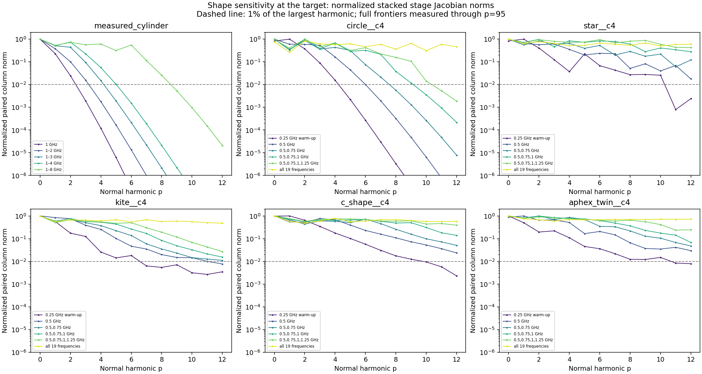

# Shape frontiers at stage frequencies

19 November 2026. **The proposed ladder comparison holds at the target outlines.** The small measured best circle has frontiers 2, 3, 4, 5 against default ladder bands 3, 6, 9, 12. Every tested TG-002 contrast-4 truth has a frontier above the ladder's band, with either frequency treatment. The mismatch is geometry-dependent: at the large measured start, the frontier exceeds every default ladder band.

All entries below are **highest-frequency / stacked** frontiers at the solver's 1% threshold. “Target” means the best measured circle or the corresponding TG-002 true outline. Starts use each saved weak material estimate at the prescribed centred 65 mm circle. Measured target: radius 15.2662 mm, centre (1.9393, 26.1912) mm, permittivity 3.05255. TG-002 targets use stored contrast 4.

| Case | Frequency set | Default band | Start: highest / stacked | Target: highest / stacked |
|---|---|---|---:|---:|
| measured_cylinder | 1 GHz | 3 | 5 / 5 | 2 / 2 |
| measured_cylinder | 1–2 GHz | 6 | 8 / 7 | 3 / 3 |
| measured_cylinder | 1–3 GHz | 9 | 11 / 10 | 4 / 4 |
| measured_cylinder | 1–4 GHz | 12 | 13 / 13 | 5 / 5 |
| measured_cylinder | 1–8 GHz | 11,15,19,25,31,37 | 24 / 23 | 8 / 8 |
| circle__c4 | 0.25 GHz warm-up | 1 | 4 / 4 | 4 / 4 |
| circle__c4 | 0.5 GHz | 3 | 7 / 7 | 6 / 6 |
| circle__c4 | 0.5,0.75 GHz | 5 | 9 / 9 | 7 / 7 |
| circle__c4 | 0.5,0.75,1 GHz | 7 | 11 / 11 | 9 / 9 |
| circle__c4 | 0.5,0.75,1,1.25 GHz | 9 | 13 / 13 | 11 / 10 |
| circle__c4 | all 19 frequencies | 11,15,19,25,31,37 | 23 / 22 | 20 / 18 |
| star__c4 | 0.25 GHz warm-up | 1 | 4 / 4 | 15 / 15 |
| star__c4 | 0.5 GHz | 3 | 7 / 7 | 21 / 21 |
| star__c4 | 0.5,0.75 GHz | 5 | 9 / 9 | 23 / 23 |
| star__c4 | 0.5,0.75,1 GHz | 7 | 11 / 11 | 30 / 30 |
| star__c4 | 0.5,0.75,1,1.25 GHz | 9 | 13 / 13 | 32 / 32 |
| star__c4 | all 19 frequencies | 11,15,19,25,31,37 | 23 / 22 | 55 / 49 |
| kite__c4 | 0.25 GHz warm-up | 1 | 4 / 4 | 6 / 6 |
| kite__c4 | 0.5 GHz | 3 | 7 / 7 | 11 / 11 |
| kite__c4 | 0.5,0.75 GHz | 5 | 9 / 9 | 12 / 12 |
| kite__c4 | 0.5,0.75,1 GHz | 7 | 11 / 11 | 16 / 14 |
| kite__c4 | 0.5,0.75,1,1.25 GHz | 9 | 13 / 13 | 16 / 15 |
| kite__c4 | all 19 frequencies | 11,15,19,25,31,37 | 23 / 22 | 26 / 24 |
| c_shape__c4 | 0.25 GHz warm-up | 1 | 4 / 4 | 9 / 9 |
| c_shape__c4 | 0.5 GHz | 3 | 7 / 7 | 13 / 13 |
| c_shape__c4 | 0.5,0.75 GHz | 5 | 9 / 9 | 18 / 18 |
| c_shape__c4 | 0.5,0.75,1 GHz | 7 | 11 / 11 | 20 / 19 |
| c_shape__c4 | 0.5,0.75,1,1.25 GHz | 9 | 13 / 13 | 26 / 24 |
| c_shape__c4 | all 19 frequencies | 11,15,19,25,31,37 | 23 / 22 | 43 / 41 |
| aphex_twin__c4 | 0.25 GHz warm-up | 1 | 4 / 4 | 10 / 10 |
| aphex_twin__c4 | 0.5 GHz | 3 | 7 / 7 | 20 / 20 |
| aphex_twin__c4 | 0.5,0.75 GHz | 5 | 9 / 9 | 24 / 24 |
| aphex_twin__c4 | 0.5,0.75,1 GHz | 7 | 11 / 11 | 28 / 25 |
| aphex_twin__c4 | 0.5,0.75,1,1.25 GHz | 9 | 13 / 13 | 33 / 29 |
| aphex_twin__c4 | all 19 frequencies | 11,15,19,25,31,37 | 23 / 22 | 48 / 44 |

The full-catalog rule is not universally conservative on TG-002 either: the circle's frontier is 20 / 18 and the kite's 26 / 24, below the final band 37. The measured best circle's full-catalog frontier is only 8 / 8, below even the first full-catalog band 11. In contrast, star, C-shape and Aphex targets support columns past band 37 by this criterion.

## What was measured

The maintained [observable_frontier](../../../../solvers/bem_inverse/forward_solvers/modal_muller.py#L347) computes B7 data Jacobian norms for orthonormal arclength-normal harmonics, pairing sine/cosine columns. Its frontier is the largest harmonic passing 1% of the largest paired norm, tested through the policy's top harmonic 95. The [runner](../../../../solvers/bem_inverse/runner.py#L241) uses one refined solve at the highest real frequency; the default calls this diagnostic only after its full-catalog releases through band 37. These measurements call that same function and refined resolution, outside the default fitting path.

Because that function takes one frequency, the stacked result is calculated separately: divide each frequency's paired profile by its observed-data norm, take the root mean square across the set, then apply the same threshold and [finite/nonzero check](../../../../solvers/bem_inverse/checks.py#L370). This matches B5's equal-frequency loss scaling. The highest-frequency result uses the solver's unscaled profile; a single-frequency scale does not change its frontier. Unnormalized stacked profiles and their frontiers are also saved.

The result supports releasing fewer shape directions near the small measured circle. It does not by itself prove why the neck formed: these are local column sensitivities at the start and target, not measurements along the failed path. A 1% relative cutoff is not an absolute noise limit or a singular-value test; large columns can be correlated, and material/shape ambiguity is not tested. The arclength-normal basis is the frontier diagnostic's basis, not the full finite slider trial map. Some profiles are nonmonotonic, so a frontier does not certify that every lower harmonic passes.

The [trial replay](trial_refusals.md) separately shows the genuine crossings near the measured fit's neck. These frontier measurements add evidence of a shape-band mismatch; they do not replace that causal evidence. In the [A1–C12 chain](../../../reference/inverse_information_chain.md), retained A4 forward states supply B7 shape sensitivities; the frontier diagnostic then informs C12 continuation.

[Script](../../../../experiments/comparison/measure_stage_frontiers.py), [summary and full profiles](../../../../results/bem/stage_scheduling/2026-11-19/stage_frontiers/summary.json), [column norms for harmonics 0–12](../../../../results/bem/stage_scheduling/2026-11-19/stage_frontiers/harmonics_0_to_12.csv). Per-outline JSONs preserve all 96 paired norms at every catalog frequency. CPU only, four workers maximum, BLAS one thread; no fits or solver edits. Run the script to rebuild; `--reuse` reuses saved profiles without forward solves.
