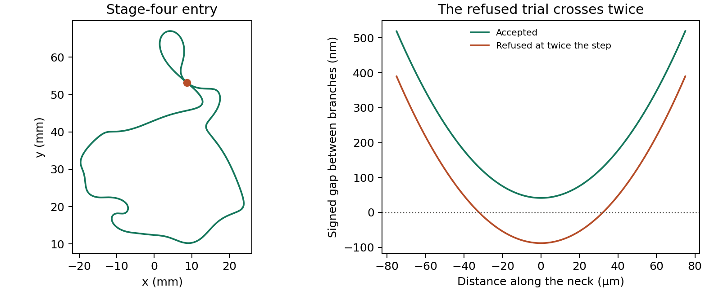

# Why the slider refused small steps

**The measured cylinder reached a 41 nm gap at the end of ladder stage three.** Stage four inherited exactly that curve, with zeros added to its stored coefficients. Both stages check 1,024 points. The unchanged curve passes, with no crossing pair or overlap. All 71 saved states (61 accepted steps and 10 stage entries) pass their own grid and give simple polygons at 32,768 points. [Saved states and trials](../../../../results/bem/baseline_data/csi_adapter/2026-11-18/first_fit/dielTM_dec8f/cuda/attempt_01/local/) · [Checks and coordinates](../../../../results/bem/stage_scheduling/2026-11-19/clean_tg002/measured_trial_crossings.json)

The default slider adds a linear step to the A1 curve, then checks that curve for crossings before C11 evaluates loss. A refused trial and the next accepted half-step at the same damping therefore give us the refused curve from the two saved accepted states. The recorded step norm measures the requested normal-update coordinates in metres. [Slider geometry update](../../../../solvers/bem_inverse/geometry_update_methods/slider.py) · [Backtracking and C11](../../../../solvers/bem_inverse/fit_stage.py) · [Intersection test](../../../../solvers/bem_inverse/checks.py)

| Measured stage and step | Refused step | Accepted half-step | Gap at acceptance | Crossing segment pairs on the refused trial (zero-based) |
|---|---:|---:|---:|---|
| Ladder 3, step 7 | 263.2 nm | 131.6 nm | 41.38 nm | (236, 383) and (237, 382) of 1,024 |
| Full 1, step 13 | 25.75 nm | 12.87 nm | 1.53 nm | (5989, 6153) and (5990, 6152) of 8,192 |

Both refused curves cross twice at 32,768 points and with the slider tolerance set to zero. Solving for coincident points on the continuous Fourier curves puts the crossings 64.39 µm apart in ladder 3 and 14.19 µm apart in full 1. The figure shows the two sides near the first contact. A negative gap means they have passed through one another. [Replay script](../../../../experiments/comparison/trace_slider_refusals.py)

The measured receipts give 128 crossing refusals in 135 trials at ladder 3, 40/40 at ladder 4, 177/190 at full 1 and 40/40 in each of full 2 through full 5. Full 6 had 38 crossings and two irregular-parameterization refusals. The smallest refused step at ladder 4 was 28.0 µm. The 4.29 nm refusal occurs in full 1. Refused directions without an accepted half-step are unavailable for exact reconstruction. The two replays establish genuine crossings and explain how small steps can fail near contact.

## Clean TG-002 denominator

| Original group | Stages | Zero accepted steps | Tried ≥1 move, none accepted | All moves stopped before candidate physics |
|---|---:|---:|---:|---:|
| 14 misses | 80 | 11 | 4 | 2 |
| 16 passes | 170 | 13 | 0 | 0 |

At ladder 4, circle and star at contrast 13.3 each tried 40 moves and sent none to candidate physics. The fit totals account for all 80 as slider refusals. Circle recorded 228 trial constructions, 202 slider refusals and 26 candidate evaluations. Star recorded 283, 236 and 47. Cog at 0.5 (ladder 4) and C-shape at 4 (full 6) each reached candidate physics. None of the 250 original stage summaries includes individual trials, so the count by geometry refusal reason is unknown. Stages that accepted earlier steps may still have exhausted their final trial search. [Per-stage counts](../../../../results/bem/stage_scheduling/2026-11-19/clean_tg002/original_trial_coverage.csv) · [Original fits](../../../../results/bem/default_clean_uc_fc/)
