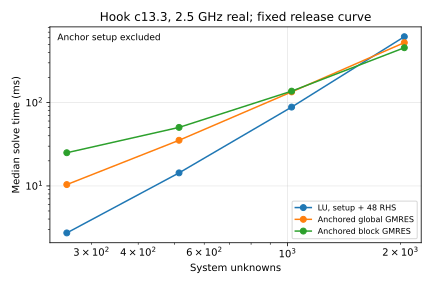
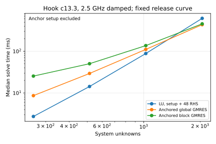

# IS-001: retain LU at the current resolutions

## Answer

At Ku64 and Ku128, neither cold nor anchored iterative solving beats LU
for all 24 source and 24 reciprocal RHS at matched field accuracy.
Close D04's anchored-solve speed claim for this workload; keep production LU.

The first measured solve-only win is Ku512, 2,050 unknowns, on the same
release curve. The best iterative solve needs four reuses to repay a full
anchor factorization. Those reuses are a cost model, not measured fits.

No inverse fit or production solver change was made. This is a dense-matrix
solve experiment; it does not test avoided assembly or matrix-free storage.

## What was replayed

H3 hook c13.3: `release_M11` iteration 15, K24/Ku64, and the saved
`fixed_M67` endpoint, K136/Ku128. The latter carries the curve accepted at
M55 through later storage promotions; M67 accepted no new step.

Nearby anchors are M11 iteration 14 and M55 iteration 3, with the latter
padded by exact zeros to K136. Maximum point changes are 0.000539 and
0.000507 mm. Both real 2.5 GHz and k(1+0.25i) are tested.

The larger-step stress test is M11 iteration 0→1: an actual accepted step,
not a refused or halved trial. Its maximum point change is 1.139 mm,
RMS 0.419 mm. It tests contraction sensitivity for that accepted move only.

## Production cost breakdown

Times below are medians of three cached same-curve repetitions, in ms.
Forward trace solve is A4; reciprocal solve and Hadamard contraction are B7.
Geometry preparation is A1, assembly A2, and source/receiver waves A3.

| Part | Ku64 real | Ku64 damped | Ku128 real | Ku128 damped |
|---|---:|---:|---:|---:|
| Cached geometry | 0 | 0 | 0 | 0 |
| Assembly, CUDA + host scalar work | 5.091 | 5.088 | 7.762 | 7.710 |
| Source/receiver waves, CPU | 3.320 | 3.892 | 5.079 | 5.934 |
| LU factorization, CPU | 1.686 | 1.674 | 11.650 | 11.428 |
| Forward trace solve, CPU | 0.514 | 0.516 | 1.707 | 1.730 |
| Field contraction/residual/checks | 0.520 | 0.521 | 1.802 | 1.827 |
| Reciprocal trace solve, CPU | 0.489 | 0.475 | 1.730 | 1.764 |
| Hadamard contraction/checks | 0.210 | 0.220 | 0.846 | 0.878 |
| Measured forward + Jacobian duration | 12.072 | 12.602 | 30.799 | 31.242 |
| LU factorization share | 14.0% | 13.3% | 37.8% | 36.0% |
| Factorization + both solve shares | 22.4% | 21.2% | 49.0% | 47.1% |

Duration combines disjoint forward/Jacobian measurements from the same
repetition. Component medians need not sum to the median duration. We did
not add unrelated medians to claim a measured full-fit runtime.

| First use, one observation each | Ku64 real | Ku64 damped | Ku128 real | Ku128 damped |
|---|---:|---:|---:|---:|
| Forward duration, ms | 230.8 | 64.2 | 296.0 | 128.5 |
| Geometry preparation, ms | 86.4 | 38.9 | 117.5 | 69.8 |
| Assembly including lazy work, ms | 128.9 | 12.6 | 140.9 | 21.6 |
| LU share of forward + Jacobian | 0.8% | 2.6% | 4.0% | 8.8% |

First use includes geometry, lazy radial preparation and CUDA/FFT first use.
It is deliberately separate from cached medians and is not a median
new-curve timing. Geometry can be shared across the 19-frequency catalog.
Amortizing it over 19 frequencies is a model; no full-catalog timing was run.

Machine: Intel Core Ultra 9 285K, RTX5090, cores 12–17, single-thread BLAS. Profile
one-minute load was 0.27–0.69, solver load 0.37–1.28. GPU snapshots during
these timings showed 0% external compute, about 899–900 MiB graphics use.

## Matched-accuracy solver comparison

All RHS columns are normalized inside Krylov solves, then restored to
physical units. Production source RHS norms are roughly 2e-7 versus 0.2
for reciprocal RHS. An unscaled aggregate residual hid field error; that
failed-accuracy result is retained separately.

Global GMRES uses one Frobenius Krylov polynomial shared by all 48 RHS.
Full block GMRES uses rank-aware block Arnoldi and removes dependent columns
by SVD. Both use fixed old-LU right preconditioning in the anchored variant.

Successful timings are medians of three repetitions. Times include every
matrix action, preconditioner application and orthogonalization. LU includes
factorization and both production 24-column solves. Anchor setup is separate.

| Method | Ku64 real, ms | Ku64 damped, ms | Ku128 real, ms | Ku128 damped, ms |
|---|---:|---:|---:|---:|
| LU | 2.728 | 2.737 | 14.566 | 14.452 |
| Cold global GMRES | failed, 1800 actions | 94.413 (56) | failed, 1800 actions | 246.737 (54) |
| Cold full block GMRES | 77.729 (6 blocks) | 80.943 (6) | 319.771 (9) | 323.271 (9) |
| Anchored global GMRES | 10.374 (4) | 8.647 (3) | 35.169 (4) | 29.256 (3) |
| Anchored full block GMRES | 25.012 (3 blocks) | 25.462 (3) | 49.606 (3) | 49.498 (3) |

All successful balanced comparisons agree with LU in predicted fields to
at most 5.20e-12, well inside the registered 1e-9 requirement. The largest
actual slider-Jacobian difference is 1.26e-11 relative; reciprocal trace
errors are recorded independently in the solver table.

Even a free anchor cannot make the measured Ku64/128 iterative methods
faster than LU. Charging its factorization strengthens that conclusion.
No trajectory continuation was triggered.

## Contraction and the accepted stress step

The table reports the Euclidean norm and spectral radius of the **right
residual operator** `I - A_current A_anchor^{-1}`. These are distinct from
GMRES's measured residual decay and from the solution-error operator norm.

| Pair | Real norm / radius | Damped norm / radius | Anchored global iterations, real/damped |
|---|---:|---:|---:|
| Nearby Ku64 | 0.14384 / 0.000344 | 0.000180 / 0.00000968 | 4 / 3 |
| Nearby Ku128 final | 0.16449 / 0.000565 | 0.00380 / 0.000112 | 4 / 3 |
| Accepted 1.139 mm stress step, Ku64 | 274.18 / 1.20326 | 1.10543 / 0.03641 | 26 / 8 |

The nearby pairs contract. The larger accepted real-frequency step has
spectral radius above one, so plain stationary anchor corrections are not
convergent in general. GMRES nevertheless converges: contraction below one
is sufficient for that correction series, not necessary for GMRES.

The stress-step anchored global solves cost 56.2/17.9 ms real/damped,
against LU 2.62/2.72 ms. Its full block solves cost 83.5/64.7 ms. High
contrast and real frequency can therefore spoil a useful close-step anchor.

## Size crossover and anchor repayment

The following comparison holds the K24 release curve and its anchor fixed
while raising Ku. It is not a promotion of the current trajectory's physics.
All larger-size fields and Jacobians passed the same checks.

| Ku / unknowns | LU real/damped, ms | Anchored global real/damped, ms | Anchored full block real/damped, ms |
|---|---:|---:|---:|
| 64 / 258 | 2.73 / 2.74 | 10.37 / 8.65 | 25.01 / 25.46 |
| 128 / 514 | 14.34 / 14.32 | 35.29 / 29.43 | 50.37 / 50.43 |
| 256 / 1026 | 88.27 / 88.52 | 134.36 / 111.13 | 137.16 / 137.13 |
| 512 / 2050 | 617.54 / 617.68 | 524.19 / 436.04 | 455.29 / 456.10 |

Plots exclude anchor setup. Four-reuse repayment assumes hypothetical
equal-cost targets, not an observed trajectory.

The first measured crossover is Ku512; its location is bounded between
Ku256 and Ku512 on this grid. Full block is fastest for real frequency;
global GMRES is fastest for damped frequency.

A full anchor factorization costs 570.5 ms at Ku512. Strict repayment needs
four equal-cost target reuses for full block, both frequencies; global
needs seven real or four damped. After four reuses, anchor-inclusive cost
is about 598 ms real/block or 579 ms damped/global, versus LU about 618 ms.

This assumes future targets remain as cheap as this exceptionally close
pair. We measured one target per anchor, not four distinct trajectory
updates. With one target the best anchored total is 1026/1007 ms, slower
than LU. The stress step demonstrates why extrapolating reuse is unsafe.

## Meaning for D04 and Haibing's review

Haibing's recommendation 4 is useful: the actual split matters. LU is
13–14% of cached Ku64 physics but 36–38% at Ku128, so the old statement
that it must be small at a few hundred unknowns is workload-dependent.
First-use preparation still reduces its share substantially. The 22%/49%
all-linear shares bound ideal solve-only savings at these cached 2.5 GHz
states; they do not bound a measured full catalog or complete inverse fit.

Item 5's warning about anchor changes is directly supported by the accepted
stress step. Standard preconditioned GMRES improves iteration counts, yet
its overhead and repeated old-LU solves lose to dense batched LU here.

Keep D04 closed for current Ku64/128 acceleration. Revisit only if actual
workloads move near 2,050 unknowns with cheap repeated targets, or if an
operator action avoids assembly. This study establishes neither condition.

## Evidence, implementation, and limits

- [Registered plan](03_plan.md), [execution details and corrections](04_execution.md).
- [Structured summary](../../../../results/validation/cleaned_interfaces/IS-001/summary.json), [profile CSV](../../../../results/validation/cleaned_interfaces/IS-001/profile_table.csv), [solver CSV](../../../../results/validation/cleaned_interfaces/IS-001/solver_table.csv), [contraction CSV](../../../../results/validation/cleaned_interfaces/IS-001/contraction_table.csv).
- [Replay and numerical prototype](../../../../experiments/linear_solves/is001.py), [saved-result report](../../../../experiments/linear_solves/report.py). Per-run receipts retain source hashes, revision, load, errors, residual histories, block ranks and memory. Saved NPZ matrices preserve the exact comparison inputs; Ku512 uses separate anchor files.
- Canonical chain: [A1–A4 and B7](../../../reference/inverse_information_chain.md), actual [A4 LU/fields](../../../../solvers/bem_inverse/a4_fields.py), [B7 reciprocal/Jacobian](../../../../solvers/bem_inverse/b7_data_jacobian.py). This is optional H3/slider research evidence, not the default spectral pipeline.
- [Haibing item 5 and recommendation 4](../../../../Haibing_directions.md); its references include [Parks et al., recycled Krylov methods](https://doi.org/10.1137/040607277). No Krylov recycling was implemented here.

The first receipt write failed on relative path handling; its traceback is
preserved, then fixed. The unbalanced field-accuracy failure and interrupted
repeated-nonconvergence run remain in the evidence folder.

Only one scene, one contrast, the highest real/damped frequency and two
close accepted states were profiled. Three timing repetitions are descriptive,
not uncertainty estimates. No fit, inverse accuracy claim, matrix-free
memory claim, or broader solver promotion follows from these results.

Peak observed GPU allocation plus host RSS was below 4 GiB at Ku512,
inside the 6 GB limit. Only the requested Ku64/128/256/512 sizes were run.
