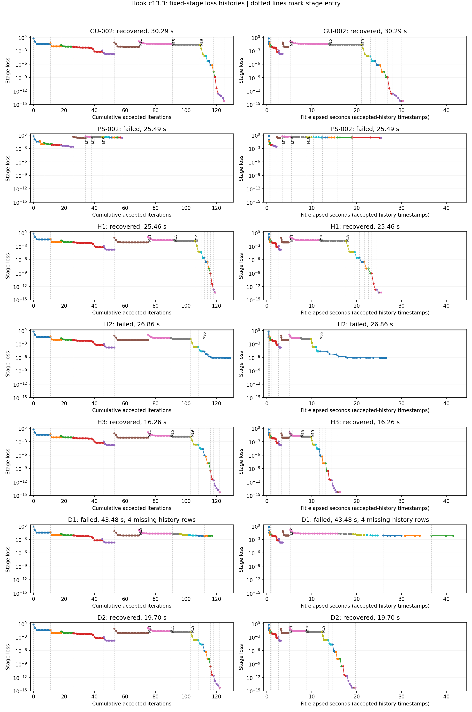

# PS-003: GPU slider policy comparisons

## Result

`compact_release` with GPU slider (H3) recovered hook in **16.256 s**, versus
saved GU-002's **30.294 s**: 46.3% less fit time in these single measurements.
It retained kite and c-shape recovery, but lost circle recovery. Do not promote it as a default.

All **13/13** planned fits completed: H1–H3, D1–D2 and O1B/O1S–O4B/O4S.
There were no retries, extra scenes or reference reruns. The existing `organised`
branch contains a separate committed and pushed result for every fit.

## Hook: recovered fit time first

| Run | Policy / change | Recovered | Fit s | Accepted | Forward calls | Reciprocal calls | Charged units | Final checks s |
|---|---|---|---:|---:|---:|---:|---:|---:|
| H3 | compact_release | yes | 16.256 | 122 | 1,348 | 1,305 | 2,653 | 1.701 |
| D2 | H3, full-real-catalog Ku=128 | yes | 19.696 | 122 | 1,348 | 1,305 | 2,653 | 1.641 |
| H1 | feedback | yes | 25.455 | 119 | 1,291 | 1,267 | 2,558 | 1.950 |
| GU-002 | saved baseline | yes | 30.294 | 125 | 1,502 | 1,476 | 2,978 | 2.520 |
| H2 | four_phase | no | 26.865 | 129 | 1,670 | 1,342 | 3,012 | 2.046 |
| D1 | baseline, release M19 directly | no | 43.477 | 117 | 1,868 | 1,172 | 3,036 | 3.175 |

Actual calls include dispatched work that can finish after another frequency fails.
Thus D1 has 3,040 actual calls but 3,036 charged units. The two counts are separate.
Final numerical checks are timed separately from fitting.

### Why hook took many iterations

GU-002 spent 15.926 s on 40 accepted iterations in M11/M15, with no rejected
trials there. PS-002 cut iterations by leaving earlier stages at higher losses;
its later M43/M49 stages cost 9.703 s and included eight rejected trials.

The new H1 and H3 records distinguish C9 proposals from their bounded and used
steps: every accepted M11/M15 step used the full raw proposal, without clipping
or backtracking. Their last step norms in optimizer coordinates were approximately 0.1–0.2 micrometres.

Those stages ended after the remaining proposals fell below the existing step
threshold. Each such exit recorded four damping retries and 40 tiny-proposal
skips. The retries are visible now; they were absent from the old trial lists.

This points to small raw proposals at a fixed update band, not repeated poor
trial curves or bounds shortening accepted moves, in those stages. Damping's
separate contribution was not isolated by the allowed comparisons.

**D1 shows that deleting M11/M15 is not an effective shortcut here.** Its M19
stage used all 22 iterations, later stages exhausted quotas, and a trial curve
failed physics in M55. It took 43.477 s and did not recover.

### Why H3 is faster

H3 uses 122 accepted iterations, close to GU-002's 125. Its main saving is
cheaper work per iteration. M11/M15 cost 4.793 s, against H1's 12.452 s;
H3 uses K24/K32 and Ku64 there, while H1 uses K192 and Ku128.

| Hook arm | B6 preparation wall s | A1–A4 forward-batch wall s | Reciprocal-batch wall s |
|---|---:|---:|---:|
| H1 | 2.060 | 19.761 | 1.096 |
| H3 | 0.803 | 13.331 | 0.713 |
| D2 | 0.803 | 16.552 | 1.058 |

**D2 isolates the full-catalog physics-resolution setting and its required
workspace.** Raising H3's Ku to 128 added 3.441 s with the same accepted count,
actual calls and charged work. Both recovered; their final curves were close.

No hook stage used stage-entry reuse, and no shortened-progress exit fired in
H1 or H3. Those mechanisms cannot explain these observed savings. The remaining
H1/H3 differences combine storage, resolution and changed trajectories.

H2's compact stages were cheap, but its M95 stage cost 15.368 s and included
16 rejected trials. Its final numerical checks failed and maximum residual
was 0.005236, above 0.003; its small shape error alone is not recovery.

Recorded expansion sizes explain another source of cost: the largest log
expansion degree over evaluated curves was 272 for H1/H3/D2, 573 for H2 and
1,127 for D1. D1's costly rejected curves therefore required larger expansions.

## Four other cases: frozen H3 versus baseline slider

| Case | Baseline fit s | H3 fit s | Baseline recovery | H3 recovery | Interpretation |
|---|---:|---:|---|---|---|
| circle c4 | 2.213 | 1.495 | yes | no | Regression: final Jacobian check fails |
| kite c0.5 | 41.826 | 15.664 | yes | yes | Recovery retained; 62.5% less fit time |
| c-shape c13.3 | 12.261 | 8.924 | yes | yes | Recovery retained; 27.2% less fit time |
| aphex c13.3 | 80.703 | 58.573 | no | no | Better shape, but no numerical recovery |

Circle's maximum final Jacobian discrepancy was 0.003476 against the unchanged
0.001 tolerance. Its field and residual checks passed. This remains a failure;
no tolerance was relaxed and no replacement fit was run.

On aphex, H3 completed its schedule and reached RMS 0.01682 mm, Hausdorff upper
bound 0.08409 mm and maximum residual 0.0000431. Its field discrepancy reached
0.0000332 and Jacobian discrepancy 0.003248, so the final checks still failed.

The selected policy preserves two of the baseline's three successes in these
four cases. There are no new recoveries in this set. Faster failed fits are
not improvements in time to recovery.

## Scope and remaining uncertainty

All new fits use frozen TG-002 data, one centred start, no localization, CUDA
physics and preparation, four frequency threads and single-threaded BLAS.
Every fit had 13,412 units / 120 s; final checks had 300 s and unchanged tolerances.

`four_phase` used similarity only for warm-up, then slider. Numerical controls
remain in `solvers/bem_inverse/`; the explicit slider adapter and case selection
remain in `experiments/benchmark/`. Registry defaults are unchanged.

The saved baseline lacks the new raw/clipped sizes, tiny-skip/retry counts and
batch wall timers. Frequency-thread timings overlap and are not summed as wall
time. Losses and gradients are interpreted within each fixed stage only.

These are single fits and historical references, not repeatability estimates or
30-case evidence. Bundled effects remain partly unresolved. No further fit is
scheduled; the 13-fit allowance is exhausted.

## Checks and implementation review

The targeted adapter, recording, policy, stage-entry reuse and continuation
checks passed. The recording check preserved accepted decisions, final curve
and charged work. Frozen TG-002 hashes were verified before the fits.

Standards review found no issues. Spec review found one unsupported preparation
setting before any fit; it was fixed and checked. No unresolved review issue
remains. The plan's small-check scope replaced a broad test campaign.

Detailed stages: [PS-003 evidence](../../../../results/validation/cleaned_interfaces/PS-003/README.md).

