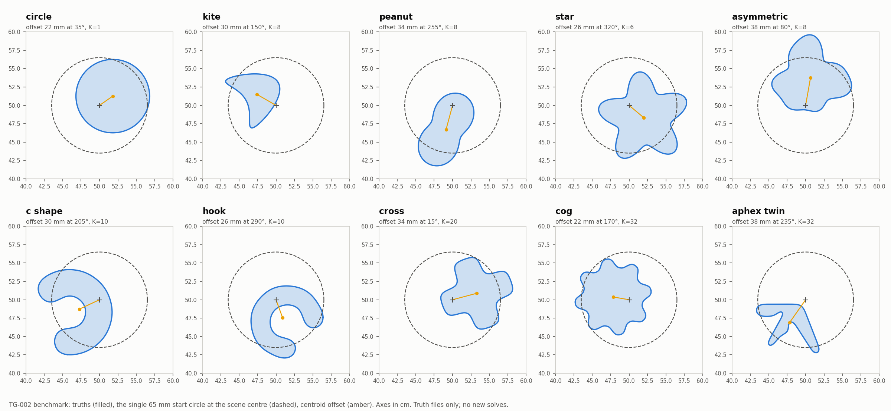

# The benchmark (TG-002): run new experiments on these scenes

**This is the only scene set for new inverse experiments.** Older scene sets were removed on
this branch; they remain on `feature/shape-frequency-continuation`. Do not add far-start cases
or a grid-search initializer to new experiments. The user retired both on 2026-10-04.



## What it is

- **Ten single-object scenes × contrasts 0.5, 4, 13.3 = 30 cases.** Case IDs are
  `<scene>__c<contrast>`, for example `aphex_twin__c13.3`.
- **One start for every case:** a 65 mm circle at the scene centre (0.5, 0.5) m.
- **Placement:** target centroids sit 22–38 mm off centre, each in its own direction and
  rotation. They are visibly off-centre, but inside the range where recorded runs recovered
  without a grid search. The values are frozen; a test pins them.
- **Data:** the frozen CI-001 acquisition (24 source/receiver pairs on a 0.30 m ring) and
  the 19-frequency catalog (0.25–2.5 GHz). Real and damped (k(1 + 0.25i)) catalogs, noiseless,
  computed with CPU reference `nodal_kress` and qualified by N1024/N2048 doubling at 1e-8.
- **Recovery:** RMS ≤ 1 mm, the Hausdorff upper bound ≤ 2 mm, and the per-frequency
  residual ≤ max(0.003, 3 × noise). `final_residual` computes the residual of the returned
  curve at the fit's own resolution, after `fit()` returns and before truth is read.
- **No final check:** the two-resolution endpoint audit (`audit.py`) no longer runs or
  counts towards recovery (user decision D11, 2026-11-02). Runs saved before then keep
  their `final_audit.json`. The fit itself never solves at a finer resolution (D7).

| Scene | Tests | Shape source |
|---|---|---|
| `circle` | Control; exact Mie check available | SC-022 `wrong_circle` |
| `kite` | Standard literature benchmark | SC-025 |
| `peanut` | Gentle concavity, neck | SC-025 |
| `star` | Star-shaped, five lobes | SC-022 `circle_to_star` |
| `asymmetric` | Smooth, no symmetry | SC-050 `new_asymmetric` |
| `c_shape` | Deep concavity; unsolved at contrast 13.3 from CI-001 starts | SC-022 `circle_to_c` |
| `hook` | Strongly non-star curl | SC-025 |
| `cross` | Four re-entrant corners | TG-001 |
| `cog` | High angular harmonics (8 teeth) | TG-001 |
| `aphex_twin` | Thin strokes, deep notch: the hardest scene | TG-001, public-domain logo SVG |

Shapes keep their historical definitions; only the placement is new.

## Default method for new experiments

- **Physics:** `modal_muller`, the node-free Fourier–Galerkin service.
- **Geometry update:** `slider` (user decision, 2026-11-02). It prepares on CUDA when available
  (GU-002) and recovered hook c13.3, which `spectral` does not (GU-001). It has not yet run on all
  30 cases. `spectral`, the default until then, and `certified_spectral` remain available with
  `--geometry-update`.
- **Localization:** `none`. `keep_start` keeps the centred start, and the 0.25 GHz damped
  warm-up moves it.
- **Policy:** otherwise the default `CumulativePolicy`.

These are the CLI defaults. `--localization grid` and `--solver nodal_kress` exist only as
controls. `--pipeline nodal_baseline|nodal_fixed|modal_fixed` selects a named recipe from
`bem_inverse.pipelines` instead of `--solver`/`--geometry-update`; `modal_fixed` is the earlier
`modal_muller` + `spectral` default.

## Commands (repository root, EMNerf environment)

```bash
export PYTHONPATH=solvers:.
python -m experiments.benchmark verify       # check the sealed inputs
python -m experiments.benchmark inventory    # list the 30 case IDs
python -m experiments.benchmark plan --cases aphex_twin__c13.3
python -m experiments.benchmark run --cases all --run-dir results/validation/cleaned_interfaces/<ID>/<arm> --workers 2
python -m experiments.benchmark run --pipeline nodal_fixed --cases all --run-dir <fresh dir> --workers 2
```

- Use one fresh `--run-dir` per setting; mixed settings are refused.
- Use at most 3 workers, because each fit can peak near 8 GB.
- `prepare` and `generate` have already run and the inputs are sealed. Do not rerun them.

| File | Role |
|---|---|
| `scenes.py` | Scene shapes, frozen placements, the start, case IDs |
| `campaign.py` | Input generation and seal, CI-001-shaped rows, `keep_start`, the fit runner, `summarize`, gallery |
| `audit.py` | The former endpoint audit; still imported by two studies, not run by `run_case` |
| `pc001.py` | Three-arm pipeline comparison N0/N1/M1 and its report; its `M1` arm is the kept reference run ([plan](../../docs/iterations/cleaned_interfaces/iteration_27/03_plan.md)) |
| `test_benchmark.py` | Frozen placements, valid truths, no truth access during fitting |
| `assets/aphex_twin_logo.svg` | Vendored public-domain logo outline for the `aphex_twin` scene |

For a new experiment, write a pre-registered plan in `docs/iterations/cleaned_interfaces/`
or the relevant iteration track and a small driver like `pc001.py`.
User approval of the requested experiment work authorizes its run; record the
tracking ID without requesting a separate ID confirmation.
