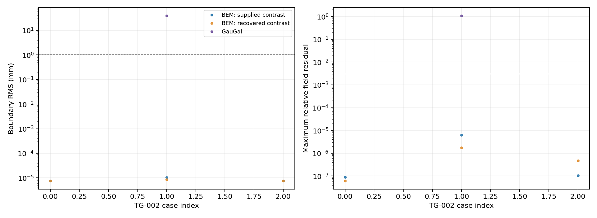
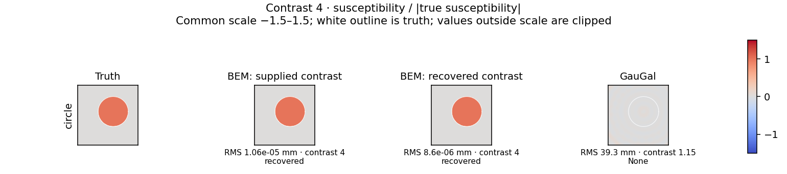
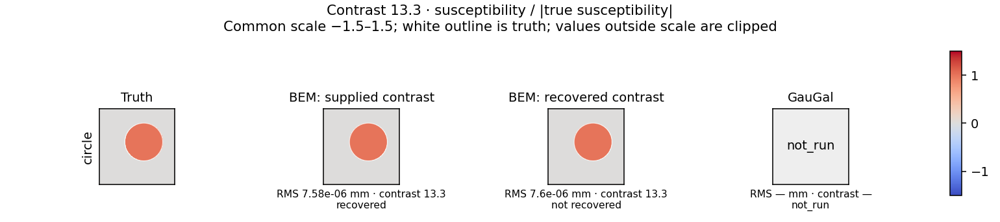

# BEM and GauGal on TG-002 — 30-case comparison

Generated 2026-11-02 02:38:51 GMT.

**INCOMPLETE:** GauGal outcomes for 1/3 cases. Failed and time-limited outcomes are retained.

Three separate arms use the same noiseless TG-002 real-frequency observations and geometry. BEM with supplied contrast knows the true contrast. BEM material recovery and GauGal estimate it. BEM also uses damped-frequency continuation data; GauGal uses the 19 real frequencies only.

## Aggregate results

| Arm | Saved images | Shared shape/field limits | Full BEM recovery | Median RMS mm | Median image RRMSE | Median recorded seconds |
|---|---:|---:|---:|---:|---:|---:|
| BEM: supplied contrast | 3 | 3 | 3 | 7.64e-06 | 0 | 3.63 |
| BEM: recovered contrast | 3 | 3 | 2 | 7.6e-06 | 5.69e-10 | 4.99 |
| GauGal | 1 | 0 | not applicable | 39.3 | 0.335 | — |

Shared limits are RMS ≤ 1 mm, Hausdorff upper bound ≤ 2 mm and maximum relative field residual ≤ 0.003. Full BEM recovery additionally requires its independent final numerical checks. GauGal has no equivalent BEM Jacobian check; its shared-limit count is not claimed as full TG-002 numerical qualification.

## Per-case results

Triples below are **supplied-contrast BEM / material-recovery BEM / GauGal**. A dash means no finite value was available. Circle cases were used for GauGal tuning.

| Case | RMS mm | Maximum field residual | Image RRMSE | GauGal status / iterations |
|---|---|---|---|---|
| circle__c0.5 | 7.64e-06 / 7.56e-06 / — | 8.88e-08 / 6.12e-08 / — | 0 / 5.69e-10 / — | not_run / — |
| circle__c4 | 1.06e-05 / 8.6e-06 / 39.3 | 6.25e-06 / 1.73e-06 / 1.08 | 0 / 6.44e-09 / 0.335 | completed / None |
| circle__c13.3 | 7.58e-06 / 7.6e-06 / — | 1.06e-07 / 4.62e-07 / — | 0 / 7.17e-11 / — | not_run / — |

## Complete scores for each arm

Contrast error is signed relative error in percent. PSNR and contrast SNR are in dB. All rows, including unsuccessful fits, contribute to the reported medians.

### BEM: supplied contrast

| Case | RMS mm | Hausdorff upper mm | Max field residual | Contrast | Error % | Seconds | Recovery |
|---|---:|---:|---:|---:|---:|---:|---|
| circle__c0.5 | 7.6351e-06 | 0.019182 | 8.8827e-08 | 0.5 | 0 | 4.0507 | recovered |
| circle__c4 | 1.0553e-05 | 0.019186 | 6.2533e-06 | 4 | 0 | 3.6229 | recovered |
| circle__c13.3 | 7.5772e-06 | 0.019183 | 1.0572e-07 | 13.3 | 0 | 3.6267 | recovered |

| Case | RRMSE | SSIM | PSNR dB | Contrast SNR dB |
|---|---:|---:|---:|---:|
| circle__c0.5 | 0 | 1 | 300 | 272.9 |
| circle__c4 | 0 | 1 | 312.04 | 288.46 |
| circle__c13.3 | 0 | 1 | 322.48 | 300.72 |

### BEM: supplied contrast: per-case stopping and failure reasons

| Case | Recorded stop | Observed reason / remaining failure | Saved evidence |
|---|---|---|---|
| circle__c0.5 | COMPLETED_SCHEDULE; fixed_M37: loss_tolerance | None: all TG-002 recovery checks passed. | [result](../../MR-001/S1_slider_known_contrast/runs/circle__c0.5/result.json), [final checks](../../MR-001/S1_slider_known_contrast/runs/circle__c0.5/final_audit.json) |
| circle__c4 | COMPLETED_SCHEDULE; fixed_M37: no_decreasing_step | None: all TG-002 recovery checks passed. | [result](../../MR-001/S1_slider_known_contrast/runs/circle__c4/result.json), [final checks](../../MR-001/S1_slider_known_contrast/runs/circle__c4/final_audit.json) |
| circle__c13.3 | COMPLETED_SCHEDULE; fixed_M37: loss_tolerance | None: all TG-002 recovery checks passed. | [result](../../MR-001/S1_slider_known_contrast/runs/circle__c13.3/result.json), [final checks](../../MR-001/S1_slider_known_contrast/runs/circle__c13.3/final_audit.json) |

### BEM: recovered contrast

| Case | RMS mm | Hausdorff upper mm | Max field residual | Contrast | Error % | Seconds | Recovery |
|---|---:|---:|---:|---:|---:|---:|---|
| circle__c0.5 | 7.557e-06 | 0.019182 | 6.1177e-08 | 0.5 | 1.2969e-07 | 4.9469 | recovered |
| circle__c4 | 8.6016e-06 | 0.019185 | 1.7308e-06 | 4 | 1.4577e-06 | 4.9931 | recovered |
| circle__c13.3 | 7.6031e-06 | 0.019189 | 4.6182e-07 | 13.3 | -1.6183e-08 | 6.4336 | not recovered |

| Case | RRMSE | SSIM | PSNR dB | Contrast SNR dB |
|---|---:|---:|---:|---:|
| circle__c0.5 | 5.6871e-10 | 1 | 190.9 | 177.74 |
| circle__c4 | 6.4371e-09 | 1 | 163.87 | 154.23 |
| circle__c13.3 | 7.1731e-11 | 1 | 202.96 | 195.14 |

### BEM: recovered contrast: per-case stopping and failure reasons

| Case | Recorded stop | Observed reason / remaining failure | Saved evidence |
|---|---|---|---|
| circle__c0.5 | COMPLETED_SCHEDULE; fixed_M37: loss_tolerance | None: all TG-002 recovery checks passed. | [result](../../MR-001/S2_slider_material_weak_start/runs/circle__c0.5/result.json), [final checks](../../MR-001/S2_slider_material_weak_start/runs/circle__c0.5/final_audit.json) |
| circle__c4 | COMPLETED_SCHEDULE; fixed_M37: no_decreasing_step | None: all TG-002 recovery checks passed. | [result](../../MR-001/S2_slider_material_weak_start/runs/circle__c4/result.json), [final checks](../../MR-001/S2_slider_material_weak_start/runs/circle__c4/final_audit.json) |
| circle__c13.3 | COMPLETED_SCHEDULE; fixed_M37: no_decreasing_step | Jacobian discrepancy 0.002607 > 0.001; contrast start 1.729, warm-up end 8.966, final 13.3; truth 13.3 | [result](../../MR-001/S2_slider_material_weak_start/runs/circle__c13.3/result.json), [final checks](../../MR-001/S2_slider_material_weak_start/runs/circle__c13.3/final_audit.json) |

### GauGal

| Case | RMS mm | Hausdorff upper mm | Max field residual | Contrast | Error % | Seconds | Recovery |
|---|---:|---:|---:|---:|---:|---:|---|
| circle__c0.5 | — | — | — | — | — | — | not attempted |
| circle__c4 | 39.32 | 56.186 | 1.0842 | 1.1483 | -71.292 | — | shared limits not met |
| circle__c13.3 | — | — | — | — | — | — | not attempted |

| Case | RRMSE | SSIM | PSNR dB | Contrast SNR dB |
|---|---:|---:|---:|---:|
| circle__c0.5 | — | — | — | — |
| circle__c4 | 0.33458 | 0.50678 | 9.6526 | 0.012031 |
| circle__c13.3 | — | — | — | — |

### GauGal: per-case stopping and failure reasons

| Case | Recorded stop | Observed reason / remaining failure | Saved evidence |
|---|---|---|---|
| circle__c0.5 | not_run | No saved outcome yet. | — |
| circle__c4 | None | unavailable; RMS (mm) 39.32 > 1; Hausdorff upper bound (mm) 56.19 > 2; maximum field residual 1.084 > 0.003; traced mean contrast 1.148; truth 4; logged mean squared relative misfit 1 → 0.9011; inner-solve summary unavailable for this partial output | [result](../T0_timing/circle__c4.json) |
| circle__c13.3 | not_run | No saved outcome yet. | — |

## Methods and interpretation

**BEM selection was fixed before GauGal results.** Supplied-contrast BEM is slider S1 with both degree-cap cases replaced by S3, for 26/30 recorded recoveries. The other cases never hit that cap and reuse their unchanged paths. This is combined evidence, not a new full campaign. It ties spectral R1’s 26/30. Material recovery uses S2, the best completed truth-free full campaign at 23/30; truth-assisted R3 starts are excluded.

The sampled-log-interval experiments S4/S4b are not selected: they added no confirmed recoveries, and two cases timed out. Supplied-contrast BEM removes the degree cap; S2 retains its earlier numerical settings. Full source paths and all scores are in [comparison.csv](comparison.csv) and [comparison.json](comparison.json).

**GauGal adaptation.** One susceptibility image is fitted to a sum of energy-normalized frequency losses on 24 source–receiver pairs at 19 real frequencies. Gaussian lattice 51×51, 201×201 quadrature pixels, width 0.7 lattice spacing, TV lambda scale 0.5, susceptibility bounds −0.9 to 15, released 100-iteration inner-solve cap. Initialization is zero susceptibility. Step sizes 1, 0.01 and 0.05 are tuned on the three circles only by mean image RRMSE. The two smaller steps replaced unrun larger steps after step 1 diverged on circle c0.5.

Tuning selection is not yet available.

The final common budget is at most 80 outer iterations and 400 seconds of optimization, with a 480-second outer process limit. The T0 timing fit required 50.1 seconds for ten iterations, so the original 300-iteration default could not fit the morning budget. Partial images have explicit stop reasons and actual iteration counts; an iteration-limit exit does not establish convergence. Inner-solve summaries cover the whole fit, including the final prediction. Their convergence tolerance is 1e-4. The saved `completed` status means the iteration budget finished, not that an accuracy target was reached.

**Forward-model limitation.** The existing seven-case sweep did not identify any tested lattice meeting 1% error across those cases at 0.75 GHz and above. All 19 real frequencies are retained here rather than discarding 18 frequencies. Thus this measures this TG-002 adaptation under its stated budget; it is not a reproduction of GauGal’s published benchmark and does not establish an intrinsic ranking of the methods.

**Scores and times.** All three image arms are rasterized on the same 1 mm grid. RRMSE, SSIM and PSNR use relative permittivity; contrast SNR uses susceptibility. GauGal’s longest closed half-peak contour supplies its boundary and mean interior contrast. All image scores, contrast estimates and Hausdorff bounds are in the CSV. BEM seconds include the fit and final checks; GauGal seconds include process, operator build and scoring, so they are not pure optimizer speed ratios. CSV/JSON also separate the available component times. Failed BEM fits can stop early.

**Reading failure reasons.** A trial curve can be refused while the last accepted curve passes numerical checks. A failed positive-lower-bound calculation is inconclusive; it does not establish that the trial curve is invalid. The four supplied-contrast failures all stop on that calculation in the selected records.

In the material arm, circle c13.3 and aphex c4/c13.3 meet the shared shape/field limits but fail final numerical comparisons. Asymmetric and cross c13.3 show large contrast drift in the saved warm-up histories, before numerical refusal. Cog c13.3 also drifts in warm-up and returns toward the truth, but still ends at the wrong contrast and large residual.

Final BEM field refinement tolerances are 1e-5 through 0.5 GHz and 1e-7 above it; Jacobian and complete-trial finite-difference tolerances are 0.001. These numerical discrepancies are separate from the 0.003 measurement-residual limit.

For GauGal, a budget stop explains why computation ended; the scored shape and field errors explain why the saved output is unsuccessful. Limited iterations, approximate inner solves and representation error may each contribute. Their individual causal contributions are not established by these runs. Logged losses use extrapolated iterates and are not identical to the separately recomputed final field residual.

## Tuning and saved forward evidence

Existing forward checks at the selected lattice and width (relative field errors). These use truth-shaped coefficients and a 2,000-iteration inner cap. The inverse uses a cap of 100. These seven cases do not certify all 30 cases.

| Case | 0.25 GHz | 0.75 GHz | 1.25 GHz | 1.75 GHz | 2.5 GHz | Unconverged forward solves |
|---|---:|---:|---:|---:|---:|---:|
| [circle__c0.5](../../FW-001/F2_gaugal_sweep/circle__c0.5.json) | 0.00028052 | 0.0028703 | 0.0076886 | 0.016898 | 0.032302 | 5/5 |
| [circle__c13.3](../../FW-001/F2_gaugal_sweep/circle__c13.3.json) | 0.0072652 | 0.10802 | 1.5992 | 2.3261 | 0.52967 | 5/5 |
| [circle__c4](../../FW-001/F2_gaugal_sweep/circle__c4.json) | 0.0006792 | 0.0091054 | 0.0083008 | 0.030738 | 0.37685 | 5/5 |
| [kite__c0.5](../../FW-001/F2_gaugal_sweep/kite__c0.5.json) | 0.00033681 | 0.0030506 | 0.008392 | 0.015976 | 0.035643 | 5/5 |
| [kite__c13.3](../../FW-001/F2_gaugal_sweep/kite__c13.3.json) | 0.0011479 | 0.051616 | 0.17386 | 0.92158 | 0.67275 | 5/5 |
| [kite__c4](../../FW-001/F2_gaugal_sweep/kite__c4.json) | 0.00094996 | 0.0096721 | 0.022578 | 0.040453 | 0.12993 | 5/5 |
| [peanut__c0.5](../../FW-001/F2_gaugal_sweep/peanut__c0.5.json) | 0.00050871 | 0.0027245 | 0.007127 | 0.016003 | 0.030271 | 5/5 |

Forward discrepancies combine representation error and remaining inner-solve error; the saved checks do not isolate either contribution. Likewise, unsuccessful inner solves in an inverse fit are evidence of approximate fields/gradients, not proof that this alone caused its reconstruction error.

## Earlier BEM diagnostic failures and timeouts

S4/S4b bypassed the inconclusive bound using a sampled interval. These outputs are preserved as diagnostics and do not replace either frozen comparison arm. Neither a timeout nor a visually close curve is counted as recovery.

| Run / case | Outcome | Observed reason | Evidence |
|---|---|---|---|
| S4 / cog__c13.3 | not recovered | field refinement discrepancy at 16 frequencies; worst tolerance ratio 3.273e+04 at 2.5 GHz; Jacobian discrepancy 0.008326 > 0.001; maximum field residual 0.246 > 0.003 | [result](../../MR-001/S4_slider_sampled_log_interval/runs/cog__c13.3/result.json), [final checks](../../MR-001/S4_slider_sampled_log_interval/runs/cog__c13.3/final_audit.json) |
| S4b / aphex_twin__c4 | not recovered | field refinement discrepancy at 16 frequencies; worst tolerance ratio 4250 at 2.5 GHz; Jacobian discrepancy 0.00536 > 0.001; maximum field residual 0.003799 > 0.003 | [result](../../MR-001/S4b_slider_sampled_log_interval/aphex_twin__c4/runs/aphex_twin__c4/result.json), [final checks](../../MR-001/S4b_slider_sampled_log_interval/aphex_twin__c4/runs/aphex_twin__c4/final_audit.json) |
| S4 / aphex_twin__c0.5 | timeout; no final result | The 900 s campaign limit expired while fixed_M25 was active. Last completed-stage checkpoint: release_M19 at 702.6 s of fit work. No final numerical checks or recovery score exist. | [exit 124](../../MR-001/S4_slider_sampled_log_interval/execution_status.json), [checkpoint](../../MR-001/S4_slider_sampled_log_interval/runs/aphex_twin__c0.5/checkpoint.json) |
| S4b / aphex_twin__c13.3 | timeout; no final result | The 300 s case limit expired while fixed_M85 was active. Last completed-stage checkpoint: fixed_M79 at 289.0 s of fit work. No final numerical checks or recovery score exist. | [exit 124](../../MR-001/S4b_slider_sampled_log_interval/aphex_twin__c13.3/exit_code.txt), [checkpoint](../../MR-001/S4b_slider_sampled_log_interval/aphex_twin__c13.3/runs/aphex_twin__c13.3/checkpoint.json) |

The timeout records establish budget exhaustion. They do not establish that either fit would recover with more time. The saved active stages distinguish time spent progressing through the fit from an immediate numerical refusal.

## Reconstruction gallery

White outlines show truth. Every saved output is displayed, including inaccurate or partial outputs. Color clipping makes severely wrong material values less visible; read the contrast labels and failure tables alongside the images.

### Contrast 0.5

### Contrast 4

### Contrast 13.3

