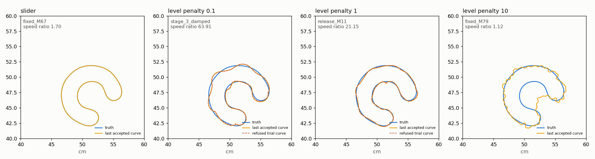

# GU-002: CUDA slider preparation and stronger level penalties on hook c13.3

Plan: [03_plan.md](../../../../docs/iterations/geometry_updates/iteration_03/03_plan.md).
Run 2026-10-25 13:06–13:15 on an Intel Core Ultra 9 285K with an RTX 5090.
Code `94fc00876`; later commits add only results.

All fits use modal Müller physics on CUDA (`modal_fixed`), four frequency
threads, single-threaded BLAS, `--localization none`, the default
`CumulativePolicy` and the benchmark's endpoint check. One run per arm, no reruns.

```bash
export PYTHONPATH=solvers:. OMP_NUM_THREADS=1 OPENBLAS_NUM_THREADS=1 MKL_NUM_THREADS=1
python -m experiments.benchmark.gu002 compare          # saved states, no fits
python -m experiments.benchmark.gu002 run --arm slider # spectral, slider_cpu, slider alone; penalty_* two at a time
python -m experiments.benchmark.gu002 report           # table.md
python -m experiments.benchmark.gu002 figure           # final_curves.png
```

## Result

1. **CUDA slider preparation: yes.** It matches the CPU result and is about
   10x faster per large preparation. The slider fit on hook c13.3 takes 30.3 s
   instead of 49.7 s with CPU preparation (1.64x). Recovery is unchanged.
2. **Stronger level penalty: no.** None of the fractions 0.1, 1 or 10 recovers
   hook c13.3.
3. **Aphex cases: not run.** The plan expands only if both directions work.



## 1. Slider preparation on CUDA

Three saved GU-001 slider stage-entry curves were prepared on CPU (NumPy
`lstsq`) and CUDA (`eigh`). Each figure is the median of three warmed runs:

| State | K | M | Rank CPU / CUDA | Relative error | Curve difference (mm) | CPU s | CUDA s | Speedup |
|---|---:|---:|---|---:|---:|---:|---:|---:|
| stage_1_damped | 8 | 3 | 33 / 33 | 3.7e-13 | 4.2e-14 | 0.0004 | 0.0018 | 0.2 |
| release_M11 | 192 | 11 | 769 / 769 | 5.9e-11 | 5.0e-12 | 0.308 | 0.030 | 10.4 |
| fixed_M67 | 192 | 67 | 769 / 769 | 4.8e-11 | 1.7e-12 | 0.340 | 0.035 | 9.8 |

- Both large states pass the accuracy limits (1e-6 and 0.001 mm) and run
  faster on CUDA. The small state is slower on CUDA, as expected; that costs
  about 1 ms per preparation.
- On the CPU, building the rows and products takes 0.25–0.26 s and the solve
  0.06–0.07 s. On CUDA these take 0.011 s and 0.017 s.
- First CUDA use costs 0.28 s, once per process.

Hook c13.3 fits, each run alone on the GPU:

| Arm | Outcome | Recovered | Fit s | Units | s per unit | Preparation s | Share | s to release_M11 |
|---|---|---|---:|---:|---:|---:|---:|---:|
| spectral | physics refused a trial curve in release_M11 | no | 8.3 | 695 | 0.0120 | 0.24 | 2.9% | 6.0 |
| slider, CPU preparation | schedule completed in fixed_M67 | yes | 49.7 | 2,978 | 0.0167 | 21.48 | 43.2% | 4.6 |
| slider, CUDA preparation | schedule completed in fixed_M67 | yes | 30.3 | 2,978 | 0.0102 | 2.41 | 8.0% | 4.8 |

Ratios above 1 mean the CUDA-preparation slider is faster:

| Against | Fit time | Preparation | Time to release_M11 | s per unit |
|---|---:|---:|---:|---:|
| slider, CPU preparation | 1.64 | 8.9 | 0.96 | 1.64 |
| spectral | — | — | 1.24 | 1.18 |

- The two sliders take the same 142 preparations and 2,978 units, and end on
  the same curve: RMS error 0.00023 mm, maximum residual 3.2e-7.
- With CUDA physics the CPU preparation was 43% of the fit; on the Mac it was
  8%. CUDA preparation brings it back to 8%. Physics is most of the remaining
  28 s.
- Spectral stops in release_M11, so its total time does not compare. Both
  methods reach release_M11; the slider gets there in 4.8 s against 6.0 s,
  and costs less per work unit.
- Up to release_M11 the storage band is at most 20, so CUDA preparation gains
  nothing there (4.8 s against 4.6 s). The gain comes from the K=192 stages.

## 2. N-update with a stronger level penalty

The fraction sets the penalty weight to fraction × data loss at stage entry.
GU-001's fraction 0.01 ran on the Mac CPU, so its time does not compare.

| Fraction | Outcome | Recovered | RMS (mm) | Hausdorff upper (mm) | Max residual | Data loss | Penalty | Max speed ratio | Units | Fit s |
|---:|---|---|---:|---:|---:|---:|---:|---:|---:|---:|
| 0.01 (GU-001) | physics refused a trial curve in stage_3_damped | no | 8.23 | 26.86 | 1.60 | 0.00583 | 1.2e-5 | 2.56 | 281 | 50 |
| 0.1 | physics refused a trial curve in stage_3_damped | no | 1.83 | 4.64 | 1.44 | 0.00152 | 2.7e-4 | 63.9 | 171 | 4 |
| 1 | physics refused a trial curve in release_M11 | no | 1.03 | 3.38 | 1.01 | 0.130 | 0.018 | 21.1 | 851 | 13 |
| 10 | schedule completed in fixed_M79 | no | 7.95 | 25.32 | 1.14 | 0.266 | 0.0016 | 1.18 | 5,993 | 66 |

Losses are at the last accepted curve, so they compare only where the last
stage matches. [table.md](table.md) gives data loss and speed ratio per stage.

- **0.1** fails in the same stage as 0.01. Its last accepted curve has a speed
  ratio of 64: a near-cusp the penalty allows.
- **1** gets as far as spectral, into release_M11, and comes closest to truth
  (RMS 1.03 mm). Its last curve still has a speed ratio of 21, and the physics
  refuses the next trial.
- **10** keeps the speed ratio below 1.2 throughout and has no physics failure.
  But the curve never enters the inner part of the hook. Its data loss stays
  at 0.27–0.35 from release_M11 to the end (RMS 7.95 mm).
- The penalty limits the average speed spread E, not the minimum speed. Weak
  weights still allow one sharp point. A weight strong enough to prevent it
  also stops the shape from forming.

## Limits

- One scene, one run per arm. The slider timings come from one fit each.
- The CPU reference uses one BLAS thread, the fit setting. Informal timings
  with four threads gave about 0.23 s per large preparation instead of 0.35 s.
- The penalty fits ran two at a time and shared the GPU, so their times are
  rough.
- "Max normal move" in table.md is about 26 mm for every penalty arm. It comes
  from the 0.25 GHz warm-up moving the start circle, not from the penalty.

## Files

- `comparison.json`, `comparison.md`: the saved-state CPU/CUDA comparison,
  with slider settings, ranks, errors, timings and the environment.
- `<arm>/`: `manifest.json` (settings, commit), `summary.json` and
  `runs/hook__c13.3/` (stage records, history, trials, `result.json`).
  Arms: `spectral`, `slider_cpu`, `slider`, `penalty_0.1`, `penalty_1`, `penalty_10`.
- `table.md`, `timing.json`, `penalty.json`: from `gu002 report`.
- `final_curves.png`: from `gu002 figure`. `logs/`: run output per arm.
