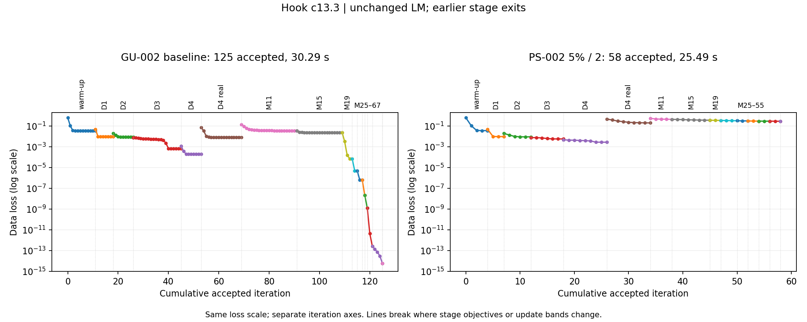

# PS-002: 5% over two accepted iterations

One new hook c13.3 fit on CUDA; comparison uses the saved GU-002 slider run.

| Run | Recovered | Accepted iterations | Fit seconds | Work units | RMS mm |
|---|---|---:|---:|---:|---:|
| GU-002 baseline | True | 125 | 30.29409323586151 | 2978 | 0.00023021616720585536 |
| PS-002 5% / 2 | False | 58 | 25.49201211053878 | 1672 | 6.604706348102664 |

Fit-time ratio (saved baseline / new): 1.1883759157378353.
A ratio involving failed recovery is not a speedup to a recovered result.

Only stage progress exits changed. The rule is active in every stage, including warm-up.
K/M/Ku/F choices, scheduled LM damping, backtracking and final recovery checks are unchanged.
Earlier exits change later curves; the dynamically selected final bands may therefore differ.

| Stage | Baseline accepted | New accepted | New stop | New final loss |
|---|---:|---:|---|---:|
| warmup_025_damped | 11 | 4 | progress_exit | 0.0362293956829805 |
| stage_1_damped | 7 | 3 | progress_exit | 0.009602800696053935 |
| stage_2_damped | 8 | 5 | progress_exit | 0.009123863108229035 |
| stage_3_damped | 19 | 6 | progress_exit | 0.005708588811339824 |
| stage_4_damped | 8 | 8 | progress_exit | 0.0027751758206296497 |
| stage_4_undamped | 16 | 8 | progress_exit | 0.20064519080857982 |
| release_M11 | 22 | 4 | progress_exit | 0.4424928746594769 |
| release_M15 | 18 | 7 | progress_exit | 0.3623163132007651 |
| release_M19 | 4 | 2 | progress_exit | 0.34880061017639663 |
| fixed_M25 | 2 | 3 | progress_exit | 0.3235753265126375 |
| fixed_M31 | 2 | 2 | progress_exit | 0.3099968151296706 |
| fixed_M37 | 1 | 2 | progress_exit | 0.29719385302048984 |
| fixed_M43 | 1 | 2 | progress_exit | 0.29426344787233727 |
| fixed_M49 | 2 | 2 | progress_exit | 0.28943658178039894 |
| fixed_M55 | 4 | 0 | None | 0.28943658178039894 |
| fixed_M61 | 0 | — | — | — |
| fixed_M67 | 0 | — | — | — |

The baseline ran on the same machine earlier, rather than being rerun beside this fit.
This one-case result does not establish performance on other TG-002 scenes.

