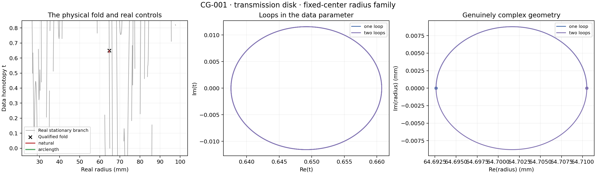

# CG-001 saved measurements

Run status: **UNQUALIFIED_TRANSPORT**.

This is a fixed-center radius component study, not a TG-002 recovery result.

| Model | Qualified folds, t in [0,1] | Qualified folds, t in [-2,3] | Seconds |
|---|---:|---:|---:|
| c13.3, [0.5] GHz | 1 | 8 | 0.09 |
| c13.3, [1.0] GHz | 10 | 31 | 0.31 |
| c13.3, [1.5] GHz | 11 | 46 | 0.47 |
| c13.3, [2.0] GHz | 21 | 69 | 0.73 |
| c13.3, [2.5] GHz | 27 | 80 | 0.98 |
| c4.0, [2.5] GHz | 11 | 37 | 0.37 |
| c0.5, [2.5] GHz | 1 | 3 | 0.07 |
| c13.3, all 19 GHz | 52 | 173 | 28.35 |

| Path | Status | Endpoint radius (mm), real + imaginary | Hessian |
|---|---|---:|---:|
| start_connection | COMPLETED | 64.710500201 -0.000000000i | 3751.704458511049 |
| natural | MINIMUM_STEP | 64.700131285 -0.000000000i | 2.64652059664877 |
| arclength | COMPLETED | 64.709866262 +0.000000000i | 3661.109038226403 |
| upper_detour | COMPLETED | 64.698802747 -0.008323172i | None |
| lower_detour | COMPLETED | 64.698802747 +0.008323172i | None |
| one_loop | COMPLETED | 64.692630494 +0.000000000i | -9453.629092645038 |
| two_loops | COMPLETED | 64.710500201 +0.000000000i | 3751.7044588972967 |
| reverse_transport | COMPLETED | 64.710500201 -0.000000000i | 3751.704458897286 |
| half_step | COMPLETED | 64.692630494 -0.000000000i | -9453.629098669531 |
| half_radius_one | COMPLETED | 64.694627118 -0.000000000i | -5951.034997447172 |
| half_radius_two | COMPLETED | 64.707036782 +0.000000000i | 3103.157863352346 |

Total measured seconds: 103.536. Peak process RSS: 472.8 MiB.

