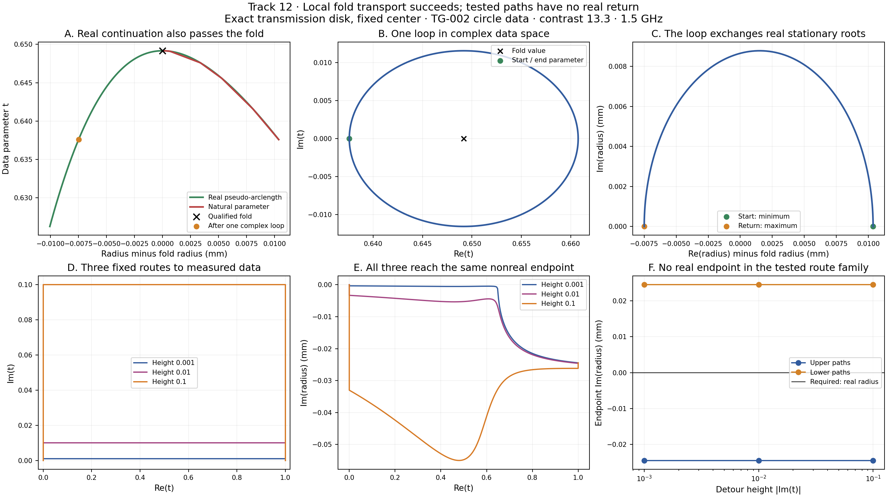

# Track 12 — saved evidence report

CG-001: qualified local complex branch exchange, with a successful real pseudo-arclength control.
CG-002: 0/3 fixed positive doglegs returned to a real shape at t=1; conjugate and half-step controls agree.

| Route height | Endpoint real radius (mm) | Endpoint imaginary radius (mm) | Half-step difference (q units) |
|---:|---:|---:|---:|
| 0.001 | 64.683784902 | -0.024428994 | 4.44e-16 |
| 0.01 | 64.683784902 | -0.024428994 | 2.22e-16 |
| 0.1 | 64.683784902 | -0.024428994 | 2.22e-16 |

Post hoc fold asymptotics from frozen receipts: the loss-barrier check was
not a preregistered acceptance gate. No path, field, derivative, or parameter was retuned.
With a=Ft, b=Fqq, epsilon=tf-t and s=sqrt(2*a*epsilon/b), the leading
root separation is 2*s and the maximum-minus-minimum loss barrier is 2*b*s^3/3.

| Loop | epsilon | Diagnostic | Leading prediction | Receipt value | Receipt / prediction |
|---|---:|---|---:|---:|---:|
| original | 0.011569012623 | Root separation (mm) | 0.0172394385866 | 0.0178697065499 | 1.0365596571 |
| original | 0.011569012623 | Normalized loss barrier | 0.000122893798119 | 0.000125042412211 | 1.0174835030 |
| half_radius | 0.0057845063115 | Root separation (mm) | 0.0121901239284 | 0.012409663489 | 1.0180096250 |
| half_radius | 0.0057845063115 | Normalized loss barrier | 4.34495190077e-05 | 4.38261313451e-05 | 1.0086678137 |

The original minimum loss is the saved start-connection endpoint loss.
The half-radius minimum loss uses the approximately restored two-loop endpoint,
whose radius differs from the loop start by 1.25e-13 q units.
Both relative corrections decrease approximately by half when epsilon is halved;
this is consistent with the local asymptotic expansion, not a rigorous remainder bound.

[Literature and theory audit](../../../../docs/iterations/complex_geometry/LITERATURE_THEORY_AUDIT.md).

This report reads saved JSON only. Fixed-center radius studies do not establish unrestricted shape recovery.
Reproduce the tables and validation without changing the figures with
`python -m experiments.benchmark.cg001_report --no-plots`.

[Local mechanism](../CG-001/run-03/completion.json) · [Endpoint study](../CG-002/run-01/outcome.json)
